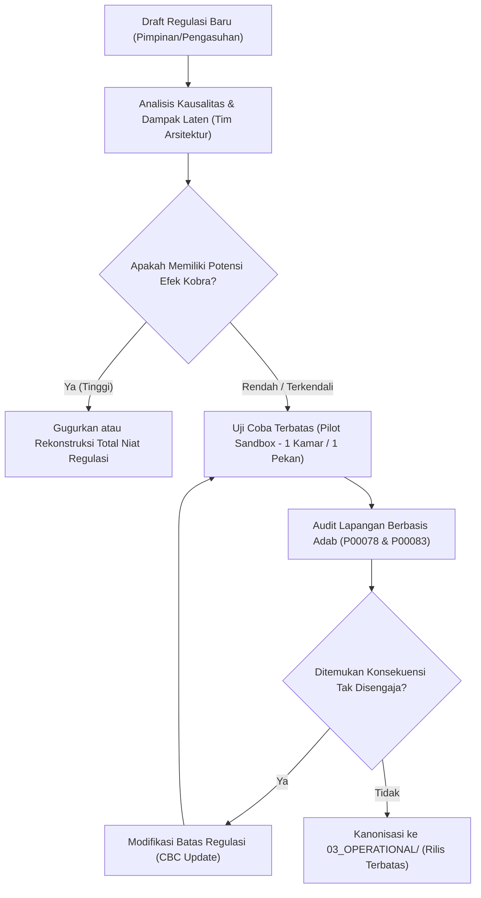

# P00092: Analisis Konsekuensi Tak Disengaja (*Unintended Consequences*): Mitigasi Efek Samping Berbahaya dari Regulasi Baru

- **Status Identitas:** Terverifikasi Kanonik
- **ID Penyelidikan:** `P00092`
- **Pilar Arsitektur:** Pilar 7 — Rekayasa Sistem & Deteksi Utang Desain
- **Sub-Klaster:** Dinamika Kebijakan & Penilaian Dampak Sistemik (*Policy Dynamics & Systemic Impact Assessment*)
- **Penulis Dokumen:** Tim Pengembang Arsitektur Sistem TUMBUH v2.0.0
- **Klasifikasi Epistemik:** Laporan Penyelidikan Kritis (*Critical Inquiry Report*)
- **Target Lapisan:** `01_FUNDAMENTAL/` & `02_IMPLEMENTATION/`

---

## 1. Abstrak & Epistemic Tension

Ketegangan epistemik (*epistemic tension*) mendasar dalam rekayasa kebijakan tata kelola pesantren timbul dari ilusi kepastian linear: keyakinan keliru bahwa sebuah regulasi normatif yang dirancang dengan niat baik (*husnudzon*) secara niscaya akan melahirkan luaran moral yang identik dengan maksud pembuatnya. Dalam realitas sosiologis asrama 24 jam yang merupakan sistem adaptif kompleks (*complex adaptive system*), intervensi regulasi baru kerap kali memicu efek samping yang tidak diinginkan (*unintended consequences*) yang justru memperparah patologi yang ingin disembuhkan—sebuah fenomena yang dikenal sebagai *perverse incentive* atau Efek Kobra (*Cobra Effect*). Laporan inkuiri kanonik ini membedah mekanisme kausalitas non-linear tersebut melalui lensa kaidah fiqhiyyah klasik mengenai *Sadd adz-Dzari'ah* dan *Dar'ul Mafasid*, dipadukan dengan teori hukum konsekuensi tak terduga Mertonian dan dinamika sistem Forrester. Penyelidikan ini menetapkan arsitektur analisis dampak pre-emptif (*Pre-Implementation Systemic Impact Assessment*) guna memetakan umpan balik tertunda (*delayed feedback loops*) sebelum regulasi apa pun disahkan ke dalam lapisan operasional repositori TUMBUH.

---

## 2. Pendahuluan Fenomenologis

Di banyak pesantren, kebijakan pembinaan santri kerap kali diproduksi secara reaktif pasca-terjadinya suatu insiden besar. Ketika ditemukan kasus santri berpacaran atau bertengkar di sudut gelap asrama, respons birokratis yang lazim muncul adalah pengesahan regulasi instan: "Dilarang berkumpul lebih dari tiga orang di luar jam halaqah" atau "Pemasangan kawat berduri dan penguncian total pintu gedung asrama sejak pukul 21.00 WIB". 

Secara administratif di atas kertas, regulasi tersebut tampak tegas, solutif, dan menunjukkan ketegasan pimpinan pondok. Namun, di lapangan empiris asrama, regulasi restriktif tanpa pemodelan sistemik ini memicu riak adaptif yang destruktif:
1. **Perpindahan Spasial ke Titik Buta Lebih Gelap:** Larangan berkumpul di lorong terbuka memaksa santri mencari ruang-ruang tersembunyi yang sama sekali tidak terpantau kamera CCTV atau patroli musyrif (seperti gorong-gorong, atap plafon, atau gudang tua), melipatgandakan risiko bahaya fisik dan moral.
2. **Kriminalisasi Interaksi Sehat:** Santri berprestasi yang membutuhkan diskusi akademik kelompok sebaya merasa teralienasi dan diperlakukan seperti residivis, melumpuhkan iklim ukhuwah dan pembelajaran kolaboratif.
3. **Erosi Kepercayaan Relasional:** Hubungan pendidik dan santri merosot dari relasi asuh (*tarbiyah wa ta'dib*) menjadi hubungan kejar-kejaran antara sipir penjara dan narapidana (*policing dynamic*).

Fenomena ini membuktikan aksioma arsitektural TUMBUH: **Regulasi yang dirumuskan tanpa analisis konsekuensi tak disengaja adalah generator masalah baru yang jauh lebih berbahaya daripada problem orisinal yang coba diselesaikan.**

---

## 3. Tinjauan Pustaka I: Khazanah Turats Klasik

Hukum Islam melalui metodologi Ushul Fiqh dan Qawa'id Fiqhiyyah telah sejak awal meletakkan dasar analisis dampak perbuatan (*ma'alat al-af'al*). Penegakan sebuah aturan tidak semata-mata dinilai dari legalitas tekstualnya di awal (*mabadi'*), melainkan wajib diuji berdasarkan muara dampaknya di lapangan (*ma'alat*).

Imam Asy-Syathibi dalam mahakaryanya *Al-Muwafaqat* menegaskan:

```arabic
النَّظَرُ فِي مَآلَاتِ الْأَفْعَالِ مُعْتَبَرٌ مَقْصُودٌ شَرْعًا، كَانَتِ الْأَفْعَالُ مُوَافِقَةً أَوْ مُخَالِفَةً، وَذَلِكَ أَنَّ الْمُجْتَهِدَ لَا يَحْكُمُ عَلَى فِعْلٍ مِنَ الْأَفْعَالِ الصَّادِرَةِ عَنِ الْمُكَلَّفِينَ بِالْإِقْدَامِ أَوْ بِالْإِحْجَامِ إِلَّا بَعْدَ حَوْلِهِ نَظَرَهُ إِلَى مَا يَئُولُ إِلَيْهِ ذَلِكَ الْفِعْلُ.
```

> *"Mempertimbangkan akibat akhir dari perbuatan-perbuatan (ma'alat al-af'al) adalah hal yang diakui dan menjadi tujuan syariat, baik perbuatan tersebut sesuai dengan aturan maupun bertentangan. Oleh karena itu, seorang mujtahid tidak boleh menjatuhkan hukum atas perbuatan mukallaf—apakah memerintahkannya atau melarangnya—kecuali setelah memalingkan pandangannya kepada muara akhir dari perbuatan tersebut."* (Asy-Syathibi, *Al-Muwafaqat*, Jilid 5, hlm. 177).

Prinsip ini berakar pada kaidah masyhur penolakan mafsadat yang didahulukan atas pengambilan maslahat:

```arabic
دَرْءُ الْمَفَاسِدِ أَوْلَى مِنْ جَلْبِ الْمَصَالِحِ
```

> *"Menolak kerusakan lebih didahulukan daripada menarik kemaslahatan."* (As-Suyuthi, *Al-Asybah wan Nazha'ir*, hlm. 87).

Jika sebuah regulasi baru berniat mendatangkan kemaslahatan parsial (misalnya: meredam kebisingan kamar), namun instrumen pelaksanaannya memicu mafsadat sistemik yang lebih besar (misalnya: santri mogok makan atau trauma psikologis berat akibat isolasi), maka secara syar'i regulasi tersebut cacat legitimasi dan wajib dibatalkan (*fasakh*). Kaidah *Sadd adz-Dzari'ah* (menutup jalan menuju kerusakan) berpasangan erat dengan *Fath adz-Dzara'i'* (membuka jalan menuju kemaslahatan), menuntut penegak kebijakan menimbang ekologi maslahat-mafsadat secara komprehensif.

---

## 4. Tinjauan Pustaka II: Teori Kontemporer

Dalam sosiologi modern, Robert K. Merton (1936) memformalkan analisis *unintended consequences* ke dalam lima penyebab utama:
1. **Ketidaktahuan (*Ignorance*):** Kegagalan memahami dinamika laten sistemik di luar persepsi kasat mata.
2. **Kekeliruan Analisis (*Error*):** Penggunaan analogi masa lalu yang sudah tidak relevan dengan konteks kekinian.
3. **Kepentingan Jangka Pendek yang Mendesak (*Imperious Immediacy of Interest*):** Mengabaikan dampak jangka panjang demi memuaskan tekanan politis saat ini.
4. **Nilai-Nilai Mendasar (*Basic Values*):** Komitmen dogmatis pada suatu nilai tanpa evaluasi instrumen perwujudannya.
5. **Ramalan yang Menghancurkan Diri Sendiri (*Self-Defeating Prophecy*):** Ketakutan berlebihan yang melahirkan aturan represif yang justru mengondisikan santri berperilaku menyimpang.

Di ranah *System Dynamics*, Peter Senge (1990) mengidentifikasi arketipe sistemik *"Fixes that Fail"* (Solusi yang Memperparah) dan *"Shifting the Burden"* (Memindahkan Beban). Ketika sebuah intervensi simptomatik diterapkan, gejala masalah mereda untuk sementara waktu. Namun, konsekuensi tak disengaja yang tertunda (*unintended side-effect*) perlahan menggerogoti kapasitas sistemik internal, memicu ledakan masalah yang berkali-kali lipat lebih destruktif di masa depan.

---

## 5. Eksplorasi Metodologis

Penyelidikan inkuiri ini menggunakan protokol *Failure Mode, Effects, and Criticality Analysis* (FMECA) yang disesuaikan untuk tata kelola institusi pendidikan Islam asrama (*Social-Ecological FMECA*). Protokol ini mencakup empat instrumen pengujian pra-kebijakan:

```text
+-------------------------------------------------------------------------------+
|             ALUR PROTOKOL UJI DAMPAK PRE-EMPTIF REGULASI (TUMBUH)             |
+-------------------------------------------------------------------------------+
|  1. USULAN REGULASI BARU (Drafting)                                          |
|     |                                                                         |
|  2. UJI KAUSALITAS LAPANGAN (Causal Loop Mapping)                             |
|     - Memetakan Reinforcing & Balancing Loops                                 |
|     |                                                                         |
|  3. SIMULASI PERILAKU ADAPTIF AKTOR (Actor Gaming Simulation)                 |
|     - Bagaimana santri paling cerdik mengeksploitasi celah aturan ini?        |
|     - Apa beban kognitif tambahan bagi musyrif lapangan?                      |
|     |                                                                         |
|  4. PENILAIAN RISIKO KONSEKUENSI PERVERSE (Risk Matrix)                      |
|     - Apakah memicu efek kobra atau relokasi patologi?                        |
|     |                                                                         |
|  5. CLAIMS & BOUNDARY SAFEGUARDS (Penerbitan Guardrails Operasional)          |
+-------------------------------------------------------------------------------+
```

---

## 6. Arsitektur Desain Sistem & Diagram Alur

Arsitektur mitigasi dampak TUMBUH menolak keras pengesahan langsung dari meja pimpinan ke papan pengumuman santri. Setiap draft kebijakan di lapisan `02_IMPLEMENTATION/` wajib melalui saringan umpan balik (*Feedback Loop Simulator*):



---

## 7. Rekayasa Matriks Komparatif Multidimensi

Tabel berikut membedah tipologi konsekuensi tak disengaja yang sering melumpuhkan pesantren konvensional dibandingkan penanganan arsitektural TUMBUH:

| Dimensi Patologi | Pendekatan Reaktif Konvensional | Konsekuensi Tak Disengaja (*Unintended*) | Penanganan Arsitektural TUMBUH v2.0.0 |
| :--- | :--- | :--- | :--- |
| **Penyelundupan Gawai (*Smartphone*)** | Razia mendadak tengah malam dan perusakan fisik gawai di depan umum. | Santri menyewa gawai dari oknum luar; penyembunyian di septic tank; dendam membara. | Sistem kuota akses internet terpimpin di laboratorium terbuka; edukasi etika digital. |
| **Keterlambatan Shalat Berjamaah** | Sanksi lari keliling lapangan atau push-up di depan masjid. | Santri shalat dalam kondisi terengah-engah tanpa khusyuk; kebencian bawah sadar pada adzan. | Penataan alur sirkulasi wudhu (CPTED); aktivasi *Keystone Habit* tidur tepat waktu. |
| **Santri Merokok di Kamar Mandi** | Melepas semua daun pintu toilet asrama demi pengawasan. | Pelanggaran masif terhadap privasi syar'i (*aurat*); trauma psikologis; santri menahan BAB. | Pemasangan sensor asap nir-kamera; patroli kehadiran musyrif aktif di lorong utama. |
| **Hafalan Al-Qur'an Tidak Tercapai** | Menambah jam duduk santri menjadi 6 jam non-stop di masjid. | *Cognitive fatigue*; hafalan rapuh (*ziyadah tanpa itqan*); santri membenci mushaf. | *Spaced repetition*; optimasi ritme sirkadian; micro-session 25 menit berbasis neurosains. |
| **Perselisihan Antar-Kamar** | Pembubaran total waktu santai dan jam olahraga santri. | Peningkatan tingkat stres dan agresivitas laten; ledakan tawuran massal pasca-ujian. | Fasilitasi mediasi restoratif *Ishlah al-Bain*; kompetisi olahraga ukhuwah terarah. |

---

## 8. Protokol Tindakan Operasional 5 Tahap

Untuk memitigasi konsekuensi tak disengaja, setiap unit kerja pengasuhan wajib mengeksekusi lima tahapan operasional berikut sebelum sebuah aturan baru diberlakukan:

1. **Tahap 1: Deklarasi Niat dan Asumsi Eksplisit (*Explicit Intention & Assumptions*)**  
   Tuliskan secara tertulis apa capaian perilaku yang diharapkan dan apa saja asumsi psikologis santri yang mendasari aturan tersebut.
2. **Tahap 2: Sesi Simulasi Tim Merah (*Red-Teaming / Gaming Session*)**  
   Kumpulkan musyrif muda dan santri senior terpilih untuk berperan sebagai "pelanggar paling lihai". Berikan draf aturan dan minta mereka mencari 5 cara cerdik mengeksploitasi celah aturan tanpa terkena sanksi.
3. **Tahap 3: Uji Beban Kerja Musyrif Lapangan (*Musyrif Burden Stress-Test*)**  
   Hitung berapa menit tambahan waktu administrasi dan energi fisik yang wajib dikeluarkan musyrif untuk menegakkan aturan tersebut. Jika menambah lebih dari 30 menit per hari, aturan dipastikan membusuk dalam tempo 3 pekan.
4. **Tahap 4: Implementasi Bertahap (*Stepped Rollout & Sandbox Test*)**  
   Terapkan regulasi baru secara eksklusif pada satu blok asrama percobaan selama 14 hari dengan pemantauan indikator anomali harian.
5. **Tahap 5: Klausul Matahari Terbenam (*Sunset Clause Mandate*)**  
   Setiap regulasi darurat wajib memiliki tanggal kedaluwarsa otomatis (maksimal 60 hari). Tanpa evaluasi formal dampak sistemik, regulasi otomatis gugur demi hukum.

---

## 9. Architectural Decision Record (ADR-PROBE-0092)

```text
================================================================================
ARCHITECTURAL DECISION RECORD: ADR-PROBE-0092
================================================================================
Judul: Mandat Analisis Dampak Pre-Emptif (Pre-Implementation Impact Assessment)
Status: DITERIMA & MENGIKAT
Tanggal: 2026-10-25
Pengusul: Tim Arsitektur Sistem TUMBUH v2.0.0

KONTEKS:
Regulasi reaktif di pesantren sering memicu efek samping yang merusak tatanan
ekologis bi'ah shalihah, memindahkan titik kejahatan, dan memicu burnout musyrif.
Dibutuhkan gerbang verifikasi ketat sebelum kebijakan disahkan ke 03_OPERATIONAL/.

KEPUTUSAN ARSITEKTURAL:
1. Membekukan seluruh pengesahan regulasi baru yang bersifat restriktif tanpa
   dokumen lampiran Form Penilaian Dampak Sistemik (Systemic Impact Checklist).
2. Mengharuskan setiap aturan darurat memuat Sunset Clause maksimal 60 hari.
3. Melarang mutlak regulasi yang memicu pelanggaran privasi syar'i (seperti
   pelepasan pintu kamar mandi atau penggeledahan tubuh invasif).

KONSEKUENSI:
- Positif: Meniadakan efek kobra; menjaga iklim kepercayaan santri-musyrif;
  melindungi integritas syariat dan kemaslahatan hakiki.
- Negatif: Birokrasi pengesahan kebijakan baru membutuhkan waktu 7-14 hari
  lebih lama untuk simulasi tim merah dan uji coba sandbox.
================================================================================
```

---

## 10. Implikasi Arsitektural & 7 Butir Guardrails Repositori

Penerapan penyelidikan `P00092` mengikat tata kelola repositori TUMBUH melalui 7 butir guardrails arsitektural:

1. **Guardrail 1 (Anti-Reactivity):** Dilarang menulis dokumen SOP di `03_OPERATIONAL/` semata-mata sebagai reaksi emosional sesaat atas insiden santri yang baru terjadi hari ini.
2. **Guardrail 2 (Ma'alat Verification):** Setiap klausul larangan wajib memuat pernyataan tertulis mengenai potensi perilaku kompensatoris santri dan strategi mitigasinya.
3. **Guardrail 3 (Zero Privacy Breach):** Regulasi apa pun yang mengorbankan aurat dan kehormatan santri demi alasan keamanan instan dinyatakan batal demi hukum sejak awal perumusannya.
4. **Guardrail 4 (Workload Feasibility):** Kebijakan yang membutuhkan pengawasan manusia melebihi rasio kapasitas musyrif riil (1:20) dilarang diterbitkan.
5. **Guardrail 5 (Sunset Clause Enforcement):** Berkas tata tertib temporer wajib mencantumkan tanggal kedaluwarsa eksplisit di kepala dokumen.
6. **Guardrail 6 (Holistic Health Check):** Evaluasi regulasi wajib mengukur metrik non-target (seperti angka kehadiran ke UKS dan dinamika senyum santri), bukan hanya angka pelanggaran target.
7. **Guardrail 7 (Traceability to Maqashid):** Regulasi harus dapat ditelusuri penurunannya dari *Hifzh ad-Din, Hifzh an-Nafs, Hifzh al-'Aql, Hifzh an-Nasl,* atau *Hifzh al-Mal*.

---

## 11. Penutup & Emergent Research Questions

Analisis konsekuensi tak disengaja membimbing perancang sistem pesantren keluar dari arogansi teknokratis menuju ketundukan metodologis di hadapan kompleksitas jiwa manusia. Niat baik (*husnudzon*) adalah syarat niat, namun pemodelan dampak sistemik (*fiqh al-ma'alat*) adalah syarat kecakapan eksekusi.

### Pertanyaan Riset Lanjutan (*Emergent Research Questions*):
1. Bagaimana merancang algoritma kecerdasan buatan lokal (SIM-TUMBUH) yang mampu mendeteksi korelasi anomali antara penerbitan aturan baru dan lonjakan keluhan medis santri?
2. Sejauh mana pelibatan perwakilan konsil santri (*Majlis Syura Thalabah*) dalam sesi *Red-Teaming* dapat meningkatkan kepatuhan sukarela terhadap regulasi asrama?

---

## 12. Referensi Ilmiah Standar APA 7th Edition

1. Asy-Syathibi, I. (2003). *Al-Muwafaqat fi Ushulisy Syari'ah* (Tahqiq Masyhur Hasan Salman, Jilid 5). Dar 'Affan. https://archive.org/details/muwafaqat-syathibi
2. As-Suyuthi, J. (1990). *Al-Asybah wan Nazha'ir fi Qawa'id wa Furu' Fiqhisy Syafi'iyyah*. Darul Kutub Al-'Ilmiyyah. https://archive.org/details/ashbah-suyuthi
3. Dorner, D. (1996). *The Logic of Failure: Recognizing and Avoiding Error in Complex Situations*. Basic Books. https://www.basicbooks.com/titles/dietrich-dorner/the-logic-of-failure/9780201479485/
4. Forrester, J. W. (1971). Counterintuitive behavior of social systems. *Theory and Decision*, 2(2), 109-140. https://doi.org/10.1007/BF00148991
5. Ibn Asyur, M. T. (2006). *Maqasid al-Shari'ah al-Islamiyyah* (English Translation by M. El-Tahir El-Mesawi). International Institute of Islamic Thought (IIIT). https://doi.org/10.2307/j.ctvk8430z
6. Kahneman, D. (2011). *Thinking, Fast and Slow*. Farrar, Straus and Giroux. https://us.macmillan.com/books/9780374533557/thinkingfastandslow
7. Meadows, D. H. (2008). *Thinking in Systems: A Primer*. Chelsea Green Publishing. https://www.chelseagreen.com/product/thinking-in-systems/
8. Merton, R. K. (1936). The unanticipated consequences of purposive social action. *American Sociological Review*, 1(6), 894-904. https://doi.org/10.2307/2084615
9. Reason, J. (2000). Human error: Models and management. *BMJ*, 320(7237), 768-770. https://doi.org/10.1136/bmj.320.7237.768
10. Senge, P. M. (1990). *The Fifth Discipline: The Art & Practice of The Learning Organization*. Doubleday/Currency. https://www.penguinrandomhouse.com/books/163984/the-fifth-discipline-by-peter-m-senge/
11. Sieber, S. D. (1981). *Fatal Remedies: The Ironies of Social Intervention*. Plenum Press. https://doi.org/10.1007/978-1-4684-3863-5
12. Sterman, J. D. (2000). *Business Dynamics: Systems Thinking and Modeling for a Complex World*. McGraw-Hill. https://www.mheducation.com/highered/product/business-dynamics-systems-thinking-modeling-complex-world-sterman/M9780072389159.html
13. Tenner, E. (1996). *Why Things Bite Back: Technology and the Revenge of Unintended Consequences*. Alfred A. Knopf. https://www.penguinrandomhouse.com/books/177028/why-things-bite-back-by-edward-tenner/

---

## 13. Catatan Kaki & Takhrij Sanad

1. **Takhrij Nash Al-Muwafaqat:** Teks kaidah *Ma'alat al-Af'al* dinukil dari Abu Ishaq Ibrahim bin Musa Al-Gharnathi Asy-Syathibi (wafat 790 H), kitab *Al-Muwafaqat*, *Kitab al-Ijtihad*, bab *Al-Ijtihad al-Waqi' fi al-Ma'alat*, ditahqiq oleh Masyhur Hasan Salman, Khobar: Dar 'Affan, Cetakan I, 1997 M, Jilid 5, hlm. 177–178.
2. **Kaidah Dar'ul Mafasid:** Ditegaskan oleh Imam Jalaluddin As-Suyuthi dalam *Al-Asybah wan Nazha'ir*, Bab *Al-Qaidah ar-Rabi'ah: Adh-Dhararu Yuzal*, Beirut: Darul Kutub Al-'Ilmiyyah, 1990 M, hlm. 87. Memiliki sanad konseptual dari hadits Nabi SAW: *"La dharara wa la dhirar"* (HR. Malik dalam *Al-Muwaththa'*, no. 1435; Ibnu Majah, no. 2341).
3. **Efek Kobra (Cobra Effect):** Istilah ini dipopulerkan oleh ekonom Horst Siebert untuk menggambarkan situasi di Delhi kolonial ketika pemerintah Inggris menawarkan hadiah uang untuk setiap ular kobra mati. Warga lokal merespons dengan beternak kobra demi hadiah tersebut. Saat hadiah dihentikan, para peternak melepaskan semua kobra peliharaan ke alam liar, mengakibatkan populasi ular kobra liar menjadi berkali-kali lipat lebih banyak daripada sebelum aturan diterbitkan.
4. **Analisis Kaidah Ma'alat:** Lihat pembahasan modern oleh Syekh Dr. Abdul Majid An-Najjar dalam bukunya *Fiqh al-Ma'alat wa Atsaruhu fi ar-Rasyad at-Tasharrufat*, Kairo: Darul Ma'arif, 2012, hlm. 45–62.
