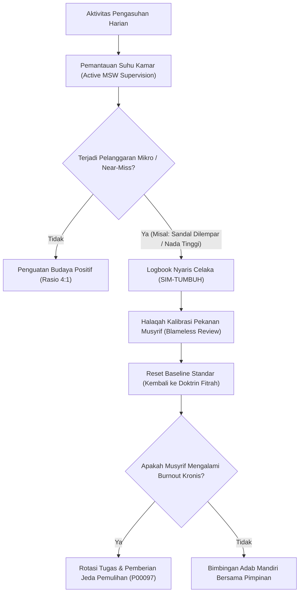

# P00093: Deteksi Sindrom Normalisasi Penyimpangan (*Normalization of Deviance*) dalam Rutinitas Musyrif Asrama

- **Status Identitas:** Terverifikasi Kanonik
- **ID Penyelidikan:** `P00093`
- **Pilar Arsitektur:** Pilar 7 — Rekayasa Sistem & Deteksi Utang Desain
- **Sub-Klaster:** Dinamika Kebijakan & Penilaian Dampak Sistemik (*Policy Dynamics & Systemic Impact Assessment*)
- **Penulis Dokumen:** Tim Pengembang Arsitektur Sistem TUMBUH v2.0.0
- **Klasifikasi Epistemik:** Laporan Penyelidikan Kritis (*Critical Inquiry Report*)
- **Target Lapisan:** `02_IMPLEMENTATION/` & `03_OPERATIONAL/`

---

## 1. Abstrak & Epistemic Tension

Ketegangan epistemik (*epistemic tension*) dalam etika pengasuhan pesantren berakar pada kontradiksi antara dokumen normatif yang melarang kekerasan secara mutlak dengan realitas sosiologis di lantai asrama tempat pelanggaran mikro (*micro-violations*) ditoleransi secara bertahap hingga menjadi budaya institusional. Fenomena ini, yang dalam sosiologi organisasi diidentifikasi oleh Diane Vaughan sebagai Normalisasi Penyimpangan (*Normalization of Deviance*), menjelaskan bagaimana tindakan menyimpang dari standar operasional prosedur (SOP)—seperti memukul santri dengan sandal, memaki dengan sebutan merendahkan, atau mengabaikan patroli jam tidur—secara berangsur-angsur tidak lagi dipersepsikan sebagai bahaya moral, melainkan dianggap sebagai kelaziman operasional yang "terbukti efektif". Penyelidikan kanonik ini menyandingkan konsep psikologis Vaughan dengan doktrin tasawuf klasik mengenai pengendapan noda hitam di kalbu (*ar-ran / an-nuktah as-sauda'*), guna merumuskan arsitektur pengawasan kalibratif yang mampu mendeteksi dan mengeliminasi erosi standar sebelum berujung pada bencana kekerasan fisik masif di ekosistem TUMBUH v2.0.0.

---

## 2. Pendahuluan Fenomenologis

Tragedi kekerasan fatal di lingkungan pesantren hampir tidak pernah meletus secara tiba-tiba tanpa sejarah erosi etika mendahuluinya. Di balik setiap insiden kekerasan fisik yang menewaskan santri atau merusak masa depan mental mereka, selalu ditemukan rantai panjang degradasi disiplin yang berlangsung selama berbulan-bulan bahkan bertahun-tahun.

Proses pergeseran baseline ini bergerak melalui trajektori bertahap yang sangat halus:
1. **Penyimpangan Awal Tanpa Konsekuensi Buruk:** Seorang musyrif muda yang kelelahan melempar sandal ke arah santri yang gaduh saat jam istirahat. Santri terdiam, tidak ada yang cedera, dan tidak ada pengurus senior yang menegur. Otak musyrif menyimpulkan secara bawah sadar: *"Cara ini berhasil dan tidak ada masalah."*
2. **Transformasi Menjadi Prosedur Baku Tak Resmi (*Informal Standard*):** Tindakan pelemparan sandal tersebut diadopsi oleh santri pengurus kamar (*mudabbir*) sebagai teknik standar pendisiplinan adik kelas.
3. **Peningkatan Intensitas Kekerasan (*Escalation Ladder*):** Karena santri menjadi terbiasa (*kebal emosional*) dengan lemparan sandal, kadar agresi ditingkatkan menjadi tamparan ringan, tendangan tulang kering, hingga pemukulan fisik berjamaah di sudut kamar mandi.
4. **Pembelaan Budaya Semu (*Rationalization of Abuse*):** Ketika ada pihak luar atau wali santri yang mempertanyakan lebam pada fisik anak, komunitas asrama serempak membela tindakan tersebut sebagai: *"Ini tradisi pondok untuk menggembleng mental santri agar tangguh."*

Ketika penyimpangan telah mengalami normalisasi, SOP tertulis di dinding kantor yayasan berubah menjadi kertas mati (*dead letter policy*). Kerusakan etika telah menjadi sistemik, menuntut intervensi struktural yang radikal.

---

## 3. Tinjauan Pustaka I: Khazanah Turats Klasik

Khazanah spiritual Islam menjelaskan mekanisme psikologis normalisasi penyimpangan melalui fenomena pembusukan kalbu akibat dosa kecil yang dibiasakan secara terus-menerus (*ar-ran*).

Rasulullah SAW menjelaskan proses internalisasi deviasi moral ini dalam hadits shahih riwayat Imam At-Tirmidzi:

```arabic
إِنَّ الْعَبْدَ إِذَا أَخْطَأَ خَطِيئَةً نُكِتَتْ فِي قَلْبِهِ نُكْتَةٌ سَوْدَاءُ، فَإِذَا هُوَ نَزَعَ وَاسْتَغْفَرَ وَتَابَ سُقِلَ قَلْبُهُ، وَإِنْ عَادَ زِيدَ فِيهَا حَتَّى تَعْلُوَ قَلْبَهُ، وَهُوَ الرَّانُ الَّذِي ذَكَرَ اللَّهُ: {كَلَّا بَلْ رَانَ عَلَى قُلُوبِهِمْ مَا كَانُوا يَكْسِبُونَ}
```

> *"Sesungguhnya seorang hamba apabila berbuat satu kesalahan, maka akan ditorehkan satu titik hitam di dalam hatinya. Jika ia melepaskan kesalahan itu, beristighfar, dan bertaubat, maka hatinya akan kembali bersih cemerlang. Namun jika ia mengulanginya kembali, titik hitam itu akan bertambah hingga menutupi seluruh hatinya. Dan itulah ar-ran (karat penutup) yang disebutkan oleh Allah dalam Al-Qur'an: 'Sekali-kali tidak! Bahkan apa yang mereka kerjakan itu telah menutupi hati mereka'."* (HR. At-Tirmidzi, no. 3334; dinilai hasan shahih).

Imam Ibnu Qayyim Al-Jauziyyah dalam *Al-Jawab Al-Kafi* membedah bahaya desensitisasi dosa:

```arabic
مِنْ عُقُوبَاتِ الْمَعَاصِي أَنَّهَا تُضْعِفُ فِي الْقَلْبِ تَعْظِيمَ الرَّبِّ جَلَّ جَلَالُهُ، وَتُضْعِفُ وَقَارَهُ فِي قَلْبِ الْعَبْدِ... فَتَصِيرُ الْمَعْصِيَةُ لَهُ عَادَةً فَلَا يَسْتَقْبِحُهَا، وَيَنْسَلِخُ مِنَ الْقَلْبِ اسْتِقْبَاحُهَا حَتَّى تَبْرُزَ لِلنَّاسِ مَفْخَرَةً وَعَادَةً مَأْلُوفَةً.
```

> *"Di antara hukuman akibat maksiat adalah ia melemahkan pengagungan kepada Allah di dalam hati... hingga maksiat itu berubah menjadi kebiasaan baginya dan ia tidak lagi memandangnya sebagai hal yang buruk. Rasa jijik dan ingkar terhadap dosa tercabut dari hatinya sampai-sampai perbuatan maksiat itu dipamerkan kepada orang lain dan dianggap sebagai tradisi yang lazim."* (Ibnu Qayyim, *Al-Jawab Al-Kafi*, hlm. 72).

Dalam konteks manajemen asrama, ketika sebuah pelanggaran adab diabaikan, kepekaan nurani (*dhamir*) pengasuh mengalami mati rasa moral (*moral numbness*). Inilah akar teologis dari normalisasi penyimpangan.

---

## 4. Tinjauan Pustaka II: Teori Kontemporer

Teori sosiologis modern menguatkan temuan turats ini. Diane Vaughan (1996), dalam riset monumentalnya mengenai ledakan pesawat ulang-alik *Challenger*, membuktikan bahwa bencana teknik tidak terjadi karena kegagalan mendadak atau kejahatan individu semata, melainkan akibat dari:
> *"Proses sosial di mana penyimpangan dari standar teknis secara bertahap diterima sebagai norma baru, karena penyimpangan-penyimpangan awal tidak menghasilkan konsekuensi bencana langsung."*

James Reason (1990) merumuskan model pertahanan berlubang (*Swiss Cheese Model*), di mana lubang-lubang laten (*latent conditions*) pada lapisan regulasi, supervisi, budaya asrama, dan peralatan pengasuhan secara bertahap bergeser sejajar. Ketika seluruh celah tersebut terbuka akibat normalisasi, insiden fatal niscaya terjadi.

Gresham Sykes dan David Matza (1957) menambahkan teori netralisasi moral (*Techniques of Neutralization*), di mana musyrif yang melakukan pelanggaran menciptakan dalih pembenaran internal:
1. *Denial of Injury* ("Toh santrinya tidak berdarah, cuma kaget saja").
2. *Denial of Victim* ("Dia pantas mendapatkannya karena sangat bandel").
3. *Appeal to Higher Loyalties* ("Saya memukul demi menegakkan syiar kedisiplinan pondok").

---

## 5. Eksplorasi Metodologis

Penyelidikan ini menggunakan metodologi *Safety Climate Drift Analysis* yang mengombinasikan tiga jalur audit:
1. **Audit Erosi Prosedural Lapangan:** Membandingkan dokumen SOP di `03_OPERATIONAL/` dengan rekaman observasi aktual 24 jam di asrama.
2. **Survei Persepsi Toleransi Risiko Musyrif:** Kuesioner berbobot Likert untuk mengukur batas ambang toleransi musyrif terhadap pelanggaran mikro.
3. **Analisis Riwayat Insiden Mikro (*Near-Miss Reporting*):** Pelacakan frekuensi santri yang mengalami lebam ringan atau keluhan psikologis tanpa laporan resmi ke pimpinan.

```text
+-------------------------------------------------------------------------------+
|         TRAJEKTORI SIKLUS NORMALISASI PENYIMPANGAN DI ASRAMA PESANTREN        |
+-------------------------------------------------------------------------------+
|  SOP RESMI KANONIK (Zero-Violence Baseline)                                   |
|      |                                                                        |
|      v  [Tekanan Lelah / Rasio Santri Berlebih]                               |
|  PELANGGARAN MIKRO PERTAMA (Lemparan sandal / Kata kasar)                    |
|      |                                                                        |
|      v  [Tidak ada teguran & tidak terjadi cedera fisik]                      |
|  AMBANG BATAS PSIKOLOGIS MENURUN (Desensitisasi Moral)                        |
|      |                                                                        |
|      v  [Diadopsi pengurus kamar santri]                                      |
|  NORMALISASI SEBAGAI "TRADISI PONDOK" (Cultural Drift)                        |
|      |                                                                        |
|      v  [Eskalasi tak terkendali saat krisis]                                 |
|  BENCANA KEKERASAN FATAL / CEDERA PERMANEN SANTRI                             |
+-------------------------------------------------------------------------------+
```

---

## 6. Arsitektur Desain Sistem & Diagram Alur

Arsitektur pencegahan normalisasi TUMBUH mengintegrasikan kalibrasi adab berkala (*Recalibration Loops*) dan pelaporan nyaris celaka (*Near-Miss Logging*):



---

## 7. Rekayasa Matriks Komparatif Multidimensi

Tabel berikut menunjukkan kontras antara institusi yang membiarkan normalisasi deviasi vs tata kelola responsif TUMBUH v2.0.0:

| Gejala Deviasi Mikro | Respon Budaya Terdegradasi (Konvensional) | Dampak Jangka Panjang | Intervensi Arsitektural TUMBUH v2.0.0 |
| :--- | :--- | :--- | :--- |
| **Panggilan Santri dengan Julukan Fisik** | Dianggap candaan akrab dan kehangatan asrama (*guyonan*). | Erosi harga diri santri; normalisasi pelecehan verbal hierarkis. | Larangan tegas pemanggilan julukan buruk (*tanabuz bil alqab*); pembiasaan kunyah adab. |
| **Pengabaian Kuncian Pintu Kamar Tidur** | Dianggap hal sepele karena pondok berada di lingkungan aman. | Masuknya pelaku pelecehan seksual atau pencurian di malam hari. | Ceklis fisik ganda (*Dual-Lock Verification*) di logbook digital musyrif pukul 22.30 WIB. |
| **Musyrif Datang Terlambat ke Halaqah** | Ditoleransi karena musyrif dihormati dan sibuk urusan lain. | Santri kehilangan respek pada disiplin waktu; halaqah molor. | Metrik integritas waktu; sanksi edukatif mandiri bagi musyrif yang abai (*Qudwah Audit*). |
| **Sanksi Menjemur Santri di Terik Matahari** | Dianggap latihan ketahanan fisik dan pendewasaan santri. | *Heatstroke*, dehidrasi akut, kebencian mendalam pada agama. | Penghapusan mutlak sanksi fisik; penerapan konsekuensi logis restoratif 4R. |
| **Laporan Santri Menangis Tidak Ditindak** | Dikatakan hanya kangen rumah biasa (*cengeng*). | Depresi klinis terabaikan; isolasi sosial; percobaan kabur. | Protokol triage kesehatan mental santri (Pakar Bimbingan Konseling). |

---

## 8. Protokol Tindakan Operasional 5 Tahap

Untuk membasmi sindrom normalisasi penyimpangan, pesantren mitra TUMBUH wajib menerapkan siklus 5 tahap berikut:

1. **Tahap 1: Pelaporan Tanpa Rasa Takut (*Blameless Near-Miss Reporting*)**  
   Menyediakan formulir digital anonim di SIM-TUMBUH bagi musyrif dan santri untuk melaporkan peristiwa "nyaris celaka" (seperti santri hampir terjatuh dari tangga atau pertengkaran mulut bertegangan tinggi) tanpa menghukum pihak pelapor.
2. **Tahap 2: Audit Silang Musyrif Antar-Blok (*Cross-Block Adab Audit*)**  
   Setiap pekan, seorang musyrif ditugaskan melakukan observasi acak selama 2 jam di blok asrama lain untuk menangkap titik buta (*blind spots*) yang mungkin dianggap biasa oleh musyrif setempat.
3. **Tahap 3: Halaqah Kalibrasi Adab Pekanan (*Weekly Standard Recalibration*)**  
   Pertemuan rutin mingguan asatidz dan musyrif untuk membaca kembali satu lembar SOP `03_OPERATIONAL/` dan mengonfrontasikannya dengan kebiasaan harian di kamar.
4. **Tahap 4: Deteksi Kelelahan Kronis Pengasuh (*Burnout Trigger Check*)**  
   Mengukur jam tidur riil musyrif. Musyrif yang tidur kurang dari 5 jam selama 3 hari berturut-turut dilarang menangani pelanggaran disiplin santri secara sepihak.
5. **Tahap 5: Tindakan Cepat Intervensi Dini (*Rapid Drift Interruption*)**  
   Bila ditemukan indikasi musyrif mulai menggunakan nada ancaman fisik, pimpinan pengasuhan langsung memberikan peringatan tertulis level 1 dan pendampingan qudwah dalam waktu 24 jam.

---

## 9. Architectural Decision Record (ADR-PROBE-0093)

```text
================================================================================
ARCHITECTURAL DECISION RECORD: ADR-PROBE-0093
================================================================================
Judul: Protokol Deteksi dan Eliminasi Normalisasi Penyimpangan (Anti-Deviance Drift)
Status: DITERIMA & MENGIKAT
Tanggal: 2026-10-25
Pengusul: Tim Arsitektur Sistem TUMBUH v2.0.0

KONTEKS:
Kekerasan fisik dan erosi adab di asrama bermula dari toleransi terhadap
pelanggaran-pelanggaran kecil yang dibiarkan hingga menjadi budaya kebiasaan.
Diperlukan mekanisme struktural untuk menghentikan penurunan standar moral ini.

KEPUTUSAN ARSITEKTURAL:
1. Mewajibkan pencatatan Near-Miss dan Micro-Violations pada modul SIM-TUMBUH.
2. Menetapkan bahwa "kebiasaan lama pondok" tidak dapat dijadikan dalil pembenar
   atas tindakan yang melanggar SOP resmi TUMBUH v2.0.0.
3. Menyelenggarakan audit silang pengasuhan antar-blok secara berkala.

KONSEKUENSI:
- Positif: Mengeliminasi risiko kekerasan fatal sejak fase embrio; menjaga
  kesucian bi'ah shalihah; menyegarkan kesadaran moral asatidz.
- Negatif: Memerlukan kedewasaan mental seluruh staf asrama untuk menerima
  evaluasi terbuka tanpa merasa diserang secara personal.
================================================================================
```

---

## 10. Implikasi Arsitektural & 7 Butir Guardrails Repositori

Hasil kajian `P00093` memvalidasi 7 butir guardrails repositori TUMBUH:

1. **Guardrail 1 (Zero Tolerance for Micro-Violence):** Segala bentuk kontak fisik agresif (termasuk melempar barang ke arah santri) diklasifikasikan sebagai pelanggaran berat dalam sistem evaluasi musyrif.
2. **Guardrail 2 (Anti-Rationalization Defense):** Alasan "demi ketegasan" atau "mentradisikan kedisiplinan" ditolak mentah-mentah jika bertentangan dengan prinsip adab nabawiyyah.
3. **Guardrail 3 (Near-Miss Metric Visibility):** Dashboard pimpinan di SIM-TUMBUH wajib menampilkan metrik insiden nyaris celaka secara mingguan.
4. **Guardrail 4 (Mandatory SOP Re-reading):** Seluruh dokumen di `03_OPERATIONAL/` wajib dikaji ulang oleh tim lapangan setiap awal semester akademik.
5. **Guardrail 5 (Protection for Whistleblowers):** Santri atau staf yang melaporkan deviasi pengasuhan dijamin perlindungan kerahasiaan dan imunitas dari sanksi sosial.
6. **Guardrail 6 (Sanction Escalation Ban):** Musyrif dilarang menciptakan sanksi baru di luar pedoman resmi konsekuensi logis TUMBUH.
7. **Guardrail 7 (Spiritual Heart Hygiene):** Mengintegrasikan amalan muhasabah dan tazkiyatun nufus dalam rutinitas dinas harian seluruh pengasuh asrama.

---

## 11. Penutup & Emergent Research Questions

Normalisasi penyimpangan adalah rayap tak terlihat yang merapuhkan tiang-tiang bangunan peradaban pesantren. Dengan memandang pelanggaran mikro sebagai sinyal darurat sistemik (*canary in the coal mine*), TUMBUH v2.0.0 berkomitmen menjaga kesucian ekosistem tarbiyah dari karat-karat kebiasaan keliru.

### Pertanyaan Riset Lanjutan (*Emergent Research Questions*):
1. Bagaimana mendesain instrumen psikometri mikro yang dapat mendeteksi pergeseran desensitisasi moral musyrif sebelum tampak dalam perilaku verbalnya?
2. Bagaimana mekanisme reintegrasi musyrif yang pernah melakukan pelanggaran mikro agar kembali memiliki kredibilitas qudwah di mata santri?

---

## 12. Referensi Ilmiah Standar APA 7th Edition

1. Al-Ghazali, A. H. (2011). *Ihya' 'Ulum ad-Din* (Jilid 3: Kitab Syarh 'Aja'ib al-Qalb). Darul Minhaj. https://archive.org/details/ihya-ulum-al-din
2. Bandura, A. (1999). Moral disengagement in the perpetration of inhumanities. *Personality and Social Psychology Review*, 3(3), 193-209. https://doi.org/10.1207/s15327957pspr0303_3
3. Dekker, S. (2011). *Drift into Failure: From Hunting Broken Components to Understanding Complex Systems*. Ashgate Publishing. https://doi.org/10.1201/9781315257402
4. Ibnu Qayyim Al-Jauziyyah, S. (2008). *Al-Jawab Al-Kafi liman Sa'ala 'an Ad-Dawa' Asy-Syafi* (Tahqiq Ali bin Hasan Al-Halabi). Dar Ibnul Jauzi. https://archive.org/details/jawabal-kafi
5. Leveson, N. (2011). *Engineering a Safer World: Systems Thinking Applied to Safety*. The MIT Press. https://mitpress.mit.edu/9780262533690/engineering-a-safer-world/
6. Reason, J. (1990). *Human Error*. Cambridge University Press. https://doi.org/10.1017/CBO9781139062367
7. Reason, J. (1997). *Managing the Risks of Organizational Accidents*. Ashgate Publishing. https://doi.org/10.4324/9781315543543
8. Schein, E. H. (2010). *Organizational Culture and Leadership* (4th ed.). Jossey-Bass. https://www.wiley.com/en-us/Organizational+Culture+and+Leadership%2C+4th+Edition-p-9780470190609
9. Snook, S. A. (2000). *Friendly Fire: The Accidental Shootdown of U.S. Black Hawks over Northern Iraq*. Princeton University Press. https://doi.org/10.1515/9781400840991
10. Sykes, G. M., & Matza, D. (1957). Techniques of neutralization: A theory of delinquency. *American Sociological Review*, 22(6), 664-670. https://doi.org/10.2307/2089195
11. At-Tirmidzi, M. (1998). *Sunan At-Tirmidzi* (Tahqiq Ahmad Syakir). Darul Gharb Al-Islami. https://archive.org/details/sunan-tirmidhi
12. Vaughan, D. (1996). *The Challenger Launch Decision: Risky Technology, Culture, and Deviance at NASA*. The University of Chicago Press. https://press.uchicago.edu/ucp/books/book/chicago/C/bo3684120.html
13. Weick, K. E., & Sutcliffe, K. M. (2015). *Managing the Unexpected: Sustained Performance in a Complex World* (3rd ed.). John Wiley & Sons. https://www.wiley.com/en-us/Managing+the+Unexpected%3A+Sustained+Performance+in+a+Complex+World%2C+3rd+Edition-p-9781118862414

---

## 13. Catatan Kaki & Takhrij Sanad

1. **Takhrij Hadits An-Nuktah As-Sauda':** Dikeluarkan oleh Imam Abu Isa Muhammad bin Isa At-Tirmidzi dalam *Sunan At-Tirmidzi*, *Kitab Tafsir Al-Qur'an*, Bab *Wa Min Surah Al-Muthaffifin*, no. 3334. Beliau berkata: *"Hadits ini hasan shahih."* Dikeluarkan juga oleh Imam Ahmad dalam *Al-Musnad* (2/297), Ibnu Majah dalam *As-Sunan* (no. 4244), dan dinilai shahih oleh Syaikh Al-Albani dalam *Shahih Sunan At-Tirmidzi*.
2. **Kutipan Ibnu Qayyim:** Dinukil dari kitab *Al-Jawab Al-Kafi liman Sa'ala 'an Ad-Dawa' Asy-Syafi* karya Syamsuddin Muhammad bin Abi Bakr Ibnu Qayyim Al-Jauziyyah (wafat 751 H), cetakan Dar Ibnul Jauzi, Dammam, 1429 H, hlm. 72–73.
3. **Analisis Normalisasi Penyimpangan NASA:** Riset Diane Vaughan membuktikan bagaimana kebocoran gas pada *O-ring seal* roket pendorong padat yang awalnya merupakan anomali teknis yang membahayakan, diterima sebagai toleransi risiko operasional karena beberapa peluncuran sebelumnya berhasil dengan selamat, hingga akhirnya meledak pada peluncuran ke-25.
4. **Swiss Cheese Model:** James Reason menggambarkan bahwa sistem memiliki banyak lapis pertahanan, namun masing-masing lapis memiliki kelemahan laten (*lubang keju*). Kecelakaan terjadi ketika lubang-lubang tersebut berada pada garis lurus sempurna akibat kebiasaan mengabaikan peringatan kecil.
