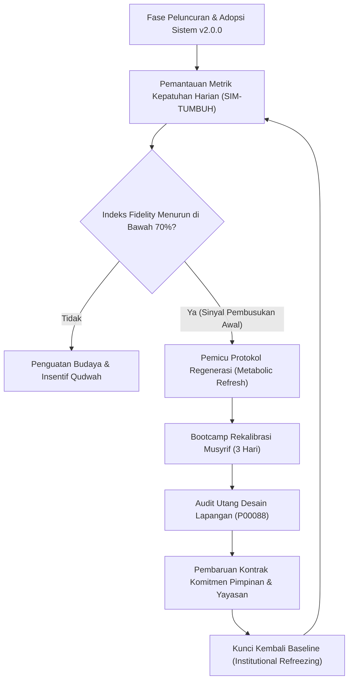

# P00094: Mencegah Pembusukan Pasca-Transisi (*Post-Transition Decay*): Mempertahankan Vitalitas Baseline Sistem Baru

- **Status Identitas:** Terverifikasi Kanonik
- **ID Penyelidikan:** `P00094`
- **Pilar Arsitektur:** Pilar 7 — Rekayasa Sistem & Deteksi Utang Desain
- **Sub-Klaster:** Dinamika Kebijakan & Penilaian Dampak Sistemik (*Policy Dynamics & Systemic Impact Assessment*)
- **Penulis Dokumen:** Tim Pengembang Arsitektur Sistem TUMBUH v2.0.0
- **Klasifikasi Epistemik:** Laporan Penyelidikan Kritis (*Critical Inquiry Report*)
- **Target Lapisan:** `02_IMPLEMENTATION/` & `03_OPERATIONAL/`

---

## 1. Abstrak & Epistemic Tension

Ketegangan epistemik (*epistemic tension*) dalam transformasi sistemik lembaga pendidikan Islam terletak pada jurang pemisah antara euforia adopsi awal (*launch euphoria*) dan kelelahan operasional jangka panjang (*operational fatigue*). Banyak inisiatif pembaruan tata kelola pesantren yang diluncurkan dengan gegap gempita, lokakarya megah, dan dukungan penuh pimpinan yayasan, mengalami keruntuhan bertahap setelah melewati masa 180 hari (6 bulan pertama)—sebuah patologi institusional yang didefinisikan sebagai Pembusukan Pasca-Transisi (*Post-Transition Decay*). Berkas penyelidikan kanonik ini membongkar mengapa sistem yang telah terbukti secara ilmiah dan disetujui secara syar'i dapat mengalami regresi kembali (*gravitational pull*) ke pola-pola otoriter masa lalu. Dengan memadukan prinsip kenabian mengenai kelanggengan amal (*mudawamah / istiqamah*) dengan model perubahan institusional Kurt Lewin dan John Kotter, laporan ini merumuskan arsitektur penguncian budaya (*Institutional Refreezing Architecture*) yang menjamin vitalitas baseline TUMBUH v2.0.0 bertahan melintasi pergantian generasi musyrif.

---

## 2. Pendahuluan Fenomenologis

Fenomena keruntuhan pasca-transisi di pesantren memperlihatkan pola kurva lonceng yang sangat konsisten:
1. **Bulan 1–3 (Fase Euforia & Observabilitas Tinggi):** Peluncuran sistem baru didampingi pelatihan intensif. Musyrif bersemangat mengisi logbook digital SIM-TUMBUH, rasio penguatan positif 4:1 dijalankan dengan penuh antusiasme, dan pelanggaran santri menurun drastis. Pimpinan merasa transformasi telah berhasil 100%.
2. **Bulan 4–5 (Fase Erosi Tenaga Kerja & Keletihan Rutinitas):** Pendamping konsultan atau tim pengembang inti mulai menarik diri dari lapangan. Beban akademik santri meningkat karena mendekati ujian. Musyrif mulai merasa pengisian logbook menyita waktu tidur malam. Peringatan mikro mulai diabaikan.
3. **Bulan 6–8 (Fase Titik Balik Pembusukan / *Decay Inflection Point*):** Terjadi pergantian beberapa personel musyrif senior. Musyrif pengganti hanya mendapat penjelasan lisan kilat tanpa pendalaman filosofi. Saat terjadi keributan asrama yang intens, musyrif baru secara spontan kembali ke metode lama: bentakan, hukuman lari keliling lapangan, dan ancaman fisik.
4. **Bulan 9 ke Atas (Regresi Total ke Status Quo):** Dokumen v2.0.0 tetap tersimpan rapi di rak kantor pengasuhan, namun realitas harian di kamar santri telah 100% kembali ke pola asuh primitif v1. Staf pesantren melabeli sistem baru tersebut sebagai: *"Bagus secara teori, tapi tidak cocok dengan realitas lapangan kita."*

Keruntuhan ini membuktikan aksioma arsitektural TUMBUH: **Sistem yang tidak memiliki mekanisme pemeliharaan metabolik (*metabolic maintenance*) niscaya akan ditelan oleh gravitasi budaya lama.**

---

## 3. Tinjauan Pustaka I: Khazanah Turats Klasik

Epistemologi Islam menempatkan kesinambungan amal (*ad-dawam*) jauh lebih tinggi daripada lonjakan amal sesaat yang kemudian terputus. Transformasi akhlak dan adab membutuhkan pembiasaan yang mengakar (*al-istiqamah*).

Ummul Mukminin Aisyah radhiyallahu 'anha meriwayatkan sabda Rasulullah SAW:

```arabic
أَحَبُّ الْأَعْمَالِ إِلَى اللَّهِ أَدْوَمُهَا وَإِنْ قَلَّ، وَكَانَتْ عَائِشَةُ إِذَا عَمِلَتِ الْعَمَلَ لَزِمَتْهُ.
```

> *"Amalan yang paling dicintai oleh Allah adalah amalan yang paling kontinu (dawam / berkesinambungan), meskipun sedikit. Dan Sayyidah Aisyah apabila mengerjakan suatu amalan, beliau selalu melazimkannya (menetapinya secara konsisten)."* (HR. Muslim, no. 782).

Imam An-Nawawi dalam *Syarh Shahih Muslim* menjelaskan hikmah di balik prinsip ini:

```arabic
فِي هَذَا الْحَدِيثِ الْحَثُّ عَلَى الْمُدَاوَمَةِ عَلَى الْعَمَلِ، وَأَنَّ قَلِيلَهُ الدَّائِمَ خَيْرٌ مِنْ كَثِيرٍ يَنْقَطِعُ، وَإِنَّمَا كَانَ الْقَلِيلُ الدَّائِمُ خَيْرًا مِنْ كَثِيرٍ يَنْقَطِعُ؛ لِأَنَّ بِدَوَامِ الْقَلِيلِ تَدُومُ الطَّاعَةُ وَالذِّكْرُ وَالْمُرَاقَبَةُ وَالنِّيَّةُ وَالْإِخْلَاصُ وَالْإِقْبَالُ عَلَى الْخَالِقِ سُبْحَانَهُ، وَيُثْمِرُ ذَلِكَ أَعْظَمَ مِمَّا يُثْمِرُهُ الْكَثِيرُ الْمُنْقَطِعُ.
```

> *"Dalam hadits ini terdapat anjuran untuk senantiasa mendawamkan amal. Bahwa amal sedikit yang berkesinambungan itu jauh lebih baik daripada amal banyak yang kemudian terputus. Mengapa demikian? Karena dengan kontinuitas yang sedikit itu, ketaatan, dzikir, kesadaran muraqabah, niat ikhlas, dan penghadapan diri kepada Sang Khaliq tetap terjaga langgeng, sehingga membuahkan hasil yang jauh lebih agung daripada amal besar yang lekas terputus."* (An-Nawawi, *Syarh Shahih Muslim*, Jilid 6, hlm. 72).

Istiqamah dalam konteks tata kelola institusional pesantren adalah kemampuan memelihara disiplin sistemik bahkan ketika antusiasme emosional telah padam.

---

## 4. Tinjauan Pustaka II: Teori Kontemporer

Dalam teori manajemen perubahan organisasi, Kurt Lewin (1951) merumuskan tiga tahap perubahan: *Unfreezing* (Mencairkan status quo), *Changing* (Bergerak ke pola baru), dan *Refreezing* (Membekukan dan mengunci pola baru). Sebagian besar kegagalan terjadi karena institusi berhenti pada tahap *Changing* dan lupa melakukan *Refreezing*, sehingga budaya lama yang cair membeku kembali ke bentuk asalnya.

John P. Kotter (1996) dalam *Leading Change* menyoroti bahwa merayakan kemenangan terlalu dini (*declaring victory too soon*) adalah kesalahan fatal nomor satu. Tanpa menanamkan perubahan ke dalam kultur tulang sumsum organisasi (*anchoring changes in corporate culture*), pembaruan akan lenyap begitu kepemimpinan berganti.

Pamela Tolbert dan Lynne Zucker (1996) melalui *Institutionalization Theory* menjelaskan tiga tahapan adopsi:
1. *Pre-institutionalization* (Adopsi teknis terbatas).
2. *Semi-institutionalization* (Penyebaran teoritis dan legalitas aturan).
3. *Full Institutionalization* (Habitualisasi dan sedimentasi, di mana sistem dianggap sebagai satu-satunya cara berpikir yang sah).

---

## 5. Eksplorasi Metodologis

Penyelidikan ini menggunakan metodologi audit longitudinal *Longitudinal Implementation Fidelity Tracking* (LIFT) untuk memantau indeks kesehatan implementasi sistem pada interval waktu: H+30, H+90, H+180, dan H+360 pasca-peluncuran:

```text
+-------------------------------------------------------------------------------+
|         KURVA DEGRADASI IMPLEMENTASI VS AMBANG PEMELIHARAAN TUMBUH            |
+-------------------------------------------------------------------------------+
| 100% |   Puncak Euforia (H+30)                                                |
|      |       *                                                                |
|  80% |      / \  <- Zona Kritis Erosi (H+90 s/d H+180)                       |
|      |     /   \                                                              |
|  60% |    /     \========= INTERVENSI PEMELIHARAAN METABOLIK (TUMBUH) =====   |
|      |   /       \ (Baseline Terkunci di 75-80%)                             |
|  40% |  /         \                                                           |
|      | /           \  <- Jalur Keruntuhan Konvensional (Post-Transition Decay)|
|   0% |/             \______________________________________________________   |
|      +------------------------------------------------------------------->    |
|      0       90       180       270       360 Hari                            |
+-------------------------------------------------------------------------------+
```

---

## 6. Arsitektur Desain Sistem & Diagram Alur

Arsitektur pencegahan pembusukan sistem TUMBUH mengandalkan siklus pemeliharaan berkelanjutan (*Continuous Institutional Metabolism*):



---

## 7. Rekayasa Matriks Komparatif Multidimensi

Tabel berikut menunjukkan perbandingan antara pendekatan transformasi rapuh konvensional vs arsitektur ketahanan pasca-transisi TUMBUH:

| Aspek Tata Kelola | Pendekatan Transformasi Konvensional | Dampak Pembusukan Pasca-Transisi | Solusi Arsitektural TUMBUH v2.0.0 |
| :--- | :--- | :--- | :--- |
| **Kaderisasi Musyrif Baru** | Penjelasan lisan informal saat musyrif baru mulai bertugas. | Musyrif baru membawa budaya represif dari pondok lamanya. | Akademi Pengasuhan Musyrif Terakreditasi (Sertifikasi 40 Jam sebelum dinas). |
| **Beban Pengisian Logbook** | Penambahan lembar administrasi manual tanpa mengurangi tugas lain. | Musyrif memalsukan data (*data cooking*) karena kelelahan fisik. | Low-Friction Digital UX (One-Click Logging < 30 detik per entri). |
| **Evaluasi Berkala Pimpinan** | Hanya dilakukan saat ada kasus viral atau sengketa wali santri. | Masalah laten membusuk selama berbulan-bulan di bawah permukaan. | Rapat Evaluasi Ekosistem Triwulanan (Q-Review) berbasis data SIM-TUMBUH. |
| **Insentif Kinerja Musyrif** | Gaji tetap flat tanpa memedulikan mutu pembinaan adab santri. | Musyrif berdedikasi tinggi merasa tidak dihargai; terjadi demotivasi. | Rekognisi Meritokratis Qudwah (Beasiswa studi lanjut / jenjang karir ta'dib). |
| **Penanganan Resistensi Lama** | Mengabaikan bisikan staf senior yang menolak perubahan. | Staf senior diam-diam menyabotase SOP baru dan memengaruhi santri. | Integrasi Terbuka Tokoh Kunci melalui Dewan Kiai Sepuh (P00115). |

---

## 8. Protokol Tindakan Operasional 5 Tahap

Untuk membasmi sindrom pembusukan pasca-transisi, lembaga mitra TUMBUH wajib mengeksekusi lima instrumen pertahanan berikut secara periodik:

1. **Tahap 1: Penguncian Struktur Organisasi (*Structural Anchor Lock*)**  
   Memasukkan seluruh prosedur inti TUMBUH ke dalam Anggaran Dasar/Anggaran Rumah Tangga (AD/ART) yayasan dan deskripsi kerja formal yang ditandatangani di atas meterai.
2. **Tahap 2: Standardisasi Jalur Masuk Personel (*The Golden Onboarding Gate*)**  
   Setiap asatidz atau musyrif baru dilarang mengasuh kamar santri sebelum menyelesaikan modul pelatihan dasar filosofi fitrah dan lulus ujian observasi lapangan.
3. **Tahap 3: Uji Petik Triwulanan Kepatuhan Sistem (*Quarterly Fidelity Spot-Check*)**  
   Tim auditor mutu internal melakukan inspeksi acak 24 jam setiap 3 bulan sekali untuk memverifikasi apakah SOP di lemari masih dijalankan di kamar mandi dan ruang makan.
4. **Tahap 4: Ritual Regenerasi Komitmen (*Semi-Annual Renewal Camp*)**  
   Setiap libur semester, seluruh staf pengasuhan mengikuti retret spiritual muhasabah untuk menyegarkan niat (*tajdidun niyah*) dan memperbarui keterampilan bimbingan santri.
5. **Tahap 5: Institusionalisasi Pengetahuan (*Knowledge Sedimentation*)**  
   Mendokumentasikan setiap keberhasilan dan kegagalan kasus ke dalam repositori *Institutional Memory* (P00080) agar santri angkatan baru dapat belajar dari sejarah nyata pesantren.

---

## 9. Architectural Decision Record (ADR-PROBE-0094)

```text
================================================================================
ARCHITECTURAL DECISION RECORD: ADR-PROBE-0094
================================================================================
Judul: Penegakan Mekanisme Pemeliharaan Metabolik Pasca-Transisi (Anti-Decay)
Status: DITERIMA & MENGIKAT
Tanggal: 2026-10-25
Pengusul: Tim Arsitektur Sistem TUMBUH v2.0.0

KONTEKS:
Transformasi sistemik di pesantren rentan mengalami keruntuhan bertahap setelah
6 bulan pertama akibat kelelahan operasional dan pergantian staf yang tidak
terstandardisasi, mengembalikan pesantren ke pola asuh kekerasan lama.

KEPUTUSAN ARSITEKTURAL:
1. Menetapkan ambang batas kritis kepatuhan implementasi minimal 75% di SIM-TUMBUH.
2. Mewajibkan Sertifikasi Musyrif Masuk (Onboarding Barrier) sebelum dinas.
3. Mengikat evaluasi berkala triwulanan (Q-Review) ke dalam kalender resmi yayasan.

KONSEKUENSI:
- Positif: Mencegah regresi budaya; melindungi investasi perubahan jangka panjang;
  menjamin kelangsungan adab nabawiyyah lintas kepengurusan.
- Negatif: Memerlukan anggaran tetap yayasan untuk pelatihan berkala dan audit.
================================================================================
```

---

## 10. Implikasi Arsitektural & 7 Butir Guardrails Repositori

Penyelidikan `P00094` menetapkan 7 guardrails arsitektural repositori TUMBUH:

1. **Guardrail 1 (Anti-Premature Victory):** Dilarang mengklaim sebuah program atau sistem telah "berhasil berakar" sebelum terbukti bertahan stabil minimal 3 siklus akademik berturut-turut.
2. **Guardrail 2 (Mandatory Onboarding Gate):** Tidak ada staf pengasuh baru yang boleh berinteraksi mandiri dengan santri tanpa melewati modul standardisasi.
3. **Guardrail 3 (UX Friction Minimization):** Setiap instrumen pencatatan di `03_OPERATIONAL/` wajib didesain sesederhana mungkin agar tidak menguras energi biologis musyrif.
4. **Guardrail 4 (Continuous Data Visibility):** Metrik kepatuhan operasional wajib terlihat secara real-time pada dashboard pimpinan di SIM-TUMBUH.
5. **Guardrail 5 (Scheduled Recalibration):** Jadwal kalibrasi musyrif mingguan dan triwulanan tidak boleh dibatalkan oleh agenda insidental apa pun.
6. **Guardrail 6 (Living Repository Mandate):** Dokumen di repositori harus terus diperbarui berdasarkan dinamika lapangan, bukan menjadi prasasti beku.
7. **Guardrail 7 (Spiritual Istiqamah Grounding):** Mengaitkan kepatuhan sistemik dengan pertanggungjawaban ukhrawi di hadapan Allah SWT.

---

## 11. Penutup & Emergent Research Questions

Mencegah pembusukan pasca-transisi adalah perjuangan melawan hukum entropi sosial. Dengan memuliakan prinsip istiqamah di atas kehebatan sesaat, TUMBUH v2.0.0 memastikan bahwa cahaya peradaban pesantren yang telah dinyalakan tidak padam oleh hembusan angin rutinitas harian.

### Pertanyaan Riset Lanjutan (*Emergent Research Questions*):
1. Bagaimana mendesain mekanisme penghargaan non-finansial berbasis tradisi pesantren yang efektif membakar motivasi intrinsik musyrif tahun kedua dan ketiga?
2. Indikator kuantitatif awal apa di modul SIM-TUMBUH yang paling akurat meramalkan datangnya kelelahan operasional musyrif sebulan sebelum terjadi?

---

## 12. Referensi Ilmiah Standar APA 7th Edition

1. Al-Mubarakfuri, S. (2002). *Rahiq al-Makhtum: Sirah Nabawiyyah*. Darul Wafa. https://archive.org/details/rahiq-makhtum
2. An-Nawawi, Y. (1994). *Syarh Shahih Muslim* (Jilid 6). Darul Ma'rifah. https://archive.org/details/sharh-sahih-muslim-nawawi
3. Argyris, C., & Schon, D. A. (1996). *Organizational Learning II: Theory, Method, and Practice*. Addison-Wesley. https://www.pearson.com/en-us/subject-catalog/p/organizational-learning-ii-theory-method-and-practice/P200000006240
4. Fixsen, D. L., Naoom, S. F., Blase, K. A., Friedman, R. M., & Wallace, F. (2005). *Implementation Research: A Synthesis of the Literature* (FMHI Publication No. 231). University of South Florida. https://nirn.fpg.unc.edu/resources/implementation-research-synthesis-literature
5. Greenhalgh, T., Robert, G., Macfarlane, F., Bate, P., & Kyriakidou, O. (2004). Diffusion of innovations in service organizations: Systematic review and recommendations. *The Milbank Quarterly*, 82(4), 581-629. https://doi.org/10.1111/j.0887-378X.2004.00325.x
6. Kotter, J. P. (1996). *Leading Change*. Harvard Business Review Press. https://www.hbs.edu/faculty/Pages/item.aspx?num=422
7. Lewin, K. (1951). *Field Theory in Social Science: Selected Theoretical Papers*. Harper & Row. https://archive.org/details/fieldtheoryinsoc00kurt
8. Muslim, I. (2006). *Shahih Muslim* (Tahqiq Muhammad Fu'ad Abdul Baqi). Darul Hadits. https://archive.org/details/sahih-muslim-baqi
9. Rogers, E. M. (2003). *Diffusion of Innovations* (5th ed.). Free Press. https://www.simonandschuster.com/books/Diffusion-of-Innovations-5th-Edition/Everett-M-Rogers/9780743222099
10. Senge, P. M. (1990). *The Fifth Discipline: The Art & Practice of The Learning Organization*. Doubleday/Currency. https://www.penguinrandomhouse.com/books/163984/the-fifth-discipline-by-peter-m-senge/
11. Tolbert, P. S., & Zucker, L. G. (1996). The institutionalization of institutional theory. In S. R. Clegg, C. Hardy, & W. R. Nord (Eds.), *Handbook of Organization Studies* (pp. 175-190). SAGE Publications. https://doi.org/10.4135/9781446218556.n6
12. Weiner, B. J. (2009). A theory of organizational readiness for change. *Implementation Science*, 4(67), 1-9. https://doi.org/10.1186/1748-5908-4-67
13. Zimmerman, M. A. (2000). Empowerment theory: Psychological, organizational and community levels of analysis. In *Handbook of Community Psychology* (pp. 43-63). Springer. https://doi.org/10.1007/978-1-4615-4193-6_2

---

## 13. Catatan Kaki & Takhrij Sanad

1. **Takhrij Hadits Mudawamah:** Hadits tentang kecintaan Allah pada amalan yang kontinu dikeluarkan oleh Imam Muslim bin Al-Hajjaj dalam *Shahih Muslim*, *Kitab Shalat al-Musafirin wa Qashruha*, Bab *Fadhilat al-'Amal ad-Da'im min Qiyam al-Lail wa Ghairihi*, no. 782. Dikeluarkan juga oleh Imam Al-Bukhari dalam *Shahih Al-Bukhari*, no. 6464.
2. **Kutipan Syarh Shahih Muslim An-Nawawi:** Dinukil dari mahakarya Imam Abu Zakariyya Yahya bin Syaraf An-Nawawi (wafat 676 H), *Al-Minhaj fi Syarh Shahih Muslim bin Al-Hajjaj*, Kairo: Darul Hadits, 2001 M, Jilid 6, hlm. 72.
3. **Konsep Refreezing Kurt Lewin:** Lewin menekankan bahwa pembekuan kembali memerlukan penyelarasan norma kelompok, struktur ganjaran, dan rutinitas harian agar perilaku baru terlindungi dari tarikan gaya lama.
4. **Implementation Drivers (NIRN):** Riset Fixsen dkk. (2005) menunjukkan bahwa keberlanjutan inovasi bergantung pada tiga penggerak utama: *Competency Drivers* (pelatihan dan supervisi), *Organization Drivers* (administrasi yang memudahkan dan sistem data), serta *Leadership Drivers* (kepemimpinan adaptif dan suportif).
