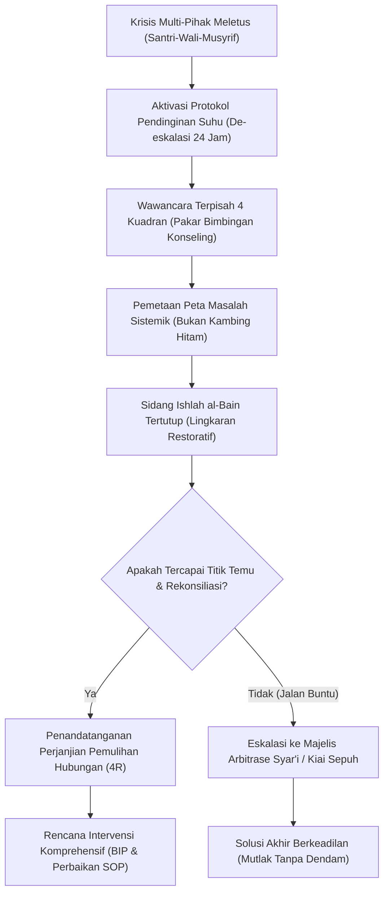

# P00095: Analisis Interaksi Multilapis: Menangani Masalah yang Melibatkan Santri, Wali Santri, Musyrif, dan Pimpinan Sekaligus

- **Status Identitas:** Terverifikasi Kanonik
- **ID Penyelidikan:** `P00095`
- **Pilar Arsitektur:** Pilar 7 — Rekayasa Sistem & Deteksi Utang Desain
- **Sub-Klaster:** Dinamika Kebijakan & Penilaian Dampak Sistemik (*Policy Dynamics & Systemic Impact Assessment*)
- **Penulis Dokumen:** Tim Pengembang Arsitektur Sistem TUMBUH v2.0.0
- **Klasifikasi Epistemik:** Laporan Penyelidikan Kritis (*Critical Inquiry Report*)
- **Target Lapisan:** `02_IMPLEMENTATION/` & `03_OPERATIONAL/`

---

## 1. Abstrak & Epistemic Tension

Ketegangan epistemik (*epistemic tension*) dalam penanganan konflik asrama pesantren berakar pada reduksionisme biner: kecenderungan institusional untuk menyederhanakan krisis relasional multi-pihak menjadi kesalahan moral tunggal (*single-point moral culpability*). Ketika santri mogok belajar, mengalami depresi, atau terlibat insiden pelanggaran berat, manajemen pesantren sering kali segera menetapkan salah satu pihak sebagai kambing hitam: apakah melabeli santri sebagai anak "nakal pembangkang", menuduh wali santri "terlalu memanjakan anak", menyalahkan musyrif sebagai "pengasuh tidak becus", atau mencap pimpinan "lepas tangan". Laporan penyelidikan kanonik ini membongkar kepicikan reduksionisme tersebut dengan menghadirkan metodologi Analisis Interaksi Multilapis (*Multi-Layered Interaction Analysis*). Dengan memadukan prinsip syariat mengenai *Ishlah Dzat al-Bain* dengan Teori Sistem Bioekologis Urie Bronfenbrenner dan Triangulasi Sistemik Salvador Minuchin, dokumen ini menetapkan arsitektur mediasi holistik yang membedah keterkaitan struktural antara dinamika keluarga, ekosistem asrama, beban kerja pengasuh, dan kebijakan kepemimpinan di ekosistem TUMBUH v2.0.0.

---

## 2. Pendahuluan Fenomenologis

Krisis santri di era modern jarang sekali merupakan fenomena terisolasi. Mari kita amati anatomi sengketa asrama yang lazim meledak di lapangan:
Seorang santri kelas 2 Tsanawiyah mendadak melarikan diri (*kabur*) dari asrama pada malam hari. Setibanya di rumah, santri menangis histeris di hadapan orang tuanya, mengaku telah diperlakukan tidak adil dan dipukul oleh musyrif kamar. Wali santri yang marah besar segera menyebarkan narasi kemarahan di grup WhatsApp wali santri dan mendatangi kantor pengasuhan bersama kuasa hukum, menuntut musyrif dipecat dan dipidanakan.

Respons birokratis konvensional biasanya terbelah ke dalam dua polaritas ekstrem:
1. **Defensif Kelembagaan Total:** Pimpinan pesantren membela mati-matian musyrif, menuduh santri memutarbalikkan fakta demi menutupi kemalasannya, dan mengancam melaporkan balik wali santri atas pencemaran nama baik.
2. **Pengorbanan Kambing Hitam Cepat (*Scapegoating*):** Demi meredam amarah wali santri dan menjaga citra publik pondok, pimpinan langsung memecat musyrif secara sepihak tanpa investigasi objektif, mengabaikan fakta bahwa musyrif tersebut bertugas sendirian mengawasi 80 santri tanpa libur selama 3 pekan berturut-turut.

Kedua pendekatan tersebut gagal total karena mengabaikan kenyataan bahwa krisis tersebut lahir dari jeratan interaksi multilapis:
- **Lapisan Santri (Mikrosistem 1):** Mengalami perundungan verbal laten dari teman sekamar yang tidak pernah tertangani, sehingga mencari pelarian.
- **Lapisan Musyrif (Mikrosistem 2):** Kelelahan kognitif ekstrem (*chronic burnout*) akibat rasio pengawasan yang melanggar batas kemanusiaan.
- **Lapisan Wali Santri (Mesosistem):** Memiliki kecemasan berlebih (*helicopter parenting*) dan riwayat komunikasi yang buruk dengan pihak pesantren.
- **Lapisan Pimpinan (Eksosistem/Makrosistem):** Menetapkan target penerimaan santri melebihi kapasitas tempat tidur dan tidak menyediakan ruang jeda bagi musyrif.

Tanpa analisis sistemik multilapis, luka institusional tidak akan pernah sembuh, melainkan hanya terkubur menunggu ledakan berikutnya.

---

## 3. Tinjauan Pustaka I: Khazanah Turats Klasik

Islam mewajibkan penanganan perselisihan melalui kacamata pendamaian hakiki antar-pihak (*Ishlah Dzat al-Bain*), bukan sekadar penjatuhan vonis menang-kalah di pengadilan formal.

Allah SWT berfirman dalam Al-Qur'an:

```arabic
إِنَّمَا الْمُؤْمِنُونَ إِخْوَةٌ فَأَصْلِحُوا بَيْنَ أَخَوَيْكُمْ ۚ وَاتَّقُوا اللَّهَ لَعَلَّكُمْ تُرْحَمُونَ
```

> *"Sesungguhnya orang-orang mukmin itu bersaudara, karena itu damaikanlah antara kedua saudaramu (yang berselisih) dan bertakwalah kepada Allah agar kamu mendapat rahmat."* (QS. Al-Hujurat: 10).

Rasulullah SAW menegaskan betapa tingginya derajat meluruskan dan menata kembali jalinan hubungan antar-manusia:

```arabic
أَلَا أُخْبِرُكُمْ بِأَفْضَلَ مِنْ دَرَجَةِ الصِّيَامِ وَالصَّلَاةِ وَالصَّدَقَةِ؟ قَالُوا: بَلَى، قَالَ: إِصْلَاحُ ذَاتِ الْبَيْنِ، فَإِنَّ فَسَادَ ذَاتِ الْبَيْنِ هِيَ الْحَالِقَةُ، لَا أَقُولُ تَحْلِقُ الشَّعَرَ، وَلَكِنْ تَحْلِقُ الدِّينَ.
```

> *"Maukah kalian aku beritahukan tentang perkara yang derajatnya lebih utama daripada shalat, puasa, dan sedekah?' Para sahabat menjawab: 'Tentu, wahai Rasulullah!' Beliau bersabda: 'Yaitu mendamaikan perselisihan antar-sesama (ishlahu dzat al-bain). Sebab rusaknya hubungan antar-sesama itulah pemangkas; aku tidak mengatakan ia memangkas rambut, melainkan ia memangkas agama'."* (HR. Abu Dawud, no. 4919; At-Tirmidzi, no. 2509; dinilai shahih).

Imam Ibnu Hajar Al-Asqalani dalam *Fathul Bari* menjelaskan bahwa kata *al-bain* secara bahasa merujuk pada ikatan, hubungan, dan ruang sambung antar-individu. Merusaknya berarti merusak seluruh struktur sosial kaum muslimin. Oleh karena itu, syariat menolak investigasi sepihak yang memihak secara buta (*ashabiyyah*), melainkan memerintahkan pendengaran yang adil dari seluruh mata rantai perselisihan (*al-istima' al-munsif*).

---

## 4. Tinjauan Pustaka II: Teori Kontemporer

Dalam psikologi perkembangan modern, Urie Bronfenbrenner (1979) merumuskan *Bioecological Systems Theory* yang membedah kehidupan anak ke dalam lima subsistem yang saling bertaut:
1. **Mikrosistem:** Lingkungan terdekat tempat anak berinteraksi langsung (kamar santri, keluarga rumah, kelas).
2. **Mesosistem:** Interaksi antar-mikrosistem (komunikasi antara wali santri dengan musyrif kamar).
3. **Eksosistem:** Kebijakan yang tidak melibatkan anak secara langsung tetapi memengaruhi kehidupannya (kebijakan gaji musyrif dari yayasan, jam kerja orang tua).
4. **Makrosistem:** Nilai-nilai budaya, hukum agama, dan pandangan sosial tentang kepesantrenan.
5. **Kronosistem:** Dimensi waktu dan fase transisi kehidupan anak (usia pubertas, perceraian orang tua, era digital).

Salvador Minuchin (1974) dalam *Structural Family Therapy* menyoroti bahaya Triangulasi (*Triangulation*): situasi di mana ketegangan antara dua pihak (misalnya: santri dan wali santri) dialihkan dengan melibatkan pihak ketiga (musyrif atau institusi pondok) sebagai penampung konflik. Jika musyrif terpancing masuk ke dalam jebakan triangulasi ini tanpa pemahaman sistemik, ia akan menjadi korban proyeksi emosi yang merusak.

---

## 5. Eksplorasi Metodologis

Penyelidikan ini menggunakan instrumen investigasi *Multidimensional Stakeholder Mapping & Inquiry* (MSMI) yang mewajibkan pengumpulan perspektif dari 4 kuadran sebelum kesimpulan intervensi diambil:

```text
+-------------------------------------------------------------------------------+
|               MATRIKS ANALISIS INTERAKSI MULTILAPIS (TUMBUH)                  |
+-------------------------------------------------------------------------------+
|  KUADRAN 1: PERSPEKTIF SANTRI            |  KUADRAN 2: PERSPEKTIF WALI       |
|  - Apa luka emosional yang dirasakan?    |  - Apa kecemasan terdalam orang   |
|  - Apa kebutuhan yang belum terpenuhi?   |    tua? Riwayat pengasuhan rumah? |
|  - Bagaimana dinamika kelompok sebaya?   |  - Ekspektasi terhadap pondok?    |
|------------------------------------------+-----------------------------------|
|  KUADRAN 3: PERSPEKTIF MUSYRIF           |  KUADRAN 4: PERSPEKTIF LEMBAGA    |
|  - Apa tingkat kelelahan & beban kerja?  |  - Apakah ada cacat desain SOP?   |
|  - Apa pemicu (triggers) frustrasi?      |  - Apakah fasilitas memadai?      |
|  - Apakah ada supervisi pendamping?      |  - Bagaimana mitigasi risiko tim? |
+-------------------------------------------------------------------------------+
```

---

## 6. Arsitektur Desain Sistem & Diagram Alur

Arsitektur penanganan konflik multilapis TUMBUH melarang sidang vonis sepihak dan menggantikannya dengan Meja Mediasi Restoratif Sirkular (*Circular Restorative Council*):



---

## 7. Rekayasa Matriks Komparatif Multidimensi

Tabel berikut menunjukkan perbandingan antara respons penanganan sengketa tradisional vs arsitektur sistemik TUMBUH v2.0.0:

| Parameter Sengketa | Penanganan Tradisional Reduksionis | Dampak Kerusakan Sistemik | Penanganan Sistemik Multilapis TUMBUH |
| :--- | :--- | :--- | :--- |
| **Fokus Investigasi** | Mencari siapa yang salah untuk dijatuhi sanksi hukuman. | Polaritas permusuhan; salah satu pihak merasa dizalimi. | Mengidentifikasi titik simpul kerusakan sistemik & relasional. |
| **Posisi Musyrif** | Dianggap robot penegak aturan tanpa kebutuhan emosional. | *Burnout* tersembunyi; musyrif defensif atau resign massal. | Diperiksa kapasitas kognitif & beban kerjanya secara manusiawi. |
| **Keterlibatan Wali** | Dianggap gangguan eksternal yang tidak paham aturan pondok. | Wali mencemarkan nama pondok ke medsos atau ranah hukum. | Dijadikan mitra ko-terapis dalam pemulihan fitrah anak. |
| **Kondisi Santri** | Diberi label moral permanen ("Santri bermasalah / mbalelo"). | Santri mengalami internalisasi identitas buruk (*stigma*). | Diposisikan sebagai subjek fitrah yang butuh bimbingan adab. |
| **Luaran Akhir** | Surat pemecatan musyrif atau pengeluaran santri (*DO*). | Masalah yang sama akan terulang pada santri/musyrif lain. | Resolusi pemulihan hubungan (*Ishlah*) & penyempurnaan SOP. |

---

## 8. Protokol Tindakan Operasional 5 Tahap

Ketika sengketa multilapis meledak, tim manajemen pesantren wajib menjalankan 5 langkah operasional berikut:

1. **Tahap 1: Jeda Emosional & Isolasi Narasi (*Cooling-Off Protocol*)**  
   Hentikan seluruh perdebatan di grup percakapan digital. Amankan santri di ruang konseling yang nyaman dan berikan waktu istirahat 12–24 jam tanpa interogasi yang menekan.
2. **Tahap 2: Pengumpulan Fakta Objektif 4 Lapis (*4-Layer Fact Gathering*)**  
   Petugas konselor independen mendengarkan kesaksian santri, musyrif, teman sekamar, dan wali santri secara terpisah menggunakan formulir pencatatan berbasis fakta indrawi, bukan asumsi moral.
3. **Tahap 3: Pemetaan Kebutuhan Laten (*Latent Needs Analysis*)**  
   Mengurai apa ketakutan dan kebutuhan mendasar masing-masing pihak: Wali menginginkan rasa aman anaknya; musyrif membutuhkan wibawa dan waktu istirahat; santri membutuhkan pengakuan dan ruang bernapas.
4. **Tahap 4: Fasilitasi Meja Ishlah Restoratif (*Restorative Circle Facilitation*)**  
   Mempertemukan seluruh pihak dalam forum tertutup yang dipimpin oleh mediator bersertifikasi. Setiap pihak diberi kesempatan berbicara tanpa interupsi untuk mendengarkan dampak rasa sakit yang dialami pihak lain.
5. **Tahap 5: Desain Solusi Rekonstruktif Bersama (*Co-Designed Restitution*)**  
   Menyusun kesepakatan tertulis yang memuat tanggung jawab masing-masing pihak: Santri berkomitmen pada adab tertentu; musyrif meminta maaf atas kekhilafan nada bicara; lembaga memperbaiki jadwal patroli; wali santri mendampingi komunikasi berkala.

---

## 9. Architectural Decision Record (ADR-PROBE-0095)

```text
================================================================================
ARCHITECTURAL DECISION RECORD: ADR-PROBE-0095
================================================================================
Judul: Mandat Analisis Interaksi Multilapis dalam Penyelesaian Sengketa Asrama
Status: DITERIMA & MENGIKAT
Tanggal: 2026-10-25
Pengusul: Tim Arsitektur Sistem TUMBUH v2.0.0

KONTEKS:
Penyederhanaan konflik asrama menjadi kesalahan sepihak (kambing hitam) terbukti
merusak ukhuwah, memicu trauma santri, dan menutupi cacat desain sistemik lembaga.
Diperlukan protokol penyelidikan dan resolusi holistik.

KEPUTUSAN ARSITEKTURAL:
1. Melarang pemecatan musyrif atau pengeluaran santri secara sepihak sebelum
   seluruh prosedur Wawancara 4 Kuadran dan Mediasi Restoratif dituntaskan.
2. Mengharuskan evaluasi beban kerja musyrif sebagai variabel wajib dalam setiap
   investigasi insiden pelanggaran pengasuhan.
3. Menetapkan bahwa setiap kesepakatan damai wajib berorientasi pada pemulihan
   relasi (Ishlah ad-Din) dan koreksi struktural institusi.

KONSEKUENSI:
- Positif: Menghentikan budaya saling menyalahkan; memulihkan iklim kepercayaan;
  memperbaiki akar kerapuhan tata kelola asrama secara permanen.
- Negatif: Memerlukan waktu penanganan kasus lebih panjang (3-5 hari kerja)
  dibandingkan keputusan kilat otoriter.
================================================================================
```

---

## 10. Implikasi Arsitektural & 7 Butir Guardrails Repositori

Penyelidikan `P00095` mengikat repositori TUMBUH melalui 7 butir guardrails arsitektural:

1. **Guardrail 1 (Anti-Scapegoating):** Dilarang keras menjadikan individu musyrif atau santri sebagai tumbal kesalahan organisasi demi melindungi nama baik pengurus.
2. **Guardrail 2 (Multi-Perspective Hearing):** Tidak ada keputusan sanksi yang sah tanpa adanya rekaman kesaksian tertulis dari keempat kuadran pemangku kepentingan.
3. **Guardrail 3 (Workload Contextualization):** Analisis pelanggaran musyrif wajib menyertakan log rasio santri dan jam istirahat musyrif dalam 7 hari terakhir.
4. **Guardrail 4 (Confidentiality Safeguard):** Segala rekaman wawancara mediasi diklasifikasikan sebagai data rahasia tingkat tinggi (*Strict Confidential*) sesuai mandat perlindungan anak dan UU PDP.
5. **Guardrail 5 (Zero Hostile Communication):** Komunikasi resmi dengan wali santri yang bersengketa wajib menggunakan bahasa empati restoratif, bukan bahasa ancaman hukum.
6. **Guardrail 6 (Root Cause Loop Closure):** Setiap sengketa yang selesai wajib menghasilkan satu rekomendasi perbaikan SOP pada `02_IMPLEMENTATION/` atau `03_OPERATIONAL/`.
7. **Guardrail 7 (Ishlah as the Supreme Value):** Perdamaian sejati yang merajut kembali ukhuwah ditempatkan lebih mulia daripada keangkuhan mempertahankan prestise kelembagaan.

---

## 11. Penutup & Emergent Research Questions

Analisis interaksi multilapis menolak ilusi bahwa pesantren dapat dikelola dengan logika komando hitam-putih. Manusia adalah simpul dalam jaring-jaring relasi yang rumit. Dengan memuliakan prinsip *Ishlah Dzat al-Bain*, TUMBUH v2.0.0 mengubah setiap krisis sengketa menjadi momentum emas pendewasaan peradaban lembaga.

### Pertanyaan Riset Lanjutan (*Emergent Research Questions*):
1. Bagaimana menyusun panduan praktis mediasi restoratif yang mudah dipelajari oleh musyrif muda dalam menghadapi orang tua santri yang bersikap agresif (*entitled*)?
2. Bagaimana memodelkan dampak interaksi sosial digital (grup percakapan orang tua) terhadap eskalasi kecemasan santri di kamar asrama menggunakan pendekatan *System Dynamics*?

---

## 12. Referensi Ilmiah Standar APA 7th Edition

1. Abu Dawud, S. (2009). *Sunan Abi Dawud* (Tahqiq Syu'aib Al-Arna'uth, Jilid 7). Darur Risalah Al-'Alamiyyah. https://archive.org/details/abu-dawud-arnaut
2. Bateson, G. (1972). *Steps to an Ecology of Mind: Collected Essays in Anthropology, Psychiatry, Evolution, and Epistemology*. Chandler Publishing Company. https://press.uchicago.edu/ucp/books/book/chicago/S/bo3631980.html
3. Bowen, M. (1978). *Family Therapy in Clinical Practice*. Jason Aronson. https://rowman.com/ISBN/9780876683392/Family-Therapy-in-Clinical-Practice
4. Bronfenbrenner, U. (1979). *The Ecology of Human Development: Experiments by Nature and Design*. Harvard University Press. https://www.hup.harvard.edu/books/9780674224575
5. Fisher, R., Ury, W. L., & Patton, B. (2011). *Getting to Yes: Negotiating Agreement Without Giving In* (3rd ed.). Penguin Books. https://www.penguinrandomhouse.com/books/310706/getting-to-yes-by-roger-fisher-william-ury-and-bruce-patton/
6. Ibnu Hajar Al-Asqalani, A. (2001). *Fathul Bari Syarh Shahih Al-Bukhari* (Tahqiq Abdul Qadir Syaibah Al-Hamd). Maktabah Al-Malik Fahd. https://archive.org/details/fath-al-bari-al-asqalani
7. Minuchin, S. (1974). *Families and Family Therapy*. Harvard University Press. https://www.hup.harvard.edu/books/9780674292369
8. Quthb, S. (2003). *Fi Zhilal al-Qur'an* (Jilid 6). Darusy Syuruq. https://archive.org/details/fi-zilal-al-quran
9. Senge, P. M. (1990). *The Fifth Discipline: The Art & Practice of The Learning Organization*. Doubleday/Currency. https://www.penguinrandomhouse.com/books/163984/the-fifth-discipline-by-peter-m-senge/
10. At-Tirmidzi, M. (1998). *Sunan At-Tirmidzi* (Tahqiq Ahmad Syakir). Darul Gharb Al-Islami. https://archive.org/details/sunan-tirmidhi
11. Watzlawick, P., Bavelas, J. B., & Jackson, D. D. (1967). *Pragmatics of Human Communication: A Study of Interactional Patterns, Pathologies, and Paradoxes*. W. W. Norton & Company. https://wwnorton.com/books/9780393710595
12. Zehr, H. (2015). *The Little Book of Restorative Justice: Revised and Updated*. Good Books. https://www.skyhorsepublishing.com/9781561488230/the-little-book-of-restorative-justice/
13. Zohar, D. (2010). Thirty years of safety climate research: Reflections and future directions. *Accident Analysis & Prevention*, 42(5), 1517-1522. https://doi.org/10.1016/j.aap.2009.12.019

---

## 13. Catatan Kaki & Takhrij Sanad

1. **Takhrij Hadits Ishlah Dzat al-Bain:** Hadits tentang keutamaan mendamaikan perselisihan dikeluarkan oleh Imam Abu Dawud dalam *Sunan Abi Dawud*, *Kitab al-Adab*, Bab *Fi Ishlah Dzat al-Bain*, no. 4919; dan oleh Imam At-Tirmidzi dalam *Sunan At-Tirmidzi*, *Kitab Shifat al-Qiyamah*, Bab no. 56, no. 2509. Imam At-Tirmidzi berkata: *"Hadits ini shahih."* Diriwayatkan dari sahabat Abu ad-Darda' radhiyallahu 'anhu.
2. **Kutipan Makna Ishlah:** Dijelaskan oleh Al-Hafizh Ibnu Hajar Al-Asqalani dalam *Fathul Bari Syarh Shahih Al-Bukhari*, Kitab ash-Shulh, Riyadh: Maktabah Al-Malik Fahd, 2001 M, Jilid 5, hlm. 298.
3. **Konsep Triangulasi Salvador Minuchin:** Merujuk pada kecenderungan sistem relasional yang tidak stabil untuk melibatkan pihak ketiga demi mengurangi ketegangan internal antara dua pihak awal, yang jika tidak disadari akan memperluas cakupan konflik menjadi patologi multi-institusional.
4. **Teori Bioekologis Bronfenbrenner:** Bronfenbrenner membuktikan bahwa perkembangan individu tidak dapat dipahami hanya dengan mengamati perilaku individualnya di satu tempat, melainkan harus menganalisis interkoneksi dinamis antara berbagai sistem lingkungan yang melingkupinya.
