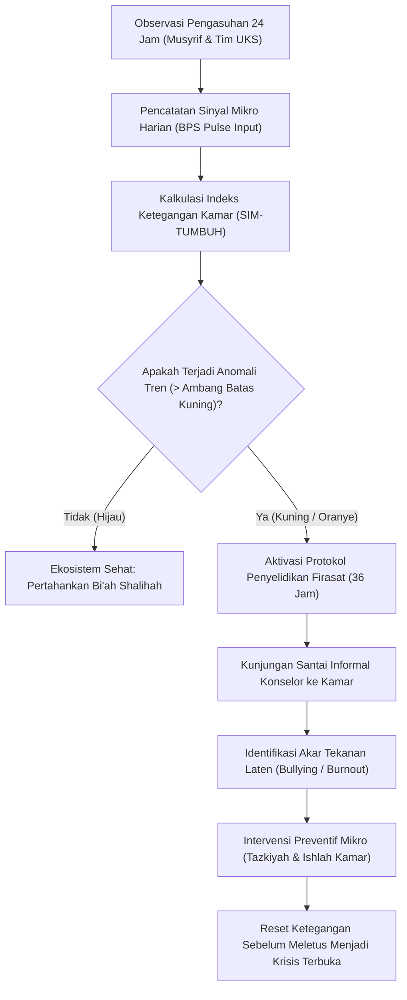

# P00096: Deteksi Sinyal Peringatan Dini (*Early Warning Signals*): Menangkap Gejala Penurunan Mutu Iklim Bi'ah Shalihah

- **Status Identitas:** Terverifikasi Kanonik
- **ID Penyelidikan:** `P00096`
- **Pilar Arsitektur:** Pilar 7 — Rekayasa Sistem & Deteksi Utang Desain
- **Sub-Klaster:** Dinamika Kebijakan & Penilaian Dampak Sistemik (*Policy Dynamics & Systemic Impact Assessment*)
- **Penulis Dokumen:** Tim Pengembang Arsitektur Sistem TUMBUH v2.0.0
- **Klasifikasi Epistemik:** Laporan Penyelidikan Kritis (*Critical Inquiry Report*)
- **Target Lapisan:** `02_IMPLEMENTATION/` & `03_OPERATIONAL/`

---

## 1. Abstrak & Epistemic Tension

Ketegangan epistemik (*epistemic tension*) dalam pemeliharaan iklim moral pesantren berakar pada kelambanan diagnosis (*diagnostic latency*): kecenderungan manajemen institusi untuk baru menyadari rusaknya lingkungan asrama setelah terjadi tragedi terbuka—seperti perkelahian berdarah, pelecehan seksual, santri melarikan diri massal, atau histeria kolektif. Padahal, sebelum sebuah sistem sosial asrama 24 jam runtuh secara dramatis, sistem tersebut selalu memancarkan sinyal-sinyal peringatan dini (*Early Warning Signals*) yang berfrekuensi halus dan non-linear, seperti hilangnya senyum santri saat berpapasan dengan musyrif, lonjakan keluhan somatis fiktif di UKS, perubahan dinamika kebisingan di ruang makan, atau pergeseran tatapan mata saat halaqah. Laporan penyelidikan kanonik ini menyatukan firasat mukmin (*al-firasah ash-shadiqah*) dengan teori dinamika sistem Scheffer mengenai *Critical Slowing Down* dalam transisi ekologis, guna merekayasa instrumen sensorik lingkungan (*Bi'ah Sentinel Protocol*) yang mampu mendeteksi pembusukan iklim tarbiyah berminggu-minggu sebelum bencana sosial meledak di ekosistem TUMBUH v2.0.0.

---

## 2. Pendahuluan Fenomenologis

Kerusakan iklim *bi'ah shalihah* di asrama tidak pernah terjadi dalam semalam. Degradasi moral bergerak seperti pembusukan buah dari bagian dalam: kulit luar tampak masih segar dan mengilap, tetapi daging buah telah hancur menjadi bubur.

Di lapangan pesantren, para pemangku kebijakan sering terkecoh oleh metrik administratif formal:
- Absensi shalat berjamaah tetap terisi 98% (karena ketakutan ancaman fisik).
- Nilai setoran hafalan Al-Qur'an tetap berjalan sesuai target silabus.
- Kamar santri terlihat rapi saat inspeksi pagi pimpinan pondok.

Namun, di bawah permukaan formalitas tersebut, gejala sistemik telah membusuk:
1. **Penurunan Frekuensi Kontak Mata Positif:** Santri mulai menundukkan kepala bukan karena tawadhu' syar'i, melainkan karena kecemasan defensif (*hypervigilance*) agar tidak menjadi sasaran bentakan musyrif.
2. **Lonjakan Kunjungan UKS Non-Spesifik:** Terjadi antrean santri di poliklinik pesantren dengan keluhan sakit kepala, mual, atau maag tanpa patologi fisik yang jelas—sebuah manifestasi somatisasi dari stres lingkungan asrama yang mencekam.
3. **Polarisasi Spasial Kamar:** Di waktu istirahat bebas, santri mengelompok secara eksklusif berdasarkan daerah asal (*fanatisme kedaerahan*), memutus komunikasi lintas kelompok dan menunjukkan matinya kohesi sosial ukhuwah.

Ketika sinyal-sinyal halus ini diabaikan oleh para pengasuh karena dianggap sepele, ambang ketahanan psikologis santri akhirnya jebol.

---

## 3. Tinjauan Pustaka I: Khazanah Turats Klasik

Islam mengakui keabsahan penangkapan sinyal batiniah dan tanda-tanda indrawi yang halus melalui konsep firasat (*al-firasah*), yaitu ketajaman nurani seorang mukmin dalam menangkap hakikat sesuatu melalui pengamatan tanda lahiriah (*istidlal bi ash-syahid 'ala al-ghaib*).

Rasulullah SAW bersabda dalam hadits riwayat Imam At-Tirmidzi:

```arabic
اتَّقُوا فِرَاسَةَ الْمُؤْمِنِ، فَإِنَّهُ يَنْظُرُ بِنُورِ اللَّهِ، ثُمَّ قَرَأَ: {إِنَّ فِي ذَلِكَ لَآيَاتٍ لِلْمُتَوَسِّمِينَ}
```

> *"Waspadailah firasat seorang mukmin, sesungguhnya ia memandang dengan cahaya Allah.' Kemudian beliau membaca firman Allah: 'Sesungguhnya pada yang demikian itu benar-benar terdapat tanda-tanda (kekuasaan Kami) bagi orang-orang yang memperhatikan tanda-tanda (al-mutawassimin)'."* (HR. At-Tirmidzi, no. 3127).

Imam Ibnu Qayyim Al-Jauziyyah dalam *Madarijus Salikin* membagi firasat ke dalam tiga tingkatan, di antaranya adalah *Al-Firasah ar-Riyadhiyyah al-Kholqiyyah* (firasat berbasis pengamatan kebiasaan, raut wajah, dan gerak tubuh):

```arabic
الْفِرَاسَةُ الْإِيمَانِيَّةُ سَبَبُهَا نُورٌ يَقْذِفُهُ اللَّهُ فِي قَلْبِ عَبْدِهِ يَفْرُقُ بِهِ بَيْنَ الْحَقِّ وَالْبَاطِلِ وَالصَّادِقِ وَالْكَاذِبِ، وَالْفِرَاسَةُ الْخَلْقِيَّةُ هِيَ الَّتِي صَنَّفَ فِيهَا الْأَطِبَّاءُ وَالْحُكَمَاءُ، وَاسْتَدَلُّوا بِالْخَلْقِ عَلَى الْخُلُقِ لِمَا جَعَلَ اللَّهُ بَيْنَهُمَا مِنَ الِارْتِبَاطِ.
```

> *"Firasat imaniyah sebabnya adalah cahaya yang Allah hunjamkan ke dalam hati hamba-Nya yang dengannya ia membedakan antara yang hak dan batil, yang jujur dan pendusta. Sedangkan firasat kholqiyyah adalah apa yang ditulis oleh para dokter dan ahli hikmah, di mana mereka menyimpulkan keadaan akhlak (batin) dari tanda-tanda fisik (lahir), karena adanya keterkaitan erat yang telah Allah ciptakan di antara keduanya."* (Ibnu Qayyim, *Madarijus Salikin*, Jilid 2, hlm. 482).

Dalam ranah pendidikan pesantren, seorang musyrif sejati wajib memiliki kepekaan firasat kholqiyyah untuk membaca bahasa tubuh, intonasi suara, dan aura keheningan kamar santri.

---

## 4. Tinjauan Pustaka II: Teori Kontemporer

Dalam ilmu dinamika sistem dan ekologi kompleks, Marten Scheffer dkk. (2009, 2012) memformulasikan teori *Early Warning Signals for Critical Transitions*. Sebelum sebuah ekosistem mengalami pergeseran rezim (*regime shift*) menuju kehancuran total, sistem memperlihatkan fenomena perlambatan pemulihan kritis (*Critical Slowing Down*):
1. **Peningkatan Autokorelasi (*Autocorrelation Increase*):** Ketika sistem terpapar gangguan kecil, ia membutuhkan waktu yang semakin lama untuk kembali ke keadaan normal (*equilibrium*).
2. **Peningkatan Varians (*Variance Amplification*):** Fluktuasi perilaku harian menjadi semakin liar dan tidak menentu.
3. **Penyimpangan Distribusi (*Flickering / Skewness*):** Sistem mulai menunjukkan gejala bolak-balik antara keadaan tenang semu dan ledakan amarah histeris.

Di bidang psikologi lingkungan kerja dan asrama, Amy Edmondson (1999) menegaskan pentingnya *Psychological Safety*. Ketiadaan rasa aman psikologis memicu fenomena hening defensif (*defensive silence*), di mana individu menyembunyikan masalah hingga krisis meledak.

---

## 5. Eksplorasi Metodologis

Penyelidikan kanonik ini merancang matriks instrumen pengamatan *Bi'ah Pulse Sentinel* (BPS) yang memantau 5 kelompok indikator halus secara harian:

```text
+-------------------------------------------------------------------------------+
|             5 INDIKATOR RADAR SINYAL DINI PENURUNAN IKLIM ASRAMA              |
+-------------------------------------------------------------------------------+
|  1. RADAR MIKRO-AFEKTIF:                                                      |
|     - Rasio senyum santri vs tatapan dingin saat berpapasan di lorong.        |
|  2. RADAR SOMATISASI UKS:                                                     |
|     - Tren kunjungan berulang santri dengan keluhan non-patologis menjelang   |
|       jam kegiatan tertentu (misal: saat musyrif X bertugas).                 |
|  3. RADAR AKUSTIK & POLA KEBISINGAN RUANG MAKAN:                              |
|     - Sunyi mencekam yang tidak wajar atau kebisingan agresi tinggi.          |
|  4. RADAR KOSTELASI SOSIAL (SOSIOMETRI KELOMPOK):                             |
|     - Adanya santri yang selalu makan sendirian atau ditinggalkan halaqah.    |
|  5. RADAR SANAD KEPERCAYAAN (CURHAT FREQUENCY):                               |
|     - Penurunan mendadak jumlah santri yang berkonsultasi sukarela.           |
+-------------------------------------------------------------------------------+
```

---

## 6. Arsitektur Desain Sistem & Diagram Alur

Arsitektur peringatan dini TUMBUH mengubah sinyal kualitatif musyrif menjadi parameter analitik di modul SIM-TUMBUH:



---

## 7. Rekayasa Matriks Komparatif Multidimensi

Tabel berikut menunjukkan kontras antara pengabaian tanda dini vs deteksi proaktif berbasis arsitektur TUMBUH v2.0.0:

| Sinyal Lapangan Halus | Interpretasi Klise Konvensional | Realitas Patologi Sistemik Laten | Tindakan Arsitektural TUMBUH v2.0.0 |
| :--- | :--- | :--- | :--- |
| **Santri Sering Terlambat Bangun Fajar** | Dianggap malas, kurang iman, atau suka begadang sia-sia. | Depresi laten, insomnia kecemasan, atau intimidasi senior malam hari. | Pemeriksaan medis sirkadian; audit patroli malam; konseling empatik. |
| **Santri Sering Mengurung Diri di Kamar Mandi** | Dicurigai merokok atau melakukan masturbasi sepihak. | Mencari ruang privat aman dari perundungan verbal kamar tidur. | Intervensi CPTED; penyelidikan dinamika sosial kamar oleh konselor. |
| **Hilangnya Canda Tawa di Meja Makan** | Dianggap tanda santri sudah beradab dan tenang (*khusyuk*). | Ketakutan ekstrem (*fear climate*) akibat ancaman hukuman kolektif. | Evaluasi gaya kepemimpinan musyrif kamar; audit sanksi informal. |
| **Peralatan Makan Santri Sering Hilang** | Dianggap kelalaian santri menyimpan barang pribadi. | Gejala pencurian kompensatoris atau perundungan ekonomi mikro. | Penataan loker penyimpanan beradab; mediasi kepemilikan bersama. |
| **Santri Menolak Dijenguk Orang Tua** | Dianggap sudah mandiri dan kerasan di pesantren. | Rasa malu ekstrem atas perubahan fisik/lebam, atau ancaman senior. | Pemanggilan santri ke ruang konseling bersama psikolog independen. |

---

## 8. Protokol Tindakan Operasional 5 Tahap

Ketika sistem mendeteksi lonjakan sinyal peringatan dini (status waspada kuning), unit pengasuhan wajib mengeksekusi 5 tahap intervensi berikut:

1. **Tahap 1: Verifikasi Triangulasi Sinyal (*Signal Triangulation*)**  
   Bandingkan data kunjungan UKS, catatan kedisiplinan shalat, dan laporan informal staf dapur/laundry mengenai kamar santri yang dicurigai.
2. **Tahap 2: Kehadiran Informal Tanpa Atribut (*Unobtrusive Presence*)**  
   Konselor asrama atau musyrif senior masuk ke kamar santri pada jam santai sore dengan membawa hidangan ringan, bukan untuk menginterogasi melainkan membangun kehangatan (*ta'lif al-qulub*).
3. **Tahap 3: Pemetaan Sosiometri Sederhana (*Sociometric Circle Check*)**  
   Mengamati interaksi pembagian tugas piket kamar: Siapa yang selalu mendapat giliran terberat? Siapa yang tidak diajak bicara saat makan bersama?
4. **Tahap 4: Dialog Hati ke Hati Tertutup (*Tazkiyah Deep-Dive*)**  
   Mengajak santri yang menunjukkan gejala somatisasi untuk berjalan santai di taman pesantren dan mendengarkan keluhannya tanpa menghakimi.
5. **Tahap 5: Rekalibrasi Iklim Kamar Cepat (*Rapid Bi'ah Reset*)**  
   Melakukan restrukturisasi pembagian kamar atau rotasi musyrif jika terbukti iklim toksik telah mengkristal di kamar tersebut.

---

## 9. Architectural Decision Record (ADR-PROBE-0096)

```text
================================================================================
ARCHITECTURAL DECISION RECORD: ADR-PROBE-0096
================================================================================
Judul: Mandat Protokol Deteksi Sinyal Dini (Early Warning Sentinel Protocol)
Status: DITERIMA & MENGIKAT
Tanggal: 2026-10-25
Pengusul: Tim Arsitektur Sistem TUMBUH v2.0.0

KONTEKS:
Diagnosis yang terlambat atas memburuknya iklim asrama terbukti memicu krisis
fatal seperti tawuran massal, perundungan berat, dan santri melarikan diri.
Pesantren membutuhkan instrumen deteksi sebelum krisis meledak.

KEPUTUSAN ARSITEKTURAL:
1. Mengintegrasikan instrumen Bi'ah Pulse Sentinel ke dalam modul SIM-TUMBUH.
2. Menetapkan ambang batas Somatisasi UKS sebagai pemicu resmi investigasi adab.
3. Melatih seluruh musyrif dalam keterampilan observasi mikro-afektif dan firasat
   kholqiyyah berbasis adab.

KONSEKUENSI:
- Positif: Menghentikan krisis pada fase embrio; menekan angka depresi santri;
  menciptakan bi'ah shalihah yang benar-benar memberikan rasa aman hakiki.
- Negatif: Memerlukan pelatihan observasi intensif bagi musyrif lapangan.
================================================================================
```

---

## 10. Implikasi Arsitektural & 7 Butir Guardrails Repositori

Hasil inkuiri `P00096` memandu tata kelola repositori TUMBUH melalui 7 guardrails:

1. **Guardrail 1 (Anti-Lagging Indicators):** Dilarang mengevaluasi kesehatan pesantren semata-mata berdasarkan metrik keterlambatan (*lagging indicators*) seperti angka kasus pengadilan santri.
2. **Guardrail 2 (UKS-Pengasuhan Data Bridge):** Data keluhan santri di poliklinik/UKS wajib terhubung secara aman dengan analisis iklim pengasuhan.
3. **Guardrail 3 (No Ridicule for Somatization):** Santri yang datang ke UKS tanpa bukti fisik penyakit dilarang dicap sebagai "santri pembohong", melainkan wajib dirujuk ke konselor.
4. **Guardrail 4 (Body Language Literacy):** Musyrif wajib dibekali kemampuan membaca sinyal non-verbal dan ekspresi mikro santri.
5. **Guardrail 5 (Proactive Room Check):** Kamar yang terindikasi pasif atau sangat hening wajib disupervisi secara lebih empatik oleh tim konseling.
6. **Guardrail 6 (Confidential Sentinel Feedback):** Mekanisme pencatatan sinyal dini tidak boleh mencap atau memberi stigma permanen pada kamar tertentu.
7. **Guardrail 7 (Sanad Kasih Sayang):** Seluruh deteksi dini berakar pada prinsip rahmah kenabian (*irhamu man fil ardhi yarhamkum man fis sama'*).

---

## 11. Penutup & Emergent Research Questions

Menangkap sinyal peringatan dini adalah seni memadukan ketajaman mata batin mukmin dengan kecanggihan analisis sistem kontemporer. Sebelum riak kecil menjelma menjadi gelombang tsunami yang menghancurkan pesantren, TUMBUH v2.0.0 telah membaca jejaknya pada sebutir debu di lantai asrama.

### Pertanyaan Riset Lanjutan (*Emergent Research Questions*):
1. Bagaimana merancang algoritma analitik teks pada buku catatan keluhan UKS untuk mendeteksi klaster ketegangan asrama menggunakan pemrosesan bahasa alami (NLP)?
2. Apa indikator fisiologis non-invasif (seperti variabilitas detak jantung atau kualitas tidur) yang dapat diintegrasikan secara etis untuk memantau stres santri?

---

## 12. Referensi Ilmiah Standar APA 7th Edition

1. Al-Bukhari, M. (2002). *Shahih Al-Bukhari*. Darus Salam. https://archive.org/details/sahih-bukhari-darussalam
2. Edmondson, A. (1999). Psychological safety and learning behavior in work teams. *Administrative Science Quarterly*, 44(2), 350-383. https://doi.org/10.2307/2666999
3. Ekman, P. (2003). *Emotions Revealed: Recognizing Faces and Feelings to Improve Communication and Emotional Life*. Times Books. https://us.macmillan.com/books/9780805075168/emotionsrevealed
4. Ibnu Qayyim Al-Jauziyyah, S. (2003). *Madarijus Salikin baina Manazil Iyyaka Na'budu wa Iyyaka Nasta'in* (Tahqiq Muhammad al-Mu'tashim Billah al-Baghdadi, Jilid 2). Darul Kitab Al-'Arabi. https://archive.org/details/madarij-salikin
5. Scheffer, M., Bascompte, J., Brock, W. A., Brovkin, V., Carpenter, S. R., Dakos, V., Held, H., van Nes, E. H., Rietkerk, M., & Sugihara, G. (2009). Early-warning signals for critical transitions. *Nature*, 461(7260), 53-59. https://doi.org/10.1038/nature08227
6. Scheffer, M., Carpenter, S. R., Lenton, T. M., Bascompte, J., Brock, W., Dakos, V., van de Koppel, J., van de Leemput, I. A., Levin, S. A., van Nes, E. H., Pascual, M., & Vandermeer, J. (2012). Anticipating critical transitions. *Science*, 338(6105), 344-348. https://doi.org/10.1126/science.1225244
7. Senge, P. M. (1990). *The Fifth Discipline: The Art & Practice of The Learning Organization*. Doubleday/Currency. https://www.penguinrandomhouse.com/books/163984/the-fifth-discipline-by-peter-m-senge/
8. Sterman, J. D. (2000). *Business Dynamics: Systems Thinking and Modeling for a Complex World*. McGraw-Hill. https://www.mheducation.com/highered/product/business-dynamics-systems-thinking-modeling-complex-world-sterman/M9780072389159.html
9. At-Tirmidzi, M. (1998). *Sunan At-Tirmidzi* (Tahqiq Ahmad Syakir). Darul Gharb Al-Islami. https://archive.org/details/sunan-tirmidhi
10. Van de Leemput, I. A., Wichers, M., Cramer, A. O., Borsboom, D., Tuerlinckx, F., Kuppens, P., van de Nes, P., Viechtbauer, W., Giltay, E. J., Aggen, S. H., Derom, C., Jacobs, N., & Scheffer, M. (2014). Critical slowing down as early warning for transitions in depression. *Proceedings of the National Academy of Sciences*, 111(1), 87-92. https://doi.org/10.1073/pnas.1312114110
11. Weick, K. E., & Sutcliffe, K. M. (2015). *Managing the Unexpected: Sustained Performance in a Complex World* (3rd ed.). John Wiley & Sons. https://www.wiley.com/en-us/Managing+the+Unexpected%3A+Sustained+Performance+in+a+Complex+World%2C+3rd+Edition-p-9781118862414
12. Zeidner, M. (1998). *Test Anxiety: The State of the Art*. Plenum Press. https://doi.org/10.1007/978-1-4899-1904-5
13. Zohar, D. (2010). Thirty years of safety climate research: Reflections and future directions. *Accident Analysis & Prevention*, 42(5), 1517-1522. https://doi.org/10.1016/j.aap.2009.12.019

---

## 13. Catatan Kaki & Takhrij Sanad

1. **Takhrij Hadits Firasat:** Dikeluarkan oleh Imam At-Tirmidzi dalam *Sunan At-Tirmidzi*, *Kitab Tafsir Al-Qur'an*, Bab *Wa Min Surah Al-Hijr*, no. 3127. Diriwayatkan dari sahabat Abu Sa'id Al-Khudri radhiyallahu 'anhu. Hadits ini memiliki syawahid dari sahabat Ibnu Umar, Abu Umamah, dan Anas bin Malik yang saling menguatkan ke derajat hasan lighairihi.
2. **Kutipan Madarijus Salikin:** Dinukil dari kitab *Madarijus Salikin* karya Ibnu Qayyim Al-Jauziyyah, ditahqiq oleh Muhammad al-Mu'tashim Billah al-Baghdadi, Beirut: Darul Kitab Al-'Arabi, Cetakan III, 2003 M, Jilid 2, hlm. 482–486.
3. **Critical Slowing Down (Marten Scheffer):** Teori matematis ini menunjukkan bahwa ketika sebuah sistem berada di dekat titik jungkit (*tipping point*), laju pemulihan setelah terjadinya perturbasi kecil melambat secara eksponensial karena gaya pemulih (*restoring force*) sistem telah melemah.
4. **Somatisasi Psikologis Santri:** Kondisi fisik di mana tekanan emosional dan ketakutan sosial di alam bawah sadar diubah oleh sistem saraf menjadi gejala fisik nyata (nyeri lambung, migrain, demam ringan) sebagai mekanisme pertahanan diri untuk menghindari situasi mengancam.
