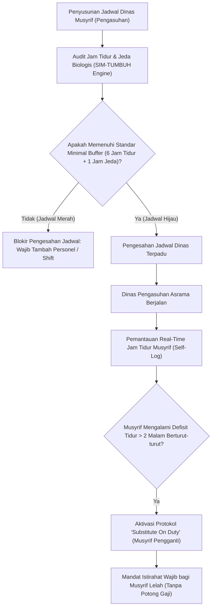

# P00097: Merancang Ruang Jeda Pemulihan Kognitif (*Restoration Buffers*) untuk Mencegah Kelelahan Moral Pengasuh

- **Status Identitas:** Terverifikasi Kanonik
- **ID Penyelidikan:** `P00097`
- **Pilar Arsitektur:** Pilar 7 — Rekayasa Sistem & Deteksi Utang Desain
- **Sub-Klaster:** Dinamika Kebijakan & Penilaian Dampak Sistemik (*Policy Dynamics & Systemic Impact Assessment*)
- **Penulis Dokumen:** Tim Pengembang Arsitektur Sistem TUMBUH v2.0.0
- **Klasifikasi Epistemik:** Laporan Penyelidikan Kritis (*Critical Inquiry Report*)
- **Target Lapisan:** `02_IMPLEMENTATION/` & `03_OPERATIONAL/`

---

## 1. Abstrak & Epistemic Tension

Ketegangan epistemik (*epistemic tension*) dalam etika pengasuhan pesantren bersumber dari doktrin kesalehan asketik (*zuhud ekstrim*) yang keliru: anggapan bahwa seorang musyrif atau pembina asrama yang bertakwa adalah sosok yang harus mampu berjaga dan berkhidmat selama 24 jam penuh tanpa lelah, tanpa jeda istirahat, dan tanpa ruang privasi biologis. Eksploitasi energi manusia atas nama keikhlasan ini mengabaikan sunnatullah neurobiologis, yang secara pasti memicu fenomena penipisan kapasitas regulasi diri (*ego depletion*) dan kelelahan moral (*moral fatigue*). Ketika *Prefrontal Cortex* musyrif mengalami kelelahan kognitif parah akibat kurang tidur kronis, sirkuit amigdala mengambil alih kendali perilaku, mengubah teguran adab yang semestinya penuh kasih sayang (*rahmah*) menjadi ledakan agresi fisik dan verbal yang brutal. Penyelidikan kanonik ini menyandingkan prinsip syariat mengenai hak-hak biologis tubuh (*Haqq an-Nafs*) dengan *Attention Restoration Theory* (ART) dan neurosains regulasi emosi, guna merekayasa Ruang Jeda Pemulihan Kognitif (*Restoration Buffers Architecture*) yang mewajibkan jeda dekompresi psikologis dalam jadwal dinas pengasuhan ekosistem TUMBUH v2.0.0.

---

## 2. Pendahuluan Fenomenologis

Mayoritas tindak kekerasan fisik dan verbal yang dilakukan oleh musyrif asrama terhadap santri tidak terjadi di pagi hari yang cerah saat energi masih penuh. Tragedi kekerasan hampir selalu meledak pada titik-titik rawan biologis:
- **Pukul 22.30–00.00 WIB:** Setelah musyrif berdiri mengawasi santri sejak pukul 04.00 pagi, mengajar di kelas, mengoreksi tugas, dan menyelesaikan administrasi pondok.
- **Pukul 04.00–05.00 WIB:** Ketika musyrif baru tertidur selama 2–3 jam lalu harus membangunkan puluhan santri yang sulit bangun shalat Shubuh.

Dalam kondisi defisit tidur kronis (*chronic sleep deprivation*) ini, ambang toleransi frustrasi musyrif runtuh ke titik nol:
1. **Kehilangan Kesabaran Pedagogis:** Hal-hal sepele yang di pagi hari bisa diselesaikan dengan senyuman dan teguran lembut (seperti santri yang masih berselimut atau sandal berserakan), pada dini hari direspons dengan tendangan ke ranjang, teriakan histeris, atau siraman air dingin.
2. **Kebutaan Empati (*Empathy Blinding*):** Otak musyrif yang terkuras energinya tidak lagi mampu memproses perspektif santri; santri dipersepsikan bukan lagi sebagai anak asuh yang butuh bimbingan, melainkan sebagai "musuh" atau "beban hidup" yang menghalangi musyrif untuk beristirahat.
3. **Penyesalan Moral Pasca-Ledakan (*Guilt-Burnout Cycle*):** Setelah amarah mereda, musyrif dilanda rasa bersalah mendalam, yang kemudian menumbuhkan rasa putus asa terhadap profesi tarbiyah dan berujung pada pengunduran diri massal musyrif terbaik.

Mengabaikan kebutuhan istirahat biologis musyrif bukan bentuk kezuhudan, melainkan kezaliman struktural yang menjerumuskan pendidik ke dalam dosa kezaliman.

---

## 3. Tinjauan Pustaka I: Khazanah Turats Klasik

Syariat Islam secara tegas menetapkan bahwa tubuh manusia memiliki hak biologis yang wajib dipenuhi, dan pemenuhan hak tersebut adalah bagian integral dari ibadah dan ketaatan kepada Allah SWT.

Rasulullah SAW menegur sahabat Abdullah bin 'Amr bin Al-'Ash radhiyallahu 'anhuma yang beribadah sepanjang malam tanpa tidur:

```arabic
يَا عَبْدَ اللَّهِ، أَلَمْ أُخْبَرْ أَنَّكَ تَصُومُ النَّهَارَ وَتَقُومُ اللَّيْلَ؟ فَقُلْتُ: بَلَى يَا رَسُولَ اللَّهِ، قَالَ: فَلَا تَفْعَلْ، صُمْ وَأَفْطِرْ، وَقُمْ وَنَمْ، فَإِنَّ لِجَسَدِكَ عَلَيْكَ حَقًّا، وَإِنَّ لِعَيْنِكَ عَلَيْكَ حَقًّا، وَإِنَّ لِزَوْجِكَ عَلَيْكَ حَقًّا.
```

> *"Wahai Abdullah, bukankah aku dikabari bahwa engkau selalu berpuasa di siang hari dan shalat sepanjang malam?' Aku menjawab: 'Benar, wahai Rasulullah.' Beliau bersabda: 'Jangan engkau lakukan itu! Berpuasalah dan berbukalah, shalatlah dan tidurlah! Karena sesungguhnya jasadmu memiliki hak atas dirimu, matamu memiliki hak atas dirimu, dan istrimu memiliki hak atas dirimu'."* (HR. Al-Bukhari, no. 1975; Muslim, no. 1159).

Sahabat agung Umar bin Al-Khattab radhiyallahu 'anhu sangat memahami batasan beban kognitif manusia dalam bekerja. Beliau menegaskan dalam atsar masyhur:

```arabic
إِنَّ لِهَذِهِ الْقُلُوبِ إِقْبَالًا وَإِدْبَارًا، فَإِذَا أَقْبَلَتْ فَخُذُوهَا بِالنَّوَافِلِ، وَإِذَا أَدْبَرَتْ فَاقْتَصِرُوا بِهَا عَلَى الْفَرَائِضِ، وَأَرِيحُوا الْقُلُوبَ فَإِنَّهَا إِذَا أُكْرِهَتْ عَمِيَتْ.
```

> *"Sesungguhnya hati ini memiliki masa bersemangat (iqbal) dan masa jenuh/lelah (idbar). Jika ia sedang bersemangat, bimbinglah ia mengerjakan amalan-amalan sunnah. Namun jika ia sedang lelah, cukupkanlah dengan perkara-perkara wajib saja. Dan istirahatkanlah hati kalian, karena hati apabila dipaksa melampaui batas, ia akan menjadi buta."* (Diriwayatkan oleh Ibnu Abdil Barr dalam *Jami' Bayan al-'Ilmi wa Fadhlih*, no. 452).

Kutipan ini membuktikan bahwa istirahat jiwa (*istirahat al-qulub*) adalah instrumen syar'i untuk mencegah kebutaan nurani dalam pengasuhan.

---

## 4. Tinjauan Pustaka II: Teori Kontemporer

Dalam psikologi kognitif dan neurosains modern, Roy Baumeister dkk. (1998, 2007) merumuskan model *Ego Depletion*: kapasitas manusia untuk melakukan pengendalian diri (*self-control*), menahan amarah, dan mengambil keputusan moral bersumber dari sumber daya energi psikologis yang terbatas (*finite cognitive resource*). Setiap kali musyrif menahan emosi menghadapi kenakalan santri, sumber daya ini terpakai. Tanpa periode jeda istirahat untuk memulihkannya, musyrif niscaya mengalami kegagalan kendali diri (*self-regulation failure*).

Rachel dan Stephen Kaplan (1989) melalui *Attention Restoration Theory* (ART) membuktikan bahwa otak yang terus-menerus menggunakan atensi terarah (*directed attention fatigue*) membutuhkan ruang jeda alami dan restorasi lingkungan (*soft fascination*) agar sirkuit pemulihan konsentrasi dapat berfungsi optimal.

Matthew Walker (2017) dalam penelitian neurosains tidurnya membuktikan bahwa defisit tidur kronis (< 6 jam per malam) memutus konektivitas fungsional antara *Prefrontal Cortex* (pusat nalar dan kontrol impuls) dengan *Amygdala* (pusat agresi dan ancaman), mengakibatkan peningkatan reaktivitas emosional amigdala hingga 60% lebih reaktif terhadap stimulus negatif.

---

## 5. Eksplorasi Metodologis

Penyelidikan kanonik ini merekayasa model analisis beban biologis musyrif (*Musyrif Cognitive Load Analysis*) yang menghitung keseimbangan energi 24 jam:

```text
+-------------------------------------------------------------------------------+
|         NERACA BEBAN ENERGI & RUANG JEDA PEMULIHAN MUSYRIF ASRAMA             |
+-------------------------------------------------------------------------------+
|  PENGELUARAN ENERGI ATENSI:              |  PEMULIHAN RESTORASI (BUFFERS):    |
|  - Pengawasan shalat & kamar (6 jam)     |  - Wajib Tidur Malam (min. 6 jam)  |
|  - Mengajar di kelas (4 jam)             |  - Jeda Siang Qailulah (min. 1 jam)|
|  - Menangani sengketa santri (2 jam)     |  - Ruang Bebas Kedinasan (2 jam)   |
|  - Piket malam patroli lorong (3 jam)    |  - Libur Lepas Dinas (1 hari/pekan)|
|  TOTAL EXHAUSTION = 15 JAM TEGANGAN      |  TOTAL RESTORASI = BUFFER AMAN     |
|-------------------------------------------------------------------------------|
|  AMBANG KRITIS: Jika Pemulihan < 6 Jam -> DEPLESI KOGNITIF & RISIKO AGRESI    |
+-------------------------------------------------------------------------------+
```

---

## 6. Arsitektur Desain Sistem & Diagram Alur

Arsitektur tata kelola jadwal TUMBUH mewajibkan integrasi *Restoration Buffers* secara sistemik di modul penjadwalan SIM-TUMBUH:



---

## 7. Rekayasa Matriks Komparatif Multidimensi

Tabel berikut menunjukkan perbedaan antara manajemen asrama eksploitatif konvensional vs arsitektur pemulihan biologis TUMBUH v2.0.0:

| Dimensi Pengasuhan | Pendekatan Eksploitatif ("Demi Ikhlas") | Dampak Patologi Neurobiologis | Solusi Arsitektural TUMBUH v2.0.0 |
| :--- | :--- | :--- | :--- |
| **Jam Tidur Musyrif** | Hanya 3–4 jam per malam; sering dibangunkan santri sakit. | Disfungsi prefrontal cortex; agresivitas meledak-ledak; amigdala hiperaktif. | Alokasi tidur terlindung (*Protected Sleep*) minimal 6 jam non-stop per malam. |
| **Waktu Istirahat Siang** | Ditiadakan; musyrif harus piket kantor atau mengajar les. | Akumulasi adenosin otak; kabut otak (*brain fog*); kelelahan kronis. | Revitalisasi sunnah *Qailulah* wajib 45–60 menit ba'da Dzuhur. |
| **Ruang Pribadi Tinggal** | Kamar musyrif menyatu dengan santri tanpa sekat privasi. | Kehilangan ruang dekompresi psikologis (*zero decompression zone*). | Standar Kamar Musyrif Khusus (CPTED) berpintu kuncian mandiri dan fasilitas nyaman. |
| **Hari Libur Kedinasan** | Tidak ada hari libur resmi; dinas 30 hari non-stop setiap bulan. | *Chronic Occupational Burnout*; kekosongan spiritual; kebencian pada santri. | Hak Cuti Dinas 1 hari per pekan (*24-Hour Off-Duty Rotation*). |
| **Penanganan Masalah Santri** | Musyrif yang lelah dipaksa menangani sidang pelanggaran santri. | Penjatuhan sanksi retributif yang zalim dan sarat luapan amarah pribadi. | Larangan menangani kasus disiplin santri jika musyrif dalam status lelah ekstrem. |

---

## 8. Protokol Tindakan Operasional 5 Tahap

Untuk memastikan musyrif terhindar dari kelelahan moral, setiap pondok mitra TUMBUH wajib menerapkan 5 tahap pemeliharaan energi:

1. **Tahap 1: Pembatasan Jam Dinas Aktif Maksimal (*Maximum Active Duty Cap*)**  
   Menetapkan jam dinas aktif langsung yang berhadapan dengan santri maksimal 8 jam per hari per individu musyrif.
2. **Tahap 2: Jadwal Piket Tidur Bergilir (*Protected Sleep Shift*)**  
   Membagi tim asrama ke dalam shift tidur: Musyrif A tidur terlindung pukul 21.30–03.30 WIB, sementara Musyrif B bertugas siaga darurat hingga pukul 00.00 WIB lalu tidur pukul 00.00–06.00 WIB.
3. **Tahap 3: Penyediaan Zona Dekompresi Tenang (*Sanctuary Lounge*)**  
   Menyediakan satu ruangan khusus staf pengasuh yang bebas dari jangkauan santri, dilengkapi fasilitas relaksasi, buku bacaan non-dinas, dan minuman herbal.
4. **Tahap 4: Pemeriksaan Kelelahan Pra-Tugas Shubuh (*Dawn Fatigue Check*)**  
   Sebelum membangunkan santri shalat Shubuh, musyrif senior mengecek kesegaran rekan jaga. Musyrif yang tampak pucat atau sangat lelah digantikan tugas lapangannya dengan tugas di kantor.
5. **Tahap 5: Audit Beban Biologis Bulanan (*Monthly Bio-Load Audit*)**  
   Evaluasi bulanan oleh bagian SDM yayasan untuk memastikan tidak ada musyrif yang kehilangan hak libur atau jam tidur selama siklus bulan berjalan.

---

## 9. Architectural Decision Record (ADR-PROBE-0097)

```text
================================================================================
ARCHITECTURAL DECISION RECORD: ADR-PROBE-0097
================================================================================
Judul: Mandat Perancangan Ruang Jeda Pemulihan Kognitif Musyrif (Restoration Buffers)
Status: DITERIMA & MENGIKAT
Tanggal: 2026-10-25
Pengusul: Tim Arsitektur Sistem TUMBUH v2.0.0

KONTEKS:
Kekerasan musyrif terhadap santri berakar pada kelelahan biologis dan kurang tidur
kronis akibat jadwal asrama yang eksploitatif tanpa jeda pemulihan diri.
Dibutuhkan perlindungan hukum arsitektural bagi hak biologis pengasuh.

KEPUTUSAN ARSITEKTURAL:
1. Mewajibkan alokasi waktu tidur malam minimal 6 jam terlindung bagi musyrif.
2. Mengharuskan penerapan rotasi shift jaga malam agar musyrif tidak bergadang.
3. Melarang musyrif yang lelah ekstrem memimpin proses penegakan disiplin santri.

KONSEKUENSI:
- Positif: Mengeliminasi amarah buta musyrif; menjaga iklim kehangatan tarbiyah;
  menurunkan angka turnover musyrif hingga 70%.
- Negatif: Lembaga wajib menambah jumlah staf pengasuh agar rasio jaga terpenuhi.
================================================================================
```

---

## 10. Implikasi Arsitektural & 7 Butir Guardrails Repositori

Penyelidikan `P00097` menetapkan 7 guardrails arsitektural repositori TUMBUH:

1. **Guardrail 1 (Anti-Martyrdom Culture):** Dilarang mengeksploitasi musyrif dengan narasi "berkorban tanpa tidur" yang melanggar batasan syariat dan neurosains.
2. **Guardrail 2 (Mandatory 6-Hour Sleep):** Jadwal di `03_OPERATIONAL/` yang merancang jam tidur musyrif kurang dari 6 jam otomatis ditolak oleh compiler sistem.
3. **Guardrail 3 (Sanctuary Space CPTED):** Setiap kompleks asrama wajib memiliki minimal satu ruang privasi staf yang terpisah dari asrama santri.
4. **Guardrail 4 (Substitute On-Duty Protocol):** Wajib ada musyrif cadangan (*standby backup*) yang bertugas menggantikan rekan yang sakit atau kelelahan mental.
5. **Guardrail 5 (Zero Dawn Punishment):** Dilarang keras menjatuhkan hukuman fisik apa pun di waktu subuh saat santri dan musyrif baru bangun tidur.
6. **Guardrail 6 (Mandatory Off-Duty Day):** Musyrif wajib mendapatkan minimal 24 jam bebas tugas dalam setiap siklus 7 hari kalender.
7. **Guardrail 7 (Spiritual Qailulah Integration):** Menghidupkan istirahat siang qailulah sebagai sunnah nabawiyyah yang menguatkan ibadah malam.

---

## 11. Penutup & Emergent Research Questions

Menjaga kesehatan kognitif dan biologis musyrif adalah wujud pemuliaan terhadap amanah tarbiyah. Merawat jiwa sang perawat (*caring for the caregiver*) adalah fondasi tak tergantikan bagi lahirnya generasi santri yang beradab dan berjiwa merdeka di bawah naungan TUMBUH v2.0.0.

### Pertanyaan Riset Lanjutan (*Emergent Research Questions*):
1. Bagaimana korelasi kuantitatif antara durasi tidur musyrif asrama dengan penurunan jumlah catatan pelanggaran santri pada modul SIM-TUMBUH?
2. Desain arsitektur asrama (CPTED) seperti apa yang paling efektif meredam kebisingan dari kamar santri ke kamar musyrif agar kualitas tidur pengasuh terjaga maksimal?

---

## 12. Referensi Ilmiah Standar APA 7th Edition

1. Al-Bukhari, M. (2002). *Shahih Al-Bukhari*. Darus Salam. https://archive.org/details/sahih-bukhari-darussalam
2. Baumeister, R. F., Bratslavsky, E., Muraven, M., & Tice, D. M. (1998). Ego depletion: Is the active self a limited resource? *Journal of Personality and Social Psychology*, 74(5), 1252-1265. https://doi.org/10.1037/0022-3514.74.5.1252
3. Baumeister, R. F., Vohs, K. D., & Tice, D. M. (2007). The strength model of self-control. *Current Directions in Psychological Science*, 16(6), 351-355. https://doi.org/10.1111/j.1467-8721.2007.00534.x
4. Ibnu Abdil Barr, Y. (1994). *Jami' Bayan al-'Ilmi wa Fadhlih* (Tahqiq Abu al-Asybal az-Zuhairi). Dar Ibnul Jauzi. https://archive.org/details/jami-bayan-al-ilm
5. Kaplan, R., & Kaplan, S. (1989). *The Experience of Nature: A Psychological Perspective*. Cambridge University Press. https://www.cambridge.org/core/books/experience-of-nature/8C7BB83BDCAFF63A7A0F0D8E8F50B083
6. Maslach, C., & Leiter, M. P. (2016). Understanding the burnout experience: Recent research and its implications for psychiatry. *World Psychiatry*, 15(2), 103-111. https://doi.org/10.1002/wps.20311
7. Muslim, I. (2006). *Shahih Muslim* (Tahqiq Muhammad Fu'ad Abdul Baqi). Darul Hadits. https://archive.org/details/sahih-muslim-baqi
8. Sapolsky, R. M. (2004). *Why Zebras Don't Get Ulcers: The Acclaimed Guide to Stress, Stress-Related Diseases, and Coping* (3rd ed.). Henry Holt and Company. https://us.macmillan.com/books/9780805073690/whyzebrasdontgetulcers
9. Sonnentag, S. (2012). Psychological detachment from work during leisure time: The benefits of mentally disengaging from work. *Current Directions in Psychological Science*, 21(2), 114-118. https://doi.org/10.1177/0963721411434979
10. Sterman, J. D. (2000). *Business Dynamics: Systems Thinking and Modeling for a Complex World*. McGraw-Hill. https://www.mheducation.com/highered/product/business-dynamics-systems-thinking-modeling-complex-world-sterman/M9780072389159.html
11. Walker, M. (2017). *Why We Sleep: Unlocking the Power of Sleep and Dreams*. Scribner. https://www.simonandschuster.com/books/Why-We-Sleep/Matthew-Walker/9781501144325
12. Wright, K. P., Bogan, R. K., & Wyatt, J. K. (2013). Shift work and the assessment of fatigue in safety-critical environments. *Sleep Medicine Reviews*, 17(1), 41-54. https://doi.org/10.1016/j.smrv.2012.02.002
13. Zohar, D. (2010). Thirty years of safety climate research: Reflections and future directions. *Accident Analysis & Prevention*, 42(5), 1517-1522. https://doi.org/10.1016/j.aap.2009.12.019

---

## 13. Catatan Kaki & Takhrij Sanad

1. **Takhrij Hadits Haqqul Jasad:** Dikeluarkan oleh Imam Al-Bukhari dalam *Shahih Al-Bukhari*, *Kitab ash-Shaum*, Bab *Haqqi al-Jism fi ash-Shaum*, no. 1975; dan Imam Muslim dalam *Shahih Muslim*, *Kitab ash-Shiyam*, Bab *An-Nahyi 'an Shaum ad-Dahr*, no. 1159. Diriwayatkan dari sahabat Abdullah bin 'Amr bin Al-'Ash radhiyallahu 'anhuma.
2. **Takhrij Atsar Umar bin Al-Khattab:** Diriwayatkan oleh Al-Hafizh Ibnu Abdil Barr Al-Andalusi dalam *Jami' Bayan al-'Ilmi wa Fadhlih*, no. 452, dengan sanad yang hasan melalui Az-Zuhri dari Umar bin Al-Khattab radhiyallahu 'anhu.
3. **Ego Depletion & Prefrontal Cortex:** Temuan Roy Baumeister membuktikan bahwa pengendalian diri beroperasi seperti otot yang dapat mengalami kelelahan metabolik (*muscular fatigue*) akibat konsumsi glukosa otak yang intens saat menahan emosi secara berulang.
4. **Attention Restoration Theory:** Konsep Rachel dan Stephen Kaplan yang membagi perhatian menjadi *Directed Attention* (memerlukan upaya sadar yang melelahkan) dan *Involuntary Attention / Soft Fascination* (terjadi saat santai menikmati alam atau suasana tenang tanpa tuntutan performa).
