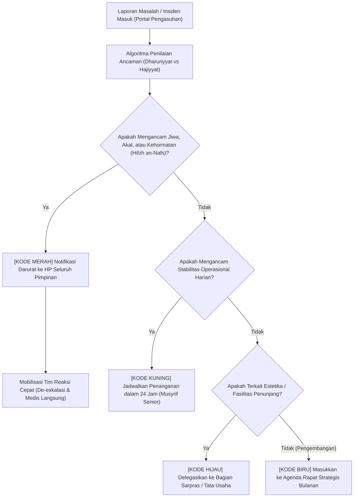

# P00098: Protokol Triage Masalah Lembaga: Menentukan Prioritas Perbaikan Saat Banyak Persoalan Muncul Bersamaan

- **Status Identitas:** Terverifikasi Kanonik
- **ID Penyelidikan:** `P00098`
- **Pilar Arsitektur:** Pilar 7 — Rekayasa Sistem & Deteksi Utang Desain
- **Sub-Klaster:** Dinamika Kebijakan & Penilaian Dampak Sistemik (*Policy Dynamics & Systemic Impact Assessment*)
- **Penulis Dokumen:** Tim Pengembang Arsitektur Sistem TUMBUH v2.0.0
- **Klasifikasi Epistemik:** Laporan Penyelidikan Kritis (*Critical Inquiry Report*)
- **Target Lapisan:** `02_IMPLEMENTATION/` & `03_OPERATIONAL/`

---

## 1. Abstrak & Epistemic Tension

Ketegangan epistemik (*epistemic tension*) dalam manajemen strategis pesantren meletus ketika puluhan persoalan asrama, akademik, sarana prasarana, keuangan, dan relasi wali santri menyeruak secara simultan: ketiadaan algoritma prioritisasi yang jelas sering kali menjerumuskan pimpinan pesantren ke dalam jebakan ilusi urgensi (*urgency paradox*). Pimpinan pondok menghabiskan seluruh energi kognitif dan waktu harian mereka untuk memadamkan "kebakaran-kebakaran kecil" yang bersuara bising tetapi berkepentingan rendah (seperti perselisihan warna seragam atau keluhan dispenser air minum), seraya menelantarkan "kebakaran besar bawah tanah" yang mengancam nyawa dan akidah (seperti perundungan seksual laten, ide melarikan diri santri, atau *burnout* kronis pengasuh). Laporan penyelidikan kanonik ini menyatukan hierarki Maqashid Syari'ah (*Dharuriyyat, Hajiyyat, Tahsiniyyat*) dan kaidah *Irtikab Akhaff adh-Dhararain* dengan metodologi Triage Klinis Modern (*Simple Triage and Rapid Treatment - START*), guna merumuskan Protokol Triage Masalah Lembaga (*Institutional Problem Triage Architecture*) yang memandu pimpinan pesantren mengalokasikan sumber daya intervensi secara presisi, adil, dan berdaya selamat tinggi di ekosistem TUMBUH v2.0.0.

---

## 2. Pendahuluan Fenomenologis

Pemandangan meja kerja seorang pimpinan pengasuhan pesantren pada hari Senin pagi lazim diwarnai oleh tumpukan memo krisis yang datang bersamaan:
1. Dua santri kelas 1 Tsanawiyah dilaporkan demam tinggi dan sesak napas di UKS.
2. Seorang wali santri berpengaruh mengancam menarik donasi karena AC kamar anaknya rusak.
3. Ditemukan puntung rokok di plafon kamar mandi asrama putra.
4. Musyrif senior mengundurkan diri mendadak karena kelelahan mental.
5. Laporan rahasia mengenai dugaan pemalakan (*extortion*) oleh santri senior terhadap santri baru di lantai 3.
6. Keluhan dari dapur bahwa pasokan beras terlambat tiba.

Dalam situasi kepanikan birokratis ini, fenomena salah arah prioritas sering kali terjadi:
- Pimpinan memanggil musyrif dan memarahi mereka selama 2 jam gara-gara masalah puntung rokok (karena pelanggaran ini tampak nyata dan mencoreng nama baik pondok).
- Pimpinan meluangkan waktu 1 jam merayu wali santri kaya mengenai perbaikan AC.
- Laporan pemalakan santri dan pengunduran diri musyrif hanya dicatat sekilas dan ditunda pembahasannya hingga rapat akhir bulan.

Akibat kekeliruan prioritas ini: Tiga hari kemudian, santri baru yang dipalak melarikan diri dari asrama dan mengalami trauma psikologis berat, sementara musyrif pengganti yang belum terlatih memukul santri hingga patah tulang. 

Kegagalan ini membuktikan aksioma arsitektural TUMBUH: **Ketika semua masalah dianggap sama-sama darurat, maka tidak ada satu pun masalah hakiki yang benar-benar tertangani.**

---

## 3. Tinjauan Pustaka I: Khazanah Turats Klasik

Epistemologi Ushul Fiqh dan Fiqh Siyasah meletakkan hierarki nilai perlindungan melalui stratifikasi Maqashid Asy-Syari'ah: tingkatan *Dharuriyyat* (kebutuhan primer eksistensial yang mengancam kehancuran jika hilang), *Hajiyyat* (kebutuhan sekunder yang memudahkan kehidupan), dan *Tahsiniyyat* (kebutuhan tersier pelengkap kesempurnaan dan estetika).

Imam Al-Izz bin Abdissalam dalam mahakaryanya *Qawa'id al-Ahkam fi Mashalih al-Anam* merumuskan algoritma penimbangan mafsadat:

```arabic
إِذَا اجْتَمَعَتِ الْمَفَاسِدُ قُدِّمَ أَخَفُّهَا وَأَهْوَنُهَا، وَارْتُكِبَ الْأَدْنَى لِدَفْعِ الْأَعْلَى، فَإِنَّ دَفْعَ أَعْظَمِ الْمَفْسَدَتَيْنِ بِاحْتِمَالِ أَدْنَاهُمَا هُوَ عَيْنُ الْمَصْلَحَةِ وَمُقْتَضَى الْعَدْلِ وَالْحِكْمَةِ.
```

> *"Apabila beberapa mafsadat berkumpul secara bersamaan, maka didahulukan yang paling ringan dan paling sepele, serta dikerjakan mafsadat yang lebih rendah demi menolak mafsadat yang lebih besar. Sesungguhnya menolak sebesar-besar mafsadat dengan menanggung mafsadat yang lebih ringan adalah hakikat kemaslahatan serta tuntutan keadilan dan hikmah."* (Al-Izz bin Abdissalam, *Qawa'id al-Ahkam*, Jilid 1, hlm. 89).

Kaidah fiqhiyyah masyhur menguatkan prinsip triage ini:

```arabic
يُخْتَارُ أَهْوَنُ الشَّرَّيْنِ أَوْ أَخَفُّ الضَّرَرَيْنِ
```

> *"Dipilihlah yang paling ringan di antara dua keburukan, atau yang paling kecil di antara dua madharat."* (As-Suyuthi, *Al-Asybah wan Nazha'ir*, hlm. 87).

Prinsip *Fiqh al-Aulawiyyat* (Fiqih Prioritas) mengharuskan seorang pemimpin mendahulukan keselamatan nyawa dan kesehatan akal santri di atas urusan estetika seragam atau kenyamanan fasilitas fisik semata.

---

## 4. Tinjauan Pustaka II: Teori Kontemporer

Dalam ilmu kedokteran darurat dan penanganan bencana, sistem *Simple Triage and Rapid Treatment* (START) dan *Manchester Triage System* (MTS) mengelompokkan korban ke dalam 4 kategori warna universal dalam hitungan detik:
1. **Merah (Immediate / Kritis):** Ancaman nyawa langsung; wajib ditangani detik ini juga.
2. **Kuning (Delayed / Mendesak):** Cedera serius yang memerlukan perawatan cepat, tetapi masih stabil dalam 1–2 jam.
3. **Hijau (Minor / Ringan):** Pasien masih bisa berjalan mandiri (*walking wounded*); penanganan bisa ditunda.
4. **Hitam (Expectant / Deceased):** Korban meninggal atau luka fatal tak tertolong; fokus dialihkan ke yang selamat.

Dwight D. Eisenhower (dipopulerkan Stephen Covey, 1989) merumuskan Matriks Kuadran Waktu:
- Kuadran I: Mendesak & Penting (*Crises*).
- Kuadran II: Tidak Mendesak tetapi Penting (*Strategic Planning & Bi'ah Building*).
- Kuadran III: Mendesak tetapi Tidak Penting (*Deceptive Interruptions*).
- Kuadran IV: Tidak Mendesak & Tidak Penting (*Time Wasters*).

W. Edwards Deming (1986) menambahkan bahwa manajemen yang baik tidak mengizinkan seluruh waktu habis di Kuadran I, melainkan secara sadar menginvestasikan 70% sumber daya di Kuadran II untuk menghentikan timbulnya krisis Kuadran I.

---

## 5. Eksplorasi Metodologis

Penyelidikan kanonik ini merekayasa model *Institutional Problem Triage System* (IPTS) yang mengadaptasi kode triage medis ke dalam matriks krisis pesantren:

```text
+-------------------------------------------------------------------------------+
|         PROTOKOL KODE WARNA TRIAGE MASALAH LEMBAGA (TUMBUH IPTS)              |
+-------------------------------------------------------------------------------+
| [KODE MERAH - T1: KRITIS INSTAN (Respon Maksimal < 60 Menit)]                 |
| - Ancaman nyawa, kekerasan fisik aktif, ide bunuh diri, pelecehan seksual,    |
|   keracunan makanan massal, kebakaran/bencana fisik.                          |
|                                                                               |
| [KODE KUNING - T2: SIGNIFIKAN MENDESAK (Respon < 24 Jam)]                    |
| - Santri kabur dari asrama, ancaman mogok belajar, burnout musyrif parah,     |
|   konflik terbuka wali santri, dugaan pencurian sistemik.                     |
|                                                                               |
| [KODE HIJAU - T3: NORMAL TERJADWAL (Respon 3-7 Hari)]                        |
| - Keterlambatan masuk kelas biasa, pelanggaran kerapian kamar, kerusakan AC,  |
|   pergantian menu dapur, revisi jadwal ekstrakurikuler.                       |
|                                                                               |
| [KODE BIRU - T4: STRATEGIS FUNDAMENTAL (Investasi Jangka Panjang)]           |
| - Penyusunan kurikulum adab baru, pelatihan musyrif, perbaikan sistem SIM.    |
+-------------------------------------------------------------------------------+
```

---

## 6. Arsitektur Desain Sistem & Diagram Alur

Arsitektur penanganan triage TUMBUH melarang pemrosesan masalah secara acak dan mewajibkan filtering otomatis melalui modul Triage SIM-TUMBUH:



---

## 7. Rekayasa Matriks Komparatif Multidimensi

Tabel berikut menunjukkan perbandingan pola alokasi respon antara kepemimpinan impulsif vs kepemimpinan terukur berbasis triage TUMBUH:

| Karakteristik Penanganan | Kepemimpinan Impulsif Reaktif | Manajemen Terukur Protokol Triage TUMBUH |
| :--- | :--- | :--- |
| **Kriteria Penentuan Prioritas** | Siapa yang berteriak paling kencang / siapa wali paling kaya. | Tingkat keparahan ancaman terhadap Maqashid Syari'ah (*Hifzh an-Nafs*). |
| **Respons terhadap Kerusakan Fisik Non-Kritis (AC/Dispenser)** | Pimpinan turun langsung memeriksa; menyita waktu rapat penting. | Didelegasikan 100% ke staf logistik; penanganan berbatas waktu standar. |
| **Penanganan Laporan Santri Murung/Menangis** | Diabaikan karena dianggap bukan pelanggaran tata tertib pondok. | Diklasifikasikan sebagai Kode Kuning; aktivasi pendampingan konselor. |
| **Alokasi Waktu Pimpinan Pondok** | 90% waktu habis memadamkan komplain harian (Kuadran I & III). | 60% waktu diinvestasikan pada pencegahan strategis (Kuadran II & Kode Biru). |
| **Dampak terhadap Organisasi** | Staf pengasuh kelelahan; masalah fatal meledak tanpa terduga. | Masalah kritis tertangani cepat; sistemik utuh dan berdaya tahan tinggi. |

---

## 8. Protokol Tindakan Operasional 5 Tahap

Ketika puluhan masalah menumpuk di meja pengasuhan, pimpinan pondok wajib mengeksekusi 5 langkah algoritma triage berikut:

1. **Tahap 1: Penghentian Pendarahan Sistemik (*Halt The Bleeding*)**  
   Tinjau daftar laporan dan identifikasi seketika masalah Kode Merah. Masalah Merah wajib ditangani detik itu juga; seluruh agenda rapat rutin dibekukan.
2. **Tahap 2: Pendelegasian Kode Hijau Seketika (*Immediate Delegation*)**  
   Keluarkan seluruh masalah sarana prasarana dan administrasi teknis dari meja pimpinan. Serahkan kepada kepala divisi logistik/staf tata usaha dengan SLA penyelesaian tertulis.
3. **Tahap 3: Triangulasi Investigasi Kode Kuning (*Yellow Investigation Queue*)**  
   Tugaskan konselor atau musyrif senior untuk mendalami kasus santri kabur atau konflik wali santri secara terpisah dalam kurun waktu 12–24 jam.
4. **Tahap 4: Blok Perlindungan Waktu Strategis (*Strategic Time Blocking*)**  
   Pimpinan mengunci minimal 2 jam setiap hari bebas dari interupsi tamu/masalah sepele untuk fokus merawat arsitektur bi'ah shalihah (Kode Biru).
5. **Tahap 5: Evaluasi Triage Pascakrisis (*Post-Triage Audit*)**  
   Setiap akhir pekan, lakukan review: Berapa banyak masalah Merah yang sebenarnya merupakan masalah Hijau yang membusuk karena kelalaian masa lalu?

---

## 9. Architectural Decision Record (ADR-PROBE-0098)

```text
================================================================================
ARCHITECTURAL DECISION RECORD: ADR-PROBE-0098
================================================================================
Judul: Penerapan Protokol Triage Masalah Lembaga Berbasis Maqashid (IPTS)
Status: DITERIMA & MENGIKAT
Tanggal: 2026-10-25
Pengusul: Tim Arsitektur Sistem TUMBUH v2.0.0

KONTEKS:
Pimpinan pesantren sering mengalami distorsi fokus akibat ilusi urgensi,
menghabiskan waktu menangani komplain sepele seraya menelantarkan krisis moral
dan keselamatan santri yang berakibat fatal bagi institusi.

KEPUTUSAN ARSITEKTURAL:
1. Mewajibkan klasifikasi 4 kode warna triage (Merah, Kuning, Hijau, Biru)
   pada setiap tiket pengaduan di modul SIM-TUMBUH.
2. Menetapkan larangan keterlibatan langsung pimpinan pada masalah Kode Hijau
   kecuali staf delegasi telah mengalami kegagalan operasional.
3. Memberikan otoritas mutlak kepada Tim Reaksi Cepat untuk mengeksekusi tindakan
   penyelamatan Kode Merah tanpa harus menunggu disposisi surat pimpinan.

KONSEKUENSI:
- Positif: Penanganan krisis darurat menjadi instan; pimpinan terlindungi dari
  beban kognitif remeh; penyelamatan jiwa santri terjamin.
- Negatif: Memerlukan pelatihan pemilahan tiket bagi staf penerima laporan.
================================================================================
```

---

## 10. Implikasi Arsitektural & 7 Butir Guardrails Repositori

Hasil inkuiri `P00098` mengikat tata kelola repositori TUMBUH melalui 7 guardrails:

1. **Guardrail 1 (Life Over Property):** Keselamatan fisik, mental, dan iman santri mutlak didahulukan di atas urusan fasilitas fisik dan materi yayasan.
2. **Guardrail 2 (No VIP Bias in Triage):** Status sosial atau besaran donasi wali santri dilarang keras mengubah kode warna triage masalah secara tidak adil.
3. **Guardrail 3 (Maximum 60-Minute Response for Red):** Masalah berkategori Kode Merah wajib mendapatkan tindakan nyata di lapangan dalam tempo maksimal 60 menit.
4. **Guardrail 4 (Delegation Mandate):** Masalah administratif non-kritis dilarang menyita waktu musyrif utama yang sedang bertugas mendampingi santri.
5. **Guardrail 5 (Protected Strategic Hours):** Yayasan wajib menjamin adanya waktu tenang bagi pimpinan untuk berpikir dan muhasabah strategis.
6. **Guardrail 6 (Clear Escalation Chain):** SOP penanganan krisis harus memuat nama dan kontak darurat petugas pengganti bila pejabat utama berhalangan.
7. **Guardrail 7 (Traceability of Decision Rationale):** Alasan penundaan masalah tertentu wajib terdokumentasi rapi di repositori catatan pimpinan.

---

## 11. Penutup & Emergent Research Questions

Protokol triage masalah lembaga adalah kompas kepemimpinan di tengah badai krisis. Dengan berpegang teguh pada hierarki Maqashid Syari'ah, pimpinan pesantren TUMBUH v2.0.0 tidak lagi terombang-ambing oleh suara gaduh yang fana, melainkan tegak melangkah menyelamatkan hal-hal yang abadi.

### Pertanyaan Riset Lanjutan (*Emergent Research Questions*):
1. Bagaimana mendesain modul pemilah tiket otomatis (*Automated Triage Classifier*) pada SIM-TUMBUH berbasis kecerdasan buatan untuk menentukan kode warna secara objektif?
2. Bagaimana mengukur secara psikometrik ketahanan mental pimpinan pesantren dalam membuat keputusan sulit (*ethical dilemma triage*) saat terjadi krisis ganda?

---

## 12. Referensi Ilmiah Standar APA 7th Edition

1. Al-Izz bin Abdissalam, A. (1999). *Qawa'id al-Ahkam fi Mashalih al-Anam* (Tahqiq Taha Abdur Rauf Sa'ad, Jilid 1). Maktabah Al-Kulliyyat Al-Azhariyyah. https://archive.org/details/qawaid-ahkam-izz
2. As-Suyuthi, J. (1990). *Al-Asybah wan Nazha'ir fi Qawa'id wa Furu' Fiqhisy Syafi'iyyah*. Darul Kutub Al-'Ilmiyyah. https://archive.org/details/ashbah-suyuthi
3. Covey, S. R. (1989). *The 7 Habits of Highly Effective People: Powerful Lessons in Personal Change*. Free Press. https://www.simonandschuster.com/books/The-7-Habits-of-Highly-Effective-People/Stephen-R-Covey/9781982137274
4. Deming, W. E. (1986). *Out of the Crisis*. MIT Press. https://mitpress.mit.edu/9780262541152/out-of-the-crisis/
5. Drucker, P. F. (2006). *The Effective Executive: The Definitive Guide to Getting the Right Things Done*. HarperBusiness. https://www.harpercollins.com/products/the-effective-executive-peter-f-drucker
6. Eisenhardt, K. M. (1989). Making fast strategic decisions in high-velocity environments. *Academy of Management Journal*, 32(3), 543-576. https://doi.org/10.5465/256434
7. Mackway-Jones, K., Marsden, J., & Windle, J. (Eds.). (2014). *Emergency Triage: Manchester Triage Group* (3rd ed.). John Wiley & Sons. https://doi.org/10.1002/9781118299067
8. Al-Qaradhawi, Y. (1995). *Fi Fiqh al-Awlawiyyat: Dirasah fi Dhaw' al-Qur'an wa as-Sunnah*. Maktabah Wahbah. https://archive.org/details/fiqh-awlawiyyat
9. Super, G. (1984). *START: A Triage Training Program*. Hoag Memorial Hospital Presbyterian. https://www.citmt.org/start/
10. Senge, P. M. (1990). *The Fifth Discipline: The Art & Practice of The Learning Organization*. Doubleday/Currency. https://www.penguinrandomhouse.com/books/163984/the-fifth-discipline-by-peter-m-senge/
11. Sterman, J. D. (2000). *Business Dynamics: Systems Thinking and Modeling for a Complex World*. McGraw-Hill. https://www.mheducation.com/highered/product/business-dynamics-systems-thinking-modeling-complex-world-sterman/M9780072389159.html
12. Weick, K. E., & Sutcliffe, K. M. (2015). *Managing the Unexpected: Sustained Performance in a Complex World* (3rd ed.). John Wiley & Sons. https://www.wiley.com/en-us/Managing+the+Unexpected%3A+Sustained+Performance+in+a+Complex+World%2C+3rd+Edition-p-9781118862414
13. Zohar, D. (2010). Thirty years of safety climate research: Reflections and future directions. *Accident Analysis & Prevention*, 42(5), 1517-1522. https://doi.org/10.1016/j.aap.2009.12.019

---

## 13. Catatan Kaki & Takhrij Sanad

1. **Takhrij Kaidah Al-Izz bin Abdissalam:** Dinukil dari kitab *Qawa'id al-Ahkam fi Mashalih al-Anam* karya Sulthanul Ulama Al-Imam Abu Muhammad Izzuddin Abdul Aziz bin Abdissalam As-Sulami (wafat 660 H), ditahqiq oleh Taha Abdur Rauf Sa'ad, Kairo: Maktabah Al-Kulliyyat Al-Azhariyyah, 1414 H / 1994 M, Jilid 1, hlm. 89–92.
2. **Kaidah Akhaffu adh-Dhararain:** Merupakan turunan dari kaidah pokok *Adh-Dhararu Yuzal* yang disepakati oleh seluruh mazhab fiqih empat. Disebutkan oleh Ibnu Nujaim dalam *Al-Asybah wan Nazha'ir* (hlm. 89) dan As-Suyuthi dalam *Al-Asybah wan Nazha'ir* (hlm. 87).
3. **Sistem Triage START:** Dikembangkan pada tahun 1983 oleh Departemen Pemadam Kebakaran Pantai Newport dan Rumah Sakit Hoag di California untuk memungkinkan tim penyelamat pertama melakukan evaluasi cepat korban dalam waktu kurang dari 60 detik per individu berdasarkan pernapasan, perfusi, dan status mental.
4. **Fiqh al-Awlawiyyat Dr. Yusuf Al-Qaradhawi:** Pembahasan mendalam mengenai penataan prioritas amal dalam Islam berdasarkan nas syariat yang sahih, membedakan antara amalan yang tampak besar tetapi bernilai kecil dengan amalan yang tampak sepele tetapi menjadi pilar keselamatan umat.
