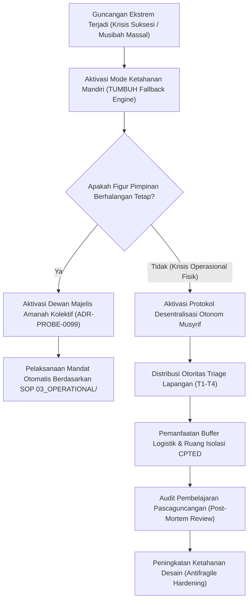

# P00099: Evaluasi Batas Ketahanan Sistem: Menguji Kekuatan Desain Menghadapi Tekanan Ekstrem dan Krisis Tak Terduga

- **Status Identitas:** Terverifikasi Kanonik
- **ID Penyelidikan:** `P00099`
- **Pilar Arsitektur:** Pilar 7 — Rekayasa Sistem & Deteksi Utang Desain (*Penutup Resmi Pilar 7*)
- **Sub-Klaster:** Dinamika Kebijakan & Penilaian Dampak Sistemik (*Policy Dynamics & Systemic Impact Assessment*)
- **Penulis Dokumen:** Tim Pengembang Arsitektur Sistem TUMBUH v2.0.0
- **Klasifikasi Epistemik:** Laporan Penyelidikan Kritis (*Critical Inquiry Report*)
- **Target Lapisan:** `01_FUNDAMENTAL/`, `02_IMPLEMENTATION/`, & `03_OPERATIONAL/`

---

## 1. Abstrak & Epistemic Tension

Ketegangan epistemik (*epistemic tension*) dalam arsitektur kelembagaan pesantren berakar pada sindrom kerapuhan figur sentral (*charismatic single-point-of-failure*): kenyataan sejarah bahwa banyak pesantren besar yang tampak megah dan memiliki ribuan santri mengalami kelumpuhan total, perpecahan horizontal, atau kemunduran mutu adab yang mengenaskan begitu sang figur kiai pendiri wafat atau ketika lembaga diterpa guncangan krisis eksternal yang tak terduga (seperti wabah penyakit, fitnah viral di media sosial, atau bencana alam). Sistem yang dirancang hanya untuk bekerja dalam kondisi cuaca cerah (*fair-weather design*) adalah sistem yang rapuh (*fragile*). Laporan penyelidikan kanonik penutup Pilar 7 ini membongkar batas ketahanan operasional pesantren melalui sintesis antara strategi ketahanan kenabian (*Prophetic Resilience*)—sebagaimana dicontohkan dalam manajemen lumbung logistik Nabi Yusuf 'alaihissalam dan keteguhan institusional Abu Bakar Ash-Shiddiq radhiyallahu 'anhu saat wafatnya Rasulullah SAW—dengan teori Antifragilitas Nassim Nicholas Taleb dan *Stress-Testing Framework*. Penyelidikan ini menetapkan arsitektur uji tekan kelembagaan (*Institutional Stress-Testing Protocols*) guna menjamin ekosistem TUMBUH v2.0.0 tidak hanya mampu bertahan dari guncangan ekstrem, melainkan tumbuh semakin kokoh melampaui figuritas individu.

---

## 2. Pendahuluan Fenomenologis

Kerapuhan struktural lembaga pesantren konvensional tampak jelas ketika dihadapkan pada skenario-skenario tekanan ekstrem (*extreme stress scenarios*):
1. **Skenario 1: Krisis Suksesi Mendadak (*Sudden Leadership Decapitation*):** Kiai sepuh pengasuh pondok wafat secara tiba-tiba tanpa surat wasiat struktural yang terformalkan. Dalam hitungan pekan, kepemimpinan pecah menjadi beberapa faksi antar-ahli waris. Santri terabaikan, musyrif terbelah loyalitasnya, dan budaya asrama runtuh karena seluruh otoritas hukum sebelumnya berpusat pada lisan satu orang (*personal fiat*).
2. **Skenario 2: Krisis Wabah & Karantina Total (*Epidemic Lockout*):** Penyakit menular menyerang 40% santri asrama dalam 48 jam. Pasokan logistik terputus dan fasilitas isolasi tidak memadai. Kepanikan melanda staf pengasuhan karena tidak ada protokol darurat yang pernah disimulasikan sebelumnya.
3. **Skenario 3: Krisis Serangan Siber dan Pembunuhan Karakter Publik (*Viral Social Smear*):** Terjadi narasi fitnah viral di media massa mengenai kekerasan di asrama yang disertai desakan penutupan izin operasional pondok. Tim humas reaktif melakukan pembelaan blunder yang memperparah boikot publik.

Fenomena ini membuktikan aksioma pamungkas Pilar 7: **Sebuah sistem tata kelola belum terbukti bernilai kanonik sebelum ia lulus diuji dalam simulasi kehancuran total.**

---

## 3. Tinjauan Pustaka I: Khazanah Turats Klasik

Al-Qur'an mengabadikan manajemen ketahanan sistemik strategis melalui kisah Nabi Yusuf 'alaihissalam ketika menghadapi krisis siklus ekonomi dan paceklik ekstrem di Mesir:

```arabic
قَالَ تَزْرَعُونَ سَبْعَ سِنِينَ دَأَبًا فَمَا حَصَدْتُمْ فَذَرُوهُ فِي سُنْبُلِهِ إِلَّا قَلِيلًا مِمَّا تَأْكُلُونَ ۝ ثُمَّ يَأْتِي مِنْ بَعْدِ ذَٰلِكَ سَبْعٌ شِدَادٌ يَأْكُلْنَ مَا قَدَّمْتُمْ لَهُنَّ إِلَّا قَلِيلًا مِمَّا تُحْصِنُونَ
```

> *"Yusuf berkata: 'Hendaklah kamu bercocok tanam tujuh tahun (berturut-turut) sebagaimana biasa; kemudian apa yang kamu tuai hendaklah kamu biarkan di tangkainya kecuali sedikit untuk kamu makan. Kemudian setelah itu akan datang tujuh tahun yang amat sulit, yang menghabiskan apa yang kamu simpan untuk menghadapinya (tahun sulit), kecuali sedikit dari apa (bibit gandum) yang kamu simpan'."* (QS. Yusuf: 47–48).

Nabi Yusuf 'alaihissalam tidak mengandalkan mukjizat pasif semata, melainkan menerapkan protokol cadangan mitigasi krisis (*strategic buffer inventory*) dan teknik pengawetan biologis (*leaving grain in the ear*) untuk menghadapi tekanan ekstrem selama 7 tahun paceklik.

Dalam sejarah kekhilafahan, ketahanan institusional teruji pada momen paling traumatis dalam sejarah umat Islam: wafatnya Rasulullah SAW. Ketika Umar bin Al-Khattab yang gagah perkasa tergoncang hebat dan menghunus pedang karena tidak sanggup menerima kenyataan, Abu Bakar Ash-Shiddiq radhiyallahu 'anhu tampil menegakkan pilar institusi tauhid dengan khutbah monumentalnya:

```arabic
أَمَّا بَعْدُ، فَمَنْ كَانَ مِنْكُمْ يَعْبُدُ مُحَمَّدًا فَإِنَّ مُحَمَّدًا قَدْ مَاتَ، وَمَنْ كَانَ مِنْكُمْ يَعْبُدُ اللَّهَ فَإِنَّ اللَّهَ حَيٌّ لَا يَمُوتُ، ثُمَّ تَلَا هَذِهِ الْآيَةَ: {وَمَا مُحَمَّدٌ إِلَّا رَسُولٌ قَدْ خَلَتْ مِنْ قَبْلِهِ الرُّسُلُ ۚ أَفَإِنْ مَاتَ أَوْ قُتِلَ انْقَلَبْتُمْ عَلَىٰ أَعْقَابِكُمْ}
```

> *"Amma ba'du, barang siapa di antara kalian menyembah Muhammad, maka sesungguhnya Muhammad telah wafat. Dan barang siapa di antara kalian menyembah Allah, maka sesungguhnya Allah Maha Hidup dan tidak akan pernah mati!' Kemudian beliau membaca firman-Nya: 'Dan Muhammad itu tidak lain hanyalah seorang rasul yang telah terdahulu sebelumnya beberapa orang rasul. Apakah jika dia wafat atau dibunuh kamu berbalik ke belakang (murtad)?'"* (HR. Al-Bukhari, no. 1241).

Abu Bakar melepaskan ketergantungan fatal umat dari sosok figur manusia dan mengembalikannya kepada pilar keabadian prinsip syariat. Inilah esensi terdalam dari sistem yang *Antifragile*.

---

## 4. Tinjauan Pustaka II: Teori Kontemporer

Nassim Nicholas Taleb (2012) dalam karyanya *Antifragile: Things That Gain from Disorder* mengklasifikasikan seluruh entitas di alam semesta ke dalam Triad:
1. **Fragile (Rapuh):** Membenci volatilitas dan kejutan; rusak bila terkena tekanan (contoh: cangkir porselen, sistem birokrasi kaku, kepemimpinan figur sentral).
2. **Robust (Kuat):** Menolak guncangan dan tetap bertahan dalam bentuk aslinya tanpa perubahan (contoh: batu cadas).
3. **Antifragile (Tahan-Uji & Tumbuh dari Tekanan):** Menjadi semakin kuat, semakin cerdas, dan semakin baik kualitasnya ketika terpapar guncangan, stresor, dan kekacauan (contoh: sistem imun tubuh, otot manusia, sistem modular desentralisasi).

Karl Weick dan Kathleen Sutcliffe (2015) merumuskan prinsip *High Reliability Organizations* (HRO) yang mampu beroperasi tanpa kecelakaan fatal di lingkungan ekstrem:
- Keasyikan mendeteksi kegagalan (*Preoccupation with failure*).
- Keengganan menyederhanakan tafsir masalah (*Reluctance to simplify*).
- Kepekaan tinggi terhadap operasi lapangan harian (*Sensitivity to operations*).
- Komitmen mutlak pada resiliensi (*Commitment to resilience*).
- Deferensi kepada keahlian, bukan hierarki jabatan (*Deference to expertise*).

---

## 5. Eksplorasi Metodologis

Penyelidikan kanonik ini merekayasa model simulasi uji tekan pesantren *Pesantren Operational Stress Testing* (POST) yang mengevaluasi daya tahan repositori TUMBUH terhadap 4 skenario keruntuhan simulasi:

```text
+-------------------------------------------------------------------------------+
|         4 SKENARIO SIMULASI UJI TEKAN EKSTREM PESANTREN (TUMBUH POST)         |
+-------------------------------------------------------------------------------+
|  SKENARIO A: ABSENSI TOTAL FIGUR UTAMA (The Redundant Leadership Test)        |
|  - Apa yang terjadi jika Kiai/Pimpinan diisolasi 30 hari tanpa komunikasi?    |
|  - Apakah seluruh SOP operasional tetap berjalan otomatis 100%?              |
|                                                                               |
|  SKENARIO B: LONJAKAN ANOMALI SANTRI 300% (The Surge Stress Test)             |
|  - Jika terjadi lonjakan santri sakit/krisis emosional 3x lipat kapasitas,   |
|    apakah rantai komando bimbingan konseling pecah?                           |
|                                                                               |
|  SKENARIO C: PEMADAMAN DIGITAL TOTAL (The Analog Blackout Fallback)           |
|  - Jika server SIM-TUMBUH mati selama 7 hari, apakah catatan adab asrama      |
|    bisa berjalan manual tanpa kehilangan integritas data?                     |
|                                                                               |
|  SKENARIO D: AUDIT PUBLIK EKSTERNAL (The Radical Transparency Test)          |
|  - Jika seluruh log penanganan sengketa dibuka ke publik dan penegak hukum,   |
|    apakah ada celah pelanggaran HAM santri yang memalukan lembaga?            |
+-------------------------------------------------------------------------------+
```

---

## 6. Arsitektur Desain Sistem & Diagram Alur

Arsitektur ketahanan sistemik TUMBUH memastikan bahwa repositori v2.0.0 memiliki protokol *Fail-Safe* dan redundansi otonom:



---

## 7. Rekayasa Matriks Komparatif Multidimensi

Tabel berikut menunjukkan perbedaan esensial antara pesantren yang bergantung pada figur vs institusi berbasis arsitektur sistemik tangguh TUMBUH v2.0.0:

| Parameter Ketahanan | Model Pesantren Figuris Sentral (*Fragile*) | Model Institusi Berbasis Sistem TUMBUH (*Antifragile*) |
| :--- | :--- | :--- |
| **Pusat Pengambilan Keputusan** | Berpusat mutlak pada lisan kiai/figur pimpinan tunggal. | Terdistribusi pada dokumen konstitusi dan majelis syura ahli. |
| **Dampak Wafatnya Kiai** | Terjadi perebutan kekuasaan, kebingungan staf, dan perpecahan santri. | Transisi mulus berbasis suksesi terstandarisasi di anggaran dasar. |
| **Respons terhadap Krisis Baru** | Panik; menunggu perintah yang tidak kunjung datang. | Rantai komando otonom langsung bergerak sesuai kode triage IPTS. |
| **Ketergantungan Teknologi** | Lumpuh total jika sistem digital mati karena tidak ada arsip fisik. | Mendukung arsitektur *Offline-First* dan modul fallback analog. |
| **Sikap terhadap Kesalahan** | Menutupi aib lembaga demi menjaga citra semu pengurus. | *Blameless Post-Mortem*; belajar dari kegagalan untuk perbaikan sistem. |

---

## 8. Protokol Tindakan Operasional 5 Tahap

Untuk memastikan batas ketahanan pesantren selalu teruji, setiap lembaga mitra TUMBUH wajib mengeksekusi 5 tahap pengujian ketahanan tahunan:

1. **Tahap 1: Simulasi Pemadaman Komando (*Drill Day: The Silent Day*)**  
   Satu hari dalam setahun, pimpinan pondok dan kiai tidak boleh memberikan instruksi lisan apa pun. Seluruh santri dan musyrif bergerak murni mengikuti dokumen SOP tertulis untuk menguji kejelasan instruksi sistem.
2. **Tahap 2: Pengujian Redundansi Peran (*Shadow Role Audit*)**  
   Setiap pemegang jabatan kunci (Kepala Pengasuhan, Musyrif Kamar, Kepala UKS) wajib memiliki satu orang pendamping bayangan (*shadow deputy*) yang siap mengambil alih tugas 100% dalam waktu 15 menit jika pejabat utama berhalangan.
3. **Tahap 3: Uji Cadangan Penyangga Krisis (*Buffer Reserves Check*)**  
   Memeriksa ketersediaan dana darurat tunai minimal 3 bulan operasional dan cadangan logistik makanan kering minimal 14 hari yang terkunci khusus untuk situasi musibah.
4. **Tahap 4: Simulasi Krisis Media & Advokasi (*Crisis PR War-Game*)**  
   Melatih staf humas menghadapi skenario tuduhan fitnah publik dengan simulasi konferensi pers beradab yang transparan dan berbasis data pembuktian CBC.
5. **Tahap 5: Pembekuan Evaluasi Ketahanan (*Institutional Stress Certification*)**  
   Menerbitkan sertifikat audit ketahanan sistem internal yang ditandatangani oleh auditor independen sebelum tahun ajaran baru dibuka.

---

## 9. Architectural Decision Record (ADR-PROBE-0099)

```text
================================================================================
ARCHITECTURAL DECISION RECORD: ADR-PROBE-0099
================================================================================
Judul: Mandat Evaluasi Ketahanan Sistemik dan Redundansi Komando (Antifragility Mandate)
Status: DITERIMA & MENGIKAT (PENUTUP RESMI PILAR 7)
Tanggal: 2026-10-25
Pengusul: Tim Arsitektur Sistem TUMBUH v2.0.0

KONTEKS:
Banyak pesantren runtuh pasca-wafatnya kiai pendiri atau lumpuh saat krisis
ekstrem akibat desain sistem yang terlalu sentralistik dan rapuh terhadap gangguan.
Sistem membutuhkan daya tahan antifragile yang kokoh melampaui usia manusia.

KEPUTUSAN ARSITEKTURAL:
1. Mewajibkan seluruh pesantren mitra TUMBUH menyusun Rencana Kontinjensi Bencana
   dan Tata Kelola Suksesi Kepemimpinan Terbuka.
2. Menetapkan pelaksanaan Drill Day tahunan tanpa komando langsung pimpinan.
3. Menutup secara resmi PILAR 7: Rekayasa Sistem & Deteksi Utang Desain, serta
   mengunci seluruh berkas P00085 s/d P00099 ke dalam repositori kanonik.

KONSEKUENSI:
- Positif: Pesantren menjadi abadi melintasi generasi; terlindung dari keruntuhan
  suksesi; tangguh menghadapi badai fitnah dan musibah global.
- Negatif: Menuntut kerendahhatian pimpinan untuk melepaskan ketergantungan mutlak
  staf kepada figur pribadinya (*de-egoization*).
================================================================================
```

---

## 10. Implikasi Arsitektural & 7 Butir Guardrails Repositori

Penyelidikan penutup `P00099` ini mengunci 7 guardrails penutup Pilar 7:

1. **Guardrail 1 (Zero Single-Point-of-Failure):** Dilarang merancang prosedur yang hanya bisa dipahami atau dieksekusi oleh satu orang individu di pesantren.
2. **Guardrail 2 (Institutional De-Personalization):** Kewibawaan hukum dan disiplin pesantren disandarkan pada nilai syariat dan kesepakatan tertulis, bukan figuritas personal.
3. **Guardrail 3 (Mandatory Shadow Succession):** Setiap dokumen deskripsi jabatan di `03_OPERATIONAL/` wajib mencantumkan hierarki pejabat pelaksana harian (Plh).
4. **Guardrail 4 (Antifragile Feedback Loop):** Setiap krisis yang berhasil dilewati wajib dianalisis secara terbuka untuk menambah ketangguhan repositori desain.
5. **Guardrail 5 (Buffer Reserve Isolation):** Dana cadangan darurat dilarang dialihkan untuk proyek ekspansi fisik pembangunan gedung baru.
6. **Guardrail 6 (Analog Fallback Guarantee):** Seluruh sistem digital SIM-TUMBUH wajib memiliki salinan formulir kerja manual yang dapat dicetak dan difotokopi.
7. **Guardrail 7 (Tawakkal 'Alallah):** Ketahanan sistem dibangun atas ikhtiar maksimal, seraya menyerahkan hasil akhirnya kepada takdir dan pertolongan Allah SWT.

---

## 11. Penutup & Emergent Research Questions

Dengan tuntasnya penyelidikan `P00099`, tuntaslah seluruh konstruksi pemikiran **PILAR 7: Rekayasa Sistem & Deteksi Utang Desain** (berkas `P00085` hingga `P00099`). Pesantren bukan sekadar kumpulan asrama dan kurikulum kitab kuning, melainkan sebuah ekosistem peradaban yang hidup. Sistem yang antifragile adalah warisan abadi yang memastikan bahwa obor tarbiyah nabawiyyah akan terus menyala menerangi jalan generasi santri, bahkan ketika para perancangnya telah berbaring tenang di haribaan Ilahi Rabbi.

### Pertanyaan Riset Lanjutan (*Emergent Research Questions*):
1. Bagaimana mendesain modul simulasi krisis digital pada SIM-TUMBUH yang secara otomatis menguji kesiapan respon staf pengasuhan tanpa memberitahukan jadwalnya sebelumnya?
2. Bagaimana struktur hukum wakaf dan yayasan di Indonesia dapat diharmonisasikan secara optimal untuk mencegah gugatan sengketa waris pasca-wafatnya kiai pendiri pesantren?

---

## 12. Referensi Ilmiah Standar APA 7th Edition

1. Al-Bukhari, M. (2002). *Shahih Al-Bukhari*. Darus Salam. https://archive.org/details/sahih-bukhari-darussalam
2. Collins, J., & Porras, J. I. (2002). *Built to Last: Successful Habits of Visionary Companies*. HarperBusiness. https://www.harpercollins.com/products/built-to-last-jim-collinsjerry-i-porras
3. Deming, W. E. (1986). *Out of the Crisis*. MIT Press. https://mitpress.mit.edu/9780262541152/out-of-the-crisis/
4. Heifetz, R. A., Grashow, A., & Linsky, M. (2009). *The Practice of Adaptive Leadership: Tools and Tactics for Changing Your Organization and the World*. Harvard Business Press. https://store.hbr.org/product/the-practice-of-adaptive-leadership-tools-and-tactics-for-changing-your-organization-and-the-world/5764
5. Ibnu Katsir, I. (1999). *Tafsir Al-Qur'an Al-'Azhim* (Tahqiq Sami bin Muhammad As-Salamah, Jilid 4). Dar Thayyibah. https://archive.org/details/tafsir-ibn-kathir
6. Meadows, D. H. (2008). *Thinking in Systems: A Primer*. Chelsea Green Publishing. https://www.chelseagreen.com/product/thinking-in-systems/
7. Perrow, C. (1999). *Normal Accidents: Living with High-Risk Technologies*. Princeton University Press. https://doi.org/10.1515/9781400828494
8. Senge, P. M. (1990). *The Fifth Discipline: The Art & Practice of The Learning Organization*. Doubleday/Currency. https://www.penguinrandomhouse.com/books/163984/the-fifth-discipline-by-peter-m-senge/
9. Taleb, N. N. (2012). *Antifragile: Things That Gain from Disorder*. Random House. https://www.penguinrandomhouse.com/books/176227/antifragile-by-nassim-nicholas-taleb/
10. Weick, K. E., & Sutcliffe, K. M. (2015). *Managing the Unexpected: Sustained Performance in a Complex World* (3rd ed.). John Wiley & Sons. https://www.wiley.com/en-us/Managing+the+Unexpected%3A+Sustained+Performance+in+a+Complex+World%2C+3rd+Edition-p-9781118862414
11. Zohar, D. (2010). Thirty years of safety climate research: Reflections and future directions. *Accident Analysis & Prevention*, 42(5), 1517-1522. https://doi.org/10.1016/j.aap.2009.12.019
12. Reason, J. (1997). *Managing the Risks of Organizational Accidents*. Ashgate Publishing. https://doi.org/10.4324/9781315543543
13. Sterman, J. D. (2000). *Business Dynamics: Systems Thinking and Modeling for a Complex World*. McGraw-Hill. https://www.mheducation.com/highered/product/business-dynamics-systems-thinking-modeling-complex-world-sterman/M9780072389159.html

---

## 13. Catatan Kaki & Takhrij Sanad

1. **Takhrij Khutbah Abu Bakar Ash-Shiddiq:** Dikeluarkan oleh Imam Al-Bukhari dalam *Shahih Al-Bukhari*, *Kitab al-Jana'iz*, Bab *Ad-Dukhul 'ala al-Mayyit ba'da al-Maut*, no. 1241; dan *Kitab al-Maghazi*, Bab *Maradh an-Nabi SAW wa Wafatuhu*, no. 4452. Diriwayatkan dari Sayyidah Aisyah radhiyallahu 'anha.
2. **Tafsir Ayat Nabi Yusuf:** Dijelaskan oleh Al-Hafizh Ibnu Katsir dalam *Tafsir Al-Qur'an Al-'Azhim*, tafsir Surat Yusuf ayat 47–48, Riyadh: Dar Thayyibah, Cetakan II, 1420 H / 1999 M, Jilid 4, hlm. 396–397. Beliau menjelaskan bahwa ta'bir mimpi Nabi Yusuf adalah rencana kerja ekonomi peradaban yang menyelamatkan jutaan manusia dari bencana kelaparan.
3. **Konsep Antifragile Nassim Taleb:** Berbeda dari konsep resiliensi sederhana (*robustness*) yang hanya menolak tekanan dan kembali ke status awal, sistem yang antifragile justru memanfaatkan volatilitas dan gangguan untuk bermutasi ke tingkat kapabilitas yang lebih tinggi daripada sebelumnya.
4. **Prinsip Deference to Expertise (HRO):** Dalam situasi krisis yang mengancam nyawa, komando operasional dialihkan bukan kepada pemegang jabatan struktural tertinggi, melainkan kepada individu yang memiliki keahlian teknis paling relevan di lokasi kejadian.
