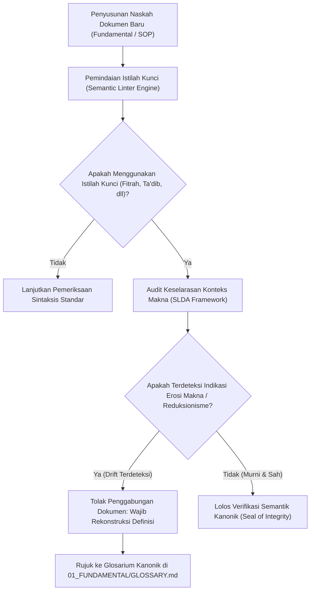

# P00100: Pengendalian Erosi Makna (*Semantic Drift*): Menjaga Kesucian Makna Istilah Tarbiyah dari Degradasi Zaman

- **Status Identitas:** Terverifikasi Kanonik
- **ID Penyelidikan:** `P00100`
- **Pilar Arsitektur:** Pilar 8 — Integritas Semantik, Verifikasi Sitasi, & Kematangan (AMI) (*Pembuka Resmi Pilar 8*)
- **Sub-Klaster:** Semantik Islam & Pewarisan Nalar Tarbiyah (*Islamic Semantics & Lineage Transmission*)
- **Penulis Dokumen:** Tim Pengembang Arsitektur Sistem TUMBUH v2.0.0
- **Klasifikasi Epistemik:** Laporan Penyelidikan Kritis (*Critical Inquiry Report*)
- **Target Lapisan:** `01_FUNDAMENTAL/` & `02_IMPLEMENTATION/`

---

## 1. Abstrak & Epistemic Tension

Ketegangan epistemik (*epistemic tension*) dalam keilmuan pendidikan Islam bermula ketika kata-kata luhur (*al-alfazh asy-syar'iyyah*) mengalami pembusukan semantik (*semantic drift*): proses degradasi di mana istilah-istilah wahyu dan peradaban yang sarat dengan kedalaman spiritual dan muatan etis—seperti *Fitrah, Ta'dib, Qudwah, dan Adab*—perlahan-lahan tercabut dari akar maknanya (*al-ashl al-lughawi wa asy-syar'i*) dan direduksi menjadi jargon birokratis kosong atau bahkan dibajak untuk melegitimasi praktik-praktik kekerasan militeristik di lapangan pesantren. Fenomena pendangkalan bahasa ini bukan sekadar masalah linguistik teoritis, melainkan merupakan korupsi epistemik yang secara langsung merusak pembentukan jiwa santri. Penyelidikan kanonik pembuka Pilar 8 ini menyandingkan pemikiran Syed Muhammad Naquib Al-Attas mengenai Islamisasi bahasa dan konsep *Fasad al-Lughah* dengan teori semantik historis dan sosiolinguistik modern. Penyelidikan ini menetapkan arsitektur pengendalian erosi makna (*Semantic Safeguarding Engine*) guna membentengi seluruh leksikon repositori TUMBUH v2.0.0 dari kontaminasi reduksionisme sekuler dan totalitarianisme pengasuhan.

---

## 2. Pendahuluan Fenomenologis

Di banyak pesantren di Indonesia, kita menyaksikan tragedi pergeseran makna istilah tarbiyah yang sangat memilukan dalam praktik operasional harian:
1. **Reduksi Istilah *Ta'dib* Menjadi Pemukulan Fisik:** Istilah agung *Ta'dib* (yang secara hakiki bermakna penanaman adab dan pengenalan tempat yang tepat bagi segala sesuatu dalam wujud) kerap kali digunakan oleh musyrif lapangan sebagai eufemisme untuk tindakan kekerasan: *"Santri ini sedang kami ta'dib di kamar belakang"*—yang faktanya berarti santri tersebut sedang dipukul dengan rotan, dijemur di terik matahari, atau ditampar.
2. **Reduksi Istilah *Adab* Menjadi Kepatuhan Feodal Buta:** Konsep *Adab* yang mengajarkan keadilan internal, kelembutan akhlak, dan kemerdekaan berpikir kritis dalam koridor syariat, di lapangan dipangkas menjadi sekadar tradisi sungkem tunduk, tidak boleh menatap mata guru, dan kepatuhan mutlak tanpa nalar (*perinde ac cadaver* / bagaikan mayat di hadapan pemandi jenazah).
3. **Reduksi Istilah *Fitrah* Menjadi Kelemahan Moral yang Harus Diberangus:** *Fitrah* santri yang suci, dinamis, dan memiliki potensi kecerdasan fitri, dianggap sebagai wadah kotor yang harus "ditundukkan" melalui metode latihan fisik bergaya militer (*bootcamp shock therapy*).
4. **Reduksi Istilah *Qudwah* Menjadi Pencitraan Permukaan:** *Qudwah Hasanah* (keteladanan kenabian) tereduksi menjadi sekadar formalitas mengenakan sorban rapi dan bertutur kata halus di depan forum umum, seraya mengabaikan integritas perilaku di balik pintu kamar pribadi asrama.

Ketika bahasa telah rusak, pikiran masyarakat ikut rusak; dan ketika pikiran telah rusak, tindakan kezaliman niscaya dianggap sebagai ibadah. Fenomena ini membuktikan aksioma pembuka Pilar 8: **Erosi bahasa adalah gerbang utama menuju keruntuhan peradaban tarbiyah.**

---

## 3. Tinjauan Pustaka I: Khazanah Turats Klasik

Para ulama Islam klasik sangat mewaspadai bahaya pergeseran makna lafazh syar'i. Al-Qur'an secara keras mengecam tindakan mengubah kata-kata dari tempat dan konteks semestinya (*Tahrif al-Kalim 'an Mawadhi'ih*):

```arabic
مِنَ الَّذِينَ هَادُوا يُحَرِّفُونَ الْكَلِمَ عَنْ مَوَاضِعِهِ وَيَقُولُونَ سَمِعْنَا وَعَصَيْنَا وَاسْمَعْ غَيْرَ مُسْمَعٍ وَرَاعِنَا لَيًّا بِأَلْسِنَتِهِمْ وَطَعْنًا فِي الدِّينِ
```

> *"Di antara orang-orang Yahudi, ada yang mengubah perkataan dari tempat-tempatnya. Mereka berkata: 'Kami mendengar, tetapi kami membangkang'; dan (mereka mengatakan pula): 'Dengarlah' sedang engkau sebenarnya tidak mendengar apa-apa; dan (mereka mengatakan): 'Raa'ina' dengan memutarbalikkan lidahnya dan mencela agama'."* (QS. An-Nisa: 46).

Imam Abu Hamid Al-Ghazali dalam *Ihya' 'Ulum ad-Din* mendedikasikan satu bab khusus mengenai "Kata-kata yang Telah Diubah Maknanya" (*Bayan Ma Bubbila min Alfazh al-'Ulum*), di mana beliau mengkritik bagaimana lima istilah luhur—*Al-Fiqh, Al-'Ilm, At-Tawhid, At-Tadzkir,* dan *Al-Hikmah*—telah direduksi maknanya oleh ulama dunia menjadi sekadar alat perdebatan hukum dan retorika politik:

```arabic
إِنَّ هَذِهِ الْأَلْفَاظَ خَمْسَةٌ قَدْ كَانَتْ فِي الْعَصْرِ الْأَوَّلِ مَخْصُوصَةً بِمَعَانٍ شَرِيفَةٍ، فَنَقَلَهَا النَّاسُ إِلَى مَعَانٍ دُونَ تِلْكَ، وَاشْتَغَلُوا بِهَا وَتَرَكُوا الْمَعَانِيَ الْأَصْلِيَّةَ... فَمِنْهَا لَفْظُ الْفِقْهِ، فَقَدْ تَصَرَّفُوا فِيهِ بِالتَّخْصِيصِ لَا بِالنَّقْلِ، حَتَّى خَصَّصُوهُ بِمَعْرِفَةِ الْفُرُوعِ الدَّقِيقَةِ فِي الْفَتَاوَى وَالْخُصُومَاتِ، مَعَ أَنَّهُ فِي الْعَصْرِ الْأَوَّلِ كَانَ اسْمًا لِطَرِيقِ الْآخِرَةِ وَمَعْرِفَةِ دَقَائِقِ آفَاتِ النُّفُوسِ.
```

> *"Sesungguhnya kelima lafazh ini pada generasi awal Islam dikhususkan untuk makna-makna yang sangat mulia. Lalu manusia memindahkannya kepada makna-makna yang jauh lebih rendah daripada makna aslinya, lalu mereka sibuk dengan makna yang rendah itu dan meninggalkan makna yang hakiki... Di antaranya adalah lafazh Al-Fiqh; mereka telah menyempitkannya menjadi sekadar pengetahuan tentang cabang-cabang hukum fatwa yang rumit dan persengketaan perkara, padahal pada masa generasi awal, Al-Fiqh adalah sebutan bagi pengetahuan tentang jalan menuju akhirat dan kepekaan menangkap penyakit-penyakit jiwa yang tersembunyi."* (Al-Ghazali, *Ihya' 'Ulum ad-Din*, Jilid 1, hlm. 32).

Peringatan Al-Ghazali ini menegaskan bahwa tugas utama mujaddid tarbiyah adalah memulihkan kesucian leksikon Islam ke martabat aslinya.

---

## 4. Tinjauan Pustaka II: Teori Kontemporer

Profesor Syed Muhammad Naquib Al-Attas (1980, 1993) merumuskan teori *Corruption of Knowledge* yang diawali oleh *Corruption of Language* (Korupsi Bahasa). Al-Attas menegaskan bahwa ketika istilah-istilah kunci dalam pandangan alam Islam (*Islamic Worldview*) diterjemahkan secara serampangan atau diisi dengan makna-makna sekuler, maka nalar kaum muslimin akan mengalami kekacauan kognitif (*epistemic chaos*), yang pada akhirnya melahirkan hilangnya adab (*loss of adab*) di tengah masyarakat:
> *"The corruption of knowledge involves the corruption of language, which in turn leads to the corruption of the Muslim mind and the loss of adab."*

Dalam filsafat analitik Barat, Ludwig Wittgenstein (1953) dalam *Philosophical Investigations* menyatakan bahwa *"makna suatu kata adalah penggunaannya dalam tata permainan bahasa (language-game)"*. Jika tata permainan bahasa di asrama dipenuhi oleh kekerasan, maka kata *Ta'dib* niscaya diserap maknanya sebagai instrumen represi fisik.

George Orwell (1949) melalui konsep *Newspeak* dan *Doublethink* membuktikan bagaimana rezim otoriter memanipulasi kosakata untuk membatasi ruang pikir manusia: kata-kata damai digunakan untuk menutupi perang (*War is Peace*). Di pesantren, manipulasi terjadi ketika kata *Kasih Sayang Guru* digunakan untuk melegitimasi pemukulan santri.

---

## 5. Eksplorasi Metodologis

Penyelidikan kanonik ini merekayasa instrumen *Semantic Lineage & Drift Analysis* (SLDA) yang membedah setiap istilah kunci dalam sistem TUMBUH melalui 4 lapisan filologis:

```text
+-------------------------------------------------------------------------------+
|         4 LAPISAN AUDIT INTEGRITAS SEMANTIK TUMBUH (SLDA FRAMEWORK)           |
+-------------------------------------------------------------------------------+
|  LAPISAN 1: AKAR KATA & ISYTIQAQ ETIS (Al-Ashl al-Lughawi)                   |
|  - Apa makna dasar morfologis kata ini dalam kamus Mu'jam Mu'tabar?           |
|                                                                               |
|  LAPISAN 2: KONTEKS WAHYU & TAFSIR KANONIK (Al-Ma'na asy-Syar'i)              |
|  - Bagaimana Al-Qur'an dan As-Sunnah menggunakan kata ini secara konsisten?   |
|                                                                               |
|  LAPISAN 3: DETEKSI DRIFT HISTORIS & LOKAL (Distortion Tracking)             |
|  - Bagaimana kata ini mengalami pergeseran atau degradasi di pesantren lokal?|
|                                                                               |
|  LAPISAN 4: DEFINISI RESMI TERKUNCI TUMBUH (Canonical Locking)               |
|  - Batas tegas arti istilah di lapisan 01_FUNDAMENTAL/ yang dilarang diubah.  |
+-------------------------------------------------------------------------------+
```

---

## 6. Arsitektur Desain Sistem & Diagram Alur

Arsitektur pencegahan erosi makna TUMBUH mengintegrasikan mesin pemeriksa semantik (*Semantic Linter*) pada repositori v2.0.0:



---

## 7. Rekayasa Matriks Komparatif Multidimensi

Tabel berikut menunjukkan pemulihan radikal istilah-istilah kunci tarbiyah dari pergeseran maknanya di lapangan menuju definisi kanonik TUMBUH v2.0.0:

| Istilah Kunci | Makna Terdegradasi di Lapangan (*Drifted*) | Bahaya Praktik Lapangan | Definisi Kanonik Terkunci TUMBUH v2.0.0 |
| :--- | :--- | :--- | :--- |
| **Ta'dib (تَأْدِيب)** | Pemukulan fisik, pendisiplinan represif, dan penghakiman santri. | Melegitimasi kekerasan dan kekejaman atas nama agama. | Proses penanaman adab dan disiplin spiritual-intelektual-moral secara hikmah dan adil. |
| **Fitrah (فِطْرَة)** | Sifat lugu kekanak-kanakan atau keliaran yang harus dibasmi. | Represi kepribadian santri; pembungkaman potensi akal. | Potensi bawaan suci manusia yang cenderung kepada tauhid, kebaikan, dan kebenaran hakiki. |
| **Qudwah (قُدْوَة)** | Pencitraan fisik ustadz di depan umum; formalitas jabatan. | Hipokrisi sistemik; santri kehilangan figur teladan sejati. | Integritas moral-spiritual pendidik yang selaras antara lahir dan batin, pribadi dan publik. |
| **Ta'zir (تَعْزِير)** | Hukuman balas dendam yang merendahkan martabat (cukur gundul, kalung sampah). | Menghancurkan harga diri santri; menciptakan dendam moral. | Konsekuensi edukatif terukur yang berorientasi pada pemulihan (*restitusi*) dan penyadaran jiwa. |
| **Tawadhu' (تَوَاضُع)** | Ketakutan berbicara di depan guru; rasa rendah diri (*inferiority*). | Santri menjadi pasif, tidak mandiri, dan tidak mampu berpikir kritis. | Kerendahan hati di hadapan kebenaran tanpa mengorbankan keberanian menyatakan hak. |

---

## 8. Protokol Tindakan Operasional 5 Tahap

Untuk mengunci keutuhan semantik di seluruh jaringan pesantren mitra, pengembang sistem wajib menjalankan 5 tahap operasional:

1. **Tahap 1: Pembekuan Glosarium Kanonik (*Canonical Glossary Freezing*)**  
   Menyusun dan mengunci dokumen `01_FUNDAMENTAL/GLOSSARY.md` yang memuat definisi otoritatif, akar kata bahasa Arab, dalil syar'i, dan batasan operasional bagi setiap istilah kunci.
2. **Tahap 2: Audit Istilah dalam Dokumen Pelatihan Musyrif (*Training Corpus Audit*)**  
   Menyaring seluruh buku saku, slide presentasi, dan lembar kerja musyrif untuk memastikan tidak ada istilah *Ta'dib* yang diasosiasikan dengan tindakan fisik kasar.
3. **Tahap 3: Pemurnian Bahasa Verbal Harian (*Verbal Hygiene Protocol*)**  
   Melarang staf pengasuhan menggunakan eufemisme kekerasan saat berkomunikasi dengan santri (misal: dilarang menyebut "ruang pemukulan" sebagai "ruang ta'dib").
4. **Tahap 4: Sosialisasi Semantik ke Komunitas Santri (*Student Semantic Literacy*)**  
   Mengajarkan makna hakiki adab dan fitrah kepada santri agar mereka memiliki kesadaran kritis terhadap hak dan kemuliaan diri mereka sebagai pencari ilmu.
5. **Tahap 5: Audit Berkala Integritas Istilah (*Biannual Semantic Linter Review*)**  
   Tim epistemologi memeriksa konsistensi penggunaan istilah di seluruh lapisan repositori setiap 6 bulan sekali.

---

## 9. Architectural Decision Record (ADR-PROBE-00100)

```text
================================================================================
ARCHITECTURAL DECISION RECORD: ADR-PROBE-00100
================================================================================
Judul: Penegakan Kedaulatan Semantik dan Pengendalian Erosi Makna Tarbiyah
Status: DITERIMA & MENGIKAT (PEMBUKA RESMI PILAR 8)
Tanggal: 2026-10-25
Pengusul: Tim Arsitektur Sistem TUMBUH v2.0.0

KONTEKS:
Pergeseran makna istilah-istilah suci pendidikan Islam (seperti Ta'dib dan Adab)
di lapangan pesantren telah digunakan secara keliru untuk melegitimasi praktik
kekerasan fisik dan kepatuhan buta feodalistik yang merusak fitrah santri.

KEPUTUSAN ARSITEKTURAL:
1. Menetapkan bahwa definisi resmi istilah kunci dalam repositori TUMBUH v2.0.0
   mutlak mengacu pada batasan di 01_FUNDAMENTAL/GLOSSARY.md.
2. Mengharamkan penggunaan istilah Ta'dib untuk melabeli tindakan sanksi retributif,
   pemukulan fisik, atau hukuman yang mempermalukan santri di depan umum.
3. Membuka secara resmi PILAR 8: Integritas Semantik, Verifikasi Sitasi, & AMI.

KONSEKUENSI:
- Positif: Memurnikan kembali khazanah nalar pendidikan Islam; melindungi santri
  dari manipulasi bahasa; menjaga wibawa ilmiah dan spiritual repositori.
- Negatif: Memerlukan penyesuaian kebiasaan berbicara bagi pengasuh asrama lama.
================================================================================
```

---

## 10. Implikasi Arsitektural & 7 Butir Guardrails Repositori

Hasil inkuiri `P00100` mengikat tata kelola repositori TUMBUH melalui 7 guardrails:

1. **Guardrail 1 (Glossary Primacy):** Definisi kata dalam `02_IMPLEMENTATION/` dan `03_OPERATIONAL/` wajib tunduk pada glosarium kanonik `01_FUNDAMENTAL/`.
2. **Guardrail 2 (Anti-Orwellian Euphemism):** Dilarang membungkus tindakan kezaliman, pemukulan, dan intimidasi dengan jubah istilah-istilah agama yang mulia.
3. **Guardrail 3 (Arabic Root Integrity):** Setiap istilah serapan bahasa Arab wajib dapat dipertanggungjawabkan penurunannya dari akar kata mu'jam mu'tabar.
4. **Guardrail 4 (Clarity Over Jargon):** Dokumen operasional wajib menjelaskan makna tindakan secara lugas, bukan sekadar menggunakan istilah megah yang kabur.
5. **Guardrail 5 (Student Dignity in Language):** Bahasa yang digunakan untuk memanggil atau mencatat kondisi santri dilarang menggunakan sebutan yang mencoreng kehormatan fitrah.
6. **Guardrail 6 (Protection of Turats Concepts):** Konsep-konsep turats dilarang disekularisasi atau direduksi maknanya demi mencocok-cocokkan dengan tren psikologi populer.
7. **Guardrail 7 (Living Lineage Safeguard):** Menjaga sanad makna agar tersambung lurus kepada pemahaman para salafus shalih dan aimmah al-huda.

---

## 11. Penutup & Emergent Research Questions

Mengendalikan erosi makna adalah perang mempertahankan kedaulatan epistemik Islam. Kata-kata adalah bejana bagi hakikat. Jika bejananya retak dan tercemar, maka air kebenaran di dalamnya akan tumpah dan membusuk. Melalui penyelidikan pembuka Pilar 8 ini, TUMBUH v2.0.0 menegakkan kembali kesucian bahasa peradaban tarbiyah kenabian.

### Pertanyaan Riset Lanjutan (*Emergent Research Questions*):
1. Bagaimana mendesain modul ontologi semantik terkomputerisasi (Knowledge Graph) yang mampu memetakan relasi hierarkis antar-istilah adab dalam repositori TUMBUH?
2. Bagaimana strategi linguistik yang paling efektif untuk memulihkan pemahaman masyarakat wali santri agar tidak menyamakan ketegasan adab dengan kekerasan fisik?

---

## 12. Referensi Ilmiah Standar APA 7th Edition

1. Al-Attas, S. M. N. (1980). *The Concept of Education in Islam: A Framework for an Islamic Philosophy of Education*. International Institute of Islamic Thought and Civilization (ISTAC). https://archive.org/details/concept-of-education-alattas
2. Al-Attas, S. M. N. (1993). *Islam and Secularism*. International Institute of Islamic Thought and Civilization (ISTAC). https://archive.org/details/islam-and-secularism-al-attas
3. Al-Ghazali, A. H. (2011). *Ihya' 'Ulum ad-Din* (Jilid 1: Kitab al-'Ilm). Darul Minhaj. https://archive.org/details/ihya-ulum-al-din
4. Ibnu Manzhur, M. (1994). *Lisan al-'Arab* (Jilid 1). Dar Shadir. https://archive.org/details/lisan-al-arab-ibn-manzur
5. Orwell, G. (1949). *Nineteen Eighty-Four*. Secker & Warburg. https://archive.org/details/nineteeneightyfour
6. Postman, N. (1993). *Technopoly: The Surrender of Culture to Technology*. Vintage Books. https://www.penguinrandomhouse.com/books/133083/technopoly-by-neil-postman/
7. Ar-Raghib Al-Ashfahani, H. (2009). *Al-Mufradat fi Gharib al-Qur'an* (Tahqiq Shafwan Adnan Dawudi). Darul Qalam. https://archive.org/details/mufradat-raghib
8. Senge, P. M. (1990). *The Fifth Discipline: The Art & Practice of The Learning Organization*. Doubleday/Currency. https://www.penguinrandomhouse.com/books/163984/the-fifth-discipline-by-peter-m-senge/
9. Wittgenstein, L. (1953). *Philosophical Investigations* (G. E. M. Anscombe, Trans.). Blackwell. https://archive.org/details/philosophical-investigations
10. Wan Daud, W. M. N. (1998). *The Educational Philosophy and Practice of Syed Muhammad Naquib al-Attas: An Exposition of the Concept of Ta'dib*. ISTAC. https://archive.org/details/educational-philosophy-wan-daud
11. Al-Jurjani, A. (2004). *Kitab at-Ta'rifat*. Darul Kutub Al-'Ilmiyyah. https://archive.org/details/tarifat-jurjani
12. Eco, U. (1976). *A Theory of Semiotics*. Indiana University Press. https://iupress.org/9780253202178/a-theory-of-semiotics/
13. Zohar, D. (2010). Thirty years of safety climate research: Reflections and future directions. *Accident Analysis & Prevention*, 42(5), 1517-1522. https://doi.org/10.1016/j.aap.2009.12.019

---

## 13. Catatan Kaki & Takhrij Sanad

1. **Tafsir Tahrif al-Kalim:** Al-Hafizh Ibnu Katsir dalam *Tafsir Al-Qur'an Al-'Azhim* (Jilid 2, hlm. 331) menjelaskan bahwa *Tahrif al-Kalim* mencakup pemalingan makna secara sengaja (*ta'wil bathil*) dan penggunaan lafazh bermakna ganda untuk menyembunyikan kebenaran atau membenarkan kezaliman.
2. **Kutipan Kitab al-'Ilm Ihya':** Dinukil dari mahakarya Imam Abu Hamid Al-Ghazali (wafat 505 H), *Ihya' 'Ulum ad-Din*, *Kitab al-'Ilm*, Bab II: *Fi al-'Ilm al-Mahmud wa al-Madzmum*, Jeddah: Darul Minhaj, Cetakan I, 2011 M, Jilid 1, hlm. 32–36.
3. **Konsep Ta'dib Syed Muhammad Naquib Al-Attas:** Al-Attas menguraikan bahwa *Ta'dib* berasal dari kata *aduba-ya'dubu* yang mencakup penanaman disiplin jiwa, pengenalan terhadap hierarki wujud, dan penempatan segala sesuatu pada tempat yang benar dan adil di hadapan Allah SWT.
4. **Lisan al-'Arab Ibnu Manzhur:** Dalam kamus kanonik terbesar *Lisan al-'Arab* (Jilid 1, hlm. 206), kata *Adab* dimaknai sebagai *"Ad-Du'a ila al-Mahmadah"* (seruan menuju segala perangai yang terpuji dan mencegah dari keburukan).
