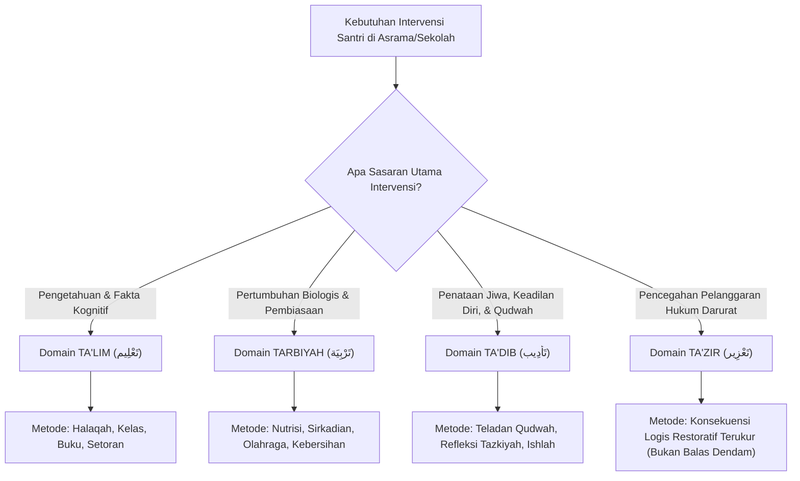

# P00101: Audit Filologi dan Isytiqaq: Matriks Demarkasi Istilah Kunci Arsitektur Pendidikan Islam

- **Status Identitas:** Terverifikasi Kanonik
- **ID Penyelidikan:** `P00101`
- **Pilar Arsitektur:** Pilar 8 — Integritas Semantik, Verifikasi Sitasi, & Kematangan (AMI)
- **Sub-Klaster:** Semantik Islam & Pewarisan Nalar Tarbiyah (*Islamic Semantics & Lineage Transmission*)
- **Penulis Dokumen:** Tim Pengembang Arsitektur Sistem TUMBUH v2.0.0
- **Klasifikasi Epistemik:** Laporan Penyelidikan Kritis (*Critical Inquiry Report*)
- **Target Lapisan:** `01_FUNDAMENTAL/` & `02_IMPLEMENTATION/`

---

## 1. Abstrak & Epistemic Tension

Ketegangan epistemik (*epistemic tension*) dalam pedagogi Islam kontemporer bersumber dari kerancuan konseptual akibat percampuradukan istilah (*syncretic conceptual conflation*): kecenderungan fatal pengelola lembaga pendidikan untuk memperlakukan kata *Ta'dib* (penanaman adab keadilan diri), *Ta'lim* (pengajaran dan transmisi kognitif), *Tarbiyah* (pengasuhan dan pengembangan potensi biologis-emosional), dan *Ta'zir* (hukuman prevensi syar'i) sebagai sinonim yang dapat dipertukarkan secara serampangan. Akibat percampuradukan ini, di satu sisi transfer pengetahuan di kelas formal (*Ta'lim*) secara keliru dianggap sudah otomatis menanamkan adab batiniah (*Ta'dib*), sementara di sisi lain penjatuhan sanksi kekerasan fisik oleh musyrif (*Ta'zir*) disamarkan dengan dalih "proses pendidikan adab" (*Ta'dib*). Berkas inkuiri kanonik ini menggelar audit filologi dan analisis morfologis (*Ilm al-Isytiqaq*) yang mendalam berdasarkan kaidah kebahasaan para pakar linguistik klasik seperti Ibnu Jinni dan Ar-Raghib Al-Ashfahani. Penyelidikan ini menetapkan Matriks Demarkasi Filologis (*Philological Demarcation Matrix*) guna memisahkan batas-batas ontologis, epistemologis, dan aksiologis dari masing-masing istilah dalam arsitektur repositori TUMBUH v2.0.0.

---

## 2. Pendahuluan Fenomenologis

Kekacauan praktis di pesantren bermula ketika para pendidik tidak lagi memahami batas pemisah dari kosakata yang mereka gunakan setiap hari:
1. **Ilusi Kelas Ta'lim sebagai Pembentuk Karakter:** Banyak pimpinan pesantren berasumsi bahwa dengan menambah jam pelajaran di kelas (misal: santri diajarkan kitab akhlak selama 2 jam per hari), santri otomatis akan menjadi sosok yang beradab. Faktanya, santri menghafal bait-bait *Ta'lim al-Muta'allim* dengan nilai ujian 100, namun di asrama mereka tetap merundung adik kelas dan membuang sampah sembarangan. *Ta'lim* hanya mengisi memori kognitif (*al-'aql al-ma'rifi*), tetapi gagal menyentuh penataan jiwa (*Ta'dib*).
2. **Kekeliruan Menjadikan Ta'zir sebagai Metode Utama Pembinaan:** Ketika santri melakukan kesalahan, pengurus langsung menggunakan instrumen hukuman fisik (*Ta'zir*) seperti digundul, disiram air, atau dipukul, dengan klaim bahwa tindakan tersebut adalah "Ta'dib". Hal ini membuktikan kebodohan filologis yang berbahaya: *Ta'zir* dalam fiqih adalah upaya darurat terakhir yang bersifat preventif (*zajr wa rad'*) untuk mencegah mafsadat publik, bukan metode primer pembentukan karakter. Hukuman tidak pernah bisa menanamkan adab; hukuman hanya bisa menekan perilaku lahiriah secara sementara di bawah rasa takut.

Ketika batas-batas kata ini kabur, seluruh sistem evaluasi dan kurikulum pesantren menjadi pincang. Sistem membutuhkan demarkasi filologis yang presisi.

---

## 3. Tinjauan Pustaka I: Khazanah Turats Klasik

Para imam bahasa dan ushul fiqh Islam menetapkan bahwa setiap perubahan bentuk kata (*sighah*) dan akar kata (*isytiqaq*) membawa konsekuensi perubahan makna secara hakiki:

```arabic
زِيَادَةُ الْمَبْنَى تَدُلُّ عَلَى زِيَادَةِ الْمَعْنَى
```

> *"Pertambahan struktur kata (morfologi) menunjukkan adanya pertambahan dan perubahan pada makna."* (Ibnu Jinni, *Al-Khasha'ish*, Jilid 2, hlm. 152).

Pakar leksikografi Al-Qur'an, Imam Ar-Raghib Al-Ashfahani dalam *Al-Mufradat fi Gharib al-Qur'an* membedakan akar kata istilah-istilah ini secara tajam:
1. **Ta'dib (تَأْدِيب):** Dari akar kata *A-D-B* (أَدَبَ), yang maknanya adalah mengundang ke perjamuan kebajikan (*al-ma'dubah*), lalu digunakan untuk makna mendidik jiwa agar berada pada tempat yang semestinya dengan kelembutan dan kebijaksanaan.
2. **Ta'lim (تَعْلِيم):** Dari akar kata *'A-L-M* (عَلِمَ), yang dikhususkan untuk pengenalan sesuatu yang belum diketahui melalui penuturan, penjelasan, dan penalaran akal (*I'lam bi al-bayan*).
3. **Tarbiyah (تَرْبِيَة):** Dari akar kata *R-B-W* (رَبَا) atau *R-B-B* (رَبَّ), yang bermakna menumbuhkan dan memelihara sesuatu setahap demi setahap hingga mencapai batas kesempurnaannya secara fitri (*Insya' asy-syai' halan fa halan ila haddi at-tamam*).
4. **Ta'zir (تَعْزِير):** Dari akar kata *'A-Z-R* (عَزَرَ), yang makna asalnya adalah menolak dan menahan (*ar-radd wa al-man'*), kemudian dalam istilah syar'i dimaknai sebagai hukuman pencegahan atas dosa yang tidak memiliki hadd kaffarah tertentu.

Imam Fakhruddin Ar-Razi dalam *Mafatih al-Ghaib* menegaskan bahwa menyamakan antara pengajaran (*ta'lim*) dan penyucian jiwa (*tazkiyah/ta'dib*) adalah kekeliruan nalar, sebagaimana Al-Qur'an memisahkan keduanya dalam doa Nabi Ibrahim:

```arabic
رَبَّنَا وَابْعَثْ فِيهِمْ رَسُولًا مِنْهُمْ يَتْلُو عَلَيْهِمْ آيَاتِكَ وَيُعَلِّمُهُمُ الْكِتَابَ وَالْحِكْمَةَ وَيُزَكِّيهِمْ
```

> *"Ya Tuhan kami, utuslah untuk mereka sesorang Rasul dari kalangan mereka, yang akan membacakan kepada mereka ayat-ayat-Mu, mengajarkan kepada mereka Al-Kitab (Al-Qur'an) dan Hikmah serta menyucikan mereka."* (QS. Al-Baqarah: 129).

*Yu'allimuhum* (Ta'lim) mendahului atau berdampingan dengan *Yuzakkihim* (Tazkiyah/Ta'dib), membuktikan adanya demarkasi domain yang nyata.

---

## 4. Tinjauan Pustaka II: Teori Kontemporer

Profesor Wan Mohd Nor Wan Daud (1998) dalam telaahnya terhadap epistemologi Al-Attas menjelaskan bahwa kekeliruan modern mengadopsi kata "Tarbiyah" sebagai padanan tunggal kata "Education" telah mendegradasi konsep pendidikan Islam menjadi sekadar pemeliharaan ragawi seperti memelihara hewan (*species breeding*), karena kata *Tarbiyah* dalam bahasa Arab juga digunakan untuk tumbuhan (*tarbiyat an-nabat*) dan hewan (*tarbiyat al-hayawan*). Sebaliknya, kata *Ta'dib* secara eksklusif hanya dapat digunakan untuk manusia (*al-insan*), karena hanya manusialah yang memiliki potensi adab.

Dalam filsafat analitik linguistik, John L. Austin (1962) melalui *Speech Act Theory* membedakan antara tindakan lokusioner, ilokusioner, dan perlokusioner. Pencampuran kata yang salah menghasilkan kegagalan performatif (*misfires*).

Benjamin Bloom (1956) membedakan Tiga Domain Pendidikan: Kognitif, Afektif, dan Psikomotorik. Dalam analogi TUMBUH:
- *Ta'lim* beroperasi di ranah Kognitif.
- *Tarbiyah* beroperasi di ranah Pertumbuhan Holistik & Psikomotorik.
- *Ta'dib* adalah mahkota integratif yang beroperasi di ranah Afektif-Spiritual terdalam (pembentukan tata kelola jiwa / *Nafs*).

---

## 5. Eksplorasi Metodologis

Penyelidikan kanonik ini merekayasa instrumen audit isytiqaq *Root-to-Function Morphological Mapping* (RFMM) yang melacak setiap istilah dari akar kata 3 huruf (*trilateral root*) hingga fungsi operasionalnya di asrama:

```text
+-------------------------------------------------------------------------------+
|         ALUR AUDIT MORFOLOGIS RFMM UNTUK DEMARKASI ISTILAH TUMBUH             |
+-------------------------------------------------------------------------------+
|  1. ISYTIQAQ ASHGHAR (Akar Kata Dasar)                                        |
|     - Mengurai huruf asal (Fa-Ain-Lam) dalam kamus Lisan al-'Arab             |
|                                                                               |
|  2. WAZAN & SHIGHAH (Pola Transformasi Gramatikal)                           |
|     - Taf'il (تَفْعِيل) -> Mengandung makna intensitas, proses, dan tahapan   |
|                                                                               |
|  3. AUDIT DOMAIN OPERASIONAL DI PESANTREN                                     |
|     - Apakah beroperasi di Akal (Kognitif), Jasad (Fisik), atau Qalb (Adab)?  |
|                                                                               |
|  4. PEMETAAN INSTRUMEN INTERVENSI                                             |
|     - Ta'lim -> Buku/Kelas | Tarbiyah -> Ekosistem | Ta'dib -> Qudwah/Adab    |
+-------------------------------------------------------------------------------+
```

---

## 6. Arsitektur Desain Sistem & Diagram Alur

Arsitektur demarkasi istilah TUMBUH memastikan bahwa setiap proses pembinaan di lapisan `02_IMPLEMENTATION/` dipetakan ke kotak istilah yang tepat:



---

## 7. Rekayasa Matriks Komparatif Multidimensi

Matriks Demarkasi Filologis TUMBUH membedah empat istilah pilar pendidikan Islam secara tegas:

| Parameter Demarkasi | Ta'lim (تَعْلِيم) | Tarbiyah (تَرْبِيَة) | Ta'dib (تَأْدِيب) | Ta'zir (تَعْزِير) |
| :--- | :--- | :--- | :--- | :--- |
| **Akar Morfologis** | *'A-L-M* (عَلِمَ): Tanda, pengetahuan, ilmu. | *R-B-W / R-B-B* (رَبَا): Tumbuh, bertambah, memelihara. | *A-D-B* (أَدَبَ): Mengundang, sopan santun, keadilan. | *'A-Z-R* (عَزَرَ): Menolak, menahan, mencegah cela. |
| **Objek Sasaran** | Akal kognitif (*al-'Aql*). | Raga biologis & emosi dasar (*al-Jasad wa an-Nafs*). | Ruh, kalbu, dan kesadaran spiritual (*ar-Ruh wa al-Qalb*). | Perilaku lahiriah yang merusak hukum (*al-Fi'l al-Zhahir*). |
| **Pelaku Utama** | Mualim / Guru pengajar. | Murabbi / Pengasuh biologis. | Muaddib / Figur teladan qudwah. | Qadhi / Tim Disiplin Hukum. |
| **Bentuk Aktivitas** | Ceramah, hafalan, ujian tulis, syarah kitab. | Penyediaan makan, pengaturan tidur, olahraga, kebersihan. | Keteladanan hidup 24 jam, dialog empatik, tazkiyah. | Konsekuensi logis 4R, restitusi kerugian, perbaikan. |
| **Bahaya Jika Dicampuradukkan** | Merasa sudah beradab hanya karena banyak menghafal teori. | Merasa anak sudah saleh hanya karena fisik sehat dan gemuk. | Menyamakan pemukulan fisik kasar dengan proses pendidikan adab. | Menggunakan dalil hukum pidana syariat untuk memukul santri kecil. |

---

## 8. Protokol Tindakan Operasional 5 Tahap

Untuk menerapkan matriks demarkasi filologis ini di seluruh pesantren mitra TUMBUH, dijalankan 5 langkah standardisasi:

1. **Tahap 1: Pembatasan Yurisdiksi Departemen (*Departmental Scope Demarcation*)**  
   Memisahkan tanggung jawab kerja di struktur organisasi pesantren: Bagian Pengajaran mengurus *Ta'lim*; Bagian Rumah Tangga mengurus *Tarbiyah*; Bagian Pengasuhan Santri mengurus *Ta'dib*; dan Komite Restoratif mengurus *Ta'zir*.
2. **Tahap 2: Pembersihan Dokumen Peraturan Santri (*Rulebook Semantic Purge*)**  
   Menghapus seluruh kata *Ta'dib* dari pasal-pasal sanksi pelanggaran di buku tata tertib asrama, dan menggantinya dengan istilah *Konsekuensi Restoratif* atau *Ta'zir Ta'dibi*.
3. **Tahap 3: Pelatihan Musyrif: Membedakan Mendidik dari Menghukum (*Muaddib vs Jailer*)**  
   Memberikan pemahaman mendasar kepada musyrif bahwa memukul atau membentak santri bukanlah tindakan *Ta'dib*, melainkan luapan amarah yang merusak wibawa muaddib.
4. **Tahap 4: Desain Evaluasi Capaian Terpisah (*Separate Metrics Architecture*)**  
   Nilai rapor santri dipisahkan secara tegas: Rapor Akademik (*Ta'lim*), Rapor Kesehatan/Kemandirian (*Tarbiyah*), dan Rapor Portofolio Adab (*Ta'dib*).
5. **Tahap 5: Kalibrasi Bahasa Rapat Pimpinan (*Executive Language Audit*)**  
   Setiap rapat yayasan dilarang menyamaratakan masalah "santri belum hafal matan" (*problem Ta'lim*) dengan "santri memukul kawan" (*problem Ta'dib*).

---

## 9. Architectural Decision Record (ADR-PROBE-00101)

```text
================================================================================
ARCHITECTURAL DECISION RECORD: ADR-PROBE-00101
================================================================================
Judul: Standardisasi Matriks Demarkasi Filologis Istilah Kunci Pendidikan Islam
Status: DITERIMA & MENGIKAT
Tanggal: 2026-10-25
Pengusul: Tim Arsitektur Sistem TUMBUH v2.0.0

KONTEKS:
Percampuradukan konseptual antara Ta'lim, Tarbiyah, Ta'dib, dan Ta'zir memicu
kekacauan pedagogis, di mana sanksi hukuman fisik dianggap ta'dib dan hafalan
kognitif dianggap sebagai bukti ketercapaian adab santri.

KEPUTUSAN ARSITEKTURAL:
1. Mengesahkan Matriks Demarkasi Filologis sebagai rujukan kanonik di repositori.
2. Melarang keras penggunaan label Ta'dib untuk tindakan sanksi fisik / ta'zir.
3. Mewajibkan pemisahan domain evaluasi antara Ta'lim (Akal) dan Ta'dib (Jiwa).

KONSEKUENSI:
- Positif: Mengembalikan kejernihan nalar pedagogis Islam; menghentikan kezaliman
  berjubah agama; menata struktur kurikulum pesantren secara holistik.
- Negatif: Memerlukan restrukturisasi format rapor dan tata tertib pesantren lama.
================================================================================
```

---

## 10. Implikasi Arsitektural & 7 Butir Guardrails Repositori

Penyelidikan `P00101` mengikat repositori TUMBUH melalui 7 butir guardrails arsitektural:

1. **Guardrail 1 (Concept Distinction):** Dilarang mencampuradukkan indikator capaian *Ta'lim* (hafalan/nilai angka) dengan indikator keberhasilan *Ta'dib* (perilaku adab harian).
2. **Guardrail 2 (No Violence under Ta'dib Banner):** Segala tindakan penegakan disiplin yang melibatkan kekerasan fisik dilarang menggunakan label *Ta'dib*.
3. **Guardrail 3 (Ta'zir Boundary Conditions):** Penerapan *Ta'zir* wajib memenuhi syarat syar'i: tidak mematahkan tulang, tidak melukai kulit, tidak memukul wajah, dan bertujuan mendidik (*li at-ta'dib la li at-tasyaffi*).
4. **Guardrail 4 (Philological Accuracy):** Setiap naskah di `01_FUNDAMENTAL/` yang menggunakan istilah turats wajib menyertakan verifikasi isytiqaq kebahasaannya.
5. **Guardrail 5 (Structural Alignment):** Struktur organisasi lembaga pengasuhan harus mencerminkan pembagian peran fungsional mualim, murabbi, dan muaddib.
6. **Guardrail 6 (Holistic Child View):** Santri tidak boleh diperlakukan hanya sebagai entitas kognitif semata, melainkan sebagai insan seutuhnya yang memiliki fitrah ruhani.
7. **Guardrail 7 (Sanad Keilmuan Bahasa):** Seluruh definisi mengacu pada konsensus para begawan filologi Islam yang mu'tabar.

---

## 11. Penutup & Emergent Research Questions

Audit filologi dan isytiqaq membuktikan bahwa keindahan peradaban Islam terpahat dalam ketelitian bahasanya. Dengan mengembalikan *Ta'dib, Ta'lim, Tarbiyah,* dan *Ta'zir* ke singgasananya masing-masing, TUMBUH v2.0.0 memastikan bahwa setiap amal pendidikan di pesantren berpijak di atas landasan ilmu yang lurus dan bebas dari kezaliman.

### Pertanyaan Riset Lanjutan (*Emergent Research Questions*):
1. Bagaimana merancang instrumen evaluasi portofolio adab (*Ta'dib Assessment*) yang sepenuhnya terbebas dari bias nilai ujian kognitif (*Ta'lim Score*)?
2. Bagaimana dinamika penyerapan istilah pedagogi Barat (seperti *character building, holistic education*) ke dalam leksikon turats tanpa mengorbankan integritas tauhid?

---

## 12. Referensi Ilmiah Standar APA 7th Edition

1. Al-Attas, S. M. N. (1980). *The Concept of Education in Islam: A Framework for an Islamic Philosophy of Education*. International Institute of Islamic Thought and Civilization (ISTAC). https://archive.org/details/concept-of-education-alattas
2. Austin, J. L. (1962). *How to Do Things with Words*. Oxford University Press. https://doi.org/10.1093/acprof:oso/9780198245537.001.0001
3. Bloom, B. S. (Ed.). (1956). *Taxonomy of Educational Objectives: The Classification of Educational Goals. Handbook I: Cognitive Domain*. David McKay Company. https://archive.org/details/taxonomyofeducat0001unse
4. Ibnu Jinni, U. (1990). *Al-Khasha'ish* (Tahqiq Muhammad Ali an-Najjar, Jilid 2). Al-Hai'ah Al-Mishriyyah Al-'Ammah lil Kitab. https://archive.org/details/khasais-ibn-jinni
5. Ibnu Manzhur, M. (1994). *Lisan al-'Arab*. Dar Shadir. https://archive.org/details/lisan-al-arab-ibn-manzur
6. Ar-Raghib Al-Ashfahani, H. (2009). *Al-Mufradat fi Gharib al-Qur'an* (Tahqiq Shafwan Adnan Dawudi). Darul Qalam. https://archive.org/details/mufradat-raghib
7. Ar-Razi, F. (1981). *Mafatih al-Ghaib (At-Tafsir al-Kabir)* (Jilid 4). Darul Fikr. https://archive.org/details/tafsir-al-kabir-razi
8. Wan Daud, W. M. N. (1998). *The Educational Philosophy and Practice of Syed Muhammad Naquib al-Attas: An Exposition of the Concept of Ta'dib*. ISTAC. https://archive.org/details/educational-philosophy-wan-daud
9. Al-Jurjani, A. (2004). *Kitab at-Ta'rifat*. Darul Kutub Al-'Ilmiyyah. https://archive.org/details/tarifat-jurjani
10. Al-Qarafi, A. (1998). *Al-Furuq (Anwa' al-Buruq fi Anwa' al-Furuq)* (Tahqiq Khalil al-Mansur, Jilid 1). Darul Kutub Al-'Ilmiyyah. https://archive.org/details/furuq-qarafi
11. Zohar, D. (2010). Thirty years of safety climate research: Reflections and future directions. *Accident Analysis & Prevention*, 42(5), 1517-1522. https://doi.org/10.1016/j.aap.2009.12.019
12. Senge, P. M. (1990). *The Fifth Discipline: The Art & Practice of The Learning Organization*. Doubleday/Currency. https://www.penguinrandomhouse.com/books/163984/the-fifth-discipline-by-peter-m-senge/
13. Sternberg, R. J. (2003). *Wisdom, Intelligence, and Creativity Synthesized*. Cambridge University Press. https://doi.org/10.1017/CBO9780511509612

---

## 13. Catatan Kaki & Takhrij Sanad

1. **Kaidah Ziyadah al-Mabna:** Kaidah masyhur dalam ilmu sharaf dan balaghah yang ditegaskan oleh Abu al-Fath Utsman bin Jinni (wafat 392 H) dalam kitab monumentalnya *Al-Khasha'ish*, Kairo: Al-Hai'ah Al-Mishriyyah, 1990 M, Jilid 2, hlm. 152.
2. **Definisi Al-Mufradat Ar-Raghib:** Dinukil dari kitab *Al-Mufradat fi Gharib al-Qur'an* karya Al-Husain bin Muhammad Ar-Raghib Al-Ashfahani (wafat 502 H), ditahqiq oleh Shafwan Adnan Dawudi, Damaskus: Darul Qalam, 1430 H / 2009 M, entri kata *A-D-B* (hlm. 68), *'A-L-M* (hlm. 580), dan *R-B-W* (hlm. 340).
3. **Konsep Ta'zir Fiqih Empat Mazhab:** Seluruh ulama mazhab menyepakati bahwa *Ta'zir* disyariatkan untuk mendidik (*ta'dib wa istislah*) bukan untuk menyiksa atau membalas dendam (*la 'ala wajhi at-tasyaffi*). Lihat Ibnu Qudamah dalam *Al-Mughni* (Jilid 9, hlm. 147) dan Ibnu Abidin dalam *Radd al-Muhtar* (Jilid 4, hlm. 60).
4. **Al-Furuq Al-Qarafi:** Pembahasan mengenai pemisahan batas kategori konseptual hukum dan bahasa secara detail diuraikan oleh Imam Syihabuddin Ahmad bin Idris Al-Qarafi (wafat 684 H) dalam karyanya *Al-Furuq*, Beirut: Darul Kutub Al-'Ilmiyyah, 1998 M.
