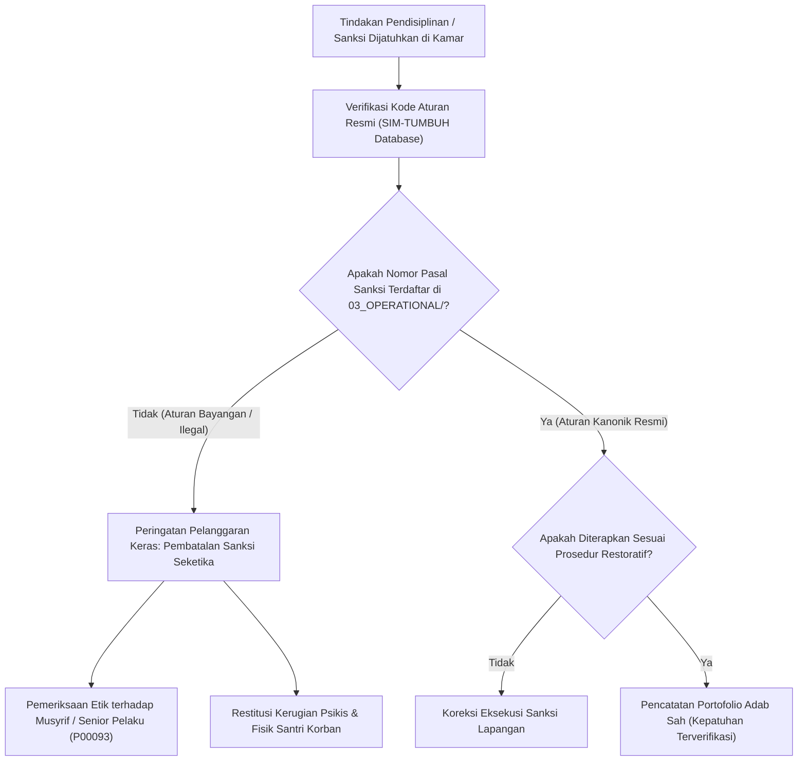

# P00102: Bahaya Silent Canonicalization: Mendeteksi Kebiasaan Lokal yang Diam-Diam Menjadi Aturan Wajib Tidak Resmi

- **Status Identitas:** Terverifikasi Kanonik
- **ID Penyelidikan:** `P00102`
- **Pilar Arsitektur:** Pilar 8 — Integritas Semantik, Verifikasi Sitasi, & Kematangan (AMI)
- **Sub-Klaster:** Semantik Islam & Pewarisan Nalar Tarbiyah (*Islamic Semantics & Lineage Transmission*)
- **Penulis Dokumen:** Tim Pengembang Arsitektur Sistem TUMBUH v2.0.0
- **Klasifikasi Epistemik:** Laporan Penyelidikan Kritis (*Critical Inquiry Report*)
- **Target Lapisan:** `02_IMPLEMENTATION/` & `03_OPERATIONAL/`

---

## 1. Abstrak & Epistemic Tension

Ketegangan epistemik (*epistemic tension*) dalam tata kelola repositori dan kehidupan asrama pesantren meletus akibat fenomena Kanonisasi Senyap (*Silent Canonicalization*): proses sosiologis yang tidak kasat mata di mana kebiasaan lokal, inisiatif pribadi musyrif senior, atau sanksi buatan kamar santri secara perlahan mengeras menjadi "aturan wajib tidak resmi" (*shadow rules*) yang dianggap berkekuatan hukum setara atau bahkan mengalahkan dokumen konstitusi resmi. Praktik ilegal ini kerap kali diselundupkan di balik dalih kearifan lokal (*al-'urf*) atau pembinaan senioritas, padahal secara nyata ia menciptakan tirani mikro (*micro-tyranny*) yang melanggar hak-hak fitrah santri dan merusak batas lapisan repositori (`AGENTS.md`). Penyelidikan kanonik ini menyandingkan kritik Imam Asy-Syathibi mengenai *Bid'ah Idhafiyyah* dalam khazanah Ushul Fiqh dengan teori *Shadow Organizations* dan *Informal Institutional Creep* sosiologi modern. Penyelidikan ini menetapkan arsitektur pembongkaran hukum bayangan (*Shadow Rule Deconstruction Architecture*) guna menjamin bahwa tidak ada satu pun kewajiban atau sanksi yang boleh ditegakkan di lingkungan pesantren mitra tanpa melalui gerbang pengesahan kanonik resmi di ekosistem TUMBUH v2.0.0.

---

## 2. Pendahuluan Fenomenologis

Di lantai asrama pesantren konvensional, sering kali ditemukan "dua undang-undang" yang saling berbenturan:
1. **Undang-Undang Resmi di Kantor Pimpinan:** Dokumen tata tertib resmi yang tercetak rapi, memuat larangan kekerasan, jam tidur yang cukup, dan hak-hak santri yang indah.
2. **Undang-Undang Senyap di Kamar Santri (*The Shadow Constitution*):** Serangkaian aturan lisan tak tertulis yang diciptakan oleh santri pengurus kamar (*mudabbir*) atau oknum musyrif senior yang ditegakkan dengan sanksi fisik keras tanpa sepengetahuan kiai pengasuh.

Bentuk-bentuk kanonisasi senyap yang lazim mencengkeram santri meliputi:
- **Kewajiban Merayap Masuk Kamar Mandi:** Aturan buatan senior bahwa santri baru dilarang berjalan tegak di lorong asrama pada malam hari.
- **Sanksi Beli Makanan Malam (*Night Chores Extortion*):** Mewajibkan santri junior membelikan kopi atau memijat senior dengan dalih "khidmat adab", di mana penolakan akan dibalas dengan perundungan kolektif.
- **Larangan Tidur Sebelum Pukul 01.00 WIB:** Ritual begadang wajib bagi santri baru untuk mendengarkan wejangan senior yang tidak berfaedah.

Ketika ditanya oleh tim penilai, para pelaku dengan percaya diri berdalih: *"Ini sudah jadi tradisi pondok sejak 20 tahun lalu, ini yang membentuk kami jadi tangguh!"* 

Tirani bayangan ini membuktikan bahaya fatal kanonisasi senyap: **Ketika sistem resmi abai melakukan audit, kebiasaan zalim akan diam-diam menobatkan dirinya menjadi hukum yang ditaati.**

---

## 3. Tinjauan Pustaka I: Khazanah Turats Klasik

Epistemologi syariat Islam menolak mutlak penciptaan kewajiban atau pengharaman baru tanpa landasan otoritas wahyu yang sah. Mengada-adakan aturan yang mengikat dalam agama atau tata kelola kebaikan tanpa sanad otoritatif dikategorikan sebagai tindakan bid'ah yang tertolak.

Rasulullah SAW menegaskan prinsip legalitas syariat ini dalam hadits shahih riwayat Sayyidah Aisyah radhiyallahu 'anha:

```arabic
مَنْ أَحْدَثَ فِي أَمْرِنَا هَذَا مَا لَيْسَ مِنْهُ فَهُوَ رَدٌّ
```

> *"Barang siapa yang mengada-adakan perkara baru dalam urusan (agama) kami ini apa-apa yang bukan berasal darinya, maka perkara tersebut tertolak."* (HR. Al-Bukhari, no. 2697; Muslim, no. 1718).

Imam Abu Ishaq Asy-Syathibi dalam kitab *Al-I'tisham* membedah fenomena *Al-Bid'ah al-Idhafiyyah* (kebiasaan yang asalnya tampak baik, tetapi diikat dengan tata cara, waktu, atau kewajiban sepihak yang tidak pernah ditetapkan oleh syariat):

```arabic
الْبِدْعَةُ الْإِضَافِيَّةُ هِيَ الَّتِي لَهَا شَائِبَتَانِ: إِحْدَاهُمَا لَهَا مُتَعَلَّقٌ بِدَلِيلٍ شَرْعِيٍّ، وَالْأُخْرَى لَيْسَ لَهَا مُتَعَلَّقٌ بِهِ... فَتَصِيرُ بِالْإِلْزَامِ وَالْمُوَاظَبَةِ وَإِظْهَارِهَا فِي الْمَحَافِلِ كَأَنَّهَا شَرِيعَةٌ مُبْتَدَأَةٌ يُؤْثَمُ تَارِكُهَا، وَهَذَا هُوَ عَيْنُ التَّشْرِيعِ الَّذِي لَا يَجُوزُ لِأَحَدٍ مِنَ الْخَلْقِ.
```

> *"Bid'ah idhafiyyah adalah perbuatan yang memiliki dua sisi: satu sisi memiliki kaitan dengan dalil syar'i, namun sisi lainnya sama sekali tidak memiliki sandaran dalil... Lalu dengan adanya pemaksaan kewajiban (al-ilzam), kontinuitas ketat, dan penampakannya di tengah publik, perbuatan itu berubah seolah-olah menjadi syariat baru yang pelakunya dicela bila meninggalkannya. Dan ini adalah hakikat tasyri' (pembuatan hukum baru) yang tidak dihalalkan bagi seorang pun dari makhluk."* (Asy-Syathibi, *Al-I'tisham*, Jilid 1, hlm. 286).

Kaidah fiqhiyyah masyhur mengenai batas keabsahan adat (*Al-'Urf*) menegaskan:

```arabic
الْعُرْفُ إِذَا خَالَفَ الشَّرْعَ فَهُوَ عُرْفٌ فَاسِدٌ لَا عِبْرَةَ بِهِ
```

> *"Adat kebiasaan apabila bertentangan dengan prinsip syariat, maka ia adalah adat yang fasid (rusak) dan sama sekali tidak bernilai hukum."* (Ibnu Nujaim, *Al-Asybah wan Nazha'ir*, hlm. 104).

Tradisi kekerasan dan senioritas feodal di asrama adalah *'urf fasid* yang wajib diamputasi dari tubuh pesantren.

---

## 4. Tinjauan Pustaka II: Teori Kontemporer

Dalam teori sosiologi organisasi dan institusionalisme baru, John Meyer dan Brian Rowan (1977) merumuskan konsep *Institutionalized Organizations: Formal Structure as Myth and Ceremony*. Organisasi kerap kali menampilkan dokumen resmi sekadar sebagai "upacara seremonial" untuk menyenangkan pihak luar (akreditasi/pemerintah), seraya membiarkan struktur kerja riil (*informal operational decoupling*) dikendalikan oleh tradisi tersembunyi yang menyimpang.

Philip Selznick (1957) dalam *Leadership in Administration* mengidentifikasi bagaimana organisasi secara tak sadar mengalami proses *Infusion with Value*: kebiasaan teknis yang awalnya bersifat sementara perlahan-lahan disucikan (*sanctified*) menjadi nilai sakral yang tidak boleh diganggu gugat oleh generasi berikutnya.

Shoshana Zuboff (1988) menegaskan pentingnya *Informating vs Automating*: jika sistem tata kelola tidak memiliki visibilitas transparan ke lantai terbawah, maka subkultur liar akan mengisi ruang kosong tersebut dengan hierarki kekuasaan bayangan (*shadow power dynamics*).

---

## 5. Eksplorasi Metodologis

Penyelidikan kanonik ini merekayasa model *Shadow Rule Audit & Interception* (SRAI) yang menggunakan teknik investigasi triangulasi santri:

```text
+-------------------------------------------------------------------------------+
|         ALUR INVESTIGASI KANONISASI SENYAP DI ASRAMA (SRAI MODEL)             |
+-------------------------------------------------------------------------------+
|  1. AUDIT DOKUMEN SISTEM RESMI (03_OPERATIONAL/)                             |
|     - Mendaftar seluruh hak, kewajiban, dan sanksi yang disahkan yayasan.     |
|                                                                               |
|  2. SURVEI PERILAKU AKTUAL SANTRI SECARA ANONIM (Ground Reality Check)        |
|     - "Apa aturan yang paling kamu takuti di kamar ini?"                      |
|     - "Siapa yang menghukummu jika aturan itu dilanggar?"                     |
|                                                                               |
|  3. PENCOCOKAN GAP HUKUM (Divergence Mapping)                                 |
|     - Menemukan aturan-aturan yang dijalankan santri tetapi TIDAK ADA di SOP.  |
|                                                                               |
|  4. INTERSEPSI & DEKONSTRUKSI KANONIK (Abolition & Reset)                     |
|     - Mengumumkan pembatalan aturan bayangan secara terbuka di hadapan santri.|
+-------------------------------------------------------------------------------+
```

---

## 6. Arsitektur Desain Sistem & Diagram Alur

Arsitektur pencegahan kanonisasi senyap TUMBUH mewajibkan verifikasi keabsahan aturan (*Rule Legitimacy Check*) di modul SIM-TUMBUH:



---

## 7. Rekayasa Matriks Komparatif Multidimensi

Tabel berikut membedah tipologi kanonisasi senyap yang sering membusukkan asrama vs instrumen dekonstruksi TUMBUH v2.0.0:

| Tipologi Aturan Bayangan | Alasan Dalih Pelaku (*Rationalization*) | Bahaya Epistemik & Fisik | Tindakan Dekonstruksi TUMBUH v2.0.0 |
| :--- | :--- | :--- | :--- |
| **Wajib Merapikan Sandal Senior** | Menanamkan khidmah santri junior kepada yang lebih tua. | Eksploitasi feodal; penindasan relasi kuasa antar-santri. | Larangan tegas perpeloncoan khidmah; kewajiban kemandirian pribadi (*Self-Service Adab*). |
| **Sanksi Guyur Air Dingin Tengah Malam** | Agar santri bangun tahajjud dan tidak malas beribadah. | Trauma psikologis; hipotermia; kebencian bawah sadar pada shalat. | Penghapusan mutlak sanksi fisik; pengkondisian ritme sirkadian tidur tepat waktu. |
| **Larangan Santri Junior Duduk di Sofa Depan** | Menghormati santri senior yang sudah lama di pondok. | Stratifikasi kasta sosial; matinya ukhuwah Islamiyyah universal. | Desain ruang publik asrama yang egaliter (*Shared Public Commons*). |
| **Piket Kamar Mandi Khusus Santri Baru** | Latihan ketahanan mental bagi santri pendatang baru. | Diskriminasi struktural; rasa ketidakadilan mendalam. | Jadwal piket bergilir merata untuk seluruh penghuni kamar tanpa memandang kelas. |
| **Denda Uang untuk Setiap Kata Bahasa Daerah** | Mempercepat penguasaan bahasa resmi Arab/Inggris. | Pemalakan terselubung; pengurus kamar pesta makan dari uang denda. | Penghapusan denda finansial; penggantian dengan tantangan literasi berbahasa edukatif. |

---

## 8. Protokol Tindakan Operasional 5 Tahap

Untuk membasmi undang-undang bayangan, pimpinan pesantren mitra TUMBUH wajib mengeksekusi 5 tahap penertiban operasional:

1. **Tahap 1: Deklarasi Doktrin Nullum Delictum Syar'i (*Legal Certainty Charter*)**  
   Mengumumkan piagam resmi kepada seluruh santri: *"Tidak ada kewajiban, tidak ada larangan, dan tidak ada sanksi yang sah di pesantren ini kecuali yang tercetak di dalam Buku Panduan Resmi TUMBUH v2.0.0."*
2. **Tahap 2: Pembukaan Saluran Pengaduan Rahasia (*Shadow Rule Whistleblowing*)**  
   Menyediakan kotak aspirasi fisik dan kanal daring aman di SIM-TUMBUH agar santri baru dapat melaporkan tradisi-tradisi aneh kamar tanpa takut diintimidasi.
3. **Tahap 3: Sidang Pembatalan Tradisi Fasid (*Public Tradition Nullification*)**  
   Pimpinan pondok secara terbuka di masjid mengumpulkan seluruh santri dan membatalkan tradisi-tradisi kamar yang menyimpang secara resmi demi hukum.
4. **Tahap 4: Pelarangan Pungutan Finansial Liar (*Zero Unofficial Cash Fine*)**  
   Melarang mutlak segala bentuk sanksi denda uang tunai di tingkat kamar atau asrama; seluruh denda uang diklasifikasikan sebagai tindak pemalakan pidana.
5. **Tahap 5: Audit Kebiasaan Kamar Acak (*Random Chamber Culture Sweep*)**  
   Tim auditor pengasuhan melakukan inspeksi tak terjadwal pada jam-jam rawan (pukul 22.00–00.00 WIB) untuk memastikan tidak ada sidang malam senioritas yang digelar.

---

## 9. Architectural Decision Record (ADR-PROBE-00102)

```text
================================================================================
ARCHITECTURAL DECISION RECORD: ADR-PROBE-00102
================================================================================
Judul: Penolakan Mutlak Kanonisasi Senyap dan Pembongkaran Aturan Bayangan (Anti-Shadow Rules)
Status: DITERIMA & MENGIKAT
Tanggal: 2026-10-25
Pengusul: Tim Arsitektur Sistem TUMBUH v2.0.0

KONTEKS:
Kebiasaan lokal musyrif senior dan tradisi perpeloncoan kamar kerap diam-diam
menjadi aturan wajib tidak resmi yang menindas santri dan merusak legitimasi
konstitusi resmi repositori TUMBUH.

KEPUTUSAN ARSITEKTURAL:
1. Menetapkan bahwa satu-satunya sumber hukum operasional yang sah adalah dokumen
   yang terdaftar di 03_OPERATIONAL/ repositori TUMBUH v2.0.0.
2. Menyatakan seluruh sanksi fisik informal, denda uang kamar, dan perpeloncoan
   senioritas sebagai tindakan ilegal yang membatalkan mandat kepengurusan pelaku.
3. Memberikan hak pembelaan diri dan perlindungan hukum penuh bagi santri yang
   menolak mematuhi aturan bayangan tersebut.

KONSEKUENSI:
- Positif: Memulihkan keadilan di asrama; melindungi santri baru dari penindasan;
  menjamin kepatuhan total pada konstitusi AGENTS.md repositori.
- Negatif: Menimbulkan gesekan awal dengan santri senior yang kehilangan privilese.
================================================================================
```

---

## 10. Implikasi Arsitektural & 7 Butir Guardrails Repositori

Penyelidikan `P00102` menetapkan 7 guardrails arsitektural repositori TUMBUH:

1. **Guardrail 1 (Operational Boundary Strictness):** Dokumen di `03_OPERATIONAL/` dilarang memuat klausul yang memberikan wewenang kepada musyrif/santri untuk menciptakan sanksi baru tanpa pengesahan yayasan.
2. **Guardrail 2 (Nullity of Unwritten Sanctions):** Segala sanksi yang tidak tertulis dalam katalog konsekuensi resmi dinyatakan batal demi hukum dan pelakunya dapat dituntut secara etik.
3. **Guardrail 3 (No Financial Penalties):** Dilarang keras menerapkan sanksi berupa denda uang tunai di lingkungan asrama santri.
4. **Guardrail 4 (Protection of Dissenting Students):** Santri yang menolak aturan tidak resmi dijamin perlindungannya dari tindakan intimidasi fisik dan sosial.
5. **Guardrail 5 (Abolition of Seniority Privileges):** Tidak ada privilese diskriminatif yang membolehkan senior memperbudak junior atas nama adab.
6. **Guardrail 6 (Mandatory Rule ID in Logging):** Setiap entri pelanggaran di SIM-TUMBUH wajib menyertakan ID pasal aturan kanonik resmi.
7. **Guardrail 7 (Traceability of Rule Origin):** Setiap usulan penambahan aturan baru harus melalui proses inkuiri PROBE dan telaah Maqashid Syari'ah.

---

## 11. Penutup & Emergent Research Questions

Membasmi kanonisasi senyap adalah ikhtiar membebaskan santri dari perbudakan tradisi jahiliyyah yang berselubung syiar agama. Keadilan syariat hanya bisa ditegakkan apabila hukum berdiri di atas cahaya transparansi, bukan di lorong-lorong gelap kesewenang-wenangan pribadi.

### Pertanyaan Riset Lanjutan (*Emergent Research Questions*):
1. Bagaimana mendesain mekanisme pendampingan kepemimpinan santri senior agar energi kepemimpinan mereka tersalurkan ke program mentoring akademik dan bukan perpeloncoan kamar?
2. Bagaimana mengukur secara sosiometrik penurunan tingkat ketakutan santri baru setelah dilakukannya pembersihan aturan bayangan di asrama?

---

## 12. Referensi Ilmiah Standar APA 7th Edition

1. Al-Bukhari, M. (2002). *Shahih Al-Bukhari*. Darus Salam. https://archive.org/details/sahih-bukhari-darussalam
2. Asy-Syathibi, I. (1997). *Al-I'tisham* (Tahqiq Masyhur Hasan Salman, Jilid 1). Maktabah At-Tawhid. https://archive.org/details/itisham-syathibi
3. Ibnu Nujaim, Z. (1999). *Al-Asybah wan Nazha'ir 'ala Mazhab Abi Hanifah an-Nu'man*. Darul Kutub Al-'Ilmiyyah. https://archive.org/details/ashbah-ibn-nujaim
4. Meyer, J. W., & Rowan, B. (1977). Institutionalized organizations: Formal structure as myth and ceremony. *American Journal of Sociology*, 83(2), 340-363. https://doi.org/10.1086/226550
5. Muslim, I. (2006). *Shahih Muslim* (Tahqiq Muhammad Fu'ad Abdul Baqi). Darul Hadits. https://archive.org/details/sahih-muslim-baqi
6. Scott, W. R. (2014). *Institutions and Organizations: Ideas, Interests, and Identities* (4th ed.). SAGE Publications. https://us.sagepub.com/en-us/nam/institutions-and-organizations/book238128
7. Selznick, P. (1957). *Leadership in Administration: A Sociological Interpretation*. Harper & Row. https://www.ucpress.edu/book/9780520034457/leadership-in-administration
8. Senge, P. M. (1990). *The Fifth Discipline: The Art & Practice of The Learning Organization*. Doubleday/Currency. https://www.penguinrandomhouse.com/books/163984/the-fifth-discipline-by-peter-m-senge/
9. Vaughan, D. (1996). *The Challenger Launch Decision: Risky Technology, Culture, and Deviance at NASA*. The University of Chicago Press. https://press.uchicago.edu/ucp/books/book/chicago/C/bo3684120.html
10. Weick, K. E. (1976). Educational organizations as loosely coupled systems. *Administrative Science Quarterly*, 21(1), 1-19. https://doi.org/10.2307/2391875
11. Zohar, D. (2010). Thirty years of safety climate research: Reflections and future directions. *Accident Analysis & Prevention*, 42(5), 1517-1522. https://doi.org/10.1016/j.aap.2009.12.019
12. Zuboff, S. (1988). *In the Age of the Smart Machine: The Future of Work and Power*. Basic Books. https://www.basicbooks.com/titles/shoshana-zuboff/in-the-age-of-the-smart-machine/9780465032112/
13. Al-Qarafi, A. (1998). *Al-Furuq (Anwa' al-Buruq fi Anwa' al-Furuq)*. Darul Kutub Al-'Ilmiyyah. https://archive.org/details/furuq-qarafi

---

## 13. Catatan Kaki & Takhrij Sanad

1. **Takhrij Hadits Man Ahdatsa:** Dikeluarkan oleh Imam Al-Bukhari dalam *Shahih Al-Bukhari*, *Kitab ash-Shulh*, Bab *Idza Ishthalahu 'ala Shulhi Jawrin fa ash-Shulhu Mardud*, no. 2697; dan Imam Muslim dalam *Shahih Muslim*, *Kitab al-Aqdhiyah*, Bab *Naqdhi al-Ahkam al-Bathilah wa Raddi Muhdatsat al-Umur*, no. 1718. Diriwayatkan dari Ummul Mukminin Aisyah radhiyallahu 'anha.
2. **Kutipan Kitab Al-I'tisham Asy-Syathibi:** Dinukil dari kitab *Al-I'tisham* karya Imam Abu Ishaq Ibrahim bin Musa Al-Lakhmi Asy-Syathibi (wafat 790 H), ditahqiq oleh Masyhur Hasan Salman, Riyadh: Maktabah At-Tawhid, Cetakan I, 1418 H / 1997 M, Jilid 1, hlm. 286–290.
3. **Formal Structure as Myth and Ceremony:** Riset sosiologis Meyer dan Rowan (1977) membuktikan bahwa institusi pendidikan sering kali menciptakan regulasi formal sekadar untuk mempertahankan legitimasi eksternal (*ceremonial myth*), sementara koordinasi kerja lapangan yang sesungguhnya berlangsung secara terpisah (*decoupled*) mengikuti kebiasaan informal yang tak teruji.
4. **Kaidah Adat Rusak (Al-'Urf al-Fasid):** Dijelaskan oleh Zainuddin bin Nujaim Al-Hanafi dalam *Al-Asybah wan Nazha'ir*, Bab *Al-Qaidah ats-Tsalitsah: Al-'Adah Muhakkamah*, Beirut: Darul Kutub Al-'Ilmiyyah, 1999 M, hlm. 104.
