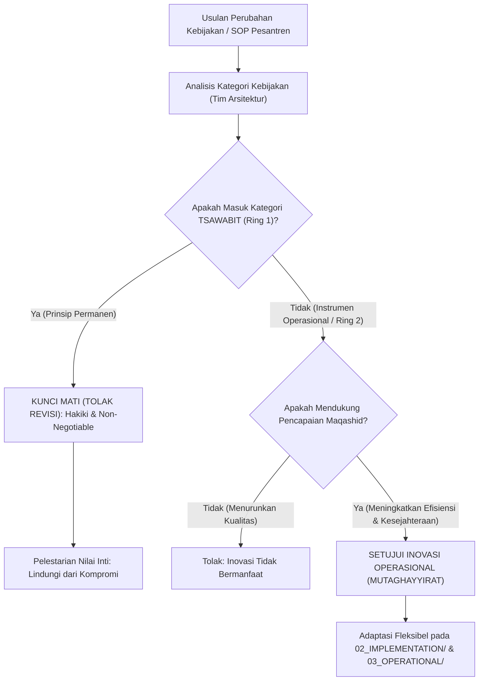

# P00103: Harmonisasi Konseptual Tsawabit dan Mutaghayyirat dalam Tata Kelola Ekosistem Pesantren

- **Status Identitas:** Terverifikasi Kanonik
- **ID Penyelidikan:** `P00103`
- **Pilar Arsitektur:** Pilar 8 — Integritas Semantik, Verifikasi Sitasi, & Kematangan (AMI)
- **Sub-Klaster:** Semantik Islam & Pewarisan Nalar Tarbiyah (*Islamic Semantics & Lineage Transmission*)
- **Penulis Dokumen:** Tim Pengembang Arsitektur Sistem TUMBUH v2.0.0
- **Klasifikasi Epistemik:** Laporan Penyelidikan Kritis (*Critical Inquiry Report*)
- **Target Lapisan:** `01_FUNDAMENTAL/` & `02_IMPLEMENTATION/`

---

## 1. Abstrak & Epistemic Tension

Ketegangan epistemik (*epistemic tension*) dalam pembaruan tata kelola pesantren berkisar pada dua kutub kegagalan ekstrem: kekakuan dogmatis (*dogmatic rigidity / jumud*) di satu sisi, dan relativisme serampangan (*reckless relativism / inhilal*) di sisi lain. Sikap kaku memandang seluruh tradisi teknis masa lalu—seperti jadwal belajar malam hari, bentuk fisik ranjang, atau cara pembagian antrean wudhu—sebagai hukum syariat yang harga mati dan haram diubah; sementara sikap relativis memandang seluruh prinsip syariat—termasuk kewajiban shalat berjamaah, penjagaan batasan aurat, dan perlindungan mutlak martabat santri dari kekerasan—sebagai hal fleksibel yang dapat dikompromikan demi dalih modernisasi pragmatis. Berkas inkuiri kanonik ini merekayasa kerangka Harmonisasi Konseptual antara *Ats-Tsawabit* (prinsip-prinsip permanen yang tidak berubah oleh waktu dan tempat) dan *Al-Mutaghayyirat* (kebijakan operasional yang fleksibel mengikuti maslahat dan konteks zaman). Dengan menyandingkan metodologi Maqashid Syari'ah klasik dengan teori arsitektur sistem mengenai *System Invariants vs Adaptable Parameters*, dokumen ini menetapkan demarkasi yang jelas guna mengunci prinsip hakiki tanpa membelenggu kelenturan inovasi di ekosistem TUMBUH v2.0.0.

---

## 2. Pendahuluan Fenomenologis

Ketiadaan batas konseptual yang jelas antara *Tsawabit* dan *Mutaghayyirat* memicu krisis tata kelola yang memilukan di pesantren:
1. **Penyakralan Perkara Teknis yang Seharusnya Fleksibel (*Sacralizing the Transient*):** Seorang pimpinan pesantren menolak memasang keran air wudhu modern atau sistem sanitasi tertutup karena bersikeras mempertahankan kolam air terbuka besar (*kulah*) yang berlumut dan menjadi sarang jentik nyamuk demam berdarah. Dalih yang digunakan: *"Kulah ini adalah warisan pendiri pondok yang berkah, barang siapa mengubahnya berarti merusak tradisi salaf."* Di sini, instrumen teknis yang temporal (*Mutaghayyirat*) telah disakralkan seolah-olah menjadi rukun iman (*Tsawabit*), mengorbankan kesehatan fisik ratusan santri.
2. **Pengorbanan Prinsip Permanen Demi Target Finansial (*Compromising the Sacred*):** Di pesantren lain, demi mengejar ekspansi jumlah santri dan profit yayasan, pimpinan melipatgandakan kuota penerimaan hingga melampaui kapasitas gedung, memaksa santri tidur berdesak-desakan seperti ikan sarden di lorong asrama. Ketika dikritik bahwa hal tersebut melanggar hak aman dan privasi fisik santri, manajemen berkilah: *"Kita harus fleksibel mengikuti dinamika pasar pendidikan modern."* Di sini, prinsip perlindungan jiwa dan kehormatan manusia (*Hifzh an-Nafs wa al-'Irdh*) yang merupakan *Tsawabit* mutlak justru dikorbankan demi pertimbangan bisnis.

Kekacauan ini membuktikan aksioma arsitektural TUMBUH: **Bencana tata kelola terjadi ketika apa yang seharusnya lentur dibuat membeku kaku, dan apa yang seharusnya kokoh abadi dibuat lentur tak bertulang.**

---

## 3. Tinjauan Pustaka I: Khazanah Turats Klasik

Epistemologi Ushul Fiqh dan Syariat Islam membagi hukum ke dalam dua kategori besar: perkara yang bersifat *Qath'iyyat / Tsawabit* dan perkara yang bersifat *Zhanniyyat / Mutaghayyirat*.

Al-Qur'an menegaskan adanya syariat yang bersifat tetap (*Syir'ah*) dan jalan penerapan yang dinamis (*Minhaj*):

```arabic
لِكُلٍّ جَعَلْنَا مِنْكُمْ شِرْعَةً وَمِنْهَاجًا ۚ وَلَوْ شَاءَ اللَّهُ لَجَعَلَكُمْ أُمَّةً وَاحِدَةً وَلَٰكِنْ لِيَبْلُوَكُمْ فِي مَا آتَاكُمْ
```

> *"Untuk setiap umat di antara kamu, Kami berikan aturan (syir'ah - prinsip pokok) dan jalan yang terang (minhaj - cara pelaksanaan). Sekiranya Allah menghendaki, niscaya kamu dijadikan-Nya satu umat (saja), tetapi Allah hendak menguji kamu terhadap karunia yang telah diberikan-Nya kepadamu."* (QS. Al-Ma'idah: 48).

Pakar Fiqh Kontemporer, Dr. Yusuf Al-Qaradhawi dalam karyanya *Al-Khasha'is al-'Ammah li al-Islam* menjelaskan keseimbangan unik antara *Ats-Tsabat* dan *Al-Murunah*:

```arabic
إِنَّ مِنَ الْخَصَائِصِ الْفَرِيدَةِ لِلْإِسْلَامِ جَمْعَهُ بَيْنَ الثَّبَاتِ وَالْمُرُونَةِ؛ فَالثَّبَاتُ فِي الْغَايَاتِ وَالْأُصُولِ وَالْكُلِّيَّاتِ، وَالْمُرُونَةُ فِي الْوَسَائِلِ وَالْفُرُوعِ وَالْجُزْئِيَّاتِ... فَالثَّوَابِتُ تُمَثِّلُ عِصَامَ الْأُمَّةِ الَّذِي يَحْفَظُ هُوِيَّتَهَا وَوِحْدَتَهَا، وَالْمُتَغَيِّرَاتُ تُمَثِّلُ رِئَتَهَا الَّتِي تَتَنَفَّسُ بِهَا لِتُوَاجِهَ تَطَوُّرَاتِ الْعَصْرِ وَحَاجَاتِ النَّاسِ.
```

> *"Sesungguhnya di antara karakteristik paling unik dari Islam adalah perpaduannya antara ketetapan permanen (ats-tsabat) dan kelenturan dinamis (al-murunah). Ketetapan permanen berada pada tujuan-tujuan agung (al-ghayat), pokok-pokok akidah/syariat (al-ushul), dan prinsip-prinsip universal (al-kulliyyat); sedangkan kelenturan berada pada sarana-sarana teknis (al-wasa'il), hukum cabang (al-furu'), dan rincian parsial (al-juz'iyyat)... Maka Tsawabit merepresentasikan ikatan pokok umat yang menjaga identitas dan kesatuannya, sedangkan Mutaghayyirat merepresentasikan paru-paru umat yang dengannya ia bernapas menghadapi perkembangan zaman dan dinamika kebutuhan manusia."* (Al-Qaradhawi, *Al-Khasha'is al-'Ammah*, hlm. 215).

Kaidah fiqhiyyah masyhur yang dirumuskan Imam Ibnu Qayyim Al-Jauziyyah dalam *I'lam al-Muwaqqi'in* menegaskan batas kelenturan fatwa dan kebijakan:

```arabic
تَغَيُّرُ الْفَتْوَى وَاخْتِلَافُهَا بِحَسَبِ تَغَيُّرِ الْأَزْمِنَةِ وَالْأَمْكِنَةِ وَالْأَحْوَالِ وَالنِّيَّاتِ وَالْعَوَائِدِ
```

> *"Perubahan fatwa dan perbedaannya terjadi sesuai dengan perubahan zaman, tempat, keadaan, niat, dan adat kebiasaan."* (Ibnu Qayyim, *I'lam al-Muwaqqi'in*, Jilid 3, hlm. 11).

Perubahan ini secara mutlak hanya berlaku pada instrumen sarana (*al-wasa'il*), bukan pada prinsip dasar (*al-maqashid*).

---

## 4. Tinjauan Pustaka II: Teori Kontemporer

Dalam teori manajemen strategis dan arsitektur institusi visioner, Jim Collins dan Jerry I. Porras (1994) melalui *Built to Last* membuktikan bahwa organisasi yang mampu bertahan melintasi ratusan tahun adalah organisasi yang menerapkan doktrin: *"Preserve the Core, Stimulate Progress"*:
> *"Sebuah institusi yang hebat wajib membedakan secara tegas antara Ideologi Inti (Core Ideology / Core Values) yang tidak boleh diubah untuk selamanya, dengan Praktik Operasional dan Strategi Budaya (Operating Practices and Strategies) yang wajib terus-menerus beradaptasi, berevolusi, dan berganti mengikuti perubahan lingkungan."*

Dalam Rekayasa Perangkat Lunak dan Arsitektur Sistem, Martin Fowler (2002) dan Robert C. Martin (2017) merumuskan konsep *System Invariants*: kondisi atau hukum matematis yang harus selalu bernilai benar (*true*) di setiap siklus eksekusi sistem. Jika sebuah invarian dilanggar demi mempermudah komputasi lokal, seluruh integritas basis data akan mengalami korupsi fatal.

---

## 5. Eksplorasi Metodologis

Penyelidikan kanonik ini merekayasa model analisis demarkasi *TUMBUH Invariant & Adaptable Boundary Framework* (TIABF) yang memetakan seluruh elemen pesantren ke dalam dua ring konsentris:

```text
+-------------------------------------------------------------------------------+
|         ARSITEKTUR DUA RING KONSENTRIS: TSAWABIT VS MUTAGHAYYIRAT             |
+-------------------------------------------------------------------------------+
|                                                                               |
|       [RING 2 - LUAR: MUTAGHAYYIRAT (Adaptable & Evolutive Space)]            |
|       - Jadwal teknis harian, sistem perangkat lunak SIM, desain CPTED,       |
|         bahasa pengantar lokal, seragam, menu dapur, variasi ekstrakurikuler. |
|                                                                               |
|            +-----------------------------------------------------+            |
|            |  [RING 1 - DALAM: TSAWABIT (Core Invariants)]        |            |
|            |  - Akidah Tauhid Ahlus Sunnah Wal Jama'ah           |            |
|            |  - Kewajiban Shalat Berjamaah & Ibadah Mahdhah      |            |
|            |  - Eliminasi Mutlak Kekerasan Fisik & Verbal        |            |
|            |  - Hak Aman, Gizi Sehat, & Istirahat 6 Jam Santri   |            |
|            |  - Qudwah Hasanah & Integritas Moral Asatidz        |            |
|            +-----------------------------------------------------+            |
|                                                                               |
+-------------------------------------------------------------------------------+
```

---

## 6. Arsitektur Desain Sistem & Diagram Alur

Arsitektur tata kelola repositori TUMBUH melarang revisi pada dokumen fundamental tanpa melewati Uji Invarian (*Invariant Preservation Test*):



---

## 7. Rekayasa Matriks Komparatif Multidimensi

Matriks berikut membedah klasifikasi Tsawabit vs Mutaghayyirat di seluruh dimensi operasional pesantren:

| Dimensi Pesantren | Kategori TSAWABIT (Harga Mati / Non-Negotiable) | Kategori MUTAGHAYYIRAT (Fleksibel / Adaptif) |
| :--- | :--- | :--- |
| **Perlindungan Santri** | Larangan mutlak segala bentuk kontak fisik kasar, tamparan, dan penghinaan verbal. | Bentuk konsekuensi logis edukatif (misal: merangkum kitab, khidmat bersih taman). |
| **Kesejahteraan Biologis** | Alokasi tidur terlindung minimal 6 jam dan asupan gizi higienis bersertifikasi. | Jadwal jam tidur (misal: 21.30–03.30 WIB atau 22.00–04.00 WIB) sesuai musim. |
| **Kurikulum Keilmuan** | Penanaman akidah shahihah, adab kenabian, dan transmisi sanad keilmuan turats. | Media pembelajaran (kitab cetak fisik vs tablet digital), metode didaktik interaktif. |
| **Tata Kelola Asrama** | Kehadiran aktif musyrif mendampingi santri (*active supervision*) rasio maksimal 1:20. | Pembagian klaster kamar (berdasarkan umur atau jenjang tahfizh), desain perabot kamar. |
| **Administrasi Lembaga** | Transparansi pencatatan sengketa tanpa rekayasa data (*Integrity of Record*). | Media pencatatan (logbook kertas manual vs aplikasi PWA SIM-TUMBUH). |

---

## 8. Protokol Tindakan Operasional 5 Tahap

Untuk memelihara keharmonisan antara keteguhan prinsip dan kelenturan sarana, pimpinan pondok wajib menjalankan 5 langkah operasional:

1. **Tahap 1: Penguncian Dokumen Konstitusi Inti (*Core Constitutional Freezing*)**  
   Menandatangani klausul *Tsawabit* di dalam AD/ART yayasan yang menyatakan bahwa pasal-pasal anti-kekerasan dan pemenuhan hak santri tidak dapat diubah oleh musyawarah pengurus apa pun (*unamendable clauses*).
2. **Tahap 2: Pemberian Otoritas Inovasi Lapangan (*Autonomous Innovation Space*)**  
   Memberikan kebebasan kepada musyrif muda untuk bereksperimen dengan metode pengajaran interaktif, lomba kebersihan kamar, dan desain kegiatan kreatif (wilayah *Mutaghayyirat*).
3. **Tahap 3: Uji Dampak Inovasi terhadap Invarian (*Invariant Impact Audit*)**  
   Setiap kali ada usulan inovasi baru (seperti penggunaan gawai untuk belajar), tim pengasuhan memeriksa: Apakah inovasi ini mengancam salah satu pilar *Tsawabit* (misal: merusak jam tidur santri)?
4. **Tahap 4: Pembongkaran Tradisi Teknis Usang (*Obsolete Tradition Sunset*)**  
   Melakukan audit berkala terhadap kebiasaan-kebiasaan lama yang terbukti tidak efektif atau membahayakan kesehatan, lalu menghapusnya tanpa rasa bersalah.
5. **Tahap 5: Dialog Edukasi Komunitas (*Community Philosophy Briefing*)**  
   Menjelaskan kepada wali santri dan alumni mengapa kebijakan teknis pondok berubah (adaptasi zaman) seraya meyakinkan mereka bahwa nilai-nilai moral salaf tetap terjaga murni.

---

## 9. Architectural Decision Record (ADR-PROBE-00103)

```text
================================================================================
ARCHITECTURAL DECISION RECORD: ADR-PROBE-00103
================================================================================
Judul: Penegakan Batas Harmonisasi Tsawabit dan Mutaghayyirat dalam Tata Kelola
Status: DITERIMA & MENGIKAT
Tanggal: 2026-10-25
Pengusul: Tim Arsitektur Sistem TUMBUH v2.0.0

KONTEKS:
Pesantren sering terjebak dalam kejumudan melarang inovasi teknis yang bermanfaat
atau terjebak dalam kompromi pragmatis yang mengorbankan hak aman dan fitrah santri.
Dibutuhkan demarkasi arsitektural yang tegas antara prinsip inti dan sarana adaptif.

KEPUTUSAN ARSITEKTURAL:
1. Mengunci 5 Pilar Tsawabit TUMBUH (Akidah, Ibadah, Anti-Kekerasan, Hak Fisik,
   Qudwah) sebagai Invariant Repositori yang haram diubah.
2. Membuka ruang adaptasi seluas-luasnya pada lapisan 02_IMPLEMENTATION/ dan
   03_OPERATIONAL/ untuk inovasi teknologi, metodologi didaktik, dan CPTED.
3. Menolak dalih "tradisi salaf" untuk mempertahankan fasilitas yang merusak
   kesehatan fisik dan mental santri.

KONSEKUENSI:
- Positif: Pesantren menjadi modern, higienis, dan adaptif tanpa kehilangan
  identitas ruhani dan sanad keilmuan Islamnya yang luhur.
- Negatif: Memerlukan kesabaran dalam mengedukasi sebagian alumni konservatif.
================================================================================
```

---

## 10. Implikasi Arsitektural & 7 Butir Guardrails Repositori

Hasil inkuiri `P00103` mengikat tata kelola repositori TUMBUH melalui 7 guardrails:

1. **Guardrail 1 (Invariant Immutability):** Dilarang mengubah klausul yang berkategori *Tsawabit* di repositori tanpa membatalkan status keabsahan kanonik dokumen.
2. **Guardrail 2 (Adaptation Freedom):** Pengelola pesantren mitra diberikan hak independen untuk menyesuaikan dokumen `03_OPERATIONAL/` sesuai konteks geografis dan budaya lokal selama tidak melanggar *Tsawabit*.
3. **Guardrail 3 (No Compromise on Safety):** Hak atas keselamatan fisik, perlindungan dari kekerasan, dan kecukupan tidur santri berstatus *Tsawabit* mutlak.
4. **Guardrail 4 (Continuous Modernization of Means):** Sarana prasarana sanitasi, teknologi informasi, dan metode pengajaran didorong untuk terus diperbarui mengikuti sains terbaik.
5. **Guardrail 5 (Traceability of Adaptation):** Setiap adaptasi lokal wajib mencantumkan klausul *Tsawabit* mana yang menjadi acuan penguncinya.
6. **Guardrail 6 (Anti-Jumud Principle):** Menolak anggapan bahwa instrumen teknis abad pertengahan adalah bagian dari syariat agama yang abadi.
7. **Guardrail 7 (Balanced Ecosystem):** Menjaga repositori agar tetap teguh seperti batu karang dalam prinsip, dan mengalir laksana air dalam penerapan.

---

## 11. Penutup & Emergent Research Questions

Harmonisasi konseptual Tsawabit dan Mutaghayyirat adalah rahasia keabadian peradaban Islam. Pohon tarbiyah yang agung adalah pohon yang akarnya menghunjam kokoh ke dasar bumi tauhid yang tidak bergeser (*Tsawabit*), sementara dahan, ranting, dan dedaunannya meliuk lentur mengikuti hembusan angin zaman (*Mutaghayyirat*). Di bawah naungan pohon inilah, TUMBUH v2.0.0 mempersembahkan keteduhan bagi generasi santri masa depan.

### Pertanyaan Riset Lanjutan (*Emergent Research Questions*):
1. Bagaimana mendesain matriks evaluasi kelayakan syar'i untuk menilai apakah integrasi teknologi kecerdasan buatan generatif dalam halaqah tafsir melanggar batas *Tsawabit* atau termasuk *Mutaghayyirat*?
2. Bagaimana merumuskan model komunikasi publik yang efektif untuk menenangkan kekhawatiran masyarakat pesantren tradisional saat dilakukan pembaruan fasilitas asrama?

---

## 12. Referensi Ilmiah Standar APA 7th Edition

1. Al-Qaradhawi, Y. (1993). *Al-Khasa'is al-'Ammah li al-Islam*. Maktabah Wahbah. https://archive.org/details/khasais-ammah-qaradhawi
2. Az-Zuhaili, W. (1986). *Ushul al-Fiqh al-Islami* (Jilid 2). Darul Fikr. https://archive.org/details/usul-al-fiqh-al-islami-zuhayli
3. Collins, J., & Porras, J. I. (1994). *Built to Last: Successful Habits of Visionary Companies*. HarperBusiness. https://www.harpercollins.com/products/built-to-last-jim-collinsjerry-i-porras
4. Fowler, M. (2002). *Patterns of Enterprise Application Architecture*. Addison-Wesley. https://martinfowler.com/books/eaa.html
5. Ibnu Katsir, I. (1999). *Tafsir Al-Qur'an Al-'Azhim* (Jilid 3). Dar Thayyibah. https://archive.org/details/tafsir-ibn-kathir
6. Ibnu Qayyim Al-Jauziyyah, S. (1991). *I'lam al-Muwaqqi'in 'an Rabbil 'Alamin* (Tahqiq Taha Abdur Rauf Sa'ad, Jilid 3). Darul Jil. https://archive.org/details/ilam-al-muwaqqiin
7. Martin, R. C. (2017). *Clean Architecture: A Craftsman's Guide to Software Structure and Design*. Prentice Hall. https://www.pearson.com/en-us/subject-catalog/p/clean-architecture-a-craftsmans-guide-to-software-structure-and-design/P200000009507
8. Senge, P. M. (1990). *The Fifth Discipline: The Art & Practice of The Learning Organization*. Doubleday/Currency. https://www.penguinrandomhouse.com/books/163984/the-fifth-discipline-by-peter-m-senge/
9. Asy-Syathibi, I. (2003). *Al-Muwafaqat fi Ushulisy Syari'ah* (Jilid 2). Dar 'Affan. https://archive.org/details/muwafaqat-syathibi
10. Taleb, N. N. (2012). *Antifragile: Things That Gain from Disorder*. Random House. https://www.penguinrandomhouse.com/books/176227/antifragile-by-nassim-nicholas-taleb/
11. Zohar, D. (2010). Thirty years of safety climate research: Reflections and future directions. *Accident Analysis & Prevention*, 42(5), 1517-1522. https://doi.org/10.1016/j.aap.2009.12.019
12. Al-Bukhari, M. (2002). *Shahih Al-Bukhari*. Darus Salam. https://archive.org/details/sahih-bukhari-darussalam
13. Muslim, I. (2006). *Shahih Muslim*. Darul Hadits. https://archive.org/details/sahih-muslim-baqi

---

## 13. Catatan Kaki & Takhrij Sanad

1. **Tafsir Syir'ah wa Minhajan:** Diterangkan oleh Al-Hafizh Ibnu Katsir dalam *Tafsir Al-Qur'an Al-'Azhim*, tafsir Surat Al-Ma'idah ayat 48, Riyadh: Dar Thayyibah, Cetakan II, 1420 H / 1999 M, Jilid 3, hlm. 129. Beliau menukil riwayat Ibnu Abbas radhiyallahu 'anhuma: *"Asy-Syir'ah adalah apa yang datang dari Al-Qur'an (prinsip pokok), dan Al-Minhaj adalah apa yang datang dari sunnah perjalanan hidup (tata cara pelaksanaan)."*
2. **Kutipan I'lam al-Muwaqqi'in:** Dinukil dari kitab *I'lam al-Muwaqqi'in 'an Rabbil 'Alamin* karya Syamsuddin Abu Abdillah Muhammad bin Abi Bakr Ibnu Qayyim Al-Jauziyyah (wafat 751 H), Beirut: Darul Jil, 1991 M, Jilid 3, hlm. 11.
3. **Doktrin Preserve the Core Collins & Porras:** Penelitian empiris terhadap perusahaan-perusahaan bervisi abadi membuktikan bahwa kegagalan terbesar sering kali berakar pada kekeliruan menganggap strategi bisnis atau produk fisik sebagai "core values", sehingga organisasi menolak beradaptasi saat produk tersebut usang.
4. **Konsep Invariant Software Systems:** Dalam sains komputer, *Class Invariant* adalah kondisi yang harus selalu dipenuhi oleh suatu objek di awal dan akhir setiap metode publik. Pelanggaran invarian menandakan terjadinya kegagalan arsitektural internal (*system defect*).
