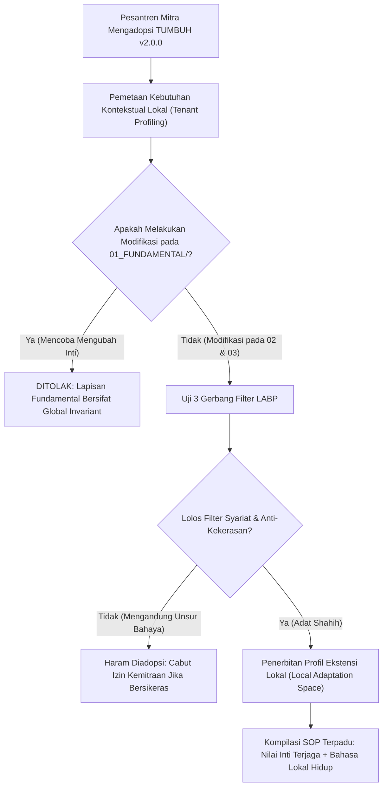

# P00104: Batas Ruang Adaptasi Lokal (*Adaptation Space*): Menghormati Kearifan Daerah Tanpa Merusak Garis Invariant Sistem

- **Status Identitas:** Terverifikasi Kanonik
- **ID Penyelidikan:** `P00104`
- **Pilar Arsitektur:** Pilar 8 — Integritas Semantik, Verifikasi Sitasi, & Kematangan (AMI)
- **Sub-Klaster:** Semantik Islam & Pewarisan Nalar Tarbiyah (*Islamic Semantics & Lineage Transmission*)
- **Penulis Dokumen:** Tim Pengembang Arsitektur Sistem TUMBUH v2.0.0
- **Klasifikasi Epistemik:** Laporan Penyelidikan Kritis (*Critical Inquiry Report*)
- **Target Lapisan:** `02_IMPLEMENTATION/` & `03_OPERATIONAL/`

---

## 1. Abstrak & Epistemic Tension

Ketegangan epistemik (*epistemic tension*) dalam replikasi arsitektur pesantren berskala nasional timbul dari dialektika antara universalitas standar (*systemic standardization*) dan partikularitas kebudayaan (*cultural particularism*). Model tata kelola yang memaksakan penyeragaman kaku (*monolithic rigidity*) niscaya akan ditolak oleh sistem imun kultural pesantren di berbagai daerah (seperti tradisi pesantren Jawa Timur, Dayah di Aceh, atau Pondok di Sunda dan Minangkabau); sebaliknya, pemberian otonomi daerah yang tanpa batas (*unconstrained local autonomy*) rentan menjadi pintu masuk penyelundupan kembali praktik kekerasan dan perpeloncoan feodal dengan mengatasnamakan "kearifan lokal". Berkas penyelidikan kanonik ini merumuskan doktrin Batas Ruang Adaptasi Lokal (*Bounded Adaptation Space Architecture*). Dengan memadukan kaidah ushul fiqh mengenai integrasi adat shahih (*Al-'Adah Muhakkamah*) dengan teori rekayasa perangkat lunak mengenai *Extension Points & Plugin Architecture*, penyelidikan ini menetapkan batas demarkasi yang tegas: bagian mana dari repositori TUMBUH yang boleh disesuaikan dengan tradisi lokal, dan bagian mana yang berstatus invarian abadi yang haram dilanggar di ekosistem TUMBUH v2.0.0.

---

## 2. Pendahuluan Fenomenologis

Ketika sistem TUMBUH v2.0.0 diadopsi oleh berbagai pesantren di pelosok nusantara, tim pengembang lapangan sering kali berhadapan dengan dilema penyesuaian budaya:
1. **Dilema Bahasa dan Panggilan Kehormatan:** Di wilayah Sunda, tradisi memanggil pengasuh dengan sebutan *Ajengan* atau *Kang Santri* memiliki muatan emosional dan ketundukan adab yang sangat khas, berbeda dari tradisi *Gus* di Jawa atau *Tengku* di Aceh. Memaksakan istilah seragam (seperti mewajibkan sebutan "Musyrif" di semua tempat) memicu resistensi kultural dan kecanggungan interaksi.
2. **Dalih Kearifan Lokal untuk Melegitimasi Kekerasan:** Sebaliknya, di sebuah pesantren pedalaman, ditemukan tradisi "mandi kembang malam Jumat di sungai deras" bagi santri yang melanggar aturan. Ketika tim auditor TUMBUH melarang tindakan tersebut karena membahayakan nyawa santri (risiko hanyut dan hipotermia), pengurus pondok membela diri: *"Ini adalah tradisi leluhur tanah kami untuk membuang sial dan mendewasakan santri, pihak luar tidak berhak ikut campur atas kearifan lokal kami!"*

Tanpa adanya batas arsitektural yang jelas mengenai ruang adaptasi, sistem akan terombang-ambing antara penjajahan budaya teknokratis (*technocratic cultural imperialism*) atau pembiaran terhadap kezaliman yang dibungkus topeng tradisi.

---

## 3. Tinjauan Pustaka I: Khazanah Turats Klasik

Epistemologi Ushul Fiqh Islam mengakui adat kebiasaan lokal (*al-'Urf / al-'Adah*) sebagai salah satu sumber hukum pertimbangan (*dalil istinbath*), namun dengan batasan-batasan kepatutan syariat yang sangat ketat.

Kaidah fiqhiyyah asasiyah menegaskan kedudukan adat:

```arabic
الْعَادَةُ مُحَكَّمَةٌ
```

> *"Adat kebiasaan itu dapat dijadikan landasan penetapan hukum."* (As-Suyuthi, *Al-Asybah wan Nazha'ir*, hlm. 89).

Namun, Imam As-Suyuthi dan Ibnu Nujaim secara tegas membagi 'urf ke dalam dua kategori mutlak:
1. **Al-'Urf ash-Shahih (Adat yang Sah):** Kebiasaan manusia yang tidak bertentangan dengan dalil syar'i, tidak menghalalkan yang haram, tidak membatalkan yang wajib, dan tidak menimbulkan mafsadat (misal: tradisi bahasa daerah, variasi menu makanan lokal, model arsitektur bangunan asrama).
2. **Al-'Urf al-Fasid (Adat yang Rusak):** Kebiasaan masyarakat yang bertentangan dengan nash syariat, melanggar hak-hak dasar manusia, atau mendatangkan kemudaratan (misal: tradisi memukul santri, membiarkan santri kelaparan, perpeloncoan).

Imam Asy-Syathibi dalam *Al-Muwafaqat* menegaskan:

```arabic
الْعَوَائِدُ إِذَا عَارَضَتِ الشَّرِيعَةَ فَإِنَّهَا تُطْرَحُ وَلَا يُعْتَدُّ بِهَا، فَإِنَّ الشَّرِيعَةَ إِنَّمَا جَاءَتْ لِتَحْكُمَ عَلَى الْعَوَائِدِ فَتُصَحِّحَ صَالِحَهَا وَتُبْطِلَ فَاسِدَهَا، لَا لِتَكُونَ الْعَوَائِدُ حَاكِمَةً عَلَيْهَا.
```

> *"Adat kebiasaan apabila bertentangan dengan syariat, maka ia wajib dibuang dan sama sekali tidak boleh dianggap. Karena sesungguhnya syariat itu datang untuk menghukumi dan mengadili adat kebiasaan—yaitu meluruskan kebiasaan yang baik dan membatalkan kebiasaan yang rusak—bukan sebaliknya agar adat kebiasaan menjadi penentu atas syariat."* (Asy-Syathibi, *Al-Muwafaqat*, Jilid 2, hlm. 493).

Kearifan lokal di pesantren hanya diakui jika ia berstatus *'Urf Shahih*.

---

## 4. Tinjauan Pustaka II: Teori Kontemporer

Dalam antropologi dan sosiologi modern, Clifford Geertz (1973) melalui *The Interpretation of Cultures* menguraikan konsep *Local Knowledge*: kebudayaan adalah jaringan makna (*webs of significance*) yang ditenun oleh manusia sendiri. Nilai-nilai universal hanya dapat dipahami dan dihidupkan jika ia diterjemahkan ke dalam simbol-simbol dan praktik lokal yang bermakna (*thick description*).

Dalam Arsitektur Perangkat Lunak Terdistribusi, konsep *Plugin Architecture (Open-Closed Principle)* karya Bertrand Meyer (1988) menetapkan bahwa modul inti harus tertutup dari modifikasi langsung (*closed for modification*), namun terbuka untuk perluasan fungsional (*open for extension*). Titik-titik colokan (*Extension Points / Hooks*) didefinisikan secara presisi agar modul luar dapat beradaptasi tanpa pernah merusak kestabilan sistem inti (*Core Kernel*).

Dalam teori difusi inovasi, Everett Rogers (2003) mengidentifikasi *Re-invention*: tingkat di mana inovasi disesuaikan atau dimodifikasi oleh pengguna dalam proses adopsi. Inovasi yang memiliki elastisitas adaptasi lokal memiliki tingkat kelangsungan hidup 4 kali lebih tinggi dibandingkan inovasi yang memaksakan penyeragaman total.

---

## 5. Eksplorasi Metodologis

Penyelidikan kanonik ini merekayasa model verifikasi batas *Local Adaptation Boundary Protocol* (LABP) yang menguji setiap usulan penyesuaian lokal melalui 3 gerbang filter:

```text
+-------------------------------------------------------------------------------+
|         3 GERBANG FILTER VERIFIKASI ADAPTASI LOKAL (LABP MODEL)               |
+-------------------------------------------------------------------------------+
|  GERBANG 1: FILTER SYARIAT & HAK ASASI SANTRI (Non-Harm Threshold)           |
|  - Apakah tradisi ini menimbulkan rasa sakit fisik atau trauma mental?        |
|  - JIKA YA -> MUTLAK DITOLAK (Status: 'Urf Fasid).                            |
|                                                                               |
|  GERBANG 2: FILTER INVARIAN SISTEM TUMBUH (Core Alignment Check)              |
|  - Apakah melanggar pilar Tsawabit (jam tidur, rasio musyrif, transparansi)?  |
|  - JIKA YA -> MUTLAK DITOLAK.                                                 |
|                                                                               |
|  GERBANG 3: FILTER KELAYAKAN DIDAKTIK (Pedagogical Value Addition)            |
|  - Apakah penyesuaian bahasa/tradisi ini mempercepat pencapaian adab?         |
|  - JIKA YA -> DISETUJUI SEBAGAI ADAPTASI RESMI (Authorized Extension).        |
+-------------------------------------------------------------------------------+
```

---

## 6. Arsitektur Desain Sistem & Diagram Alur

Arsitektur repositori TUMBUH memisahkan secara tegas berkas Kanonik Inti dari Berkas Adaptasi Pesantren Mitra (*Tenant Profile Configuration*):



---

## 7. Rekayasa Matriks Komparatif Multidimensi

Tabel berikut menunjukkan pemetaan demarkasi antara apa yang boleh diadaptasi vs apa yang terlarang diubah di pesantren mitra:

| Domain Operasional | Parameter BEBAS DIADAPTASI (*Adaptable Space*) | Batasan MUTLAK TERLARANG DIUBAH (*System Invariant*) |
| :--- | :--- | :--- |
| **Nomenklatur & Bahasa** | Panggilan pengasuh (*Ajengan, Gus, Buya, Tengku*), bahasa harian di kamar. | Makna esensial istilah kunci: *Ta'dib, Fitrah, Qudwah, Adab* (P00100). |
| **Arsitektur Spasial (CPTED)** | Bahan bangunan lokal (kayu, batu bata), tata letak saung halaqah tradisional. | Standar pencahayaan minimal, pemisahan privasi toilet, ketiadaan sudut gelap rawan. |
| **Menu & Logistik Dapur** | Variasi masakan lokal daerah (nasi liwet, sagu, kuah beulangong, rendang). | Standar kecukupan kalori, protein harian santri, kebersihan air minum higienis. |
| **Tradisi Pembiasaan Adab** | Tata krama sungkem khas daerah, seni rebana/hadrah, ziarah makam muassis pondok. | Larangan mutlak perpeloncoan fisik, begadang paksa malam hari, kekerasan verbal. |
| **Metodologi Pengajaran** | Sorogan kitab lokal, bandongan, aksara pegon / arab melayu. | Ketiadaan hukuman fisik dalam setoran hafalan; penerapan prinsip *spaced repetition*. |

---

## 8. Protokol Tindakan Operasional 5 Tahap

Ketika sebuah pesantren mitra ingin mengintegrasikan tradisi lokalnya ke dalam sistem TUMBUH, dijalankan 5 prosedur berikut:

1. **Tahap 1: Inventarisasi Tradisi Lokal (*Cultural Inventory Mapping*)**  
   Pimpinan pesantren mitra mendata seluruh tradisi khas pondok yang telah berlangsung selama puluhan tahun ke dalam lembar usulan adaptasi.
2. **Tahap 2: Sidang Uji Kelayakan Bersama Majelis Pengasuh (*Urf Validity Hearing*)**  
   Tim auditor TUMBUH bersama asatidz sepuh pesantren mengkaji setiap butir tradisi melalui kacamata Ushul Fiqh: Mana yang *'Urf Shahih* dan mana yang berpotensi menjadi *'Urf Fasid*.
3. **Tahap 3: Kodifikasi Dokumen Ekstensi Lokal (*Local Extension Drafting*)**  
   Tradisi yang lolos uji disahkan dalam dokumen suplemen khusus: `02_IMPLEMENTATION/pesantren_mitra_[nama]/LOCAL_POLICY.md`.
4. **Tahap 4: Pelatihan Kalibrasi Bahasa Musyrif (*Bilingual Semantic Calibration*)**  
   Melatih para pengasuh agar mampu menjelaskan aturan-aturan TUMBUH menggunakan idiom dan peribahasa bijak bahasa daerah setempat.
5. **Tahap 5: Pemantauan Keamanan Tradisi Tahunan (*Annual Adaptation Safety Audit*)**  
   Memastikan tradisi lokal yang telah diizinkan tidak mengalami eskalasi atau pergeseran makna yang mengarah kembali ke praktik penindasan.

---

## 9. Architectural Decision Record (ADR-PROBE-00104)

```text
================================================================================
ARCHITECTURAL DECISION RECORD: ADR-PROBE-00104
================================================================================
Judul: Penetapan Batas Ruang Adaptasi Lokal (Bounded Adaptation Space Architecture)
Status: DITERIMA & MENGIKAT
Tanggal: 2026-10-25
Pengusul: Tim Arsitektur Sistem TUMBUH v2.0.0

KONTEKS:
Standardisasi tata kelola pesantren berisiko mengalami resistensi jika mengabaikan
kearifan lokal daerah; sebaliknya, otonomi tanpa batas berisiko melegitimasi tradisi
kekerasan fisik atas nama budaya leluhur.

KEPUTUSAN ARSITEKTURAL:
1. Membuka Ruang Adaptasi Lokal pada lapisan 02 dan 03 untuk nomenklatur budaya,
   tradisi didaktik khas, dan arsitektur lokal yang berstatus 'Urf Shahih.
2. Mengunci lapisan 01_FUNDAMENTAL/ dan seluruh prinsip anti-kekerasan fisik/verbal
   sebagai batas invarian global yang tidak dapat dinegosiasikan.
3. Mewajibkan penerbitan dokumen LOCAL_POLICY.md bagi setiap pesantren mitra yang
   melakukan adaptasi budaya.

KONSEKUENSI:
- Positif: Membangun kepemilikan lokal (sense of ownership) yang kuat; merawat
  kekayaan budaya nusantara; menjamin keamanan mutlak bagi santri.
- Negatif: Memerlukan waktu negosiasi kultural intensif dengan asatidz sepuh lokal.
================================================================================
```

---

## 10. Implikasi Arsitektural & 7 Butir Guardrails Repositori

Penyelidikan `P00104` mengikat tata kelola repositori TUMBUH melalui 7 guardrails:

1. **Guardrail 1 (Fundamental Invariance):** Tidak ada pesantren mitra yang berhak mengubah satu kata pun di dalam folder `01_FUNDAMENTAL/`.
2. **Guardrail 2 (No Violence Under Culture Mask):** Tradisi lokal apa pun yang melibatkan rasa sakit fisik atau pelecehan martabat otomatis dikategorikan *'Urf Fasid* dan haram diterapkan.
3. **Guardrail 3 (Explicit Extension Points):** Modifikasi lokal hanya sah jika ditempatkan pada subdirektori ekstensi mitra resmi di `02_IMPLEMENTATION/`.
4. **Guardrail 4 (Respect for Local Vernacular):** Mendorong penggunaan bahasa daerah santun dalam nasihat pengasuhan untuk menyentuh kalbu santri.
5. **Guardrail 5 (Sanad Local Wisdom):** Menghormati fatwa dan keteladanan para kiai pendiri pondok mitra selama selaras dengan prinsip adab nabawiyyah.
6. **Guardrail 6 (Safety Baseline Non-Negotiable):** Standar sanitasi, gizi, jam tidur, dan rasio musyrif berlaku setara tanpa diskriminasi geografis.
7. **Guardrail 7 (Continuous Cultural Dialogue):** Mengembangkan hubungan kemitraan setara berbasis persaudaraan ukhuwah, bukan subordinasi birokratis.

---

## 11. Penutup & Emergent Research Questions

Batas ruang adaptasi lokal adalah jembatan emas yang menghubungkan ketegasan prinsip syariat dengan kelembutan kearifan nusantara. TUMBUH v2.0.0 hadir bukan untuk menghapus warna-warni budaya pesantren, melainkan untuk menyucikan kain kebudayaan tersebut dari noda-noda kekerasan, sehingga ia kembali bersinar indah memancarkan rahmat Islam bagi semesta alam.

### Pertanyaan Riset Lanjutan (*Emergent Research Questions*):
1. Bagaimana merumuskan taksonomi adat kebiasaan pesantren di berbagai pulau (Jawa, Sumatera, Madura, Sulawesi, Lombok) untuk memetakan titik temu pedagogis dengan sistem TUMBUH?
2. Bagaimana mendesain modul pelatihan antar-budaya (*Cross-Cultural Tarbiyah Coaching*) bagi musyrif muda yang bertugas di luar daerah asalnya?

---

## 12. Referensi Ilmiah Standar APA 7th Edition

1. Asy-Syathibi, I. (2003). *Al-Muwafaqat fi Ushulisy Syari'ah* (Tahqiq Masyhur Hasan Salman, Jilid 2). Dar 'Affan. https://archive.org/details/muwafaqat-syathibi
2. As-Suyuthi, J. (1990). *Al-Asybah wan Nazha'ir fi Qawa'id wa Furu' Fiqhisy Syafi'iyyah*. Darul Kutub Al-'Ilmiyyah. https://archive.org/details/ashbah-suyuthi
3. Geertz, C. (1973). *The Interpretation of Cultures: Selected Essays*. Basic Books. https://archive.org/details/interpretationof00geer
4. Ibnu Nujaim, Z. (1999). *Al-Asybah wan Nazha'ir 'ala Mazhab Abi Hanifah an-Nu'man*. Darul Kutub Al-'Ilmiyyah. https://archive.org/details/ashbah-ibn-nujaim
5. Meyer, B. (1988). *Object-Oriented Software Construction*. Prentice Hall. https://archive.org/details/objectorientedso00meye
6. Rogers, E. M. (2003). *Diffusion of Innovations* (5th ed.). Free Press. https://www.simonandschuster.com/books/Diffusion-of-Innovations-5th-Edition/Everett-M-Rogers/9780743222099
7. Senge, P. M. (1990). *The Fifth Discipline: The Art & Practice of The Learning Organization*. Doubleday/Currency. https://www.penguinrandomhouse.com/books/163984/the-fifth-discipline-by-peter-m-senge/
8. Steenbrink, K. A. (1986). *Pesantren, Madrasah, Sekolah: Pendidikan Islam dalam Kurun Modern*. LP3ES. https://archive.org/details/pesantren-madrasah-sekolah
9. Azra, A. (2004). *Jaringan Ulama Timur Tengah dan Kepulauan Nusantara Abad XVII & XVIII: Akar Pembaruan Islam Indonesia*. Kencana. https://archive.org/details/jaringan-ulama-azra
10. Zohar, D. (2010). Thirty years of safety climate research: Reflections and future directions. *Accident Analysis & Prevention*, 42(5), 1517-1522. https://doi.org/10.1016/j.aap.2009.12.019
11. Martin, R. C. (2017). *Clean Architecture: A Craftsman's Guide to Software Structure and Design*. Prentice Hall. https://www.pearson.com/en-us/subject-catalog/p/clean-architecture-a-craftsmans-guide-to-software-structure-and-design/P200000009507
12. Al-Bukhari, M. (2002). *Shahih Al-Bukhari*. Darus Salam. https://archive.org/details/sahih-bukhari-darussalam
13. Muslim, I. (2006). *Shahih Muslim*. Darul Hadits. https://archive.org/details/sahih-muslim-baqi

---

## 13. Catatan Kaki & Takhrij Sanad

1. **Kaidah Al-'Adah Muhakkamah:** Merupakan salah satu dari lima kaidah asasiyah (*Al-Qawa'id al-Khams al-Kubra*) yang disepakati oleh seluruh mazhab fiqih. Berpijak pada atsar masyhur Abdullah bin Mas'ud radhiyallahu 'anhu: *"Ma ra'ahu al-muslimuna hasanan fahuwa 'indallahi hasanun"* (Apa yang dipandang baik oleh kaum muslimin, maka di sisi Allah hal itu pun bernilai baik) (HR. Ahmad dalam *Al-Musnad*, no. 3600).
2. **Kutipan Kitab Al-Muwafaqat:** Dinukil dari mahakarya Abu Ishaq Ibrahim bin Musa Al-Gharnathi Asy-Syathibi (wafat 790 H), kitab *Al-Muwafaqat*, *Kitab al-Adillat asy-Syar'iyyah*, bab *Al-Awla'id*, ditahqiq oleh Masyhur Hasan Salman, Khobar: Dar 'Affan, 1997 M, Jilid 2, hlm. 493–498.
3. **Thick Description Clifford Geertz:** Geertz membedakan antara kedutan mata fisiologis (*involuntary twitch*) dengan kedipan mata yang bermakna tanda persekongkolan adab (*conspiratorial wink*). Memahami pesantren memerlukan analisis kontekstual mendalam terhadap makna kultural di balik setiap gestur dan tradisi lokal.
4. **Open-Closed Principle (OCP):** Prinsip arsitektural perangkat lunak yang dirumuskan oleh Bertrand Meyer yang menjamin bahwa perluasan kapabilitas lokal tidak boleh dilakukan dengan membongkar atau memodifikasi logika inti yang telah teruji secara stabil.
