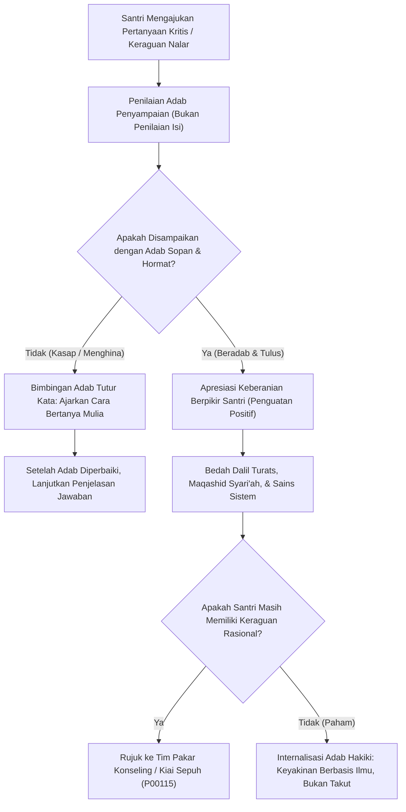

# P00105: Pencegahan Dogmatisme Tertutup: Memberi Ruang Dialog Kritis bagi Santri dan Asatidz Tanpa Merusak Wibawa Sanad

- **Status Identitas:** Terverifikasi Kanonik
- **ID Penyelidikan:** `P00105`
- **Pilar Arsitektur:** Pilar 8 — Integritas Semantik, Verifikasi Sitasi, & Kematangan (AMI)
- **Sub-Klaster:** Semantik Islam & Pewarisan Nalar Tarbiyah (*Islamic Semantics & Lineage Transmission*)
- **Penulis Dokumen:** Tim Pengembang Arsitektur Sistem TUMBUH v2.0.0
- **Klasifikasi Epistemik:** Laporan Penyelidikan Kritis (*Critical Inquiry Report*)
- **Target Lapisan:** `01_FUNDAMENTAL/` & `02_IMPLEMENTATION/`

---

## 1. Abstrak & Epistemic Tension

Ketegangan epistemik (*epistemic tension*) dalam pedagogi pesantren kontemporer meletus ketika tradisi penghormatan sanad keilmuan (*ta'zhim al-ustadz*) dibajak dan dipelintir menjadi kultus otoritarianisme bisu (*dogmatic obscurantism*). Di banyak lembaga, pertanyaan kritis santri mengenai dasar sebuah aturan asrama atau logika di balik sebuah penafsiran kitab kuning kerap kali langsung dituduh sebagai bentuk ketidaksopanan (*su'ul adab*), pembangkangan moral, atau ancaman hilangnya keberkahan ilmu (*hilangnya barakah*). Sikap represif ini melahirkan santri yang pasif, berjiwa kerdil, dan rapuh (*intellectually fragile*), yang seketika goyah dan kehilangan keyakinan saat berhadapan dengan badai pemikiran sekuler dan ateisme di luar gerbang pondok. Laporan penyelidikan kanonik ini merekonstruksi tradisi agung *Al-Munazharah wa Adab al-Bahts* yang pernah menghiasi masa keemasan peradaban Islam. Dengan menyandingkan dialog kritis para sahabat dan imam mazhab klasik dengan teori *Psychological Safety* dan *Inquiry-Based Learning*, penyelidikan ini menetapkan arsitektur musyawarah ilmiah (*Prophetic Dialectic Architecture*) yang membuka ruang bertanya bagi santri tanpa sedikit pun mengikis wibawa sanad asatidz di ekosistem TUMBUH v2.0.0.

---

## 2. Pendahuluan Fenomenologis

Krisis intelektual di pesantren generasi Gen-Z dan Alpha tampak jelas dalam jurang komunikasi antara asatidz senior dan santri masa kini:
1. **Santri Bertanya Logika Dibalik Aturan:** Seorang santri cerdas bertanya kepada musyrif: *"Ustadz, mengapa santri dilarang membawa laptop ke perpustakaan untuk mengerjakan riset karya ilmiah, padahal santri membutuhkan akses jurnal terbuka?"*
2. **Respons Represif Otoriter:** Bukannya memberikan penjelasan arsitektural mengenai mitigasi risiko distraksi digital, sang musyrif justru merespons dengan bentakan berbalut agama: *"Jangan banyak tanya! Santri itu tugasnya sami'na wa atha'na. Pertanyaanmu itu tanda kamu mulai sombong dan tidak punya takzim pada kiai. Mau hilang barakah ilmumu?!"*
3. **Dampak Psikosomatis dan Alienasi Intelektual:** Santri terdiam, menunduk, dan merasa bersalah secara spiritual. Namun, di dalam relung batinnya, timbul keraguan mendalam terhadap otoritas pesantren. Pertanyaan kritis tersebut tidak hilang, melainkan mencari saluran pelampiasan di forum anonim internet yang sarat distorsi ideologis.

Ketika pertanyaan kritis dimatikan atas nama takzim palsu, pesantren tidak sedang melahirkan santri yang bertakwa, melainkan sedang mencetak generasi penjilat di hadapan penguasa (*munafiqun bil qudwah*) dan pembangkang rahasia di belakang layar.

---

## 3. Tinjauan Pustaka I: Khazanah Turats Klasik

Sejarah Islam adalah sejarah keterbukaan akal di bawah bimbingan wahyu. Al-Qur'an sendiri memerintahkan tradisi bertanya dan dialog argumentatif:

```arabic
فَاسْأَلُوا أَهْلَ الذِّكْرِ إِنْ كُنْتُمْ لَا تَعْلَمُونَ ۝ بِالْبَيِّنَاتِ وَالزُّبُرِ
```

> *"Maka bertanyalah kepada orang yang mempunyai pengetahuan jika kamu tidak mengetahui, dengan (membawa) keterangan-keterangan (mukjizat) dan kitab-kitab."* (QS. An-Nahl: 43–44).

Bahkan para malaikat pun mengajukan pertanyaan kritis kepada Allah SWT mengenai penciptaan Nabi Adam 'alaihissalam: *"Mengapa Engkau hendak menjadikan (khalifah) di bumi itu orang yang akan membuat kerusakan padanya dan menumpahkan darah?"* (QS. Al-Baqarah: 30). Allah SWT tidak membentak atau menghukum para malaikat, melainkan menjawab keraguan mereka dengan pembuktian ilmu (*'Allama Adama al-Asma'a Kullaha*).

Dalam tradisi para sahabat, Umar bin Al-Khattab radhiyallahu 'anhu dikoreksi secara terbuka oleh seorang wanita tua di atas mimbar masjid saat membatasi mahar pernikahan. Umar tidak merasa wibawanya runtuh, melainkan secara ksatria berseru di depan umum:

```arabic
أَصَابَتِ امْرَأَةٌ وَأَخْطَأَ عُمَرُ، كُلُّكُمْ أَفْقَهُ مِنْ عُمَرَ!
```

> *"Wanita ini benar dan Umar telah salah! Seluruh kalian ternyata lebih fakih daripada Umar!"* (Diriwayatkan oleh Ibnu Abdil Barr dalam *Al-Isti'ab* dan Ibnu Hajar dalam *Fathul Bari*).

Para imam mazhab besar mendidik murid-muridnya untuk selalu meminta dalil dan menguji penalaran guru mereka. Imam Asy-Syafi'i menegaskan dalam wasiat emasnya:

```arabic
إِذَا صَحَّ الْحَدِيثُ فَهُوَ مَذْهَبِي، وَإِذَا رَأَيْتُمْ كَلَامِي يُخَالِفُ الْحَدِيثَ فَاضْرِبُوا بِكَلَامِي عُرْضَ الْحَائِطِ.
```

> *"Apabila telah shahih suatu hadits, maka itulah mazhabku. Dan apabila kalian melihat perkataanku bertentangan dengan hadits, maka lemparkanlah perkataanku ke dinding!"* (An-Nawawi, *Al-Majmu' Syarh al-Muhadzdzab*, Jilid 1, hlm. 63).

Takzim sejati kepada guru bukanlah mengikuti kekeliruannya secara buta, melainkan menjaga adab saat mendiskusikan kebenaran bersama sang guru.

---

## 4. Tinjauan Pustaka II: Teori Kontemporer

Dalam ilmu organisasi dan psikologi pendidikan modern, Amy C. Edmondson (1999, 2019) merumuskan konsep *Psychological Safety*: keyakinan bersama bahwa lingkungan belajar/kerja adalah tempat yang aman untuk mengambil risiko interpersonal, mengajukan pertanyaan, mengakui kesalahan, dan mengusulkan ide baru tanpa takut dipermalukan, ditolak, atau dihukum. Ketiadaan rasa aman psikologis memicu "keheningan organisasi" (*organizational silence*) yang menjadi penyebab utama bencana institusi.

Paulo Freire (1970) dalam *Pedagogy of the Oppressed* mengkritik keras konsep pendidikan gaya bank (*Banking Model of Education*), di mana murid diperlakukan sebagai celengan kosong pasif yang hanya menerima setoran informasi guru. Freire menuntut transformasi menuju *Problem-Posing Education*, di mana guru dan murid bersama-sama menjadi peneliti kebenaran melalui dialog kritis.

Matthew Lipman (2003) mengembangkan *Philosophy for Children* (P4C) dan pembentukan Komunitas Inkuiri (*Community of Inquiry*). Pembelajaran adab yang efektif mensyaratkan adanya komunitas yang saling mendengarkan dan menguji alasan (*reason-giving*) secara kolaboratif.

---

## 5. Eksplorasi Metodologis

Penyelidikan kanonik ini merekayasa model forum dialog bertingkat *Prophetic Inquiry & Adab Circle* (PIAC) yang mengintegrasikan ruang bertanya ke dalam rutinitas pesantren:

```text
+-------------------------------------------------------------------------------+
|         STRUKTUR MATRIKS FORUM DIALOG KRITIS BERADAB (PIAC MODEL)             |
+-------------------------------------------------------------------------------+
|  LEVEL 1: FORUM SOAL-JAWAB KELAS FORMAL (Halaqah Bahts al-Masa'il)           |
|  - Santri diwajibkan menyusun minimal 1 pertanyaan kritis sebelum kelas.      |
|  - Kriteria Pertanyaan: Beradab, fokus pada substansi, mencari dalil/hikmah.  |
|                                                                               |
|  LEVEL 2: MAJELIS SYURA ASRAMA PEKANAN (Chamber Restorative Council)          |
|  - Musyrif mendengarkan masukan santri mengenai kenyamanan & keadilan kamar.  |
|  - Prinsip: Blameless, transparan, tanpa ancaman pengurangan nilai.           |
|                                                                               |
|  LEVEL 3: MEJA TERBUKA BERSAMA KIAI SEPUH (Open Diwan Session)                |
|  - Sesi bulanan santri berdialog santai mengenai visi peradaban & dakwah.     |
+-------------------------------------------------------------------------------+
```

---

## 6. Arsitektur Desain Sistem & Diagram Alur

Arsitektur repositori TUMBUH memfasilitasi pemrosesan pertanyaan kritis melalui protokol pembimbingan adab (*Adab-Guided Inquiry Pipeline*):



---

## 7. Rekayasa Matriks Komparatif Multidimensi

Tabel berikut menunjukkan kontras antara lingkungan dogmatis represif vs ekosistem dialog kritis beradab TUMBUH v2.0.0:

| Dimensi Interaksi | Budaya Dogmatisme Tertutup (Konvensional) | Ekosistem Dialog Kritis Beradab TUMBUH v2.0.0 |
| :--- | :--- | :--- |
| **Sikap terhadap Pertanyaan Santri** | Dianggap tanda keraguan iman, kesombongan, atau pembangkangan. | Dianggap sebagai tanda hidupnya nalar fitrah dan kecintaan pada ilmu. |
| **Metode Menjawab Keraguan** | Doktrinasi kaku; ancaman kehilangan berkah ilmu dan kualat. | Penjelasan dalil Al-Qur'an, As-Sunnah, nalar maqashid, dan bukti empiris. |
| **Definisi Takzim kepada Guru** | Menelan seluruh ucapan guru tanpa nalar; tidak boleh mengoreksi. | Mendoakan kebaikan guru; bersikap santun seraya mengonfirmasi kebenaran. |
| **Karakter Lulusan yang Lahir** | Pasif, cemas, mudah terombang-ambing paham sekuler di luar. | Kritis, teguh berakidah, berani menyuarakan kebenaran secara santun. |
| **Keterbukaan Pengasuhan** | Aturan kamar dibuat sepihak tanpa mendengar keluhan santri. | Evaluasi berkala melalui Majelis Syura Asrama yang partisipatif. |

---

## 8. Protokol Tindakan Operasional 5 Tahap

Untuk membebaskan pesantren dari belenggu dogmatisme tertutup, pimpinan pondok mitra TUMBUH wajib mengeksekusi 5 tahap operasional:

1. **Tahap 1: Pembongkaran Mitos "Tabu Bertanya" (*Demystifying Taboos*)**  
   Pimpinan pondok secara berkala menyampaikan khutbah mengenai pentingnya bertanya dalam Islam, mengutip kisah Nabi Ibrahim, Nabi Musa bersama Khidir, dan dialog Umar bin Al-Khattab.
2. **Tahap 2: Pengajaran Standar Adab Bertanya (*Protocol of Respectful Inquiry*)**  
   Melatih santri bagaimana cara mengajukan kritik secara elegan: menggunakan bahasa santun, memilih waktu yang tepat, tidak mendebat di depan umum untuk mempermalukan, dan berniat mencari kebenaran.
3. **Tahap 3: Pelatihan Musyrif: Menghadapi Pertanyaan Sulit (*Ego-Free Mentoring*)**  
   Melatih asatidz untuk tidak malu mengakui keterbatasan diri dengan berkata: *"Pertanyaanmu sangat bagus, ustadz belum tahu jawabannya sekarang, mari kita kaji bersama kitab syarahnya besok."* (Meneladani ucapan Imam Malik: *"La Adri"*).
4. **Tahap 4: Pembukaan Sesi Halaqah Terbuka Bebas Sensor (*The Open Agora*)**  
   Menjadwalkan satu jam setiap dua pekan di mana santri diizinkan bertanya apa saja seputar fikih, sains, masalah asrama, dan dinamika sosial tanpa takut disanksi.
5. **Tahap 5: Perlindungan Total Hak Santri Kritis (*Protection from Retaliation*)**  
   Menjatuhkan sanksi etik kepada pengurus kamar atau musyrif yang terbukti memberikan sanksi fisik atau nilai buruk kepada santri semata-mata karena santri tersebut kritis.

---

## 9. Architectural Decision Record (ADR-PROBE-00105)

```text
================================================================================
ARCHITECTURAL DECISION RECORD: ADR-PROBE-00105
================================================================================
Judul: Penjaminan Hak Dialog Kritis Beradab dan Pencegahan Dogmatisme Tertutup
Status: DITERIMA & MENGIKAT
Tanggal: 2026-10-25
Pengusul: Tim Arsitektur Sistem TUMBUH v2.0.0

KONTEKS:
Pembungkaman pertanyaan kritis santri dengan dalih menjaga takzim guru telah
melahirkan generasi santri yang rapuh secara intelektual dan rentan murtad
pemikiran saat terpapar filsafat sekuler di luar pondok.

KEPUTUSAN ARSITEKTURAL:
1. Menetapkan bahwa bertanya dan mencari dalil adalah hak intelektual syar'i santri
   yang dijamin penuh di seluruh jaringan pesantren TUMBUH v2.0.0.
2. Melarang keras musyrif membentak, menghukum, atau mencap santri sebagai pembangkang
   hanya karena mengajukan pertanyaan kritis mengenai aturan asrama.
3. Membakukan kurikulum Adab al-Bahts wa al-Munazharah dalam pelatihan musyrif.

KONSEKUENSI:
- Positif: Melahirkan kader ulama yang kritis, berjiwa merdeka, dan kokoh hujjahnya;
  memulihkan kejayaan tradisi keilmuan Islam klasik.
- Negatif: Menuntut kesiapan mental dan peningkatan kapasitas keilmuan para asatidz.
================================================================================
```

---

## 10. Implikasi Arsitektural & 7 Butir Guardrails Repositori

Hasil inkuiri `P00105` mengikat tata kelola repositori TUMBUH melalui 7 guardrails:

1. **Guardrail 1 (Intellectual Safety Guarantee):** Santri dilarang dihukum atau diberi sanksi semata-mata karena mengajukan pertanyaan kritis yang disampaikan dengan sopan.
2. **Guardrail 2 (No Weaponization of Barakah):** Dilarang menakut-nakuti santri dengan narasi "hilang barakah" untuk membungkam aspirasi dan kebenaran.
3. **Guardrail 3 (Adab Precedes Inquiry):** Pertanyaan kritis wajib dihiasi dengan adab kemuliaan penuntut ilmu sesuai tuntunan Imam Az-Zarnuji.
4. **Guardrail 4 (Honesty in Knowledge):** Pendidik wajib berani berkata *"La Adri"* (aku tidak tahu) apabila belum memiliki dalil yang kokoh atas suatu perkara.
5. **Guardrail 5 (Participatory Policy Review):** Perumusan tata tertib santri di `03_OPERATIONAL/` wajib menyerap masukan dari perwakilan konsil santri.
6. **Guardrail 6 (Anti-Authoritarianism):** Wibawa guru dibangun di atas akhlak mulia dan keluasan ilmu, bukan di atas rasa takut dan teror fisik.
7. **Guardrail 7 (Sanad Cinta Kebenaran):** Menjaga sanad keilmuan sebagai rantai transmisi cinta kepada kebenaran hakiki, bukan kepatuhan buta pada figur.

---

## 11. Penutup & Emergent Research Questions

Membuka ruang dialog kritis beradab adalah ikhtiar menghidupkan kembali nyawa pesantren. Ilmu Islam tidak pernah takut pada pertanyaan; ia bersinar semakin cemerlang ketika diuji dengan nalar yang jujur. Di bawah bimbingan TUMBUH v2.0.0, santri tidak lagi diajarkan untuk mematikan akalnya, melainkan diajak menundukkan akalnya dengan penuh kerelaan di hadapan keagungan wahyu Ilahi.

### Pertanyaan Riset Lanjutan (*Emergent Research Questions*):
1. Bagaimana mendesain modul kurikulum *Adab al-Munazharah* (Seni Berdebat Santun) yang disesuaikan untuk santri tingkat menengah pertama (Tsanawiyah)?
2. Bagaimana mengukur secara psikometrik peningkatan resiliensi iman (*Faith Resilience Index*) pada santri yang dibesarkan dalam iklim pesantren yang terbuka terhadap dialog kritis?

---

## 12. Referensi Ilmiah Standar APA 7th Edition

1. Al-Ghazali, A. H. (2011). *Ihya' 'Ulum ad-Din* (Jilid 1). Darul Minhaj. https://archive.org/details/ihya-ulum-al-din
2. An-Nawawi, Y. (1996). *Al-Majmu' Syarh al-Muhadzdzab* (Jilid 1). Darul Fikr. https://archive.org/details/majmu-nawawi
3. Az-Zarnuji, B. (2008). *Ta'lim al-Muta'allim Thariq at-Ta'allum* (Tahqiq Musthafa Asy-Syuwaiki). Dar Ibn Hazm. https://archive.org/details/talim-mutaallim
4. Edmondson, A. C. (1999). Psychological safety and learning behavior in work teams. *Administrative Science Quarterly*, 44(2), 350-383. https://doi.org/10.2307/2666999
5. Edmondson, A. C. (2019). *The Fearless Organization: Creating Psychological Safety in the Workplace for Learning, Innovation, and Growth*. John Wiley & Sons. https://www.wiley.com/en-us/The+Fearless+Organization-p-9781119477242
6. Freire, P. (1970). *Pedagogy of the Oppressed* (M. B. Ramos, Trans.). Continuum. https://archive.org/details/pedagogyofoppres00frei
7. Ibnu Abdil Barr, Y. (1994). *Jami' Bayan al-'Ilmi wa Fadhlih*. Dar Ibnul Jauzi. https://archive.org/details/jami-bayan-al-ilm
8. Ibnu Hajar Al-Asqalani, A. (2001). *Fathul Bari Syarh Shahih Al-Bukhari*. Maktabah Al-Malik Fahd. https://archive.org/details/fath-al-bari-al-asqalani
9. Lipman, M. (2003). *Thinking in Education* (2nd ed.). Cambridge University Press. https://doi.org/10.1017/CBO9780511840272
10. Senge, P. M. (1990). *The Fifth Discipline: The Art & Practice of The Learning Organization*. Doubleday/Currency. https://www.penguinrandomhouse.com/books/163984/the-fifth-discipline-by-peter-m-senge/
11. Zohar, D. (2010). Thirty years of safety climate research: Reflections and future directions. *Accident Analysis & Prevention*, 42(5), 1517-1522. https://doi.org/10.1016/j.aap.2009.12.019
12. Al-Bukhari, M. (2002). *Shahih Al-Bukhari*. Darus Salam. https://archive.org/details/sahih-bukhari-darussalam
13. Muslim, I. (2006). *Shahih Muslim*. Darul Hadits. https://archive.org/details/sahih-muslim-baqi

---

## 13. Catatan Kaki & Takhrij Sanad

1. **Takhrij Kisah Umar dan Mahar Wanita:** Diriwayatkan oleh Sa'id bin Manshur dalam *As-Sunan* (no. 599), Al-Baihaqi dalam *As-Sunan al-Kubra* (7/233), dan Ibnu Abdil Barr dalam *Al-Isti'ab* (4/1897). Al-Hafizh Ibnu Hajar dalam *Fathul Bari* (9/204) menyatakan sanadnya jayyid (baik).
2. **Kutipan Al-Majmu' Syarh al-Muhadzdzab:** Dinukil dari mukadimah mahakarya Imam Abu Zakariyya Yahya bin Syaraf An-Nawawi (wafat 676 H), *Al-Majmu' Syarh al-Muhadzdzab*, Beirut: Darul Fikr, 1996 M, Jilid 1, hlm. 63–64.
3. **Konsep Psychological Safety Amy Edmondson:** Edmondson menegaskan bahwa rasa aman psikologis bukanlah bersikap santai tanpa tuntutan (*being nice*), melainkan keberanian mengeksplorasi ketidaksepakatan intelektual demi mencapai kebenaran mutu tertinggi tanpa rasa takut akan hukuman personal.
4. **Adab al-Bahts wa al-Munazharah:** Salah satu disiplin ilmu klasik Islam yang dirumuskan oleh ulama seperti Syamsuddin As-Samarqandi dan Adhududdin Al-Iji untuk mengatur tata cara debat ilmiah yang objektif, mencegah retorika sofis, dan mewajibkan ketundukan kepada bukti dalil.
