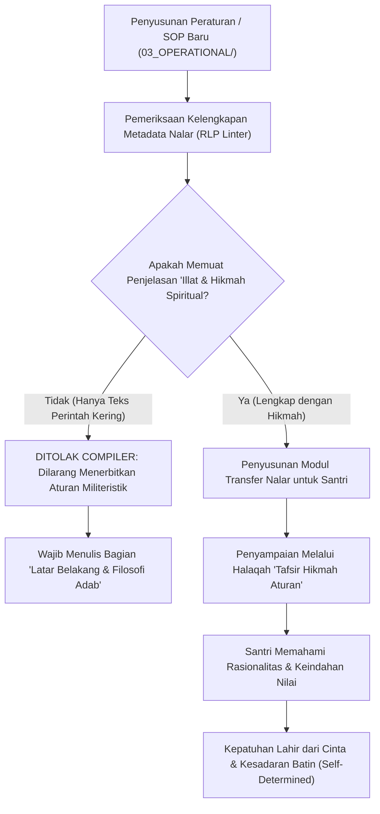

# P00106: Pewarisan Memori Penalaran Antargenerasi (*Reasoning Lineage Transmission*): Mencegah Warisan Berubah Menjadi Ritual Kosong

- **Status Identitas:** Terverifikasi Kanonik
- **ID Penyelidikan:** `P00106`
- **Pilar Arsitektur:** Pilar 8 — Integritas Semantik, Verifikasi Sitasi, & Kematangan (AMI)
- **Sub-Klaster:** Semantik Islam & Pewarisan Nalar Tarbiyah (*Islamic Semantics & Lineage Transmission*)
- **Penulis Dokumen:** Tim Pengembang Arsitektur Sistem TUMBUH v2.0.0
- **Klasifikasi Epistemik:** Laporan Penyelidikan Kritis (*Critical Inquiry Report*)
- **Target Lapisan:** `01_FUNDAMENTAL/` & `02_IMPLEMENTATION/`

---

## 1. Abstrak & Epistemic Tension

Ketegangan epistemik (*epistemic tension*) dalam kesinambungan budaya pesantren terletak pada degradasi transmisi nilai (*transgenerational value erosion*): fenomena sosiologis di mana sebuah tradisi atau aturan asrama yang awalnya diciptakan oleh pendiri pondok dengan alasan filosofis (*hikmah*) dan nalar kemaslahatan (*'illat*) yang sangat mendalam, seiring berjalannya waktu dan bergantinya generasi musyrif, perlahan-lahan kehilangan ruh penalarannya dan merosot menjadi sekadar ritual kaku yang mekanistis (*cargo-cult ritualism*). Santri generasi baru diwajibkan mematuhi ritual tersebut tanpa pernah diberi tahu "mengapa" aturan itu ada, sehingga kepatuhan yang terbangun adalah kepatuhan berbasis rasa takut (*fear-driven compliance*) alih-alih cinta pada adab (*love-driven adab*). Berkas penyelidikan kanonik ini merekayasa arsitektur Pewarisan Memori Penalaran Antargenerasi (*Reasoning Lineage Transmission Architecture*). Dengan memadukan metodologi *Ta'lil al-Ahkam* dalam Ushul Fiqh klasik dengan Model Spiral Pengetahuan SECI (*Nonaka & Takeuchi*), penyelidikan ini menetapkan mekanisme dokumentasi nalar (*Decision Traceability*) yang menjamin bahwa setiap aturan di ekosistem TUMBUH v2.0.0 selalu diwariskan bersama dengan "jiwa filosofisnya" melintasi abad peradaban.

---

## 2. Pendahuluan Fenomenologis

Gejala pembusukan nalar menjadi ritual kosong tampak jelas dalam anekdot sosiologis yang sangat nyata di banyak pesantren:
Dahulu kala, seorang Kiai pendiri pondok memiliki seekor kucing kesayangan yang suka mengeong di dekat mihrab masjid saat shalat berjamaah. Agar jamaah tetap khusyuk, sang Kiai memerintahkan santri untuk mengikat kucing tersebut di tiang serambi setiap kali menjelang azan berkumandang.
Tiga puluh tahun kemudian, sang Kiai wafat dan kucing pertama pun telah mati. Namun, para pengurus asrama generasi ketiga tetap berburu kucing liar setiap sore dan mengikatnya di tiang masjid sebelum shalat. Ketika seorang santri baru bertanya: *"Mengapa kita harus mengikat kucing di tiang sebelum shalat?"*, pengurus kamar membentaknya: *"Jangan kurang ajar! Ini adalah amalan sunnah pondok yang diwariskan langsung oleh Mbah Kiai. Mengikat kucing di tiang inilah yang mendatangkan keberkahan jamaah kita!"*

Anekdot ini merefleksikan patologi nyata di lantai asrama:
- **Aturan Pembersihan Lemari:** Santri diwajibkan melipat sajadah dengan orientasi sudut tertentu yang sangat menyiksa, bukan karena alasan kerapian fungsional, melainkan karena dulu ada musyrif angkatan pertama yang terbiasa melipat demikian.
- **Larangan Minum Sambil Berdiri:** Disampaikan kepada santri dengan ancaman mistis ("nanti perutmu dipatok ular"), bukan dengan penjelasan medis mengenai katup sfingter lambung dan adab nabawiyyah yang agung.

Ketika nalar di balik aturan terputus dari transmisi, santri menjalankan aturan dengan gerutu batin (*passive-aggressive resistance*), dan seketika meninggalkan aturan tersebut begitu mereka keluar dari gerbang pesantren.

---

## 3. Tinjauan Pustaka I: Khazanah Turats Klasik

Islam menolak keras taklid buta (*at-taqlid al-a'ma*) yang mengikuti warisan nenek moyang tanpa nalar dan bukti kebenaran. Al-Qur'an berulang kali mencela kaum musyrikin yang membela kesesatan mereka dengan dalih ritual leluhur:

```arabic
وَإِذَا قِيلَ لَهُمُ اتَّبِعُوا مَا أَنْزَلَ اللَّهُ قَالُوا بَلْ نَتَّبِعُ مَا أَلْفَيْنَا عَلَيْهِ آبَاءَنَا ۗ أَوَلَوْ كَانَ آبَاؤُهُمْ لَا يَعْقِلُونَ شَيْئًا وَلَا يَهْتَدُونَ
```

> *"Dan apabila dikatakan kepada mereka: 'Ikutilah apa yang telah diturunkan Allah,' mereka menjawab: '(Tidak), tetapi kami hanya mengikuti apa yang telah kami dapati dari nenek moyang kami.' (Apakah mereka akan mengikuti juga), walaupun nenek moyang mereka itu tidak mengetahui suatu apa pun, dan tidak mendapat petunjuk?"* (QS. Al-Baqarah: 170).

Dalam mendidik anak, Al-Qur'an mencontohkan metode pewarisan nalar melalui nasihat Luqman Al-Hakim kepada putranya. Luqman tidak sekadar memberi perintah, melainkan selalu menyertakan alasan filosofis dan hikmah di balik setiap perintah:

```arabic
يَا بُنَيَّ أَقِمِ الصَّلَاةَ وَأْمُرْ بِالْمَعْرُوفِ وَانْهَ عَنِ الْمُنْكَرِ وَاصْبِرْ عَلَىٰ مَا أَصَابَكَ ۖ إِنَّ ذَٰلِكَ مِنْ عَزْمِ الْأُمُورِ
```

> *"Wahai anakku, dirikanlah shalat, suruhlah (manusia) berbuat yang makruf dan cegahlah (mereka) dari yang mungkar, serta bersabarlah terhadap apa yang menimpamu; sesungguhnya yang demikian itu termasuk perkara-perkara yang penting (dan membutuhkan keteguhan hati)."* (QS. Luqman: 17).

Para ulama Ushul Fiqh menetapkan bahwa mayoritas hukum syariat muamalah dan adat memiliki alasan kausalitas yang rasional (*Ma'qul al-Ma'na / Mu'allal*):

```arabic
الْحُكْمُ يَدُورُ مَعَ عِلَّتِهِ وُجُودًا وَعَدَمًا
```

> *"Hukum itu beredar bersama 'illat-nya (alasan hukumnya), baik dalam keberadaannya maupun ketiadaannya."* (As-Subki, *Al-Asybah wan Nazha'ir*, Jilid 1, hlm. 124).

Jika alasan kemaslahatannya telah hilang, maka bentuk teknis aturan tersebut wajib dievaluasi agar tidak berubah menjadi beban kezaliman yang sia-sia.

---

## 4. Tinjauan Pustaka II: Teori Kontemporer

Dalam teori manajemen pengetahuan (*Knowledge Management*), Ikujiro Nonaka dan Hirotaka Takeuchi (1995) merumuskan Model SECI:
1. *Socialization* (Transmisi pengetahuan tersirat / *Tacit to Tacit* melalui keteladan langsung).
2. *Externalization* (Artikulasi pengetahuan tersirat menjadi konsep tertulis / *Tacit to Explicit*).
3. *Combination* (Penggabungan berbagai dokumen sistem menjadi arsitektur / *Explicit to Explicit*).
4. *Internalization* (Penyerapan dokumen tertulis menjadi karakter bawah sadar / *Explicit to Tacit*).

Bencana ritual kosong terjadi ketika organisasi melompati tahap *Externalization*: alasan pendiri tidak pernah ditulis secara filosofis, melainkan hanya diwariskan secara lisan sambil lalu, sehingga generasi penerus hanya mewarisi cangkang fisiknya saja.

Richard Dawkins (1976) memperkenalkan konsep Memetika (*Meme Theory*). Gagasan budaya dapat bermutasi menjadi parasit ritual (*parasitic memes*) yang menguras energi masyarakat tanpa memberikan fungsi adaptif nyata jika tidak dikendalikan oleh filter penalaran kritis (*critical reasoning filter*).

---

## 5. Eksplorasi Metodologis

Penyelidikan kanonik ini merekayasa model penelusuran nalar *Reasoning Lineage Protocol* (RLP) yang mewajibkan penyertaan Dokumen Riwayat Penalaran (*Reasoning Artifact*) pada setiap regulasi TUMBUH:

```text
+-------------------------------------------------------------------------------+
|         ANATOMI TRANSMISI NALAR ANTARGENERASI TUMBUH (RLP MODEL)              |
+-------------------------------------------------------------------------------+
|  KOMPONEN 1: PERNYATAAN REGULASI OPERASIONAL (What to do)                     |
|  - Contoh: "Santri wajib meletakkan sandal menghadap ke arah luar pintu."     |
|                                                                               |
|  KOMPONEN 2: 'ILLAT TEKNIS-MASLAHAT (Why it exists - The Practical Reason)    |
|  - Agar saat darurat kebakaran/gempa, santri dapat langsung melangkah keluar  |
|    tanpa berputar balik membuang detik-detik berharga.                        |
|                                                                               |
|  KOMPONEN 3: HIKMAH SPIRITUAL-ADAB (The Higher Spiritual Value)               |
|  - Menanamkan kesadaran mawas diri (Muraqabah), persiapan menghadapi masa     |
|    depan, dan memuliakan hak jalan serta ketenangan pandangan mata sesama.    |
|                                                                               |
|  KOMPONEN 4: TAUTAN KEPUTUSAN KANONIK (Traceability Link)                    |
|  - Terhubung langsung ke berkas Architectural Decision Record (ADR-PROBE).    |
+-------------------------------------------------------------------------------+
```

---

## 6. Arsitektur Desain Sistem & Diagram Alur

Arsitektur repositori TUMBUH melarang penerbitan aturan tanpa berkas nalar pendamping (*Rationale Attachment Pipeline*):



---

## 7. Rekayasa Matriks Komparatif Multidimensi

Tabel berikut menunjukkan perbandingan antara transmisi ritual kosong vs pewarisan memori penalaran TUMBUH v2.0.0:

| Objek Aturan Asrama | Transmisi Ritual Kosong (Tanpa Nalar) | Dampak pada Jiwa Santri | Pewarisan Memori Penalaran TUMBUH v2.0.0 |
| :--- | :--- | :--- | :--- |
| **Kerapian Ranjang Tidur** | "Lipat selimut tepat jam 05.00, kalau tidak dilipat disita pengurus!" | Melipat dengan terpaksa; kamar berantakan saat liburan di rumah. | "Menata ranjang adalah kemenangan pertama menaklukkan nafsu malas di awal hari (*keystone habit*)." |
| **Piket Cuci Piring Mandiri** | "Cuci piring sendiri, yang tidak cuci disiram air got!" | Santri merasa diperbudak; saling lempar tanggung jawab kotoran. | "Khidmah piring melatih tawadhu', menghargai rezeki Allah, dan tidak membebani orang lain." |
| **Antrean Mengambil Wudhu** | "Jangan menyerobot antrean nanti kuwalat sama senior!" | Menyerobot saat musyrif lengah; budaya suap antrean. | "Antrean wudhu adalah latihan keadilan syariat (*Inshaf*); mendahulukan hak orang yang datang lebih awal." |
| **Adab Berbicara Lembut** | "Dilarang teriak di asrama, aturan pondok melarang gaduh!" | Berteriak dan memaki saat berada di luar kompleks pesantren. | "Menjaga volume suara adalah cerminan ketenangan jiwa (*sakinah*) dan perlindungan hak istirahat sesama." |
| **Koleksi Infak Jumat** | "Wajib setor uang Rp 5.000 ke bendahara, tidak boleh absen!" | Merasa dipungut pajak paksa; tidak ikhlas beramal. | "Infak melatih pembersihan jiwa dari penyakit kikir (*syuhh*) dan membangun empati pada dhuafa." |

---

## 8. Protokol Tindakan Operasional 5 Tahap

Untuk memastikan nalar aturan selalu mengalir segar kepada generasi penerus, lembaga pengasuhan wajib menerapkan 5 tahap:

1. **Tahap 1: Bedah Filosofi Aturan Pekan Orientasi (*The Why Orientation*)**  
   Pada pekan pertama santri baru masuk asrama, alokasikan 50% waktu bukan untuk menghafal pasal-pasal sanksi, melainkan membedah "mengapa pondok ini memiliki aturan-aturan tersebut".
2. **Tahap 2: Dokumentasi Kartu Saku Hikmah (*Hikmah Pocket Cards*)**  
   Setiap aturan kunci dicetak dalam format kartu saku bergambar yang memuat penjelasan ilmiah, sabda Nabi SAW, dan manfaat praktis bagi santri.
3. **Tahap 3: Ujian Nalar Bukan Hafalan Pasal (*Reasoning Assessment*)**  
   Evaluasi kedisiplinan santri tidak menguji berapa nomor pasal pelanggaran, melainkan menguji pemahaman santri: *"Apa hikmah di balik larangan begadang malam?"*
4. **Tahap 4: Dialog Pewarisan Pengurus Kamar (*Senior-to-Junior Mentoring*)**  
   Sebelum santri senior melantik santri junior menjadi pengurus kamar baru, diadakan retret khusus di mana senior menceritakan sejarah jatuh-bangun dan alasan di balik setiap SOP asrama.
5. **Tahap 5: Pemangkasan Aturan Usang (*Pruning Dead Rules Audit*)**  
   Setiap akhir tahun, tim pengasuhan mengevaluasi: Apakah ada aturan yang 'illat-nya sudah tidak ada di dunia nyata? Jika ada, aturan tersebut dihapus secara resmi agar tidak menjadi ritual kosong.

---

## 9. Architectural Decision Record (ADR-PROBE-00106)

```text
================================================================================
ARCHITECTURAL DECISION RECORD: ADR-PROBE-00106
================================================================================
Judul: Mandat Pewarisan Memori Penalaran Antargenerasi (Reasoning Lineage Transmission)
Status: DITERIMA & MENGIKAT
Tanggal: 2026-10-25
Pengusul: Tim Arsitektur Sistem TUMBUH v2.0.0

KONTEKS:
Banyak aturan pesantren merosot menjadi ritual kosong mekanis yang dijalankan
tanpa pemahaman nalar, memicu kemunafikan sikap dan hilangnya adab sejati
begitu santri lulus dari pesantren.

KEPUTUSAN ARSITEKTURAL:
1. Mewajibkan seluruh dokumen SOP di 03_OPERATIONAL/ memuat sub-bab eksplisit:
   "Latar Belakang, 'Illat Fiqhiyyah, dan Hikmah Spiritual".
2. Melarang penegakan sanksi tata tertib yang tidak dapat dijelaskan hikmahnya
   secara rasional dan syar'i kepada santri.
3. Mengesahkan protokol pemangkasan tahunan atas aturan-aturan usang yang telah
   kehilangan relevansi maslahat hakiki.

KONSEKUENSI:
- Positif: Membangun motivasi intrinsik santri; melahirkan ketaatan berbasis cinta;
  menjaga relevansi sistem melintasi pergantian zaman.
- Negatif: Memerlukan waktu ekstra bagi musyrif untuk selalu berdialog dan mendidik.
================================================================================
```

---

## 10. Implikasi Arsitektural & 7 Butir Guardrails Repositori

Hasil inkuiri `P00106` mengikat tata kelola repositori TUMBUH melalui 7 guardrails:

1. **Guardrail 1 (Mandatory Rationale Block):** Setiap berkas instruksi di `03_OPERATIONAL/` wajib menyertakan blok metadata alasan pembuatan aturan.
2. **Guardrail 2 (No Blind Obedience Mandate):** Dilarang menuntut kepatuhan buta dari santri dengan mematikan nalar fitrah mereka.
3. **Guardrail 3 (Hikmah Explanation Obligation):** Setiap teguran disiplin yang diberikan musyrif wajib diiringi penjelasan hikmah adab di akhir sesi.
4. **Guardrail 4 (Periodic Rule Pruning):** Menghapus secara berkala aturan-aturan lama yang telah kehilangan fungsi maslahatnya.
5. **Guardrail 5 (Decision Traceability to PROBE):** Setiap aturan penting harus memiliki tautan nomor berkas inkuiri PROBE pendukungnya.
6. **Guardrail 6 (Protection of Intrinsic Motivation):** Menjaga agar pembiasaan adab berakar pada kesadaran muraqabah kepada Allah, bukan sekadar takut sanksi.
7. **Guardrail 7 (Living Lineage of Reason):** Memastikan warisan pendiri pondok ditransmisikan dalam bentuk api semangat penalarannya, bukan abunya yang dingin.

---

## 11. Penutup & Emergent Research Questions

Mewariskan memori penalaran adalah seni merawat api peradaban. Pepatah bijak mengatakan: *"Tradisi bukanlah menyembah abu yang dingin, melainkan menjaga kobaran apinya agar tetap membakar semangat."* Dengan mengaitkan setiap perintah dengan hikmah keagungan Ilahi, TUMBUH v2.0.0 memastikan bahwa generasi santri masa depan akan menjalankan adab kenabian bukan karena terpaksa oleh rotan musyrif, melainkan karena getaran cinta dan kerinduan jiwa kepada Allah SWT.

### Pertanyaan Riset Lanjutan (*Emergent Research Questions*):
1. Bagaimana merancang modul digital interaktif (seperti gamifikasi hikmah) pada SIM-TUMBUH untuk membantu santri baru mengeksplorasi alasan filosofis di balik 50 aturan asrama?
2. Bagaimana pengaruh penjelasan *'illat* dan hikmah aturan terhadap penurunan tingkat pelanggaran residivisme di asrama santri remaja?

---

## 12. Referensi Ilmiah Standar APA 7th Edition

1. Al-Bukhari, M. (2002). *Shahih Al-Bukhari*. Darus Salam. https://archive.org/details/sahih-bukhari-darussalam
2. As-Subki, T. (1991). *Al-Asybah wan Nazha'ir* (Tahqiq Adil Ahmad Abdul Maujud, Jilid 1). Darul Kutub Al-'Ilmiyyah. https://archive.org/details/ashbah-subki
3. Dawkins, R. (1976). *The Selfish Gene*. Oxford University Press. https://global.oup.com/academic/product/the-selfish-gene-9780198788607
4. Deci, E. L., & Ryan, R. M. (2000). The "what" and "why" of goal pursuits: Human needs and the self-determination of behavior. *Psychological Inquiry*, 11(4), 227-268. https://doi.org/10.1207/S15327965PLI1104_01
5. Ibnu Katsir, I. (1999). *Tafsir Al-Qur'an Al-'Azhim* (Jilid 6). Dar Thayyibah. https://archive.org/details/tafsir-ibn-kathir
6. Nonaka, I., & Takeuchi, H. (1995). *The Knowledge-Creating Company: How Japanese Companies Create the Dynamics of Innovation*. Oxford University Press. https://doi.org/10.1016/0956-5221(96)81058-0
7. Senge, P. M. (1990). *The Fifth Discipline: The Art & Practice of The Learning Organization*. Doubleday/Currency. https://www.penguinrandomhouse.com/books/163984/the-fifth-discipline-by-peter-m-senge/
8. Wenger, E. (1998). *Communities of Practice: Learning, Meaning, and Identity*. Cambridge University Press. https://doi.org/10.1017/CBO9780511803932
9. Zohar, D. (2010). Thirty years of safety climate research: Reflections and future directions. *Accident Analysis & Prevention*, 42(5), 1517-1522. https://doi.org/10.1016/j.aap.2009.12.019
10. Ar-Razi, F. (1981). *Al-Mahshul fi 'Ilm Ushul al-Fiqh* (Jilid 5). Mu'assasat ar-Risalah. https://archive.org/details/mahsol-razi
11. Al-Amidi, A. (2003). *Al-Ihkam fi Ushul al-Ahkam* (Jilid 3). Darus Shami'i. https://archive.org/details/ihkam-amidi
12. Muslim, I. (2006). *Shahih Muslim*. Darul Hadits. https://archive.org/details/sahih-muslim-baqi
13. Az-Zarkasyi, B. (1992). *Al-Bahr al-Muhith fi Ushul al-Fiqh* (Jilid 5). Darush Shafwah. https://archive.org/details/bahr-muhit-zarkashi

---

## 13. Catatan Kaki & Takhrij Sanad

1. **Kaidah Hukum Mengikuti 'Illat:** Kaidah ushuliyyah masyhur yang disepakati oleh seluruh fukaha. Diterangkan oleh Tajuddin As-Subki dalam *Al-Asybah wan Nazha'ir*, Beirut: Darul Kutub Al-'Ilmiyyah, 1991 M, Jilid 1, hlm. 124–126; dan Abu Hamid Al-Ghazali dalam *Al-Mustashfa* (hlm. 302).
2. **Tafsir Nasihat Luqman Al-Hakim:** Al-Hafizh Ibnu Katsir dalam *Tafsir Al-Qur'an Al-'Azhim* (Jilid 6, hlm. 336) menerangkan bahwa Luqman memadukan perintah amal kebajikan dengan pemaparan konsekuensi dan hikmah kesabaran agar jiwa anak memiliki daya tahan moral yang kokoh (*'azmil umur*).
3. **Model SECI Nonaka & Takeuchi:** Menunjukkan bagaimana pengetahuan institusi bertumbuh dari modal tacit individu melalui eksternalisasi (kodifikasi dokumen), kombinasi sistem, dan kemudian diinternalisasi kembali menjadi budaya instingtif generasi penerus.
4. **Self-Determination Theory (Deci & Ryan):** Membuktikan bahwa kepatuhan yang didorong oleh motivasi otonom intrinsik (*Autonomous Motivation*) menghasilkan kesehatan mental, retensi kebiasaan, dan integritas moral yang jauh lebih tinggi daripada kepatuhan yang dikontrol oleh faktor eksternal (*Controlled Motivation*).
