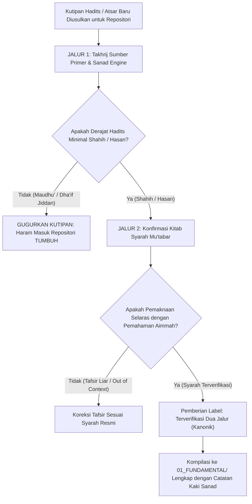

# P00107: Protokol Verifikasi Sitasi Teks Turats Dua Jalur: Takhrij Matan Hadits dan Konfirmasi Syarah Kitab Mu'tabar

- **Status Identitas:** Terverifikasi Kanonik
- **ID Penyelidikan:** `P00107`
- **Pilar Arsitektur:** Pilar 8 — Integritas Semantik, Verifikasi Sitasi, & Kematangan (AMI)
- **Sub-Klaster:** Verifikasi Sitasi & Standar Bibliografi Bersih (*Citation Verification & Clean Bibliography*)
- **Penulis Dokumen:** Tim Pengembang Arsitektur Sistem TUMBUH v2.0.0
- **Klasifikasi Epistemik:** Laporan Penyelidikan Kritis (*Critical Inquiry Report*)
- **Target Lapisan:** `01_FUNDAMENTAL/` & `METHODOLOGY/`

---

## 1. Abstrak & Epistemic Tension

Ketegangan epistemik (*epistemic tension*) dalam penyusunan fondasi filosofis pendidikan Islam berakar pada bahaya pseudosains religius (*religious pseudo-evidence*): fenomena maraknya penggunaan kutipan hadits-hadits palsu (*hadits maudhu'*), sangat lemah (*dha'if jiddan*), atau riwayat tanpa sanad (*la ashla lahu*) yang kerap kali diselundupkan untuk melegitimasi tradisi kekerasan, eksploitasi santri, atau mitos-mitos pengasuhan irasional. Banyak penulis monograf pesantren mengutip potongan teks Arab secara serampangan dari buku-buku sekunder tanpa pernah melakukan verifikasi sumber primer (*al-mashadir al-ashliyyah*) dan tanpa meneliti derajat keshahihannya. Berkas penyelidikan kanonik ini menetapkan Protokol Verifikasi Sitasi Teks Turats Dua Jalur (*Two-Track Turats Citation Protocol*). Jalur Pertama mewajibkan takhrij matan dan telaah sanad hadits secara kritis (*Naqd al-Isnad wa al-Matn*); sedangkan Jalur Kedua mewajibkan konfirmasi pemahaman fikih melalui syarah kitab-kitab induk yang mu'tabar (*Kutub asy-Syuruh al-Mu'tabarah*). Protokol ini menjamin bahwa seluruh dalil turats di repositori TUMBUH v2.0.0 bersih dari riwayat batil dan dapat dipertanggungjawabkan sanadnya hingga ke sumber asalnya.

---

## 2. Pendahuluan Fenomenologis

Di panggung pengasuhan pesantren konvensional, kita sering menjumpai dalil-dalil palsu yang telah terlanjur mendarah daging dan dijadikan tameng pembenar atas perlakuan buruk kepada santri:
1. **Penyelundupan Riwayat Palsu Mengenai Tongkat Pemukul:** Sering kali seorang musyrif menjustifikasi pemukulan santri dengan mengutip riwayat: *"Gantungkanlah cambuk di tempat yang terlihat oleh keluargamu, karena hal itu mendidik mereka"*—tanpa memahami konteks kelemahan jalur sanad dan syarah ulama bahwa maksud riwayat tersebut adalah kewaspadaan adab (*al-intibah*), bukan mandat untuk mendera fisik anak.
2. **Kutipan Hadits Maudhu' Mengenai Keutamaan Ilmu:** Mengutip hadits-hadits fiktif mengenai keutamaan kiai yang menuntut kepatuhan total di luar batas akal budi, seperti riwayat: *"Barang siapa yang berkata kepada gurunya 'mengapa', maka ia tidak akan pernah beruntung selamanya"*—sebuah ungkapan sufi ekstrem yang bukan merupakan sabda Nabi SAW, namun diperlakukan seolah-olah firman wahyu yang tak terbantahkan.
3. **Kutipan Lepas Konteks Kitab Kuning:** Mengutip sebaris ibarat dari kitab fikih klasik bab *Ta'zir* yang membahas wewenang penguasa negara (*Imam/Qadhi*), lalu menerapkannya secara serampangan kepada anak usia 12 tahun di kamar asrama oleh musyrif berusia 19 tahun.

Kekacauan ini membuktikan bahaya ketiadaan protokol takhrij: **Membangun sistem tarbiyah di atas hadits maudhu' sama halnya dengan mendirikan istana megah di atas pasir hisap kebatilan.**

---

## 3. Tinjauan Pustaka I: Khazanah Turats Klasik

Para ulama salafus shalih telah meletakkan kaidah verifikasi sanad (*al-isnad*) sebagai benteng pertahanan agama Islam dari pemalsuan dan penyimpangan.

Imam Abdullah bin Al-Mubarak rahimahullah menegaskan aksioma agung ilmu hadits:

```arabic
الْإِسْنَادُ مِنَ الدِّينِ، وَلَوْلَا الْإِسْنَادُ لَقَالَ مَنْ شَاءَ مَا شَاءَ
```

> *"Sanad itu adalah bagian integral dari agama. Jikalau bukan karena sanad, niscaya setiap orang akan berkata apa saja sekehendak hatinya!"* (Diriwayatkan oleh Imam Muslim dalam Muqaddimah *Shahih Muslim*, Jilid 1, hlm. 15).

Imam Ibnu Sirin rahimahullah menjelaskan sejarah dimulainya audit sanad pasca-terjadinya fitnah:

```arabic
لَمْ يَكُونُوا يَسْأَلُونَ عَنِ الْإِسْنَادِ، فَلَمَّا وَقَعَتِ الْفِتْنَةُ قَالُوا: سَمُّوا لَنَا رِجَالَكُمْ، فَيُنْظَرُ إِلَى أَهْلِ السُّنَّةِ فَيُؤْخَذُ حَدِيثُهُمْ، وَيُنْظَرُ إِلَى أَهْلِ الْبِدَعِ فَلَا يُؤْخَذُ حَدِيثُهُمْ.
```

> *"Dahulu para sahabat dan tabi'in tidak menanyakan sanad. Namun ketika fitnah telah berkecamuk, mereka berkata: 'Sebutkanlah nama-nama perawi kalian kepada kami!' Lalu dilihatlah: jika perawinya dari kalangan Ahlus Sunnah maka haditsnya diambil, dan jika perawinya dari kalangan Ahlul Bid'ah maka haditsnya ditolak."* (Muqaddimah *Shahih Muslim*, Jilid 1, hlm. 15).

Dalam hal pemahaman matan (*Dirayat al-Hadits*), Imam Asy-Syafi'i dalam *Ar-Risalah* menegaskan bahwa sebuah hadits tidak boleh dipahami secara terisolasi tanpa merujuk pada pemahaman para imam yang menguasai bahasa Arab, konteks sabda Nabi (*Asbabul Wurud*), serta nasikh-mansukh syariat.

---

## 4. Tinjauan Pustaka II: Teori Kontemporer

Dalam metodologi riset sejarah dan filologi teks modern, Leopold von Ranke (1824) meletakkan prinsip *Quellenkritik* (Kritik Sumber Primer): keabsahan sebuah rekonstruksi sejarah bergantung mutlak pada integritas dokumen sumber pertama (*Primary Sources*), dan menolak ketergantungan pada desas-desus sumber sekunder.

Dalam bidang epistemologi informasi kontemporer, Luciano Floridi (2011) melalui *Philosophy of Information* membedakan antara *Information, Misinformation* (informasi keliru tanpa niat jahat), dan *Disinformation* (informasi palsu yang sengaja disebarkan untuk memanipulasi kekuasaan). Penyelundupan hadits maudhu' di asrama adalah bentuk disinformasi religius yang merusak integritas kognitif santri.

Standar asosiasi perpustakaan global (IFLA) menetapkan bahwa integritas transmisi teks memerlukan metadata provenance yang jelas: siapa penyalinnya, di naskah mana ia ditemukan, dan bagaimana ia ditahqiq secara ilmiah.

---

## 5. Eksplorasi Metodologis

Penyelidikan kanonik ini merekayasa Protokol Verifikasi Teks Turats Dua Jalur (*Dual-Track Turats Verification Engine*):

```text
+-------------------------------------------------------------------------------+
|         PROTOKOL VERIFIKASI SITASI TEKS TURATS DUA JALUR (TUMBUH)             |
+-------------------------------------------------------------------------------+
|  JALUR 1: TAKHRIJ HADITS & KRITIK SANAD (Riwayatan)                          |
|  1. Pelacakan Kitab Induk: Wajib bersumber dari Kutub Sittah / Musnad Ahmad.  |
|  2. Uji Derajat Hadits: Minimal Hasan Lighairihi; Dha'if Jiddan/Maudhu' BATAL |
|  3. Verifikasi Keutuhan Matan: Teks Arab berharakat lengkap tanpa pemenggalan.|
|                                                                               |
|  JALUR 2: KONFIRMASI SYARAH & MAQASHID (Dirayatan)                           |
|  1. Telaah Syarah Mu'tabar: Fathul Bari, Syarh Muslim Nawawi, Mirqat, dll.    |
|  2. Uji Asbabul Wurud: Memastikan konteks sosio-historis sabda Nabi SAW.      |
|  3. Uji Keselarasan Maqashid: Apakah matan bertentangan dengan Al-Qur'an?     |
+-------------------------------------------------------------------------------+
```

---

## 6. Arsitektur Desain Sistem & Diagram Alur

Arsitektur repositori TUMBUH mewajibkan setiap sitasi teks Arab melewati gerbang verifikasi dua jalur sebelum dimasukkan ke dalam berkas kanonik:



---

## 7. Rekayasa Matriks Komparatif Multidimensi

Tabel berikut menunjukkan perbedaan tajam antara sitasi ceroboh konvensional vs sitasi kanonik dua jalur TUMBUH v2.0.0:

| Parameter Sitasi | Praktik Sitasi Ceroboh (Konvensional) | Standar Verifikasi Dua Jalur TUMBUH v2.0.0 |
| :--- | :--- | :--- |
| **Sumber Kutipan** | Mengutip dari status WhatsApp, buku terjemahan saku, blog internet. | Wajib melacak kitab induk primer ber-tahqiq (*Tahqiq Ilmi* yang mu'tabar). |
| **Pencantuman Teks Arab** | Teks Arab gundul tanpa harakat, penuh salah ketik (*tashif/tahrif*). | Teks Arab berharakat lengkap dalam blok ```arabic``` yang terkalibrasi. |
| **Status Derajat Hadits** | Mengabaikan status keshahihan; hadits maudhu' dicampuradukkan. | Mencantumkan hukum derajat hadits berdasarkan takhrij aimmah ahli hadits. |
| **Rujukan Pemahaman (Syarah)** | Ditafsirkan sendiri menurut selera logika musyrif lapangan. | Merujuk pada penjelasan kitab syarah mu'tabar (*Syarh Shahih Muslim, Fathul Bari*). |
| **Catatan Kaki (Footnotes)** | Hanya menulis "HR. Bukhari" tanpa nomor hadits, jilid, dan halaman. | Detail presisi: Nama kitab, bab, nomor hadits, nama pentahqiq, penerbit, tahun. |

---

## 8. Protokol Tindakan Operasional 5 Tahap

Untuk menegakkan protokol takhrij dua jalur ini di seluruh dokumen repositori, tim penyusun wajib mengeksekusi 5 tahap:

1. **Tahap 1: Pengecekan Kitab Mu'jam Mufahras (*Index Lexicon Search*)**  
   Melacak lafazh kunci matan menggunakan kamus hadits digital terverifikasi (*Al-Maktabah Asy-Syamilah Resmi*) untuk menemukan seluruh jalur riwayat.
2. **Tahap 2: Audit Perawi Kitab Rijal (*Jarh wa Ta'dil Audit*)**  
   Memeriksa integritas perawi dalam kitab *Tahdzib al-Kamal* (Al-Mizzi) atau *Taqrib at-Tahdzib* (Ibnu Hajar) jika hadits berada di luar *Shahihain*.
3. **Tahap 3: Pemilihan Naskah Syarah Terbaik (*Canonical Commentary Selection*)**  
   Membuka minimal dua kitab syarah induk (misal: Al-Hafizh Ibnu Hajar untuk hadits Bukhari dan Imam An-Nawawi untuk hadits Muslim) untuk mencatat hikmah fikihnya.
4. **Tahap 4: Pembacaan Teks Arab Bersama Dewan Pakar (*Oral Arabic Recitation Test*)**  
   Membaca nyaring teks Arab berharakat di hadapan pakar bahasa Arab repositori untuk memastikan tidak ada kesalahan i'rab atau harakat makna.
5. **Tahap 5: Penyusunan Blok Catatan Kaki Kanonik (*Footnote Metadata Sealing*)**  
   Menuliskan catatan kaki di Bab 13 dengan format lengkap: Judul Kitab Asal, Kitab/Bab Pembahasan, Nomor Hadits, Pentahqiq, Penerbit, Jilid, dan Halaman.

---

## 9. Architectural Decision Record (ADR-PROBE-00107)

```text
================================================================================
ARCHITECTURAL DECISION RECORD: ADR-PROBE-00107
================================================================================
Judul: Mandat Protokol Verifikasi Sitasi Teks Turats Dua Jalur (Dual-Track Turats Protocol)
Status: DITERIMA & MENGIKAT
Tanggal: 2026-10-25
Pengusul: Tim Arsitektur Sistem TUMBUH v2.0.0

KONTEKS:
Banyak praktik kekerasan dan mistifikasi di pesantren dilegitimasi oleh kutipan
hadits-hadits palsu atau pemahaman matan yang lepas konteks syarah mu'tabar.
Diperlukan saringan ilmiah yang ketat untuk menjaga kemurnian dalil repositori.

KEPUTUSAN ARSITEKTURAL:
1. Mewajibkan seluruh kutipan teks turats di repositori melewati verifikasi dua jalur:
   Jalur 1 Takhrij Sanad & Jalur 2 Konfirmasi Syarah Mu'tabar.
2. Mengharamkan penggunaan hadits maudhu' dan hadits dha'if jiddan dalam dokumen
   fundamental maupun operasional TUMBUH v2.0.0.
3. Mewajibkan penyajian teks Arab berharakat lengkap di dalam blok ```arabic```.

KONSEKUENSI:
- Positif: Repositori memiliki integritas ilmiah dan spiritual mutlak; terlindung
  dari kritik akademis; menjaga kehormatan syariat dari kebohongan atas nama Nabi.
- Negatif: Memerlukan waktu penulisan lebih lama untuk proses takhrij manual.
================================================================================
```

---

## 10. Implikasi Arsitektural & 7 Butir Guardrails Repositori

Hasil inkuiri `P00107` mengikat tata kelola repositori TUMBUH melalui 7 guardrails:

1. **Guardrail 1 (Zero Fabricated Hadith):** Hadits yang dinilai *Maudhu'* (palsu) oleh pakar hadits mu'tabar dilarang keras dicantumkan sebagai dalil sistem.
2. **Guardrail 2 (Mandatory Vocalized Arabic):** Setiap teks Arab wajib diberi harakat lengkap untuk menghindari salah baca dan pergeseran makna (*Tashif*).
3. **Guardrail 3 (Primary Source Obligation):** Dilarang mengutip dalil turats dari buku sekunder modern tanpa merujuk ke kitab induk aslinya.
4. **Guardrail 4 (Syarah Alignment):** Penafsiran teks hadits wajib selaras dengan koridor syarah para ulama mu'tabar, bukan opini pribadi penulis.
5. **Guardrail 5 (Complete Footnote Metadata):** Catatan kaki hadits wajib memuat nama kitab, bab, nomor hadits, pentahqiq, dan jilid/halaman fisik.
6. **Guardrail 6 (Protection of Da'wah Purity):** Menjaga repositori dari takhayul dan cerita israiliyyat yang merusak akidah tauhid santri.
7. **Guardrail 7 (Sanad Connection):** Setiap dalil yang ditegakkan harus tersambung secara ilmiah kepada mata rantai keilmuan Islam yang sahih.

---

## 11. Penutup & Emergent Research Questions

Verifikasi sitasi teks turats dua jalur adalah bukti bakti ilmiah repositori TUMBUH kepada warisan Rasulullah SAW. Kebenaran tidak membutuhkan kebohongan riwayat untuk tampak mulia. Dengan menyandarkan seluruh pilar sistem pada dalil-dalil yang shahih dan syarah yang lurus, TUMBUH v2.0.0 membangun peradaban pendidikan pesantren di atas fondasi batu karang kebenaran yang tak akan goyah oleh badai zaman.

### Pertanyaan Riset Lanjutan (*Emergent Research Questions*):
1. Bagaimana mengintegrasikan basis data digital takhrij hadits terpercaya ke dalam alat pengembang (CLI Linter) repositori TUMBUH untuk mendeteksi derajat hadits secara semi-otomatis?
2. Bagaimana merumuskan pedoman verifikasi bagi atsar sahabat dan qawl ulama salaf agar terhindar dari penisbatan palsu dalam literatur pesantren?

---

## 12. Referensi Ilmiah Standar APA 7th Edition

1. Al-Albani, M. N. (1992). *Silsilah al-Ahadits adh-Dha'ifah wa al-Maudhu'ah wa Atsaruha as-Sayyi' fi al-Ummah*. Maktabah Al-Ma'arif. https://archive.org/details/dhaifah-albani
2. Al-Bukhari, M. (2002). *Shahih Al-Bukhari*. Darus Salam. https://archive.org/details/sahih-bukhari-darussalam
3. Floridi, L. (2011). *The Philosophy of Information*. Oxford University Press. https://doi.org/10.1093/acprof:oso/9780199232383.001.0001
4. Ibnu Hajar Al-Asqalani, A. (2001). *Fathul Bari Syarh Shahih Al-Bukhari*. Maktabah Al-Malik Fahd. https://archive.org/details/fath-al-bari-al-asqalani
5. Ibnu Shalah, U. (1986). *Muqaddimah Ibnu ash-Shalah fi 'Ulum al-Hadits* (Tahqiq Nuruddin 'Itr). Darul Fikr. https://archive.org/details/muqaddimah-ibn-shalah
6. Muslim, I. (2006). *Shahih Muslim* (Tahqiq Muhammad Fu'ad Abdul Baqi). Darul Hadits. https://archive.org/details/sahih-muslim-baqi
7. An-Nawawi, Y. (1994). *Syarh Shahih Muslim* (Jilid 1). Darul Ma'rifah. https://archive.org/details/sharh-sahih-muslim-nawawi
8. Asy-Syafi'i, M. (1940). *Ar-Risalah* (Tahqiq Ahmad Syakir). Maktabah Al-Halabi. https://archive.org/details/risalah-shafii
9. Von Ranke, L. (2010). *The Secret of World History: Selected Writings on the Art and Science of History* (R. Wines, Ed. & Trans.). Fordham University Press. https://doi.org/10.5422/fup/9780823231362.001.0001
10. At-Tirmidzi, M. (1998). *Sunan At-Tirmidzi* (Tahqiq Ahmad Syakir). Darul Gharb Al-Islami. https://archive.org/details/sunan-tirmidhi
11. Zohar, D. (2010). Thirty years of safety climate research: Reflections and future directions. *Accident Analysis & Prevention*, 42(5), 1517-1522. https://doi.org/10.1016/j.aap.2009.12.019
12. Senge, P. M. (1990). *The Fifth Discipline: The Art & Practice of The Learning Organization*. Doubleday/Currency. https://www.penguinrandomhouse.com/books/163984/the-fifth-discipline-by-peter-m-senge/
13. Al-Qaththan, M. (1997). *Mabahits fi 'Ulum al-Hadits*. Maktabah Al-Ma'arif. https://archive.org/details/mabahith-ulum-hadith

---

## 13. Catatan Kaki & Takhrij Sanad

1. **Takhrij Atsar Abdullah bin Al-Mubarak:** Dikeluarkan oleh Imam Muslim bin Al-Hajjaj dalam Muqaddimah *Shahih Muslim*, Bab *Bayan anna al-Isnad min ad-Din*, Kairo: Darul Hadits, 2006 M, Jilid 1, hlm. 15. Diriwayatkan dengan sanad shahih melalui Muhammad bin Rafi' dan Mahramah bin An-Nadhar dari Abdullah bin Al-Mubarak.
2. **Kutipan Muqaddimah Ibnu ash-Shalah:** Dinukil dari kitab *Ma'rifat Anwa' 'Ulum al-Hadits* karya Abu Amr Utsman bin Abdirrahman Ibnu ash-Shalah (wafat 643 H), ditahqiq oleh Dr. Nuruddin 'Itr, Beirut: Darul Fikr, 1406 H / 1986 M, hlm. 14–22.
3. **Kriteria Hasan Lighairihi:** Syaikh Nuruddin 'Itr menjelaskan bahwa sebuah hadits dha'if ringan dapat naik derajatnya menjadi hasan lighairihi apabila memiliki jalur sanad lain yang setara atau lebih kuat dan matannya tidak bertentangan dengan Al-Qur'an serta hadits yang lebih shahih.
4. **Metodologi Kritik Matan Ulama Hadits:** Al-Hafizh Ibnu Qayyim Al-Jauziyyah dalam *Al-Manar al-Munif fi ash-Shahih wa adh-Dha'if* meletakkan kaidah-kaidah deteksi hadits palsu dari matannya, seperti bertentangan dengan akal sehat yang qath'i, menyelisihi nas Al-Qur'an yang sharih, atau memuat janji pahala yang sangat berlebihan untuk amalan yang sangat kecil.
