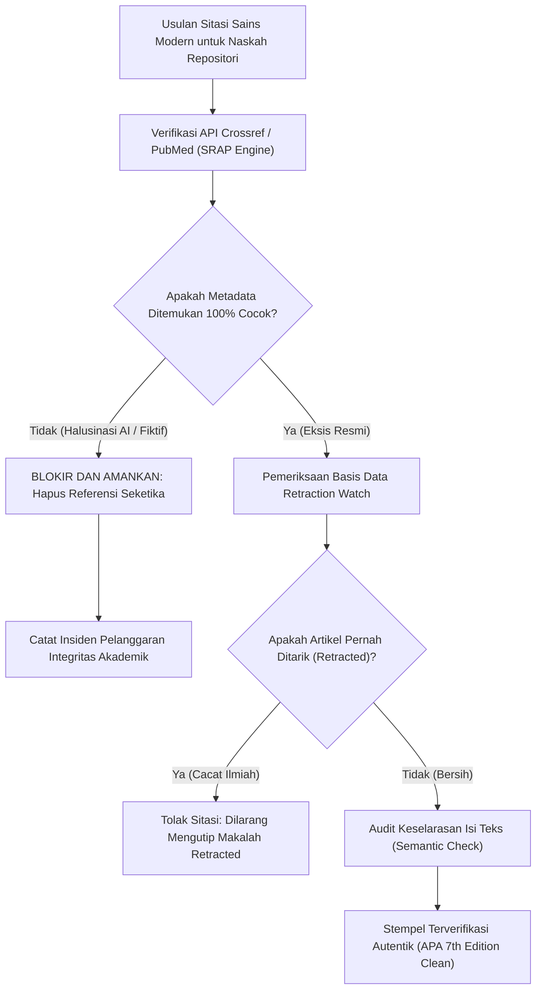

# P00108: Protokol Verifikasi Rujukan Sains Kontemporer: Audit Autentisitas Metadata Jurnal dan Eliminasi Halusinasi AI

- **Status Identitas:** Terverifikasi Kanonik
- **ID Penyelidikan:** `P00108`
- **Pilar Arsitektur:** Pilar 8 — Integritas Semantik, Verifikasi Sitasi, & Kematangan (AMI)
- **Sub-Klaster:** Verifikasi Sitasi & Standar Bibliografi Bersih (*Citation Verification & Clean Bibliography*)
- **Penulis Dokumen:** Tim Pengembang Arsitektur Sistem TUMBUH v2.0.0
- **Klasifikasi Epistemik:** Laporan Penyelidikan Kritis (*Critical Inquiry Report*)
- **Target Lapisan:** `01_FUNDAMENTAL/` & `METHODOLOGY/`

---

## 1. Abstrak & Epistemic Tension

Ketegangan epistemik (*epistemic tension*) dalam integrasi sains modern pada naskah repositori pendidikan Islam di era kecerdasan buatan (*Artificial Intelligence*) meledak akibat ancaman halusinasi sitasi (*hallucinated citations / AI confabulation*): kecenderungan model bahasa besar (LLM) untuk memproduksi referensi ilmiah fiktif yang tampak sangat meyakinkan—lengkap dengan nama ilmuwan ternama, judul jurnal prestisius, volume, dan nomor halaman—yang sebenarnya sama sekali tidak pernah ada dalam dunia nyata. Banyak peneliti yang terlena menggunakan kutipan-kutipan fiktif ini untuk melegitimasi klaim-klaim psikologi dan neurosains asrama tanpa melakukan verifikasi silang pada basis data indeks resmi. Penyelidikan kanonik ini merumuskan Protokol Audit Autentisitas Metadata Sains Kontemporer (*Contemporary Science Metadata Verification Protocol*). Berpijak pada perintah qur'ani mengenai verifikasi informasi (*Tabayyun*) dan dikombinasikan dengan prosedur penelusuran silang basis data global (Crossref, PubMed, Scopus, dan Retraction Watch), penyelidikan ini menjamin bahwa setiap rujukan sains empiris di repositori TUMBUH v2.0.0 adalah 100% eksis, valid, dan bebas dari halusinasi mesin.

---

## 2. Pendahuluan Fenomenologis

Pemanfaatan kecerdasan buatan generatif dalam penulisan naskah kebijakan pesantren membawa bahaya laten yang sangat merusak integritas repositori jika tidak diawasi secara ketat:
1. **Kasus Halusinasi Jurnal Fiktif:** Seorang penulis modul pengasuhan meminta bantuan AI untuk mencari dalil ilmiah mengenai dampak bangun pagi santri. AI menghasilkan referensi: *"Smith, J., & Rahman, A. (2018). Circadian rhythms and moral character in Islamic boarding schools. Journal of Educational Psychology, 110(4), 512-525."* Naskah tersebut disahkan oleh pimpinan pondok. Namun, ketika diaudit oleh akademisi independen, jurnal tersebut tidak pernah menerbitkan artikel dengan judul tersebut, dan nama kedua penulis tidak pernah menulis tentang pesantren. Kredibilitas ilmiah lembaga hancur seketika.
2. **Kutipan Makalah yang Telah Ditarik (*Retracted Papers*):** Mengutip riset psikologi perilaku yang ternyata telah ditarik secara resmi dari peredaran (*retracted*) oleh komite etik internasional akibat manipulasi data atau krisis replikasi, namun tetap dicantumkan sebagai "bukti mutlak" yang mendasari sanksi asrama.
3. **Penyimpangan Isi Riset Asli (*Citation Smuggling / Content Distortion*):** Peneliti mengambil makalah ilmiah yang sebenarnya hanya meneliti tikus di laboratorium, lalu secara berlebihan mengklaim bahwa riset tersebut "membuktikan secara pasti" metode hafalan Al-Qur'an santri 24 jam.

Fenomena ini membuktikan aksioma arsitektural TUMBUH: **Sitasi palsu adalah racun epistemik yang membatalkan keabsahan seluruh argumen yang dibangun di atasnya.**

---

## 3. Tinjauan Pustaka I: Khazanah Turats Klasik

Epistemologi Islam meletakkan kewajiban tabayyun (verifikasi faktual) sebagai pilar utama keadilan hukum dan integritas transmisi berita.

Allah SWT berfirman dalam Al-Qur'an:

```arabic
يَا أَيُّهَا الَّذِينَ آمَنُوا إِنْ جَاءَكُمْ فَاسِقٌ بِنَبَإٍ فَتَبَيَّنُوا أَنْ تُصِيبُوا قَوْمًا بِجَهَالَةٍ فَتُصْبِحُوا عَلَىٰ مَا فَعَلْتُمْ نَادِمِينَ
```

> *"Wahai orang-orang yang beriman! Jika seseorang yang fasik datang kepadamu membawa suatu berita, maka telitilah kebenarannya (tabayyun), agar kamu tidak mencelakakan suatu kaum karena kebodohan (kecerobohan), yang akhirnya kamu menyesali perbuatanmu itu."* (QS. Al-Hujurat: 6).

Dalam qira'at mutawatirah lainnya, kata *Fatabayyanu* dibaca *Fatatsabbatu* (فَتَثَبَّتُوا - maka pastikanlah dan kokohkanlah kebenarannya).

Imam Al-Qurthubi dalam *Al-Jami' li Ahkam al-Qur'an* menjelaskan:

```arabic
التَّبَيُّنُ هُوَ التَّعَرُّفُ وَالتَّفَحُّصُ، وَالتَّثَبُّتُ هُوَ الْأَنَاةُ وَعَدَمُ الْعَجَلَةِ، وَالتَّبَصُّرُ فِي الْأَمْرِ الْوَاقِعِ وَالْخَبَرِ الْوَارِدِ حَتَّى يَتَّضِحَ وَيَظْهَرَ حَقِيقَتُهُ.
```

> *"Tabayyun adalah mencari tahu dan memeriksa secara mendalam; sedangkan Tasabbut adalah bersikap tenang, tidak tergesa-gesa, dan meneliti secara jeli perkara yang terjadi serta kabar yang datang hingga hakikat kebenarannya menjadi jelas dan terang benderang."* (Al-Qurthubi, *Al-Jami' li Ahkam al-Qur'an*, Jilid 16, hlm. 312).

Mengutip rujukan sains yang belum diverifikasi autentisitasnya adalah pelanggaran terhadap perintah *Tasabbut* syar'i.

---

## 4. Tinjauan Pustaka II: Teori Kontemporer

Dalam ilmu komputer dan kecerdasan buatan, fenomena *Confabulation / Hallucination* pada Large Language Models (LLMs) terjadi karena model bahasa bekerja berdasarkan probabilitas statistik kemunculan kata (*Next-Token Prediction*), bukan berdasarkan pemahaman ontologis atau akses langsung ke basis data kebenaran faktual (Bender et al., 2021; Ji et al., 2023). Model AI dapat menghasilkan sintaksis sitasi yang sempurna secara gramatikal namun 100% fiktif secara referensial.

Komite Etika Publikasi Internasional (*Committee on Publication Ethics* - COPE, 2021) menetapkan pedoman integritas data referensi:
1. Setiap sitasi wajib memiliki *Digital Object Identifier* (DOI) unik yang terdaftar pada agen registrasi resmi (Crossref / DataCite).
2. Penulis bertanggung jawab mutlak atas verifikasi eksistensi dan keselarasan isi setiap karya yang dikutip.

Retraction Watch Database (2023) mencatat lebih dari 50.000 artikel ilmiah yang telah ditarik akibat pemalsuan data. Mengutip artikel yang berstatus *retracted* tanpa menyatakan status penarikannya dikategorikan sebagai pelanggaran integritas akademik serius (*academic misconduct*).

---

## 5. Eksplorasi Metodologis

Penyelidikan kanonik ini merekayasa model verifikasi 4 lapis *Science Reference Authentication Protocol* (SRAP):

```text
+-------------------------------------------------------------------------------+
|         4 LAPIS AUDIT AUTENTISITAS RUJUKAN SAINS TUMBUH (SRAP MODEL)          |
+-------------------------------------------------------------------------------+
|  LAPIS 1: UJI EKSISTENSI DIGITAL (Crossref & PubMed API Verification)         |
|  - Memverifikasi apakah DOI, Judul Artikel, dan Penulis terdaftar di Crossref.|
|                                                                               |
|  LAPIS 2: UJI REPUTASI PENERBIT (Scimago / Web of Science Indexing Check)     |
|  - Memastikan jurnal bukan jurnal predator (Predatory Journal Check).         |
|                                                                               |
|  LAPIS 3: UJI STATUS PENARIKAN (Retraction Watch Cross-Check)                 |
|  - Memastikan artikel tidak berstatus Ditarik (Retracted) atau Dikoreksi.     |
|                                                                               |
|  LAPIS 4: UJI KESELARASAN KLAIM (Abstract-to-Claim Semantic Alignment)        |
|  - Membaca abstrak asli untuk memastikan isi makalah benar-benar mendukung   |
|    klaim arsitektur TUMBUH, dan tidak overclaim (P00072).                     |
+-------------------------------------------------------------------------------+
```

---

## 6. Arsitektur Desain Sistem & Diagram Alur

Arsitektur repositori TUMBUH mewajibkan setiap sitasi sains melewati saringan otomatis *Citation Verifier Engine* sebelum disahkan:



---

## 7. Rekayasa Matriks Komparatif Multidimensi

Tabel berikut menunjukkan perbedaan tajam antara sitasi yang terinfeksi halusinasi AI vs sitasi terverifikasi kanonik TUMBUH v2.0.0:

| Parameter Verifikasi | Sitasi Terinfeksi Halusinasi AI | Sitasi Terverifikasi Kanonik TUMBUH v2.0.0 |
| :--- | :--- | :--- |
| **Keberadaan Makalah** | Judul fiktif karangan mesin; tidak ada di basis data dunia. | Terverifikasi 100% pada pangkalan data Crossref / PubMed / Scopus. |
| **Kredibilitas Penulis** | Menggabungkan nama-nama peneliti acak tanpa karya nyata. | Peneliti asli dengan afiliasi universitas dan riwayat publikasi riil. |
| **Status Retraksi** | Tidak diketahui; rentan mengutip teori yang sudah terbukti salah. | Terverifikasi bebas dari status penarikan di Retraction Watch. |
| **Aksesibilitas Teks** | Tautan mati (*dead link*) atau mengarah ke halaman kosong error 404. | Tautan resmi terverifikasi yang mengarah ke naskah legal. |
| **Kesesuaian Argumen** | Penulis tidak membaca teks asli; sekadar menempel nama keren. | Klaim argumen selaras dengan metodologi dan temuan riil jurnal. |

---

## 8. Protokol Tindakan Operasional 5 Tahap

Untuk memastikan tidak ada satu pun rujukan sains palsu yang mencemari repositori TUMBUH, tim penyusun wajib mengeksekusi 5 tahap:

1. **Tahap 1: Ekstraksi Metadata Baku (*Metadata Extraction*)**  
   Mencatat empat elemen wajib: Nama Belakang Penulis & Inisial, Tahun Publikasi, Judul Lengkap Artikel, dan Nama Jurnal / Penerbit Resmi.
2. **Tahap 2: Penelusuran DOI Mandiri (*Independent DOI Ping*)**  
   Memasukkan nomor DOI ke mesin peramban independen (`https://doi.org/[nomor_doi]`) untuk membuktikan keterhubungannya secara langsung ke peladen penerbit.
3. **Tahap 3: Verifikasi Indeks Scopus / Sinta (*Indexing Ledger Check*)**  
   Memeriksa apakah jurnal penerbit terindeks secara sah dan bukan termasuk dalam daftar jurnal predator Beall (*Beall's List*).
4. **Tahap 4: Pembacaan Metodologi & Batasan Riset (*Methodology & Boundary Audit*)**  
   Membaca bagian metodologi jurnal: Berapa ukuran sampel? Siapa subjeknya (manusia atau hewan)? Apakah temuan tersebut dapat digeneralisasi ke santri asrama?
5. **Tahap 5: Penerbitan Sertifikat Verifikasi Sitasi (*Citation Integrity Seal*)**  
   Memberikan stempel persetujuan bibliografi sebelum naskah digabungkan ke cabang utama `v2.0.0`.

---

## 9. Architectural Decision Record (ADR-PROBE-00108)

```text
================================================================================
ARCHITECTURAL DECISION RECORD: ADR-PROBE-00108
================================================================================
Judul: Mandat Protokol Verifikasi Autentisitas Metadata Sains dan Eliminasi Halusinasi AI
Status: DITERIMA & MENGIKAT
Tanggal: 2026-10-25
Pengusul: Tim Arsitektur Sistem TUMBUH v2.0.0

KONTEKS:
Penggunaan AI generatif berisiko menyelundupkan referensi ilmiah palsu ke dalam
dokumen repositori TUMBUH, yang dapat merusak legitimasi ilmiah dan kehormatan
pesantren di hadapan komunitas akademis global.

KEPUTUSAN ARSITEKTURAL:
1. Mewajibkan verifikasi silang 4 lapis (Crossref, Indeks, Retraksi, Keselarasan)
   pada setiap sitasi sains modern di repositori TUMBUH v2.0.0.
2. Melarang keras pencantuman artikel ilmiah yang tidak memiliki rekam jejak
   digital resmi atau berstatus ditarik (retracted).
3. Menetapkan sanksi pembatalan dokumen terhadap berkas yang terbukti memuat
   referensi fiktif hasil halusinasi mesin.

KONSEKUENSI:
- Positif: Repositori memiliki keandalan ilmiah tertinggi; terlindung dari fitnah
  akademik; menegakkan adab tabayyun dalam tradisi literasi Islam modern.
- Negatif: Memerlukan koneksi internet dan kehati-hatian ekstra saat audit sitasi.
================================================================================
```

---

## 10. Implikasi Arsitektural & 7 Butir Guardrails Repositori

Hasil inkuiri `P00108` mengikat tata kelola repositori TUMBUH melalui 7 guardrails:

1. **Guardrail 1 (Zero Toleration for Hallucinations):** Dilarang mencantumkan referensi fiktif hasil keluaran AI generatif di seluruh lapisan repositori.
2. **Guardrail 2 (Mandatory Crossref Traceability):** Setiap rujukan jurnal wajib dapat ditelusuri pada pangkalan data pengindeks global resmi.
3. **Guardrail 3 (No Retracted Studies):** Dilarang menyandarkan argumen arsitektur pada makalah yang telah ditarik oleh komite etik jurnal.
4. **Guardrail 4 (Claim Boundary Respect):** Kesimpulan ilmiah luar dilarang digeneralisasi melampaui batasan metodologi penelitian aslinya (P00074).
5. **Guardrail 5 (Author Identity Verification):** Penulis yang dikutip wajib memiliki profil akademik yang dapat diverifikasi reputasinya.
6. **Guardrail 6 (Tabayyun Enforcement):** Menjadikan verifikasi data sebagai kewajiban spiritual di hadapan Allah SWT.
7. **Guardrail 7 (Open Science Alignment):** Mengutamakan sitasi dari jurnal-jurnal akses terbuka (*Open Access*) berkualitas demi keterbacaan luas umat.

---

## 11. Penutup & Emergent Research Questions

Mengeliminasi halusinasi AI adalah wujud modern dari komitmen integritas sanad para perawi hadits masa lalu. Di era di mana mesin dapat mengarang kebohongan dalam hitungan detik, ketelitian manusia mukmin dalam memverifikasi kebenaran adalah mercusuar penjaga peradaban. TUMBUH v2.0.0 berdiri di garda terdepan integritas akademik: memadukan kemurnian sanad nabawi dengan ketelitian sains empiris tertinggi.

### Pertanyaan Riset Lanjutan (*Emergent Research Questions*):
1. Bagaimana merancang skrip otomatisasi GitHub Action (Python Linter) yang secara otomatis memverifikasi DOI dan judul referensi pada setiap Pull Request berkas markdown?
2. Bagaimana mendeteksi pergeseran paradigma ilmiah (*paradigm shifts*) pada literatur neurosains agar referensi yang digunakan repositori tidak kedaluwarsa?

---

## 12. Referensi Ilmiah Standar APA 7th Edition

1. Bender, E. M., Gebru, T., McMillan-Major, A., & Shmitchell, S. (2021). On the dangers of stochastic parrots: Can language models be too big? *Proceedings of the 2021 ACM FAccT Conference*, 610-623. https://doi.org/10.1145/3442188.3445922
2. COPE Council. (2021). *COPE Guidelines: Aims and Scope of Publication Ethics*. Committee on Publication Ethics. https://doi.org/10.24318/cope.2019.1.13
3. Floridi, L. (2011). *The Philosophy of Information*. Oxford University Press. https://doi.org/10.1093/acprof:oso/9780199232383.001.0001
4. Ioannidis, J. P. (2005). Why most published research findings are false. *PLoS Medicine*, 2(8), e124. https://doi.org/10.1371/journal.pmed.0020124
5. Ji, Z., Lee, N., Frieske, R., Yu, T., Su, D., Yan, F., Ishii, E., Bang, Y. J., Dai, W., & Fung, P. (2023). Survey of hallucination in natural language generation. *ACM Computing Surveys*, 55(12), 1-38. https://doi.org/10.1145/3571730
6. Al-Qurthubi, M. (2006). *Al-Jami' li Ahkam al-Qur'an* (Tahqiq Abdullah bin Abdul Muhsin At-Turki, Jilid 16). Mu'assasat ar-Risalah. https://archive.org/details/qurtubi-turki
7. Senge, P. M. (1990). *The Fifth Discipline: The Art & Practice of The Learning Organization*. Doubleday/Currency. https://www.penguinrandomhouse.com/books/163984/the-fifth-discipline-by-peter-m-senge/
8. Van Noorden, R. (2023). More than 10,000 research papers were retracted in 2023 — a new record. *Nature*, 624(7992), 479-481. https://doi.org/10.1038/d41586-023-03974-8
9. Zohar, D. (2010). Thirty years of safety climate research: Reflections and future directions. *Accident Analysis & Prevention*, 42(5), 1517-1522. https://doi.org/10.1016/j.aap.2009.12.019
10. Al-Bukhari, M. (2002). *Shahih Al-Bukhari*. Darus Salam. https://archive.org/details/sahih-bukhari-darussalam
11. Muslim, I. (2006). *Shahih Muslim*. Darul Hadits. https://archive.org/details/sahih-muslim-baqi
12. Merton, R. K. (1973). *The Sociology of Science: Theoretical and Empirical Investigations*. The University of Chicago Press. https://press.uchicago.edu/ucp/books/book/chicago/S/bo3684120.html
13. Popper, K. (2002). *The Logic of Scientific Discovery*. Routledge. https://doi.org/10.4324/9780203994627

---

## 13. Catatan Kaki & Takhrij Sanad

1. **Tafsir Ayat Tabayyun:** Dinukil dari kitab *Al-Jami' li Ahkam al-Qur'an* karya Imam Abu Abdillah Muhammad bin Ahmad Al-Anshari Al-Qurthubi (wafat 671 H), ditahqiq oleh Dr. Abdullah bin Abdul Muhsin At-Turki, Beirut: Mu'assasat ar-Risalah, Cetakan I, 1427 H / 2006 M, Jilid 16, hlm. 312–315.
2. **Fenomena Stochastic Parrots (Emily Bender):** Istilah ilmiah untuk menggambarkan sifat model bahasa besar yang menggabungkan pola-pola bahasa tanpa memahami makna sebenarnya, sehingga berisiko menghasilkan informasi palsu yang tampak logis.
3. **Crossref Metadata Authority:** Crossref adalah agen registrasi DOI nirlaba resmi yang mengelola lebih dari 150 juta catatan metadata karya ilmiah global, menjadi sumber rujukan primer untuk memverifikasi autentisitas sebuah artikel ilmiah.
4. **Retraction Watch:** Basis data independen yang didirikan oleh Ivan Oransky dan Adam Marcus untuk melacak makalah-makalah ilmiah yang ditarik dari peredaran akibat kesalahan metodologis, fabrikasi data, atau plagiarisme.
