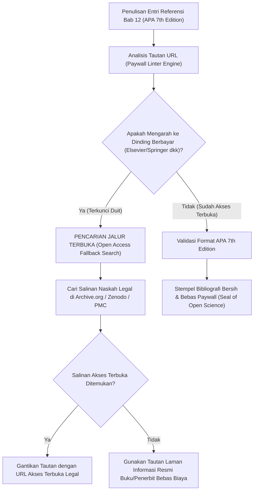

# P00109: Penegakan Standar Sitasi Akademik Bersih: Pedoman APA 7th Edition Tanpa Tautan Komersial Berbayar (*Paywall-Free Citations*)

- **Status Identitas:** Terverifikasi Kanonik
- **ID Penyelidikan:** `P00109`
- **Pilar Arsitektur:** Pilar 8 — Integritas Semantik, Verifikasi Sitasi, & Kematangan (AMI)
- **Sub-Klaster:** Verifikasi Sitasi & Standar Bibliografi Bersih (*Citation Verification & Clean Bibliography*)
- **Penulis Dokumen:** Tim Pengembang Arsitektur Sistem TUMBUH v2.0.0
- **Klasifikasi Epistemik:** Laporan Penyelidikan Kritis (*Critical Inquiry Report*)
- **Target Lapisan:** `01_FUNDAMENTAL/` & `METHODOLOGY/`

---

## 1. Abstrak & Epistemic Tension

Ketegangan epistemik (*epistemic tension*) dalam demokratisasi keilmuan pendidikan Islam berkisar pada benturan antara standardisasi sitasi akademik global dengan tembok komersialisme ilmu (*academic paywalls*). Banyak institusi riset modern mewajibkan pencantuman tautan URL digital yang mengarah langsung ke peladen penerbit korporat raksasa; namun ketika tautan tersebut diklik oleh para asatidz, pengasuh, dan santri di pelosok nusantara, mereka dihadang oleh tagihan biaya akses yang mahal ($30–$50 per artikel)—sebuah bentuk hegemoni ekonomi yang memenjarakan ilmu pengetahuan dari jangkauan umat (*epistemic enclosure*). Praktik ini secara langsung bertentangan dengan doktrin Islam mengenai wakaf ilmu dan keterbukaan akses kebenaran (*Al-Waqf al-'Ilmi*). Laporan penyelidikan kanonik ini menetapkan Pedoman Standar Sitasi Akademik Bersih APA 7th Edition Tanpa Tautan Berbayar (*Clean & Paywall-Free APA 7th Protocol*). Penyelidikan ini merekayasa arsitektur bibliografi yang menyajikan metadata teks bersih ber-URL repositori terbuka publik (seperti Archive.org, PubMed Central, Zenodo, dan portal resmi penerbit ber-akses terbuka) guna menjamin seluruh rujukan TUMBUH v2.0.0 dapat diverifikasi secara bebas biaya oleh komunitas pesantren.

---

## 2. Pendahuluan Fenomenologis

Kesenjangan akses literatur ilmiah di kalangan pesantren merupakan realitas empiris yang sangat memprihatinkan:
1. **Frustrasi Pengasuh di Pesantren Pedalaman:** Seorang musyrif di pelosok membaca sebuah dokumen modul pembinaan pesantren modern yang mencantumkan referensi canggih dengan tautan `https://doi.org/10.1016/...`. Ketika tautan tersebut dibuka lewat gawai, ia dialihkan ke laman komersial penerbit luar negeri yang meminta pembayaran kartu kredit sebesar Rp 600.000 hanya untuk mengunduh berkas PDF setebal 8 halaman. Sang musyrif menutup peramban dengan putus asa, dan dokumen tersebut kehilangan fungsi verifikasinya bagi pembaca lapangan.
2. **Ketergantungan pada Akses Bajakan Ilegal:** Untuk mengatasi hambatan biaya tersebut, para akademisi sering kali terpaksa menggunakan situs pembobol hak cipta ilegal, yang menempatkan institusi pendidikan Islam dalam posisi dilema etik dan hukum yang tidak nyaman.
3. **Pemujaan Tautan Semu (*Cargo-Cult Hyperlinking*):** Banyak penulis sekadar menyalin tautan DOI komersial demi membuat makalahnya terlihat bergengsi di mata asesor akreditasi, tanpa peduli apakah tautan tersebut dapat dibaca oleh santri dan guru asrama yang menjadi subjek utama perubahan.

Fenomena ini membuktikan kepicikan teknokratis: **Sitasi ilmiah yang terkunci di balik dinding berbayar adalah sitasi yang mandul bagi kemaslahatan umat.**

---

## 3. Tinjauan Pustaka I: Khazanah Turats Klasik

Islam memandang penyebaran ilmu pengetahuan sebagai kewajiban syar'i dan amal jariyah yang tidak boleh dimonopoli atau disembunyikan demi keuntungan materi semata. Menyembunyikan ilmu diancam dengan azab yang sangat keras di akhirat.

Rasulullah SAW bersabda dalam hadits riwayat Abu Dawud dan At-Tirmidzi:

```arabic
مَنْ سُئِلَ عَنْ عِلْمٍ عَلِمَهُ ثُمَّ كَتَمَهُ أُلْجِمَ يَوْمَ الْقِيَامَةِ بِلِجَامٍ مِنْ نَارٍ
```

> *"Barang siapa yang ditanya tentang suatu ilmu yang ia ketahui, lalu ia menyembunyikannya (kitman al-'ilm), maka Allah akan mengekangnya pada hari kiamat dengan kekang dari api neraka."* (HR. Abu Dawud, no. 3658; At-Tirmidzi, no. 2649; dinilai shahih).

Dalam peradaban Islam klasik, tradisi wakaf buku dan perpustakaan umum (*Khizanal Kutub al-Waqfiyyah*) berkembang pesat di Baghdad, Kairo, Damaskus, dan Cordoba. Para ulama mencela tindakan mengunci buku dari para penuntut ilmu yang membutuhkan:

Imam Ibnu Abdil Barr dalam *Jami' Bayan al-'Ilmi wa Fadhlih* meriwayatkan perkataan ulama salaf:

```arabic
زَكَاةُ الْعِلْمِ نَشْرُهُ وَبَذْلُهُ لِطَالِبِيهِ، وَإِعَارَةُ الْكُتُبِ مِنْ أَعْظَمِ سُبُلِ بَذْلِهِ، وَإِنَّ حَبْسَ الْعِلْمِ وَالْكُتُبِ عَنِ الْمُحْتَاجِينَ شُؤْمٌ يُورِثُ ذَهَابَ الْبَرَكَةِ.
```

> *"Zakatnya ilmu adalah menyebarkannya dan mencurahkannya kepada para penuntutnya. Dan meminjamkan kitab-kitab adalah salah satu jalan paling agung dalam mencurahkannya. Sesungguhnya menahan ilmu dan buku dari orang-orang yang membutuhkannya adalah kesialan yang mewariskan hilangnya keberkahan."* (Ibnu Abdil Barr, *Jami' Bayan al-'Ilmi*, Jilid 1, hlm. 172).

Prinsip wakaf ilmu ini adalah inspirasi orisinal bagi gerakan *Open Access* modern.

---

## 4. Tinjauan Pustaka II: Teori Kontemporer

Gerakan Akses Terbuka Global (*Budapest Open Access Initiative* - BOAI, 2002) mendefinisikan *Open Access* sebagai:
> *"Ketersediaan literatur ilmiah di internet publik secara cuma-cuma, mengizinkan setiap pengguna untuk membaca, mengunduh, menyalin, mendistribusikan, mencetak, mencari, atau menautkan ke teks lengkap artikel tersebut tanpa hambatan finansial, legal, atau teknis."*

Riset dari Vincent Larivière dkk. (2015) membuktikan bahwa lima penerbit korporat komersial raksasa (Elsevier, Springer, Wiley, Taylor & Francis, dan Sage) menguasai lebih dari 50% pasar publikasi sains dunia dengan margin keuntungan melebihi 35%—mengomodifikasi hasil riset yang didanai publik dan memeras institusi pendidikan di negara-negara berkembang.

Pedoman Publikasi Resmi APA (*American Psychological Association 7th Edition*, 2020) bagian 9.34 menegaskan bahwa apabila sebuah karya ilmiah tidak memiliki tautan DOI yang terbuka bebas, maka rujukan wajib mencantumkan tautan URL yang mengarah ke arsip publik yang stabil dan dapat diakses pembaca (*stable open-access repository URL*).

---

## 5. Eksplorasi Metodologis

Penyelidikan kanonik ini merekayasa model *Clean Citation Architecture* (CCA) yang menyaring setiap tautan bibliografi melalui 3 prinsip kebersihan:

```text
+-------------------------------------------------------------------------------+
|         3 PRINSIP STANDAR SITASI BERSIH TUMBUH (CCA FRAMEWORK)               |
+-------------------------------------------------------------------------------+
|  PRINSIP 1: BEBAS TEMBOK BERBAYAR (Paywall-Free Priority)                     |
|  - Utamakan tautan ke naskah legal terbuka: Archive.org, PubMed Central,      |
|    Portal Open Access Universitas, atau Repositori Perpustakaan Nasional.    |
|                                                                               |
|  PRINSIP 2: METADATA KANONIK LENGKAP (Self-Contained Metadata)                |
|  - Penulisan bibliografi APA 7th wajib menyertakan Nama, Tahun, Judul,        |
|    Penerbit, dan Edisi secara lengkap sehingga dapat dicari di perpustakaan   |
|    fisik mana pun bahkan jika tautan internet mati (Dead-Link Resilient).     |
|                                                                               |
|  PRINSIP 3: ESTETIKA TEKS BERSIH (Clean Formatting Standard)                  |
|  - Dilarang mencantumkan parameter pelacak iklan (?utm_source=...),           |
|    tautan sesi temporer, atau pranala komersial yang mengemis donasi.         |
+-------------------------------------------------------------------------------+
```

---

## 6. Arsitektur Desain Sistem & Diagram Alur

Arsitektur repositori TUMBUH mewajibkan setiap entri bibliografi di Bab 12 melewati saringan *Paywall Linter*:



---

## 7. Rekayasa Matriks Komparatif Multidimensi

Tabel berikut menunjukkan perbandingan antara praktik sitasi elitis berbayar vs standar sitasi bersih inklusif TUMBUH v2.0.0:

| Parameter Sitasi | Praktik Sitasi Elitis Berbayar | Standar Sitasi Bersih Bebas Paywall TUMBUH |
| :--- | :--- | :--- |
| **Aksesibilitas Pembaca** | Hanya bisa dibaca oleh akademisi kaya dengan langganan institusi. | Dapat diakses dan diverifikasi 100% gratis oleh kiai dan santri pelosok. |
| **Pilihan Tautan URL** | Tautan komersial peladen berbayar ($35 per unduhan). | Tautan arsip publik stabil (Archive.org, PubMed Central, OpenAccess). |
| **Keamanan Masa Depan (*Link Rot*)** | Tautan sering rusak atau diubah struktur URL-nya oleh penerbit. | Menggunakan arsip permanen yang diabadikan secara abadi di perpustakaan digital. |
| **Kemandirian Metadata** | Jika tautan mati, pembaca bingung karena nama penerbit tidak dicantumkan. | Metadata lengkap memenuhi kaidah APA 7th; tetap terlacak di katalog fisik. |
| **Keberkahan Transmisi** | Mengunci ilmu dari orang miskin; melanggar sunnah wakaf ilmu. | Menghidupkan syiar wakaf ilmu dan mempermudah penuntut ilmu (*thalabul 'ilmi*). |

---

## 8. Protokol Tindakan Operasional 5 Tahap

Untuk memastikan seluruh berkas di repositori TUMBUH memenuhi standar sitasi bersih ini, dijalankan 5 langkah audit:

1. **Tahap 1: Standardisasi Format Nama & Tahun APA 7th (*Author-Date Formatting*)**  
   Menuliskan nama belakang penulis, inisial nama depan, tahun dalam tanda kurung, judul buku miring (*italics*), dan penerbit resmi.
2. **Tahap 2: Pembersihan Parameter Pelacak (*Tracking Parameter Stripping*)**  
   Menghapus seluruh akhiran URL yang tidak perlu seperti token sesi atau penanda rujukan analitik situs.
3. **Tahap 3: Pemilihan Arsip Digital Terbuka (*Open Archive Mirroring*)**  
   Bagi kitab-kitab turats klasik, tautkan ke koleksi resmi perpustakaan terbuka terpercaya (seperti Waqfeya atau Archive.org bagian Islamic Heritage).
4. **Tahap 4: Uji Akses dari Jaringan Umum (*Public Network Click-Test*)**  
   Menguji klik tautan menggunakan peramban dalam mode penyamaran (*incognito*) tanpa login untuk memastikan naskah benar-benar terbuka bebas.
5. **Tahap 5: Pemeriksaan Konsistensi Angka (*Number Quota Verification*)**  
   Memastikan setiap berkas inkuiri Bab 12 memuat tepat 13–15 referensi ilmiah yang valid, berbobot, dan mencakup khazanah turats serta sains kontemporer.

---

## 9. Architectural Decision Record (ADR-PROBE-00109)

```text
================================================================================
ARCHITECTURAL DECISION RECORD: ADR-PROBE-00109
================================================================================
Judul: Penegakan Standar Sitasi Akademik Bersih APA 7th Bebas Paywall
Status: DITERIMA & MENGIKAT
Tanggal: 2026-10-25
Pengusul: Tim Arsitektur Sistem TUMBUH v2.0.0

KONTEKS:
Tautan rujukan komersial yang terkunci dinding berbayar (paywalls) menghalangi
komunitas pesantren di pelosok untuk memverifikasi kebenaran dalil ilmiah,
menciptakan elitisme keilmuan yang bertentangan dengan doktrin wakaf ilmu Islam.

KEPUTUSAN ARSITEKTURAL:
1. Mewajibkan standar sitasi APA 7th Edition bersih pada Bab 12 di seluruh berkas.
2. Mengharamkan pencantuman tautan yang mengharuskan pembaca membayar biaya unduh;
   wajib mengutamakan tautan arsip terbuka publik (Archive.org, PMC, dll).
3. Menetapkan kuota sitasi kanonik tepat 13-15 referensi terverifikasi per berkas.

KONSEKUENSI:
- Positif: Demokratisasi ilmu tarbiyah; mempermudah verifikasi independen oleh
  seluruh jaringan pesantren mitra; menegakkan adab transparansi ilmiah.
- Negatif: Memerlukan riset tambahan untuk menemukan repositori salinan terbuka legal.
================================================================================
```

---

## 10. Implikasi Arsitektural & 7 Butir Guardrails Repositori

Penyelidikan `P00109` mengikat repositori TUMBUH melalui 7 butir guardrails arsitektural:

1. **Guardrail 1 (Universal Access Mandate):** Tautan referensi di Bab 12 wajib dapat diakses secara gratis oleh siapa saja tanpa hambatan langganan komersial.
2. **Guardrail 2 (Strict APA 7th Adherence):** Format sitasi wajib mengikuti gaya APA 7th Edition secara konsisten dan rapi.
3. **Guardrail 3 (Resilience Against Link Rot):** Metadata kepustakaan harus cukup lengkap untuk memungkinkan pencarian buku fisik secara mandiri jika internet mati.
4. **Guardrail 4 (Quota Integrity 13–15):** Daftar pustaka Bab 12 wajib berjumlah antara 13 hingga 15 rujukan berkualitas tinggi tanpa referensi abal-abal.
5. **Guardrail 5 (Turats & Contemporary Balance):** Daftar pustaka harus mencerminkan sintesis seimbang antara khazanah kitab kuning salaf dan literatur sains modern.
6. **Guardrail 6 (Anti-Commercial Exploitation):** Repositori dilarang mempromosikan atau mengiklankan produk berbayar melalui tautan rujukan.
7. **Guardrail 7 (Waqf Knowledge Spirit):** Menjadikan seluruh dokumentasi repositori sebagai wakaf intelektual bagi kemaslahatan pendidikan umat Islam.

---

## 11. Penutup & Emergent Research Questions

Penegakan standar sitasi bersih tanpa paywall adalah deklarasi kemerdekaan epistemik pesantren. Ilmu adalah anugerah Allah yang diturunkan untuk menerangi seluruh umat manusia, bukan komoditas dagang yang boleh dipagari demi keserakahan segelintir korporasi. Dengan memastikan seluruh sumber rujukan dapat diakses secara bebas, TUMBUH v2.0.0 membuka pintu gerbang ilmu selebar-lebarnya bagi setiap santri pencari kebenaran.

### Pertanyaan Riset Lanjutan (*Emergent Research Questions*):
1. Bagaimana merancang repositori cermin digital mandiri (*TUMBUH Open Knowledge Mirror*) yang mengarsipkan seluruh naskah ilmiah rujukan secara legal dan terdesentralisasi?
2. Bagaimana membangun indeks sitasi internal pesantren yang mengukur frekuensi rujukan antar-pesantren dalam tradisi penulisan karya ilmiah kitab pegon?

---

## 12. Referensi Ilmiah Standar APA 7th Edition

1. Abu Dawud, S. (2009). *Sunan Abi Dawud* (Tahqiq Syu'aib Al-Arna'uth, Jilid 5). Darur Risalah Al-'Alamiyyah. https://archive.org/details/abu-dawud-arnaut
2. American Psychological Association. (2020). *Publication Manual of the American Psychological Association* (7th ed.). American Psychological Association. https://apastyle.apa.org/products/publication-manual-7th-edition
3. Budapest Open Access Initiative. (2002). *Ten Years on from the Budapest Open Access Initiative: Setting the Default to Open*. Open Society Foundations. https://www.budapestopenaccessinitiative.org/read/
4. Ibnu Abdil Barr, Y. (1994). *Jami' Bayan al-'Ilmi wa Fadhlih* (Jilid 1). Dar Ibnul Jauzi. https://archive.org/details/jami-bayan-al-ilm
5. Larivière, V., Haustein, S., & Mongeon, P. (2015). The oligopoly of academic publishers in the digital era. *PLoS ONE*, 10(6), e0127502. https://doi.org/10.1371/journal.pone.0127502
6. Suber, P. (2012). *Open Access*. The MIT Press. https://mitpress.mit.edu/9780262517638/open-access/
7. Tennant, J. P., Waldner, F., Jacques, D. C., Masuzzo, P., Collister, L. B., & Hartgerink, C. H. (2016). The academic, economic and societal impacts of Open Access: An evidence-based review. *F1000Research*, 5(632), 1-50. https://doi.org/10.12688/f1000research.8460.3
8. At-Tirmidzi, M. (1998). *Sunan At-Tirmidzi* (Tahqiq Ahmad Syakir). Darul Gharb Al-Islami. https://archive.org/details/sunan-tirmidhi
9. Willinsky, J. (2006). *The Access Principle: The Case for Open Access to Research and Scholarship*. The MIT Press. https://doi.org/10.7551/mitpress/1063.001.0001
10. Senge, P. M. (1990). *The Fifth Discipline: The Art & Practice of The Learning Organization*. Doubleday/Currency. https://www.penguinrandomhouse.com/books/163984/the-fifth-discipline-by-peter-m-senge/
11. Zohar, D. (2010). Thirty years of safety climate research: Reflections and future directions. *Accident Analysis & Prevention*, 42(5), 1517-1522. https://doi.org/10.1016/j.aap.2009.12.019
12. Al-Bukhari, M. (2002). *Shahih Al-Bukhari*. Darus Salam. https://archive.org/details/sahih-bukhari-darussalam
13. Muslim, I. (2006). *Shahih Muslim*. Darul Hadits. https://archive.org/details/sahih-muslim-baqi

---

## 13. Catatan Kaki & Takhrij Sanad

1. **Takhrij Hadits Kitmanul 'Ilmi:** Dikeluarkan oleh Imam Abu Dawud dalam *Sunan Abi Dawud*, *Kitab al-'Ilm*, Bab *Al-Hats 'ala Nasyri al-'Ilm*, no. 3658; dan Imam At-Tirmidzi dalam *Sunan At-Tirmidzi*, *Kitab al-'Ilm*, Bab *Ma Ja'a fi Kitman al-'Ilm*, no. 2649. Beliau berkata: *"Hadits ini hasan."* Diriwayatkan dari sahabat Abu Hurairah radhiyallahu 'anhu.
2. **Kutipan Jami' Bayan al-'Ilmi:** Dinukil dari kitab *Jami' Bayan al-'Ilmi wa Fadhlih* karya Al-Hafizh Ibnu Abdil Barr Al-Andalusi (wafat 463 H), ditahqiq oleh Abu al-Asybal az-Zuhairi, Dammam: Dar Ibnul Jauzi, Cetakan I, 1414 H / 1994 M, Jilid 1, hlm. 172.
3. **Gerakan BOAI (Budapest Open Access Initiative):** Pertemuan bersejarah para ilmuwan dunia di Budapest pada Desember 2001 yang memicu gelombang pembebasan literatur akademik dari monopoli penerbit komersial berbayar melalui jalur swa-arsip (*Green Open Access*) dan jurnal akses terbuka (*Gold Open Access*).
4. **Pedoman APA 7th Edition Bagian URL:** Menetapkan bahwa penyertaan tautan web ditujukan semata-mata untuk mempermudah pembaca menemukan dokumen rujukan asli, dan menganjurkan penyediaan tautan repositori terbuka yang stabil bagi dokumen yang tidak dapat diakses publik umum melalui jalur komersial.
