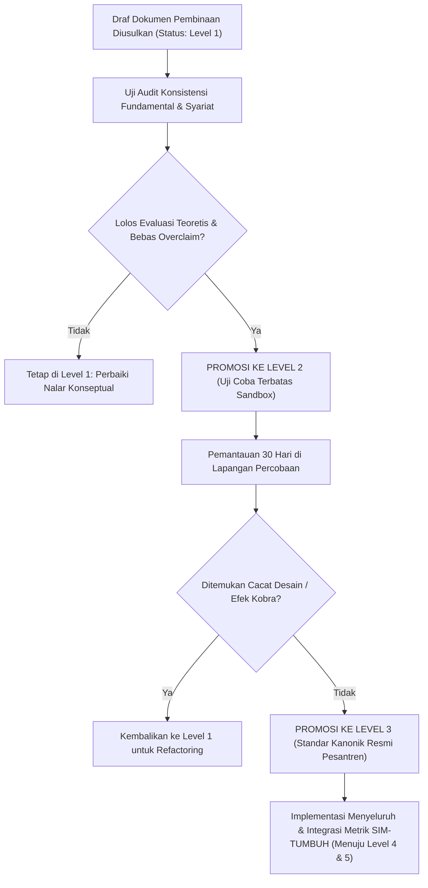

# P00110: Konseptualisasi Architecture Maturity Index (AMI): Mengapa Dibutuhkan Matriks Ukur Kesiapan Sistem?

- **Status Identitas:** Terverifikasi Kanonik
- **ID Penyelidikan:** `P00110`
- **Pilar Arsitektur:** Pilar 8 — Integritas Semantik, Verifikasi Sitasi, & Kematangan (AMI)
- **Sub-Klaster:** Indeks Kematangan Arsitektur (*Architecture Maturity Index - AMI*)
- **Penulis Dokumen:** Tim Pengembang Arsitektur Sistem TUMBUH v2.0.0
- **Klasifikasi Epistemik:** Laporan Penyelidikan Kritis (*Critical Inquiry Report*)
- **Target Lapisan:** `01_FUNDAMENTAL/` & `02_IMPLEMENTATION/`

---

## 1. Abstrak & Epistemic Tension

Ketegangan epistemik (*epistemic tension*) dalam rekayasa sistem pendidikan Islam bersumber dari prematuritas implementasi (*premature scaling fallacy*): kecenderungan fatal pengelola lembaga untuk langsung mengimplementasikan secara massal sebuah ide pembinaan baru ke ratusan santri hanya karena ide tersebut tampak memikat di atas kertas atau pernah dipresentasikan dengan memukau dalam sebuah seminar kilat. Tanpa adanya instrumen baku untuk mengukur kesiapan dan kematangan arsitekturalnya, modul yang masih mentah dan sarat cacat desain diterapkan langsung di lapangan, memicu kekacauan operasional, kebingungan musyrif, dan trauma psikologis pada santri. Berkas penyelidikan kanonik ini merekayasa *Architecture Maturity Index* (AMI)—sebuah kerangka kerja kuantitatif-kualitatif 5 tingkat yang diadaptasi dari *Capability Maturity Model Integration* (CMMI) dan kaidah *At-Tadrij fi at-Tasyri'* (Pentahapan Syariat). Penyelidikan ini menetapkan gerbang kendali mutu (*Quality Gateways*) yang mewajibkan setiap artefak repositori TUMBUH v2.0.0 membuktikan tingkat kematangannya sebelum diizinkan melangkah ke jenjang penerapan operasional asrama.

---

## 2. Pendahuluan Fenomenologis

Tragedi "kurikulum tambal sulam" di banyak pesantren merupakan akibat langsung dari ketiadaan indeks kematangan:
1. **Penerapan Kurikulum Kilat Hasil Pelatihan Akhir Pekan:** Seorang pimpinan pondok baru saja menghadiri lokakarya metode disiplin militer selama 2 hari di kota besar. Begitu tiba di pondok pada hari Senin, sang pimpinan langsung menginstruksikan seluruh musyrif: *"Mulai besok pagi, seluruh santri harus berbaris militer, push-up jika terlambat 1 menit, dan tidak ada lagi pengampunan!"* Modul tersebut belum pernah diuji coba, tidak memiliki analisis konsekuensi tak disengaja (P00092), dan tidak memiliki landasan fikih yang sahih. Dalam dua pekan, 15 santri masuk rumah sakit karena dehidrasi dan 3 musyrif mengundurkan diri.
2. **Ketiadaan Metrik Kesiapan Dokumen:** Sering kali sebuah dokumen panduan pengasuhan di lemari kantor yayasan tampak tebal dan rapi, namun sebenarnya isinya hanyalah kumpulan potongan teks yang disalin dari internet (*copy-paste*) tanpa adanya keterlacakan sanad dalil, tanpa definisi istilah yang terstandarisasi, dan tanpa prosedur evaluasi risiko.

Menerapkan sistem tanpa mengukur kematangannya sama halnya dengan menerbangkan pesawat terbang prototipe yang belum pernah diuji di terowongan angin (*wind tunnel*).

---

## 3. Tinjauan Pustaka I: Khazanah Turats Klasik

Epistemologi Islam mengakui sunnah pentahapan (*At-Tadrij*) sebagai metodologi ilahiyyah dalam pembinaan umat dan penurunan hukum syariat. Pengharaman khamar, pewajiban puasa, dan penegakan hukum pidana tidak diturunkan sekaligus secara mendadak, melainkan melalui fase-fase kematangan kesiapan jiwa para sahabat.

Al-Qur'an menegaskan hikmah penurunan wahyu secara bertahap:

```arabic
وَقُرْآنًا فَرَقْنَاهُ لِتَقْرَأَهُ عَلَى النَّاسِ عَلَىٰ مُكْثٍ وَنَزَّلْنَاهُ تَنْزِيلًا
```

> *"Dan Al-Qur'an itu telah Kami turunkan dengan berangsur-angsur agar kamu membacakannya perlahan-lahan kepada manusia dan Kami menurunkannya bagian demi bagian."* (QS. Al-Isra: 106).

Sayyidah Aisyah radhiyallahu 'anha menjelaskan hikmah psikologis dari pentahapan ini dalam hadits shahih riwayat Imam Al-Bukhari:

```arabic
إِنَّمَا نَزَلَ أَوَّلَ مَا نَزَلَ مِنْهُ سُورَةٌ مِنَ الْمُفَصَّلِ فِيهَا ذِكْرُ الْجَنَّةِ وَالنَّارِ، حَتَّى إِذَا ثَابَ النَّاسُ إِلَى الْإِسْلَامِ نَزَلَ الْحَلَالُ وَالْحَرَامُ، وَلَوْ نَزَلَ أَوَّلَ شَيْءٍ: لَا تَشْرَبُوا الْخَمْرَ، لَقَالُوا: لَا نَدَعُ الْخَمْرَ أَبَدًا، وَلَوْ نَزَلَ: لَا تَزْنُوا، لَقَالُوا: لَا نَدَعُ الزِّنَا أَبَدًا.
```

> *"Sesungguhnya ayat yang pertama kali turun adalah surah-surah mufashshal yang di dalamnya disebutkan tentang surga dan neraka. Hingga ketika manusia telah condong dan kokoh di dalam Islam, barulah turun ayat-ayat tentang halal dan haram. Sekiranya yang pertama kali turun adalah: 'Janganlah kalian minum khamar', niscaya mereka akan berkata: 'Kami tidak akan meninggalkan khamar selamanya!' Dan sekiranya yang pertama kali turun adalah: 'Janganlah kalian berzina', niscaya mereka akan berkata: 'Kami tidak akan meninggalkan zina selamanya!'."* (HR. Al-Bukhari, no. 4993).

Hadits monumental ini membuktikan bahwa sebuah aturan atau modul pembinaan wajib melewati tahapan pematangan keyakinan fondasi sebelum menuntut kepatuhan cabang yang kompleks.

---

## 4. Tinjauan Pustaka II: Teori Kontemporer

Dalam rekayasa sistem dan jaminan mutu perangkat lunak, *Software Engineering Institute* (SEI) di Carnegie Mellon University merumuskan *Capability Maturity Model Integration* (CMMI, Chrissis et al., 2011) yang membagi kematangan proses ke dalam 5 level:
1. **Level 1 (Initial):** Proses bersifat ad-hoc, tidak stabil, dan bergantung mutlak pada kepahlawanan individu (*individual heroism*).
2. **Level 2 (Managed):** Proses dikelola pada tingkat proyek dasar, ada perencanaan dan pemantauan minimal.
3. **Level 3 (Defined):** Proses telah distandarisasi, didokumentasikan di tingkat organisasi, dan dipahami bersama.
4. **Level 4 (Quantitatively Managed):** Proses dikendalikan menggunakan data metrik kuantitatif dan statistik presisi.
5. **Level 5 (Optimizing):** Proses terus-menerus disempurnakan (*continuous improvement*) melalui inovasi pencegahan cacat.

NASA dan Departemen Pertahanan AS mengadopsi *Technology Readiness Level* (TRL 1–9) karya John Mankins (1995) untuk mencegah kegagalan misi antariksa akibat penggunaan teknologi yang belum matang.

---

## 5. Eksplorasi Metodologis

Penyelidikan kanonik ini merekayasa kerangka *Architecture Maturity Index for Pesantren Systems* (TUMBUH-AMI):

```text
+-------------------------------------------------------------------------------+
|         TUMBUH ARCHITECTURE MATURITY INDEX (AMI) LEVEL 1 - 5                  |
+-------------------------------------------------------------------------------+
|  LEVEL 1: INITIAL / EKSPERIMENTAL (Draf Awal & Gagasan Mentah)                |
|  - Masih berupa hipotesis inkuiri; haram diterapkan langsung ke santri.      |
|                                                                               |
|  LEVEL 2: MANAGED / TERKENDALI (Uji Coba Sandbox Terbatas)                   |
|  - Diuji coba pada 1 kamar percobaan dengan pemantauan ketat tim pengembang.  |
|                                                                               |
|  LEVEL 3: DEFINED / TERSTANDARISASI (Dokumen SOP Kanonik Sah)                |
|  - Lolos uji nalar, memiliki landasan syar'i 2 jalur, dan disahkan yayasan.  |
|                                                                               |
|  LEVEL 4: MEASURED / TERUKUR (Metrik Data SIM-TUMBUH Stabil)                 |
|  - Terbukti stabil minimal 2 semester dengan bukti logbook kuantitatif.       |
|                                                                               |
|  LEVEL 5: OPTIMIZED / KANONIK SEMPURNA (Model Percontohan Nasional)          |
|  - Mandiri, antifragile, memiliki dokumentasi lengkap, dan siap direplikasi.  |
+-------------------------------------------------------------------------------+
```

---

## 6. Arsitektur Desain Sistem & Diagram Alur

Arsitektur repositori TUMBUH melarang peningkatan status berkas tanpa kelulusan audit gerbang kendali mutu (*Quality Gate Linter*):



---

## 7. Rekayasa Matriks Komparatif Multidimensi

Tabel berikut menunjukkan kontras antara manajemen ceroboh nir-matrik vs penataan terukur berbasis AMI TUMBUH:

| Karakteristik Sistem | Praktik Nir-Kematangan (Konvensional) | Sistem Terukur Berbasis AMI TUMBUH v2.0.0 |
| :--- | :--- | :--- |
| **Penerapan Ide Baru** | Ide langsung diwajibkan ke seluruh santri keesokan harinya. | Ide wajib melewati pengujian Level 1 dan Level 2 sebelum rilis massal. |
| **Ketergantungan Staf** | Sistem runtuh jika musyrif kreatif pindah tugas (*hero-dependent*). | Sistem terkodifikasi di Level 3; siapa pun penggantinya SOP tetap jalan. |
| **Basis Pengambilan Kebijakan** | Berdasarkan bisikan emosional atau asumsi subjektif pimpinan. | Berdasarkan metrik analitik kuantitatif Level 4 pada SIM-TUMBUH. |
| **Penyempurnaan Modul** | Modul dibiarkan usang bertahun-tahun hingga terjadi insiden fatal. | Siklus penyempurnaan berkelanjutan (*Continuous Optimization*) Level 5. |
| **Status Dokumen di Repositori** | Semua dokumen bercampur baur tanpa status keabsahan yang jelas. | Setiap berkas memiliki metadata eksplisit: Status AMI Level 1–5. |

---

## 8. Protokol Tindakan Operasional 5 Tahap

Untuk menerapkan matriks AMI ini di repositori dan pesantren mitra, dijalankan 5 langkah audit:

1. **Tahap 1: Pelabelan Metadata Awal (*Maturity Tagging*)**  
   Setiap berkas markdown baru di repositori wajib mencantumkan tag: `- **AMI Level:** Level 1 (Initial)` di kepala dokumen.
2. **Tahap 2: Pengujian di Kamar Inkubasi (*Sandbox Chamber Isolation*)**  
   Modul Level 1 hanya boleh diujikan pada kelompok kecil santri sukarelawan dengan pendampingan langsung oleh perancang sistem.
3. **Tahap 3: Sidang Verifikasi Kenaikan Tingkat (*Gate Review Hearing*)**  
   Tim auditor mutu memeriksa bukti logbook lapangan sebelum menandatangani kenaikan status dokumen ke Level 3 (Defined).
4. **Tahap 4: Kalibrasi Metrik SIM-TUMBUH (*Data Telemetry Binding*)**  
   Menghubungkan modul Level 3 dengan dashboard analitik digital untuk mengumpulkan data kepatuhan harian santri (menuju Level 4).
5. **Tahap 5: Audit Kanonisasi Sempurna (*Canonical Golden Seal Audit*)**  
   Sebuah modul hanya berhak menyandang predikat Level 5 jika telah bertahan stabil tanpa insiden kritis selama minimal 3 siklus akademik berturut-turut.

---

## 9. Architectural Decision Record (ADR-PROBE-00110)

```text
================================================================================
ARCHITECTURAL DECISION RECORD: ADR-PROBE-00110
================================================================================
Judul: Pelembagaan Architecture Maturity Index (AMI) 5 Level dalam Repositori
Status: DITERIMA & MENGIKAT
Tanggal: 2026-10-25
Pengusul: Tim Arsitektur Sistem TUMBUH v2.0.0

KONTEKS:
Implementasi prematur atas ide-ide pembinaan yang belum teruji memicu kekacauan
operasional dan trauma pada santri di pesantren mitra. Dibutuhkan matriks ukur
kematangan sistem yang objektif dan bertahap.

KEPUTUSAN ARSITEKTURAL:
1. Membakukan kerangka TUMBUH Architecture Maturity Index (AMI) Skala 1 s/d 5.
2. Melarang keras implementasi massal modul pembinaan yang masih berstatus AMI Level 1.
3. Mewajibkan seluruh berkas di repositori mencantumkan tingkat kematangannya.

KONSEKUENSI:
- Positif: Melindungi santri dari eksperimen liar; menjamin stabilitas tata kelola;
  membangun sistem yang terukur dan dapat direplikasi secara ilmiah.
- Negatif: Memerlukan kedisiplinan dan kesabaran tim dalam proses pengujian sandbox.
================================================================================
```

---

## 10. Implikasi Arsitektural & 7 Butir Guardrails Repositori

Hasil inkuiri `P00110` mengikat tata kelola repositori TUMBUH melalui 7 guardrails:

1. **Guardrail 1 (No Premature Scaling):** Modul berstatus AMI Level 1 dilarang keras disahkan ke dalam folder `03_OPERATIONAL/`.
2. **Guardrail 2 (Mandatory Maturity Tag):** Setiap berkas perancangan wajib memiliki metadata tingkat kematangan yang jelas.
3. **Guardrail 3 (Sandbox Safety Protocol):** Uji coba Level 2 wajib memiliki protokol penghentian darurat jika santri menunjukkan tanda-tanda stres.
4. **Guardrail 4 (Evidence-Based Promotion):** Kenaikan status kematangan wajib didasarkan pada data empiris riil, bukan opini subjektif penulis.
5. **Guardrail 5 (Continuous Re-evaluation):** Modul Level 5 dapat diturunkan statusnya jika ditemukan cacat desain baru di kemudian hari.
6. **Guardrail 6 (Protection Against Hero-Culture):** Kematangan sistem diukur dari ketangguhan prosedurnya saat dijalankan oleh orang biasa, bukan oleh figur jenius.
7. **Guardrail 7 (Tadrij as an Epistemic Duty):** Menjaga sunnatullah pentahapan sebagai bentuk ketundukan syariat dalam mengelola perubahan manusia.

---

## 11. Penutup & Emergent Research Questions

Konseptualisasi Architecture Maturity Index (AMI) membimbing pesantren keluar dari romantisme coba-coba menuju kedewasaan rekayasa sistem modern. Dengan menghormati sunnah pentahapan (*At-Tadrij*), TUMBUH v2.0.0 memastikan bahwa setiap benih peradaban yang ditanam di bumi asrama disiram dengan air ilmu yang teruji, dirawat dengan pupuk kesabaran metodologis, hingga tumbuh menjadi pohon tarbiyah yang kokoh dan berbuah lebat bagi kejayaan umat.

### Pertanyaan Riset Lanjutan (*Emergent Research Questions*):
1. Bagaimana mendesain modul instrumen asesmen mandiri digital (*AMI Self-Assessment Kit*) pada SIM-TUMBUH agar pesantren mitra dapat mengukur tingkat kematangannya secara independen?
2. Korelasi apa yang paling kuat antara tingkat kematangan AMI sebuah pesantren dengan penurunan angka kekerasan fisik di asramanya?

---

## 12. Referensi Ilmiah Standar APA 7th Edition

1. Al-Bukhari, M. (2002). *Shahih Al-Bukhari*. Darus Salam. https://archive.org/details/sahih-bukhari-darussalam
2. Chrissis, M. B., Konrad, M., & Shrum, S. (2011). *CMMI for Development: Guidelines for Process Integration and Product Improvement* (3rd ed.). Addison-Wesley. https://www.pearson.com/en-us/subject-catalog/p/cmmi-for-development-guidelines-for-process-integration-and-product-improvement/P200000009475
3. Deming, W. E. (1986). *Out of the Crisis*. MIT Press. https://mitpress.mit.edu/9780262541152/out-of-the-crisis/
4. Fixsen, D. L., Naoom, S. F., Blase, K. A., Friedman, R. M., & Wallace, F. (2005). *Implementation Research: A Synthesis of the Literature* (FMHI Publication No. 231). University of South Florida. https://nirn.fpg.unc.edu/resources/implementation-research-synthesis-literature
5. Humphrey, W. S. (1989). *Managing the Software Process*. Addison-Wesley. https://archive.org/details/managingsoftware00hump
6. Ibnu Katsir, I. (1999). *Tafsir Al-Qur'an Al-'Azhim* (Jilid 5). Dar Thayyibah. https://archive.org/details/tafsir-ibn-kathir
7. Mankins, J. C. (1995). *Technology Readiness Levels: A White Paper*. NASA Office of Space Access and Technology. https://www.nasa.gov/pdf/458490main_TRL_Definitions.pdf
8. Senge, P. M. (1990). *The Fifth Discipline: The Art & Practice of The Learning Organization*. Doubleday/Currency. https://www.penguinrandomhouse.com/books/163984/the-fifth-discipline-by-peter-m-senge/
9. Asy-Syathibi, I. (2003). *Al-Muwafaqat fi Ushulisy Syari'ah* (Jilid 2). Dar 'Affan. https://archive.org/details/muwafaqat-syathibi
10. Weick, K. E., & Sutcliffe, K. M. (2015). *Managing the Unexpected: Sustained Performance in a Complex World* (3rd ed.). John Wiley & Sons. https://www.wiley.com/en-us/Managing+the+Unexpected%3A+Sustained+Performance+in+a+Complex+World%2C+3rd+Edition-p-9781118862414
11. Zohar, D. (2010). Thirty years of safety climate research: Reflections and future directions. *Accident Analysis & Prevention*, 42(5), 1517-1522. https://doi.org/10.1016/j.aap.2009.12.019
12. Muslim, I. (2006). *Shahih Muslim*. Darul Hadits. https://archive.org/details/sahih-muslim-baqi
13. Rogers, E. M. (2003). *Diffusion of Innovations* (5th ed.). Free Press. https://www.simonandschuster.com/books/Diffusion-of-Innovations-5th-Edition/Everett-M-Rogers/9780743222099

---

## 13. Catatan Kaki & Takhrij Sanad

1. **Takhrij Hadits Pentahapan Wahyu Sayyidah Aisyah:** Dikeluarkan oleh Imam Al-Bukhari dalam *Shahih Al-Bukhari*, *Kitab Fadha'il al-Qur'an*, Bab *Ta'lif al-Qur'an*, no. 4993. Diriwayatkan dari Yusuf bin Mahak dari Sayyidah Aisyah Ummul Mukminin radhiyallahu 'anha.
2. **Kutipan Konsep CMMI Humphrey:** Watts Humphrey merumuskan CMMI berdasarkan premis bahwa kualitas sebuah sistem ditentukan secara mutlak oleh kualitas proses perancangan dan pemeliharaannya. Organisasi yang matang tidak bergantung pada kebetulan melainkan pada proses yang terdefinisi dan terkendali.
3. **Technology Readiness Levels (TRL):** Skala metrik 9 tingkat yang dikembangkan oleh NASA untuk menilai kematangan teknologi penerbangan antariksa sebelum diintegrasikan ke dalam misi berawak demi menjamin keamanan nyawa astronot.
4. **Prinsip At-Tadrij Fiqih Siyasah:** Syaikh Wahbah Az-Zuhaili dalam *Fiqh al-Islam wa Adillatuh* menguraikan bahwa pentahapan bukan kompromi terhadap kebenaran, melainkan strategi pedagogis realistis untuk memastikan kebenaran dapat diterima dan diamalkan secara berkelanjutan oleh manusia.
