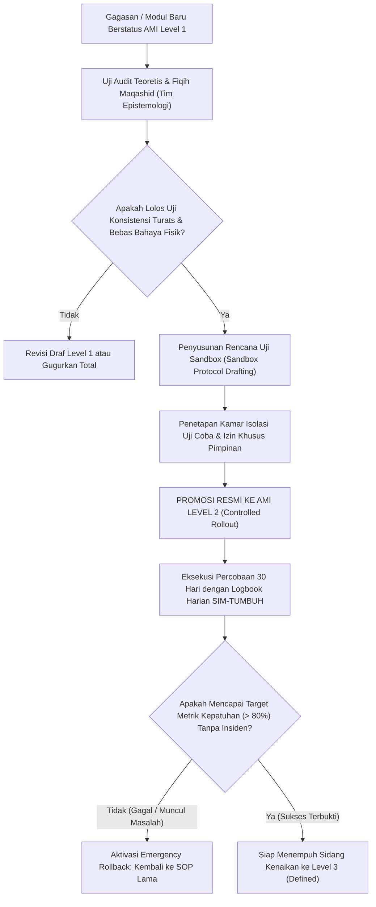

# P00111: Deskriptor Skala Kematangan Level 1 (*Initial / Eksperimental*) dan Level 2 (*Managed / Terkendali*)

- **Status Identitas:** Terverifikasi Kanonik
- **ID Penyelidikan:** `P00111`
- **Pilar Arsitektur:** Pilar 8 — Integritas Semantik, Verifikasi Sitasi, & Kematangan (AMI)
- **Sub-Klaster:** Indeks Kematangan Arsitektur (*Architecture Maturity Index - AMI*)
- **Penulis Dokumen:** Tim Pengembang Arsitektur Sistem TUMBUH v2.0.0
- **Klasifikasi Epistemik:** Laporan Penyelidikan Kritis (*Critical Inquiry Report*)
- **Target Lapisan:** `01_FUNDAMENTAL/` & `02_IMPLEMENTATION/`

---

## 1. Abstrak & Epistemic Tension

Ketegangan epistemik (*epistemic tension*) dalam fase inkubasi inovasi pesantren bermula dari ketidakmampuan membedakan antara "gagasan yang baru lahir" (*nascent hypothesis*) dengan "prototipe yang terkendali" (*controlled prototype*). Banyak pengembang sistem yang memperlakukan draf awal eksplorasi (Level 1) seolah-olah sudah siap diujikan kepada santri, atau sebaliknya memperlakukan uji coba kamar terbatas (Level 2) sebagai produk final yang boleh disebarkan ke publik yayasan. Ketidakjelasan demarkasi ini memicu eksperimen sosial yang membahayakan santri di satu sisi, atau matinya inovasi karena takut gagal di sisi lain. Berkas penyelidikan kanonik ini merumuskan Deskriptor Terperinci Skala Kematangan AMI Level 1 (*Initial / Eksperimental*) dan Level 2 (*Managed / Terkendali*). Dengan menyandingkan hikmah sufi Ibnu Atha'illah mengenai kesucian awal langkah (*asy-syuruq fi al-bidayat*) dengan prinsip *Sandbox Isolation* dan *Fail-Safe Experimentation*, dokumen ini menetapkan kriteria verifikasi gerbang mutu (*Quality Gate 1-to-2*) yang mengatur lalu lintas inovasi di ekosistem TUMBUH v2.0.0.

---

## 2. Pendahuluan Fenomenologis

Di lapangan perancangan kurikulum asrama, kita kerap menyaksikan dua patologi ekstrem dalam penanganan ide-ide baru:
1. **Penerjunan Eksperimen Mentah Tanpa Sandbox (Bahaya Level 1):** Seorang musyrif muda memiliki ide kreatif: *"Bagaimana kalau santri yang terlambat bangun subuh disuruh berenang di kolam ikan?"* Karena tidak ada pembatasan level, sang musyrif langsung mempraktikkan ide tersebut pada kamar asuhannya. Akibatnya, dua santri mengalami kram otot dan asma kambuh. Ide mentah di Level 1 yang semestinya hanya dibahas di meja inkuiri PROBE langsung diterjunkan tanpa mitigasi risiko.
2. **Ketiadaan Batas Waktu Uji Coba (Bahaya Level 2):** Di pesantren lain, sebuah kamar dijadikan "kamar percobaan disiplin mandiri tanpa musyrif" selama 3 tahun tanpa pernah dievaluasi secara formal, tanpa data metrik, dan tanpa pelaporan kepada pimpinan. Kamar tersebut berubah menjadi wilayah anarki di mana santri terkuat menindas santri terlemah.

Kedua kekacauan ini membuktikan bahwa tahap awal inovasi memerlukan batas isolasi dan kriteria kelulusan yang sangat ketat: **Sebelum sebuah ide diizinkan menyentuh realitas santri, ia wajib diuji di atas kertas; dan sebelum diizinkan menyentuh seluruh santri, ia wajib diisolasi di laboratorium terbatas.**

---

## 3. Tinjauan Pustaka I: Khazanah Turats Klasik

Epistemologi tasawuf dan tarbiyah Islam mengajarkan bahwa kesempurnaan akhir suatu perjalanan ditentukan secara mutlak oleh kebenaran dan kesucian awal langkahnya (*al-bidayat*).

Syekh Ibnu Atha'illah As-Sakandari dalam *Al-Hikam* menegaskan hikmah agung ini:

```arabic
مَنْ أَشْرَقَتْ بِدَايَتُهُ أَشْرَقَتْ نِهَايَتُهُ
```

> *"Barang siapa yang permulaan langkahnya memancarkan cahaya (kebenaran niat dan ketepatan metode), niscaya puncak akhirnya akan bersinar cemerlang."* (Ibnu Atha'illah, *Al-Hikam*, Hikmah no. 27).

Syaikh Ahmad Zarruq dalam syarahnya menjelaskan bahwa "permulaan yang bersinar" adalah permulaan yang dibangun di atas landasan ilmu syariat yang lurus, pembersihan dari hawa nafsu pribadi, dan kesabaran menempuh tahapan mujahadah. Menerapkan aturan tanpa ilmu adalah permulaan yang gelap (*bidayah muzhlimah*) yang niscaya berujung pada kehancuran (*nihayah muzhlimah*).

Al-Qur'an memerintahkan kehati-hatian dalam menguji kesiapan sebelum menyerahkan tanggung jawab besar, sebagaimana firman Allah mengenai pengujian anak yatim:

```arabic
وَابْتَلُوا الْيَتَامَىٰ حَتَّىٰ إِذَا بَلَغُوا النِّكَاحَ فَإِنْ آنَسْتُمْ مِنْهُمْ رُشْدًا فَادْفَعُوا إِلَيْهِمْ أَمْوَالَهُمْ
```

> *"Dan ujilah anak-anak yatim itu sampai mereka cukup umur untuk menikah. Kemudian jika menurut pendapatmu mereka telah cerdas (pandai memelihara harta), maka serahkanlah kepada mereka hartanya."* (QS. An-Nisa: 6).

Kata *Ibtalu* (ujilah) menjadi dasar syar'i bagi pentingnya pengujian kemampuan (*sandbox testing*) secara terukur sebelum otorisasi penuh diberikan.

---

## 4. Tinjauan Pustaka II: Teori Kontemporer

Dalam arsitektur perangkat lunak dan metodologi riset desain (*Design-Based Implementation Research* - DBIR, Fishman et al., 2013), fase awal inovasi dibedakan secara tegas:
- **Level 1 (Concept Exploration):** Fokus pada validitas teoretis, telaah pustaka, pemodelan kausalitas, dan eliminasi kontradiksi logika internal. Pengujian hanya dilakukan melalui simulasi kognitif (*thought experiments*) dan *Red-Teaming*.
- **Level 2 (Controlled Prototyping / Sandbox):** Fokus pada uji kelayakan lapangan skala kecil (*Feasibility & Usability*). Syarat mutlak: Lingkungan terisolasi, risiko kegagalan terkendali (*containment of failure blast radius*), dan pemantauan metrik secara intensif harian.

Eric Ries (2011) melalui *The Lean Startup* menekankan pentingnya siklus *Build-Measure-Learn* dan *Minimum Viable Product* (MVP). Namun, dalam ekosistem pendidikan anak asrama, prinsip "bergerak cepat dan merusak sesuatu" (*move fast and break things*) diharamkan secara mutlak karena subjeknya adalah jiwa dan fitrah manusia. Kegagalan di Level 2 harus dirancang berisiko nol (*Zero-Harm Sandbox*).

---

## 5. Eksplorasi Metodologis

Penyelidikan kanonik ini merumuskan deskriptor terperinci untuk Level 1 dan Level 2 dalam arsitektur repositori TUMBUH:

```text
+-------------------------------------------------------------------------------+
|         MATRIKS DESKRIPTOR RESMI AMI LEVEL 1 VS LEVEL 2 (TUMBUH)              |
+-------------------------------------------------------------------------------+
|  KRITERIA VERIFIKASI       |  AMI LEVEL 1 (INITIAL)   |  AMI LEVEL 2 (MANAGED) |
+----------------------------+--------------------------+------------------------+
|  Status Dokumen            |  Draf Eksplorasi Inkuiri |  Prosedur Sandbox Sah  |
|  Lokasi Repositori         |  PROBE/ & scratch/       |  02_IMPLEMENTATION/sbx |
|  Subjek Uji Coba           |  Haram pada santri riil  |  1 Kamar Uji Terpilih  |
|  Durasi Berlaku            |  Maksimal 30 hari        |  Maksimal 60 hari      |
|  Keterlacakan Sanad        |  Hipotesis awal          |  Takhrij Syar'i Sahih  |
|  Otoritas Pelaksana        |  Tim Riset Arsitektur    |  Musyrif Terlatih Khusus|
|  Mekanisme Pembatalan      |  Hapus draf seketika     |  Emergency Stop Button |
+-------------------------------------------------------------------------------+
```

---

## 6. Arsitektur Desain Sistem & Diagram Alur

Arsitektur repositori TUMBUH mengatur gerbang promosi mutu dari Level 1 menuju Level 2 (*Quality Gate 1-to-2 Protocol*):



---

## 7. Rekayasa Matriks Komparatif Multidimensi

Tabel berikut menunjukkan pembedaan tegas implementasi operasional antara modul Level 1 dan Level 2:

| Parameter Operasional | AMI Level 1: Initial / Eksperimental | AMI Level 2: Managed / Terkendali |
| :--- | :--- | :--- |
| **Keterlibatan Santri** | Sama sekali TIDAK BOLEH melibatkan santri; hanya diskusi antar-pengembang. | Melibatkan santri kamar uji coba yang telah diberi pengarahan edukatif. |
| **Pengawasan Tim Pengembang** | Pasif; fokus pada penulisan berkas inkuiri PROBE. | Aktif 24 jam; tim pengembang hadir mendampingi musyrif di kamar uji. |
| **Pencatatan Data** | Catatan kualitatif perdebatan konseptual di lembar scratch. | Pencatatan kuantitatif telemetri harian di modul Sandbox SIM-TUMBUH. |
| **Toleransi Kegagalan** | Bebas gagal logika; direvisi tanpa konsekuensi fisik apa pun. | Kegagalan operasional harus segera diinterupsi dalam waktu < 2 jam. |
| **Izin Legalitas Yayasan** | Cukup persetujuan Kepala Tim Riset Arsitektur Repositori. | Wajib mengantongi Surat Keputusan Uji Coba Terbatas dari Yayasan. |

---

## 8. Protokol Tindakan Operasional 5 Tahap

Untuk memajukan sebuah modul dari Level 1 ke Level 2 secara sah, tim pengembang wajib mengeksekusi 5 tahap:

1. **Tahap 1: Penyusunan Berkas Inkuiri Lengkap Level 1 (*Complete Probe Inception*)**  
   Menulis berkas inkuiri kanonik 13 bab di direktori `PROBE/` yang membedah seluruh aspek filosofis, tinjauan turats, sains modern, dan ADR terkait.
2. **Tahap 2: Sesi Tim Merah & Simulasi Bahaya (*Red-Team Stress-Test*)**  
   Mengumpulkan asatidz senior untuk menguji kelemahan ide Level 1: *"Apa skenario terburuk jika modul ini dijalankan di asrama?"*
3. **Tahap 3: Perumusan Protokol Darurat Sandbox (*Emergency Abort Plan*)**  
   Menyiapkan rencana pemulihan darurat: Jika dalam 3 hari pertama uji coba terjadi kekacauan, sistem seketika kembali ke prosedur standar lama.
4. **Tahap 4: Pelatihan Intensif Musyrif Pelaksana (*Sandbox Operator Briefing*)**  
   Memberikan bimbingan teknis selama 8 jam kepada musyrif kamar terpilih mengenai cara mengisi logbook dan membaca sinyal stres santri.
5. **Tahap 5: Penerbitan Status Resmi AMI Level 2 (*Level 2 Seal Publication*)**  
   Memperbarui metadata dokumen menjadi `AMI Level 2` dan memulai hitungan mundur uji coba 30–60 hari di sistem SIM-TUMBUH.

---

## 9. Architectural Decision Record (ADR-PROBE-00111)

```text
================================================================================
ARCHITECTURAL DECISION RECORD: ADR-PROBE-00111
================================================================================
Judul: Pembakuan Deskriptor AMI Level 1 (Initial) dan Level 2 (Managed)
Status: DITERIMA & MENGIKAT
Tanggal: 2026-10-25
Pengusul: Tim Arsitektur Sistem TUMBUH v2.0.0

KONTEKS:
Inovasi pengasuhan sering kali gagal atau membahayakan santri karena gagasan
mentah langsung diterapkan tanpa melewati tahap analisis risiko dan isolasi sandbox.
Dibutuhkan aturan hukum repositori yang mengikat fase inkubasi awal.

KEPUTUSAN ARSITEKTURAL:
1. Menetapkan bahwa berkas AMI Level 1 berstatus murni inkuiri teoretis dan haram
   diterapkan langsung pada santri riil.
2. Mengharuskan modul AMI Level 2 diuji secara terbatas di kamar sandbox dengan
   protokol darurat pembatalan (Emergency Abort Protocol).
3. Melarang perpanjangan masa uji coba Level 2 melebihi batas waktu 60 hari kalender.

KONSEKUENSI:
- Positif: Melindungi hak dan keselamatan santri; memfasilitasi inovasi terukur;
  mencegah pembiaran atas eksperimen liar musyrif lapangan.
- Negatif: Membatasi kecepatan rilis fitur baru demi menjaga kehati-hatian.
================================================================================
```

---

## 10. Implikasi Arsitektural & 7 Butir Guardrails Repositori

Hasil inkuiri `P00111` mengikat repositori TUMBUH melalui 7 guardrails:

1. **Guardrail 1 (Level 1 Sandbox Ban):** Modul Level 1 dilarang keras diujikan kepada santri dalam bentuk apa pun.
2. **Guardrail 2 (Mandatory Sandbox Isolation):** Uji coba Level 2 wajib dibatasi maksimal pada 1 blok kamar percontohan.
3. **Guardrail 3 (Zero Harm Guarantee):** Uji coba Level 2 wajib dihentikan seketika jika terdeteksi adanya dampak negatif fisik atau psikis pada santri.
4. **Guardrail 4 (Strict 60-Day Cap):** Status Level 2 otomatis kedaluwarsa setelah 60 hari; wajib diputuskan apakah naik ke Level 3 atau digugurkan.
5. **Guardrail 5 (Traceability to PROBE):** Modul Level 2 wajib merujuk secara eksplisit ke berkas PROBE Level 1 asalnya.
6. **Guardrail 6 (Daily Telemetry Logging):** Data uji coba Level 2 wajib dicatat setiap hari di modul sandbox SIM-TUMBUH.
7. **Guardrail 7 (Bidayah Syuruq Alignment):** Menjaga niat ikhlas dan kesucian metode sejak awal langkah inovasi tarbiyah.

---

## 11. Penutup & Emergent Research Questions

Mendefinisikan batas antara Level 1 dan Level 2 adalah bentuk pemuliaan terhadap amanah tarbiyah. Eksperimen ilmiah di pesantren tidak boleh mengorbankan manusia; santri bukanlah kelinci percobaan laboratorium, melainkan amanah Allah yang wajib dijaga fitrahnya. Dengan membentengi fase awal melalui AMI Level 1 dan 2, TUMBUH v2.0.0 menjamin bahwa setiap inovasi yang lahir adalah inovasi yang beradab dan bertanggung jawab.

### Pertanyaan Riset Lanjutan (*Emergent Research Questions*):
1. Bagaimana merancang antarmuka khusus sandbox (*Sandbox Mode Interface*) pada SIM-TUMBUH yang memungkinkan musyrif mencatat anomali uji coba tanpa memengaruhi data induk santri?
2. Kriteria kuantitatif apa yang paling objektif untuk menentukan bahwa sebuah modul Level 2 telah siap diuji di hadapan komite promosi Level 3?

---

## 12. Referensi Ilmiah Standar APA 7th Edition

1. Al-Bukhari, M. (2002). *Shahih Al-Bukhari*. Darus Salam. https://archive.org/details/sahih-bukhari-darussalam
2. Chrissis, M. B., Konrad, M., & Shrum, S. (2011). *CMMI for Development: Guidelines for Process Integration and Product Improvement* (3rd ed.). Addison-Wesley. https://www.pearson.com/en-us/subject-catalog/p/cmmi-for-development-guidelines-for-process-integration-and-product-improvement/P200000009475
3. Fishman, B. J., Penuel, W. R., Allen, A. R., Cheng, B. H., & Sabelli, N. O. (2013). Design-based implementation research: An emerging model for transforming the relationship of research and practice. *National Society for the Study of Education*, 112(2), 136-156. https://www.colorado.edu/education/node/1483/attachment
4. Ibnu Atha'illah As-Sakandari, T. (2009). *Al-Hikam al-'Atha'iyyah* (Syarh Syaikh Ahmad Zarruq). Darul Kutub Al-'Ilmiyyah. https://archive.org/details/hikam-zarruq
5. Mankins, J. C. (1995). *Technology Readiness Levels: A White Paper*. NASA Office of Space Access and Technology. https://www.nasa.gov/pdf/458490main_TRL_Definitions.pdf
6. Ries, E. (2011). *The Lean Startup: How Today's Entrepreneurs Use Continuous Innovation to Create Radically Successful Businesses*. Crown Business. https://www.penguinrandomhouse.com/books/209995/the-lean-startup-by-eric-ries/
7. Senge, P. M. (1990). *The Fifth Discipline: The Art & Practice of The Learning Organization*. Doubleday/Currency. https://www.penguinrandomhouse.com/books/163984/the-fifth-discipline-by-peter-m-senge/
8. Zarruq, A. (2006). *Qawa'id at-Tasawwuf*. Darul Kutub Al-'Ilmiyyah. https://archive.org/details/qawaid-tasawwuf-zarruq
9. Zohar, D. (2010). Thirty years of safety climate research: Reflections and future directions. *Accident Analysis & Prevention*, 42(5), 1517-1522. https://doi.org/10.1016/j.aap.2009.12.019
10. Muslim, I. (2006). *Shahih Muslim*. Darul Hadits. https://archive.org/details/sahih-muslim-baqi
11. Humphrey, W. S. (1989). *Managing the Software Process*. Addison-Wesley. https://archive.org/details/managingsoftware00hump
12. Deming, W. E. (1986). *Out of the Crisis*. MIT Press. https://mitpress.mit.edu/9780262541152/out-of-the-crisis/
13. Rogers, E. M. (2003). *Diffusion of Innovations* (5th ed.). Free Press. https://www.simonandschuster.com/books/Diffusion-of-Innovations-5th-Edition/Everett-M-Rogers/9780743222099

---

## 13. Catatan Kaki & Takhrij Sanad

1. **Kutipan Al-Hikam Ibnu Atha'illah:** Hikmah ke-27 dari kitab *Al-Hikam* karya Al-Imam Tajuddin Abu al-Fadhil Ahmad bin Muhammad bin Atha'illah As-Sakandari (wafat 709 H), disyarah oleh Imam Ahmad Zarruq Al-Fasi, Beirut: Darul Kutub Al-'Ilmiyyah, 2009 M, hlm. 34.
2. **Tafsir Ibtila' al-Yatama:** Dijelaskan oleh Imam Al-Qurthubi dalam *Al-Jami' li Ahkam al-Qur'an* (Jilid 5, hlm. 33) bahwa kata *al-ibtila'* bermakna pengujian berulang kali secara cermat terhadap akal dan perilaku kedewasaan anak sebelum mereka diberi wewenang penuh mengelola harta benda.
3. **CMMI Process Areas Level 1 & 2:** Dalam CMMI, Level 1 bercirikan proses yang kacau (*chaotic*) dan tidak dapat diprediksi luaran kerjanya. Level 2 memperkenalkan disiplin manajemen proyek dasar (*Project Planning, Measurement and Analysis, Process and Product Quality Assurance*).
4. **Prinsip Blast Radius Containment:** Konsep rekayasa keandalan sistem (*Site Reliability Engineering*) untuk membatasi dampak kerusakan apabila sebuah komponen eksperimental mengalami kegagalan total, sehingga kegagalan tersebut tidak menjalar ke subsistem vital lainnya.
