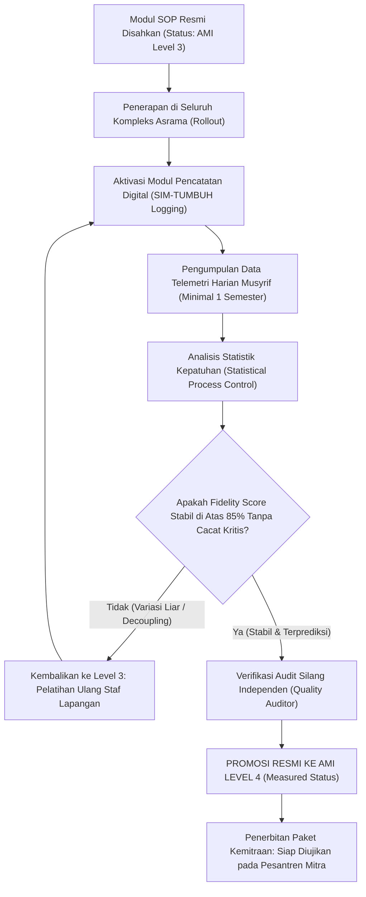

# P00112: Deskriptor Skala Kematangan Level 3 (*Defined / Terstandarisasi*) dan Level 4 (*Measured / Terukur*)

- **Status Identitas:** Terverifikasi Kanonik
- **ID Penyelidikan:** `P00112`
- **Pilar Arsitektur:** Pilar 8 — Integritas Semantik, Verifikasi Sitasi, & Kematangan (AMI)
- **Sub-Klaster:** Indeks Kematangan Arsitektur (*Architecture Maturity Index - AMI*)
- **Penulis Dokumen:** Tim Pengembang Arsitektur Sistem TUMBUH v2.0.0
- **Klasifikasi Epistemik:** Laporan Penyelidikan Kritis (*Critical Inquiry Report*)
- **Target Lapisan:** `02_IMPLEMENTATION/` & `03_OPERATIONAL/`

---

## 1. Abstrak & Epistemic Tension

Ketegangan epistemik (*epistemic tension*) dalam fase ekspansi sistem pesantren terletak pada ilusi standarisasi dokumen (*the documentation illusion*): keyakinan naif bahwa jika sebuah modul pembinaan telah tersusun rapi dalam dokumen SOP tebal yang disahkan oleh yayasan (Level 3), maka modul tersebut secara otomatis telah berhasil berjalan secara konsisten di lapangan. Faktanya, dokumen yang terstandarisasi di atas kertas sering kali tidak dijalankan sama sekali di kamar asrama (*procedural decoupling*), atau dijalankan dengan variasi liar antar-musyrif tanpa adanya alat ukur kepatuhan yang objektif. Tanpa lompatan menuju Level 4 (*Measured / Terukur*), sistem tidak memiliki kemampuan membedakan antara keberhasilan semu hasil rekayasa laporan dengan keberhasilan hakiki berbasis data perilaku riil. Berkas penyelidikan kanonik ini menetapkan Deskriptor Terperinci Skala Kematangan AMI Level 3 (*Defined*) dan Level 4 (*Measured*). Dengan memadukan doktrin kenabian mengenai profesionalisme mutu (*Itqan al-'Amal*) dengan teori *Statistical Process Control* (SPC) dan analitik telemetri SIM-TUMBUH, dokumen ini merumuskan gerbang verifikasi (*Quality Gate 3-to-4*) yang menjamin modul pembinaan terbukti stabil secara empiris sebelum direplikasi ke jaringan pesantren mitra.

---

## 2. Pendahuluan Fenomenologis

Kesenjangan antara dokumen Level 3 dan realitas Level 4 tampak nyata dalam kehidupan asrama sehari-hari:
1. **SOP Lengkap Namun Nir-Ukuran (Level 3 Tanpa Level 4):** Sebuah pesantren memiliki berkas SOP penanganan keterlambatan shalat subuh yang sangat indah: tertulis rapi langkah-langkah de-eskalasi, dialog adab, dan pencatatan. Namun, ketika ditanya oleh pengawas yayasan: *"Berapa persen santri yang masih terlambat setelah SOP ini dijalankan selama 6 bulan? Kamar mana yang memiliki deviasi tertinggi? Dan jam berapa puncak keterlambatan terjadi?"*, pengurus pengasuhan tidak mampu menjawab karena tidak ada sistem pengukuran data kuantitatif. Seluruh evaluasi hanya didasarkan pada ingatan samar musyrif senior: *"Kayaknya sudah agak mendingan, Ustadz."*
2. **Keterkejutan Saat Audit Eksternal:** Karena tidak adanya pengukuran metrik harian (Level 4), pimpinan pondok dikejutkan oleh gelombang pengunduran diri 20 santri di akhir semester. Ketika diselidiki, ternyata SOP pencegahan perundungan yang berstatus Level 3 di lemari kantor sama sekali tidak dipatuhi di lantai 2 asrama selama berbulan-bulan tanpa terdeteksi oleh sistem data.

Kelemahan ini membuktikan aksioma arsitektural TUMBUH: **Apa yang terdokumentasi (Level 3) baru merupakan janji komitmen; hanya apa yang terukur secara konsisten (Level 4) yang merupakan realitas peradaban.**

---

## 3. Tinjauan Pustaka I: Khazanah Turats Klasik

Epistemologi Islam menuntut profesionalisme kerja yang sempurna dan terukur rapi (*Al-Itqan*). Seorang mukmin dilarang bekerja secara serampangan atau berpuas diri dengan formalitas lahiriah yang semu.

Rasulullah SAW bersabda dalam hadits riwayat Imam Al-Baihaqi:

```arabic
إِنَّ اللَّهَ يُحِبُّ إِذَا عَمِلَ أَحَدُكُمْ عَمَلًا أَنْ يُتْقِنَهُ
```

> *"Sesungguhnya Allah sangat mencintai apabila salah seorang di antara kalian mengerjakan suatu amal (pekerjaan), ia melakukannya dengan itqan (rapi, teliti, profesional, dan sempurna)."* (HR. Al-Baihaqi dalam *Syu'abul Iman*, no. 4930; dinilai hasan).

Al-Imam Al-Munawi dalam *Faidh al-Qadir* menjelaskan hakikat kata *Itqan*:

```arabic
الْإِتْقَانُ هُوَ إِحْكَامُ الشَّيْءِ وَتَحْسِينُ صَنْعَتِهِ، وَأَنْ يَكُونَ صَادِرًا عَنْ عِلْمٍ وَبَصِيرَةٍ بِحَيْثُ يَكُونُ خَالِيًا عَنِ الْخَلَلِ وَالنَّقْصِ، مُطَابِقًا لِلْمَقَاصِدِ الشَّرْعِيَّةِ وَالْمَعَايِيرِ الْمُعْتَبَرَةِ.
```

> *"Al-Itqan adalah memperkokoh sesuatu, memperindah buatannya, dan memastikan ia bersumber dari ilmu dan mata batin yang tajam, sehingga pekerjaan tersebut bersih dari cacat dan kekurangan, serta selaras dengan tujuan-tujuan syariat dan standar-standar yang diakui."* (Al-Munawi, *Faidh al-Qadir*, Jilid 2, hlm. 286).

Dalam Al-Qur'an, Allah SWT menegaskan bahwa segala ciptaan-Nya diatur dengan ukuran yang sangat presisi (*Qadar / Taqdir*):

```arabic
إِنَّا كُلَّ شَيْءٍ خَلَقْنَاهُ بِقَدَرٍ
```

> *"Sesungguhnya Kami menciptakan segala sesuatu menurut ukuran (yang presisi)."* (QS. Al-Qamar: 49).

Kematangan tata kelola di Level 4 adalah perwujudan dari prinsip *taqdir*—mengukur dan mengendalikan proses pendidikan dengan data yang teliti.

---

## 4. Tinjauan Pustaka II: Teori Kontemporer

Dalam *Capability Maturity Model Integration* (CMMI, Chrissis et al., 2011):
- **Level 3 (Defined):** Proses organisasi telah distandarisasi secara komprehensif ke dalam seperangkat prosedur baku (*Organization's Set of Standard Processes*). Panduan, deskripsi kerja, dan kriteria penyelesaian terdokumentasi jelas dan dipahami oleh seluruh staf.
- **Level 4 (Quantitatively Managed):** Organisasi telah menetapkan sasaran kuantitatif untuk kualitas dan kinerja proses. Kinerja dipantau menggunakan teknik-teknik statistik (*Statistical Process Control* - SPC) untuk mengidentifikasi variasi khusus (*special causes of variation*) dan memprediksi hasil kinerja di masa depan.

W. Edwards Deming (1986) menegaskan aksioma manajemen mutu: *"In God we trust, all others must bring data"* (Kepada Allah kita berserah diri, selain itu wajib membawa data pembuktian). Tanpa data metrik, penilaian terhadap keberhasilan kurikulum adab hanyalah ilusi subjektif.

National Implementation Research Network (NIRN, Fixsen et al., 2005) menekankan *Implementation Fidelity Measurement*: keberhasilan sebuah inovasi pendidikan mensyaratkan pengukuran berkala terhadap seberapa tepat prosedur operasional dijalankan di lapangan sesuai desain aslinya.

---

## 5. Eksplorasi Metodologis

Penyelidikan kanonik ini merumuskan deskriptor terperinci untuk Level 3 dan Level 4 dalam arsitektur repositori TUMBUH:

```text
+-------------------------------------------------------------------------------+
|         MATRIKS DESKRIPTOR RESMI AMI LEVEL 3 VS LEVEL 4 (TUMBUH)              |
+-------------------------------------------------------------------------------+
|  KRITERIA VERIFIKASI       |  AMI LEVEL 3 (DEFINED)   |  AMI LEVEL 4 (MEASURED)|
+----------------------------+--------------------------+------------------------+
|  Status Dokumen            |  SOP Kanonik Resmi       |  SOP Ber-Telemetri Data|
|  Lokasi Repositori         |  03_OPERATIONAL/         |  03_OPERATIONAL/ & SIM |
|  Cakupan Penerapan         |  Seluruh Santri Pondok   |  Jaringan Multi-Pondok |
|  Mekanisme Pemantauan      |  Inspeksi Fisik Berkala  |  Dashboard SIM-TUMBUH  |
|  Kriteria Data Kunci       |  Daftar Ceklis Checklist |  Indeks Kepatuhan >85% |
|  Deteksi Variasi Deviasi   |  Reaktif (Pasca-Insiden) |  Proaktif (Run Charts) |
|  Kesiapan Replikasi        |  Uji Coba Terbatas Mitra |  Siap Adopsi Massal    |
+-------------------------------------------------------------------------------+
```

---

## 6. Arsitektur Desain Sistem & Diagram Alur

Arsitektur repositori TUMBUH mengatur gerbang kenaikan mutu dari Level 3 menuju Level 4 (*Quality Gate 3-to-4 Protocol*):



---

## 7. Rekayasa Matriks Komparatif Multidimensi

Tabel berikut menunjukkan pembedaan mendasar dalam operasionalisasi asrama antara Level 3 dan Level 4:

| Dimensi Tata Kelola | AMI Level 3: Defined / Terstandarisasi | AMI Level 4: Measured / Terukur |
| :--- | :--- | :--- |
| **Bentuk Bukti Keberhasilan** | Tersedianya buku panduan SOP tebal bertanda tangan pimpinan. | Adanya grafik tren kepatuhan harian dan penurunan insiden di SIM-TUMBUH. |
| **Pengawasan Musyrif** | Musyrif membaca SOP saat orientasi awal tahun ajaran. | Musyrif mencatat eksekusi adab setiap hari (< 30 detik per entri). |
| **Deteksi Anomali Santri** | Menunggu laporan santri babak belur atau kabur dari asrama. | Sistem membaca sinyal peringatan dini (P00096) sebelum krisis meledak. |
| **Evaluasi Kinerja Pengasuhan** | Menggunakan penilaian kesan umum pimpinan pondok (*subjektif*). | Menggunakan Many-Facet Rasch Model dan metrik reliabilitas antar-penilai. |
| **Tingkat Kesiapan Replikasi** | Rentan gagal jika diterapkan di pondok cabang yang budayanya beda. | Memiliki batas toleransi variasi yang jelas, terbukti sukses direplikasi. |

---

## 8. Protokol Tindakan Operasional 5 Tahap

Untuk memajukan sebuah modul dari Level 3 ke Level 4 secara sah, tim auditor penjamin mutu wajib mengeksekusi 5 tahap:

1. **Tahap 1: Verifikasi Kelengkapan Dokumen Level 3 (*Completeness Audit*)**  
   Memastikan dokumen di `03_OPERATIONAL/` memuat: Deskripsi Tujuan, Ruang Lingkup, Dasar Syar'i, Alur Diagram, Ceklis Tindakan, dan Formulir Pencatatan.
2. **Tahap 2: Pengikatan Variabel Telemetri SIM-TUMBUH (*Telemetry Variable Binding*)**  
   Menghubungkan setiap butir ceklis tindakan dengan kolom data di basis data SIM-TUMBUH (misal: jam bangun tidur, kehadiran shalat, catatan restitusi).
3. **Tahap 3: Pelaksanaan Audit Kepatuhan Lapangan (*Fidelity Spot-Check*)**  
   Auditor melakukan inspeksi mendadak 24 jam untuk membandingkan data yang diinput musyrif di aplikasi dengan realitas fisik santri di lapangan.
4. **Tahap 4: Analisis Grafik Kendali Statistik (*Run-Chart Stability Analysis*)**  
   Memplot data kepatuhan selama 180 hari berturut-turut pada grafik kendali Shewhart: Memastikan tidak ada pergeseran proses yang tidak terkendali (*out-of-control signals*).
5. **Tahap 5: Deklarasi Sertifikasi AMI Level 4 (*Level 4 Accreditation Hearing*)**  
   Pimpinan Pondok Pesantren menandatangani sertifikat kematangan Level 4 dan mendaftarkannya ke dalam katalog rujukan sistem nasional.

---

## 9. Architectural Decision Record (ADR-PROBE-00112)

```text
================================================================================
ARCHITECTURAL DECISION RECORD: ADR-PROBE-00112
================================================================================
Judul: Pembakuan Deskriptor AMI Level 3 (Defined) dan Level 4 (Measured)
Status: DITERIMA & MENGIKAT
Tanggal: 2026-10-25
Pengusul: Tim Arsitektur Sistem TUMBUH v2.0.0

KONTEKS:
Banyak pesantren merasa telah berhasil melakukan pembaruan hanya karena memiliki
buku SOP di lemari (Level 3), padahal prosedur tersebut tidak dijalankan di kamar
santri karena tidak adanya instrumen pengukuran data kuantitatif yang objektif.

KEPUTUSAN ARSITEKTURAL:
1. Menetapkan bahwa status AMI Level 3 mensyaratkan standarisasi dokumen lengkap
   di 03_OPERATIONAL/ yang disahkan yayasan.
2. Mengharuskan promosi ke AMI Level 4 dibuktikan dengan data telemetri SIM-TUMBUH
   selama minimal 180 hari dengan skor fidelity minimal 85%.
3. Melarang replikasi massal modul ke pesantren mitra sebelum berstatus AMI Level 4.

KONSEKUENSI:
- Positif: Mengeliminasi laporan palsu (data cooking); memastikan efektivitas riil
  pembinaan karakter santri; membangun sistem yang berbasis bukti ilmiah nyata.
- Negatif: Memerlukan infrastruktur digital PWA dan kedisiplinan staf pengasuh.
================================================================================
```

---

## 10. Implikasi Arsitektural & 7 Butir Guardrails Repositori

Hasil inkuiri `P00112` mengikat repositori TUMBUH melalui 7 guardrails:

1. **Guardrail 1 (Level 3 Standard Checklist):** Dokumen Level 3 wajib memiliki ceklis verifikasi operasional yang tidak bermakna ganda.
2. **Guardrail 2 (Mandatory Telemetry for Level 4):** Tidak ada modul yang boleh menyandang status Level 4 tanpa data analitik digital di SIM-TUMBUH.
3. **Guardrail 3 (Minimum 180-Day Stability):** Pengukuran Level 4 wajib melewati rentang waktu minimal 1 siklus semester akademik penuh.
4. **Guardrail 4 (No Replica Before Level 4):** Pesantren mitra dilarang mengadopsi modul yang belum lulus sertifikasi Level 4.
5. **Guardrail 5 (Fidelity Threshold 85%):** Indeks kepatuhan pelaksanaan di bawah 85% menggugurkan kelayakan modul untuk promosi.
6. **Guardrail 6 (Independent Data Verification):** Data pengukuran wajib diaudit oleh pihak independen di luar musyrif pelaksana harian.
7. **Guardrail 7 (Itqan as Divine Obedience):** Menjadikan ketelitian pengukuran data sebagai manifestasi ibadah itqan kepada Allah SWT.

---

## 11. Penutup & Emergent Research Questions

Mencapai kematangan Level 3 dan Level 4 adalah pembuktian kesungguhan pesantren dalam memuliakan amanah umat. Niat yang suci harus diiringi dengan tata kelola yang rapi (*Defined*) dan pembuktian data yang jujur (*Measured*). Dengan menapaki tangga AMI Level 3 dan 4, TUMBUH v2.0.0 membuktikan bahwa pesantren mampu memimpin peradaban manajemen modern tanpa sedikit pun kehilangan keikhlasan spiritualnya.

### Pertanyaan Riset Lanjutan (*Emergent Research Questions*):
1. Bagaimana merancang algoritma deteksi manipulasi data (*Anomaly Data Detection*) pada SIM-TUMBUH untuk mencegah musyrif melakukan pengisian logbook palsu secara serentak?
2. Bagaimana menyederhanakan penyajian grafik kendali statistik (SPC) agar mudah dipahami dan diinterpretasikan oleh Kiai sepuh pesantren dalam rapat evaluasi?

---

## 12. Referensi Ilmiah Standar APA 7th Edition

1. Al-Baihaqi, A. (2003). *Syu'ab al-Iman* (Tahqiq Abdul Ali Abdul Hamid Hamid, Jilid 7). Maktabah Ar-Rusyd. https://archive.org/details/shuab-al-iman-baihaqi
2. Chrissis, M. B., Konrad, M., & Shrum, S. (2011). *CMMI for Development: Guidelines for Process Integration and Product Improvement* (3rd ed.). Addison-Wesley. https://www.pearson.com/en-us/subject-catalog/p/cmmi-for-development-guidelines-for-process-integration-and-product-improvement/P200000009475
3. Deming, W. E. (1986). *Out of the Crisis*. MIT Press. https://mitpress.mit.edu/9780262541152/out-of-the-crisis/
4. Fixsen, D. L., Naoom, S. F., Blase, K. A., Friedman, R. M., & Wallace, F. (2005). *Implementation Research: A Synthesis of the Literature* (FMHI Publication No. 231). University of South Florida. https://nirn.fpg.unc.edu/resources/implementation-research-synthesis-literature
5. Humphrey, W. S. (1989). *Managing the Software Process*. Addison-Wesley. https://archive.org/details/managingsoftware00hump
6. Al-Munawi, M. (1972). *Faidh al-Qadir Syarh al-Jami' ash-Shaghir* (Jilid 2). Darul Ma'rifah. https://archive.org/details/fayd-al-qadir
7. Montgomery, D. C. (2019). *Introduction to Statistical Quality Control* (8th ed.). John Wiley & Sons. https://www.wiley.com/en-us/Introduction+to+Statistical+Quality+Control%2C+8th+Edition-p-9781119399308
8. Senge, P. M. (1990). *The Fifth Discipline: The Art & Practice of The Learning Organization*. Doubleday/Currency. https://www.penguinrandomhouse.com/books/163984/the-fifth-discipline-by-peter-m-senge/
9. Shewhart, W. A. (1931). *Economic Control of Quality of Manufactured Product*. D. Van Nostrand Company. https://archive.org/details/economiccontrolo00shew
10. Zohar, D. (2010). Thirty years of safety climate research: Reflections and future directions. *Accident Analysis & Prevention*, 42(5), 1517-1522. https://doi.org/10.1016/j.aap.2009.12.019
11. Al-Bukhari, M. (2002). *Shahih Al-Bukhari*. Darus Salam. https://archive.org/details/sahih-bukhari-darussalam
12. Muslim, I. (2006). *Shahih Muslim*. Darul Hadits. https://archive.org/details/sahih-muslim-baqi
13. Rogers, E. M. (2003). *Diffusion of Innovations* (5th ed.). Free Press. https://www.simonandschuster.com/books/Diffusion-of-Innovations-5th-Edition/Everett-M-Rogers/9780743222099

---

## 13. Catatan Kaki & Takhrij Sanad

1. **Takhrij Hadits Itqan:** Dikeluarkan oleh Imam Al-Baihaqi dalam *Syu'ab al-Iman*, Bab *Fi Thalab al-Halal*, no. 4930. Diriwayatkan dari Sayyidah Aisyah radhiyallahu 'anha. Dinilai hasan oleh Syaikh Al-Albani dalam *Silsilah al-Ahadits ash-Shahihah*, no. 1113.
2. **Kutipan Faidh al-Qadir Al-Munawi:** Dinukil dari kitab *Faidh al-Qadir Syarh al-Jami' ash-Shaghir* karya Al-Hafizh Zainuddin Muhammad Abdur Rauf Al-Munawi (wafat 1031 H), Beirut: Darul Ma'rifah, Cetakan II, 1391 H / 1972 M, Jilid 2, hlm. 286.
3. **Statistical Process Control (Walter Shewhart):** Shewhart membuktikan bahwa proses apa pun di alam semesta mengandung variasi. Pengendalian mutu bertujuan membedakan *Common Cause Variation* (variasi alami sistem) dari *Special Cause Variation* (gangguan luar biasa yang memerlukan intervensi perbaikan segera).
4. **Implementation Fidelity (NIRN):** Riset Fixsen dkk. (2005) menunjukkan bahwa intervensi pendidikan yang dijalankan dengan tingkat kepatuhan fidelity > 80% menghasilkan dampak pembelajaran 3–4 kali lebih besar dibandingkan intervensi yang sama yang dijalankan dengan fidelity rendah (< 60%).
