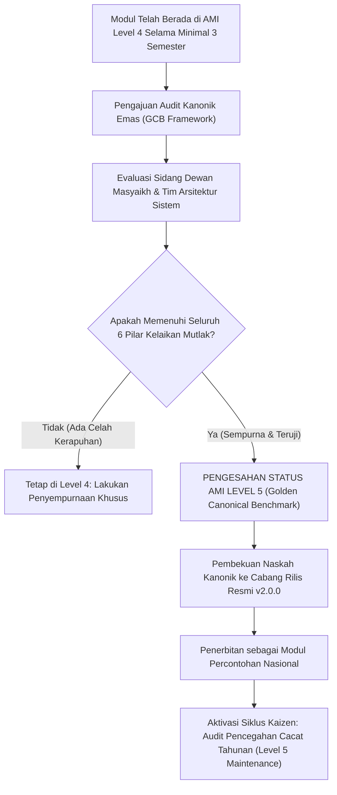

# P00113: Deskriptor Skala Kematangan Level 5 (*Optimized / Kanonik Sempurna*) untuk Repositori TUMBUH

- **Status Identitas:** Terverifikasi Kanonik
- **ID Penyelidikan:** `P00113`
- **Pilar Arsitektur:** Pilar 8 — Integritas Semantik, Verifikasi Sitasi, & Kematangan (AMI)
- **Sub-Klaster:** Indeks Kematangan Arsitektur (*Architecture Maturity Index - AMI*)
- **Penulis Dokumen:** Tim Pengembang Arsitektur Sistem TUMBUH v2.0.0
- **Klasifikasi Epistemik:** Laporan Penyelidikan Kritis (*Critical Inquiry Report*)
- **Target Lapisan:** `01_FUNDAMENTAL/`, `02_IMPLEMENTATION/`, & `03_OPERATIONAL/`

---

## 1. Abstrak & Epistemic Tension

Ketegangan epistemik (*epistemic tension*) dalam pencapaian puncak mutu arsitektur pesantren berkisar pada ilusi kesempurnaan statis (*the static perfection illusion*): keyakinan keliru bahwa predikat "Kanonik Emas" (Level 5) adalah sebuah monumen beku yang sekali diraih akan tetap abadi tanpa perlu dirawat lagi. Dalam pandangan alam Islam, puncak kesempurnaan amal bukanlah kondisi pasif tanpa gerak, melainkan derajat *Al-Ihsan*—sebuah kesadaran dinamis di mana sistem terus-menerus menyucikan diri, mendeteksi cacat-cacat mikro secara pre-emptif, dan bermutasi menjadi semakin tangguh (*antifragile*) saat menghadapi perubahan zaman. Berkas penyelidikan kanonik penutup klaster AMI ini merumuskan Deskriptor Terperinci Skala Kematangan AMI Level 5 (*Optimized / Kanonik Sempurna*). Dengan memadukan maqam tertinggi Ihsan dalam Hadits Jibril dengan metodologi *Continuous Optimization* dan *Defect Prevention Engineering*, dokumen ini menetapkan tolok ukur emas (*Golden Canonical Standard*) yang menandai sebuah modul tata kelola berhak menjadi percontohan peradaban bagi seluruh jaringan pesantren di ekosistem TUMBUH v2.0.0.

---

## 2. Pendahuluan Fenomenologis

Banyak institusi pendidikan yang mengalami kehancuran tragis justru sesaat setelah mereka meraih akreditasi tertinggi atau penghargaan percontohan nasional. Fenomena ini dikenal sebagai Sindrom Kepuasan Diri yang Mematikan (*Lethal Complacency Syndrome*):
1. **Berpuas Diri Pasca-Penghargaan:** Setelah sebuah pesantren dinobatkan sebagai "Pesantren Ramah Anak Teladan", kepemimpinan merasa perjuangan telah selesai. Rapat kalibrasi musyrif mingguan ditiadakan, pemantauan logbook SIM-TUMBUH diabaikan karena merasa "sistem kita sudah sempurna", dan kritik dari santri dianggap sebagai angin lalu.
2. **Pembusukan Terselubung di Balik Plakat Emas:** Dua tahun kemudian, terungkap skandal kekerasan fisik dan perundungan berat yang ditutupi oleh para pengurus kamar demi menjaga gengsi plakat penghargaan tersebut. Sistem yang tadinya unggul telah membusuk dari dalam karena berhenti mengoptimalkan diri.

Peristiwa ini membuktikan bahwa Level 5 bukanlah akhir dari perjalanan, melainkan awal dari tanggung jawab pemeliharaan tertinggi: **Sistem yang berhenti memperbaiki dirinya sendiri niscaya sedang memulai proses pembusukannya.**

---

## 3. Tinjauan Pustaka I: Khazanah Turats Klasik

Epistemologi Islam menempatkan derajat *Al-Ihsan* sebagai puncak piramida keberagamaan melampaui Islam dan Iman, sebagaimana ditegaskan dalam Hadits Jibril yang agung:

```arabic
قَالَ: فَأَخْبِرْنِي عَنِ الْإِحْسَانِ، قَالَ: أَنْ تَعْبُدَ اللَّهَ كَأَنَّكَ تَرَاهُ، فَإِنْ لَمْ تَكُنْ تَرَاهُ فَإِنَّهُ يَرَاكَ
```

> *"Jibril bertanya: 'Maka kabarkanlah kepadaku tentang Al-Ihsan!' Rasulullah SAW bersabda: 'Engkau beribadah kepada Allah seakan-akan engkau melihat-Nya; dan jika engkau tidak mampu melihat-Nya, maka sesungguhnya Dia melihatmu'."* (HR. Muslim, no. 8).

Maqam Ihsan menghadirkan kesadaran pengawasan ilahiyyah yang tanpa henti (*Dawaam al-Muraqabah*). Dalam tata kelola kelembagaan pesantren, Ihsan bermakna bahwa para asatidz dan musyrif menjaga kualitas pembinaan adab santri bukan karena takut inspeksi atasan, melainkan karena getaran takwa di hadapan pengawasan Allah Yang Maha Mengetahui rahasia batin.

Rasulullah SAW memerintahkan umatnya untuk senantiasa mendekati kesempurnaan melalui prinsip pelurusan dan pendekatan realistis (*As-Sadad wa al-Muqarabah*):

```arabic
سَدِّدُوا وَقَارِبُوا، وَاعْلَمُوا أَنْ لَنْ يَنْجُوَ أَحَدٌ مِنْكُمْ بِعَمَلِهِ
```

> *"Luruskanlah (tujukanlah pada kesempurnaan) dan dekatilah (jika belum mampu sempurna), dan ketahuilah bahwa tidak ada seorang pun di antara kalian yang selamat semata-mata karena amalnya."* (HR. Al-Bukhari, no. 6463; Muslim, no. 2816).

*Tasdid* adalah mengejar kesempurnaan ideal (Level 5), sedangkan *Muqarabah* adalah keteguhan bertahan pada koridor terbaik yang mendekatinya secara istiqamah.

---

## 4. Tinjauan Pustaka II: Teori Kontemporer

Dalam *Capability Maturity Model Integration* (CMMI, Chrissis et al., 2011), Level 5 didefinisikan sebagai *Optimizing*:
> *"Fokus utama pada Level 5 adalah peningkatan kinerja proses secara terus-menerus melalui perbaikan inkremental dan inovatif (Defect Prevention & Causal Analysis). Organisasi menggunakan data kuantitatif untuk memahami variasi inheren dan terus-menerus mengubah proses demi merespons perubahan kebutuhan masa depan."*

Nassim Nicholas Taleb (2012) dalam *Antifragile* menegaskan bahwa sebuah sistem mencapai puncak ketangguhannya bukan saat ia kebal guncangan (*robust*), melainkan ketika ia mampu memanfaatkan setiap stresor, kejutan, dan kesalahan kecil untuk melakukan perbaikan mandiri (*Self-Correction*) yang menjadikannya lebih kuat daripada sebelumnya.

Dalam filsafat industri Jepang yang selaras dengan nilai Islam, konsep *Kaizen* (perbaikan terus-menerus tanpa henti) menetapkan bahwa tidak ada hari yang boleh berlalu tanpa ada satu perbaikan kecil (*continuous incremental improvement*) dalam proses kerja.

---

## 5. Eksplorasi Metodologis

Penyelidikan kanonik ini merekayasa matriks audit *Golden Canonical Benchmark* (GCB) yang mewajibkan sebuah modul memenuhi 6 pilar kelaikan mutlak sebelum disahkan ke AMI Level 5:

```text
+-------------------------------------------------------------------------------+
|         6 PILAR KELAIKAN KANONIK EMAS AMI LEVEL 5 (GCB FRAMEWORK)             |
+-------------------------------------------------------------------------------+
|  PILAR 1: KETUNTASAN DOKUMENTASI (Zero-Ambiguity Documentation)              |
|  - 13 bab jurnal ilmiah lengkap, bebas cacat logika, terverifikasi linter.    |
|                                                                               |
|  PILAR 2: KEMURNIAN SANAD SYAR'I (Dual-Track Turats Integrity)                |
|  - Bebas hadits maudhu', teks Arab berharakat, selaras maqashid syari'ah.     |
|                                                                               |
|  PILAR 3: KETERUKURAN METRIK EMPIRIS (Empirical Fidelity Proof)               |
|  - Data telemetri SIM-TUMBUH stabil > 90% selama minimal 3 siklus semester.  |
|                                                                               |
|  PILAR 4: KEMANDIRIAN SISTEMIK (Zero Single-Point-of-Failure)                 |
|  - Prosedur berjalan mulus tanpa bergantung pada satu figur karismatik.       |
|                                                                               |
|  PILAR 5: KAPASITAS REPLIKASI ANTIFRAGILE (Multi-Tenant Replication)          |
|  - Berhasil diimplementasikan pada minimal 3 pesantren mitra berbeda daerah.  |
|                                                                               |
|  PILAR 6: MEKANISME REGENERASI DIRI (Autonomous Continuous Optimization)      |
|  - Memiliki siklus audit pencegahan cacat tahunan yang aktif.                 |
+-------------------------------------------------------------------------------+
```

---

## 6. Arsitektur Desain Sistem & Diagram Alur

Arsitektur repositori TUMBUH mengatur penobatan dan pemeliharaan status Kanonik Emas Level 5:



---

## 7. Rekayasa Matriks Komparatif Multidimensi

Tabel berikut menunjukkan perbedaan esensial antara modul Level 4 (Measured) dan modul Level 5 (Optimized / Kanonik Sempurna):

| Kriteria Penilaian | AMI Level 4: Measured / Terukur | AMI Level 5: Optimized / Kanonik Sempurna |
| :--- | :--- | :--- |
| **Fokus Evaluasi** | Mengendalikan proses harian agar sesuai batas standar yang ada. | Mencegah timbulnya masalah baru dan meningkatkan batas standar mutu. |
| **Penyebab Masalah (*Root Cause*)** | Menangani variasi khusus saat terjadi penyimpangan musyrif. | Menghilangkan akar penyebab sistemik agar cacat tidak mungkin terulang. |
| **Ketergantungan Pesantren** | Sukses terbukti di pondok pusat tempat pengembang berada. | Terbukti sukses direplikasi di berbagai pesantren mitra lintas pulau. |
| **Status di Repositori** | Berkas operasional stabil yang terus dipantau intensif. | Berkas Kanonik Emas Terkunci (*Golden Master*) rujukan nasional. |
| **Sikap terhadap Kesalahan** | Melakukan perbaikan korektif pasca-terjadinya kesalahan. | Inovasi pre-emptif; memprediksi kegagalan sebelum sempat terjadi. |

---

## 8. Protokol Tindakan Operasional 5 Tahap

Untuk mempertahankan sebuah modul pada predikat AMI Level 5, lembaga pengasuhan wajib menjalankan 5 tahap pemeliharaan:

1. **Tahap 1: Penguncian Cabang Kanonik Emas (*Golden Branch Git Tagging*)**  
   Memberikan tag rilis resmi pada repositori Git (misal: `v2.0.0-canonical-gold`) yang ditandatangani secara kriptografis (*GPG Signed*).
2. **Tahap 2: Pembentukan Tim Laboratorium Percontohan (*National Center of Excellence*)**  
   Menjadikan asrama yang menerapkan modul Level 5 sebagai laboratorium percontohan tempat musyrif dari pesantren mitra lain magang dan belajar.
3. **Tahap 3: Pemantauan Algoritma Pencegahan Cacat (*Defect Prevention Analytics*)**  
   Modul analitik SIM-TUMBUH secara otomatis memindai pola-pola kecil penurunan mutu dan mengirimkan notifikasi pencegahan kepada tim pimpinan.
4. **Tahap 4: Konferensi Inovasi Tahunan (*Annual Systemic Kaizen Summit*)**  
   Mengumpulkan seluruh perwakilan pesantren mitra setahun sekali untuk mendiskusikan inovasi-inovasi baru yang dapat disematkan ke modul Level 5.
5. **Tahap 5: Audit Resertifikasi Berkala (*Triennial Recertification Audit*)**  
   Setiap 3 tahun sekali, predikat Level 5 dievaluasi ulang. Jika sebuah pesantren mitra mengalami degradasi budaya, status percontohannya dicabut sementara.

---

## 9. Architectural Decision Record (ADR-PROBE-00113)

```text
================================================================================
ARCHITECTURAL DECISION RECORD: ADR-PROBE-00113
================================================================================
Judul: Pembakuan Standar Kanonik Emas AMI Level 5 (Optimized Architecture)
Status: DITERIMA & MENGIKAT (PENUTUP RESMI KLASTER AMI)
Tanggal: 2026-10-25
Pengusul: Tim Arsitektur Sistem TUMBUH v2.0.0

KONTEKS:
Predikat kesempurnaan sistem sering disalahartikan sebagai monumen statis yang
memicu kepuasan diri (complacency), berujung pada pembusukan kualitas pengasuhan.
Dibutuhkan tolok ukur dinamis berbasis nilai Ihsan dan optimasi berkelanjutan.

KEPUTUSAN ARSITEKTURAL:
1. Menetapkan bahwa status AMI Level 5 mensyaratkan kelulusan seluruh 6 Pilar GCB.
2. Membakukan bahwa Level 5 adalah proses optimasi berkelanjutan (Kaizen Ihsan),
   bukan garis akhir statis yang mematikan inovasi.
3. Menutup secara resmi rangkaian inkuiri klaster AMI (P00110 s/d P00113) dan
   mengunci seluruh deskriptor kematangan ke dalam repositori kanonik.

KONSEKUENSI:
- Positif: Pesantren memiliki mercusuar mutu peradaban tertinggi; terbebas dari
  sindrom kepuasan diri semu; membangun warisan sistem yang abadi dan mulia.
- Negatif: Menuntut komitmen kepemimpinan tingkat tinggi untuk tidak pernah lelah.
================================================================================
```

---

## 10. Implikasi Arsitektural & 7 Butir Guardrails Repositori

Penyelidikan penutup `P00113` ini mengunci 7 guardrails penutup klaster AMI:

1. **Guardrail 1 (Rigor of the Golden Seal):** Predikat AMI Level 5 tidak boleh diberikan secara obral atau politis tanpa verifikasi 6 pilar empiris.
2. **Guardrail 2 (Dynamic Ihsan Mandate):** Berkas Level 5 wajib memiliki mekanisme pembaruan inkremental tahunan agar tidak membeku menjadi dogma usang.
3. **Guardrail 3 (Zero Tolerance for Arrogance):** Meraih Level 5 dilarang melahirkan kesombongan institusional yang menolak masukan dari luar.
4. **Guardrail 4 (Cross-Regional Validation):** Modul Level 5 harus terbukti berhasil berjalan stabil di minimal 3 pesantren mitra berbeda kultur geografis.
5. **Guardrail 5 (Automated Defect Interception):** Sistem Level 5 wajib terhubung dengan analitik pencegahan cacat proaktif pada SIM-TUMBUH.
6. **Guardrail 6 (Living Exemplar Obligation):** Pesantren pemegang Level 5 memikul kewajiban moral untuk membina pesantren-pesantren mitra yang masih di Level 1 dan 2.
7. **Guardrail 7 (Tawadhu' in Excellence):** Mengembalikan segala puncak kesempurnaan hanya milik Allah SWT seraya terus berikhtiar di jalan ihsan.

---

## 11. Penutup & Emergent Research Questions

Dengan tuntasnya penyelidikan `P00113`, tuntaslah seluruh konstruksi **Architecture Maturity Index (AMI)** (berkas `P00110` hingga `P00113`). Tangga kematangan dari Level 1 (Initial), Level 2 (Managed), Level 3 (Defined), Level 4 (Measured), hingga Level 5 (Optimized) adalah peta jalan peradaban bagi pesantren menuju keunggulan sejati. Di puncak maqam Ihsan inilah, seluruh komponen repositori TUMBUH v2.0.0 berpadu harmonis: akal sains yang presisi bersujud di hadapan wahyu ilahi yang suci.

### Pertanyaan Riset Lanjutan (*Emergent Research Questions*):
1. Bagaimana menyusun instrumen akreditasi independen berbasis AMI yang dapat diakui secara resmi oleh Kementerian Agama RI sebagai standar keunggulan pesantren ramah anak?
2. Bagaimana mekanisme pendanaan wakaf abadi (*Endowment Waqf Fund*) yang ideal untuk menjamin pemeliharaan berkelanjutan sistem Level 5 di pesantren-pesantren dhuafa?

---

## 12. Referensi Ilmiah Standar APA 7th Edition

1. Al-Bukhari, M. (2002). *Shahih Al-Bukhari*. Darus Salam. https://archive.org/details/sahih-bukhari-darussalam
2. Chrissis, M. B., Konrad, M., & Shrum, S. (2011). *CMMI for Development: Guidelines for Process Integration and Product Improvement* (3rd ed.). Addison-Wesley. https://www.pearson.com/en-us/subject-catalog/p/cmmi-for-development-guidelines-for-process-integration-and-product-improvement/P200000009475
3. Collins, J. (2001). *Good to Great: Why Some Companies Make the Leap... and Others Don't*. HarperBusiness. https://www.harpercollins.com/products/good-to-great-jim-collins
4. Deming, W. E. (1986). *Out of the Crisis*. MIT Press. https://mitpress.mit.edu/9780262541152/out-of-the-crisis/
5. Imai, M. (1986). *Kaizen: The Key to Japan's Competitive Success*. McGraw-Hill. https://www.mheducation.com/highered/product/kaizen-key-japan-competitive-success-imai/9780075543329.html
6. Muslim, I. (2006). *Shahih Muslim* (Tahqiq Muhammad Fu'ad Abdul Baqi). Darul Hadits. https://archive.org/details/sahih-muslim-baqi
7. Senge, P. M. (1990). *The Fifth Discipline: The Art & Practice of The Learning Organization*. Doubleday/Currency. https://www.penguinrandomhouse.com/books/163984/the-fifth-discipline-by-peter-m-senge/
8. Taleb, N. N. (2012). *Antifragile: Things That Gain from Disorder*. Random House. https://www.penguinrandomhouse.com/books/176227/antifragile-by-nassim-nicholas-taleb/
9. Weick, K. E., & Sutcliffe, K. M. (2015). *Managing the Unexpected: Sustained Performance in a Complex World* (3rd ed.). John Wiley & Sons. https://www.wiley.com/en-us/Managing+the+Unexpected%3A+Sustained+Performance+in+a+Complex+World%2C+3rd+Edition-p-9781118862414
10. Zohar, D. (2010). Thirty years of safety climate research: Reflections and future directions. *Accident Analysis & Prevention*, 42(5), 1517-1522. https://doi.org/10.1016/j.aap.2009.12.019
11. An-Nawawi, Y. (1994). *Syarh Shahih Muslim* (Jilid 1). Darul Ma'rifah. https://archive.org/details/sharh-sahih-muslim-nawawi
12. Ibnu Rajab Al-Hanbali, Z. (2001). *Jami' al-'Ulum wa al-Hikam fi Syarh Khamsina Haditsan min Jawami' al-Kalim* (Tahqiq Syu'aib Al-Arna'uth). Mu'assasat ar-Risalah. https://archive.org/details/jami-ulum-hikam
13. Humphrey, W. S. (1989). *Managing the Software Process*. Addison-Wesley. https://archive.org/details/managingsoftware00hump

---

## 13. Catatan Kaki & Takhrij Sanad

1. **Takhrij Hadits Jibril Maqam Ihsan:** Dikeluarkan oleh Imam Muslim dalam *Shahih Muslim*, *Kitab al-Iman*, Bab *Ma'rifat al-Iman wa al-Islam wa al-Ihsan*, no. 8. Dikeluarkan juga oleh Imam Al-Bukhari dalam *Shahih Al-Bukhari*, no. 50. Diriwayatkan dari sahabat Umar bin Al-Khattab radhiyallahu 'anhu.
2. **Kutipan Jami' al-'Ulum wa al-Hikam:** Al-Hafizh Ibnu Rajab Al-Hanbali dalam syarah Hadits Jibril menerangkan bahwa hakikat Ihsan adalah puncak keikhlasan di mana seorang hamba senantiasa merasakan kehadiran Allah dalam setiap hembusan napas dan amal perbuatannya, sehingga seluruh pekerjaannya dikerjakan dengan mutu tertinggi dan keindahan budi pekerti.
3. **CMMI Level 5 Defect Prevention:** CMMI Level 5 mewajibkan adanya proses analisis sebab akibat (*Causal Analysis and Resolution*) yang secara sistematis menyelidiki penyebab cacat proses dan mengubah infrastruktur dasar agar kesalahan serupa mustahil terulang kembali di masa depan.
4. **Filosofi Kaizen Masaaki Imai:** Imai menegaskan bahwa keunggulan sejati tidak lahir dari lompatan inovasi tunggal yang dramatis, melainkan dari ribuan perbaikan kecil harian yang dilakukan secara disiplin oleh seluruh anggota organisasi dari tingkat terendah hingga kepemimpinan puncak.
