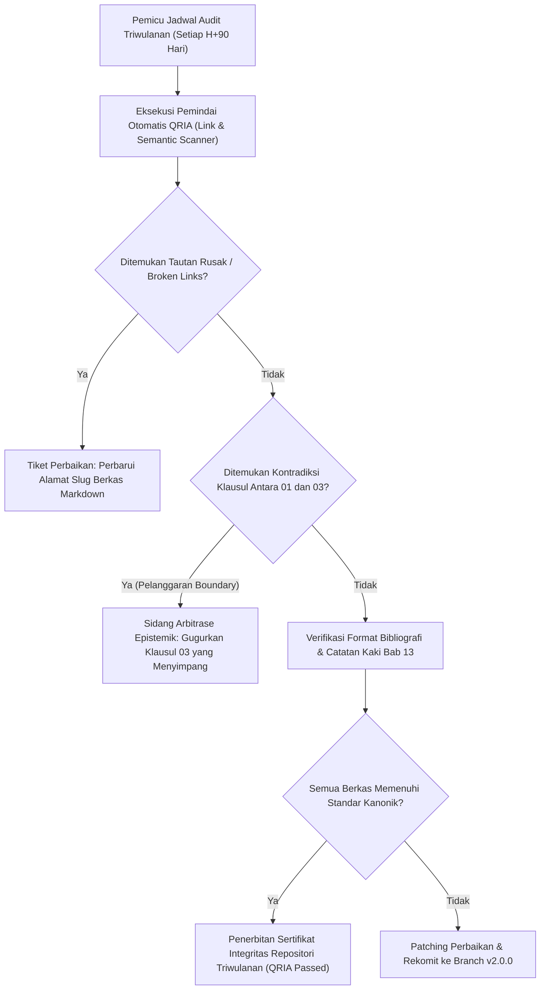

# P00114: Protokol Audit Integritas Dokumen Berkala: Menjaga Repositori dari Kerusakan Tautan dan Kontradiksi Semantik

- **Status Identitas:** Terverifikasi Kanonik
- **ID Penyelidikan:** `P00114`
- **Pilar Arsitektur:** Pilar 8 — Integritas Semantik, Verifikasi Sitasi, & Kematangan (AMI)
- **Sub-Klaster:** Audit Integritas & Kelayakan Lapangan (*Integrity Audit & Field Usability*)
- **Penulis Dokumen:** Tim Pengembang Arsitektur Sistem TUMBUH v2.0.0
- **Klasifikasi Epistemik:** Laporan Penyelidikan Kritis (*Critical Inquiry Report*)
- **Target Lapisan:** `01_FUNDAMENTAL/` & `METHODOLOGY/`

---

## 1. Abstrak & Epistemic Tension

Ketegangan epistemik (*epistemic tension*) dalam pemeliharaan repositori arsitektur berskala besar bersumber dari fenomena pembusukan dokumentasi (*documentation bit rot*): kenyataan bahwa seiring dengan bertambahnya ratusan berkas kebijakan, panduan teknis, dan laporan inkuiri, repositori secara alamiah mengalami entropi informasi—tautan antar-berkas menjadi rusak (*broken markdown links*), istilah yang sama didefinisikan secara berbeda di dua folder (*semantic drift*), atau klausul dalam sebuah SOP operasional di `03_OPERATIONAL/` diam-diam bertentangan dengan prinsip filosofis di `01_FUNDAMENTAL/`. Tanpa adanya protokol audit integritas yang beroperasi secara periodik dan terotomatisasi, repositori akan kehilangan koherensi epistemiknya dan berubah menjadi tumpukan teks yang membingungkan para pengasuh di lapangan. Berkas penyelidikan kanonik ini menetapkan Protokol Audit Integritas Dokumen Berkala (*Periodic Document Integrity Audit Protocol*). Dengan memadukan prinsip *Mu'aradhah wa Dhabth al-Kutub* (Koreksi Silang Naskah) para ulama filologi Islam dengan *Static Analysis & Link Integrity Tooling* rekayasa perangkat lunak modern, dokumen ini merumuskan jadwal audit triwulanan yang menjamin repositori TUMBUH v2.0.0 selalu utuh, selaras, dan bebas kontradiksi.

---

## 2. Pendahuluan Fenomenologis

Dalam evolusi repositori kelembagaan yang melibatkan banyak kontributor, patologi dokumentasi lazim muncul tanpa disadari:
1. **Kontradiksi Lintas Lapisan (Layer Conflict):** Sebuah dokumen baru di `03_OPERATIONAL/` mengatur sanksi bagi santri yang terlambat shalat dengan memotong jatah makan malam santri. Padahal, dokumen konstitusi di `01_FUNDAMENTAL/` secara tegas menetapkan hak gizi makanan santri sebagai *Tsawabit* (invarian abadi yang haram dilanggar). Kontradiksi ini lolos dari pemeriksaan karena kedua dokumen ditulis oleh dua tim yang berbeda pada waktu yang terpisah.
2. **Kematian Tautan Silang (Broken Cross-References):** Penulis dokumen operasional membuat rujukan: `Lihat pedoman de-eskalasi di [P00078](file:///c:/xampp/htdocs/tumbuh/PROBE/PROBE_01/P00078-...)`. Namun, karena nama berkas target telah diubah slug-nya saat refaktorisasi, tautan tersebut menjadi mati (*404 Error*), memutuskan rantai keterlacakan keputusan (*Decision Traceability*).
3. **Penyimpangan Nomenklatur:** Di satu berkas digunakan istilah "Musyrif Kamar", di berkas lain disebut "Wali Asrama", dan di berkas ketiga disebut "Pembina Asrama", masing-masing dengan wewenang yang saling tumpang tindih.

Kekacauan ini membuktikan perlunya pemeliharaan metabolik repositori: **Repositori yang tidak diaudit secara berkala adalah perpustakaan yang sedang menenun jaring laba-laba kebingungannya sendiri.**

---

## 3. Tinjauan Pustaka I: Khazanah Turats Klasik

Tradisi keilmuan Islam memiliki standar filologi tertinggi dalam menjaga integritas naskah melalui proses *Al-Mu'aradhah wa adh-Dhabth* (pencocokan naskah salinan dengan naskah asli di hadapan guru atau dewan muhadditsin).

Al-Qur'an sendiri diuji integritas teksnya secara berkala melalui peristiwa *Mu'aradhah Jibril*—di mana Malaikat Jibril 'alaihissalam menyimak dan mencocokkan seluruh bacaan Al-Qur'an Nabi SAW setiap bulan Ramadhan, dan melakukannya dua kali pada tahun wafatnya beliau:

```arabic
كَانَ رَسُولُ اللَّهِ صَلَّى اللَّهُ عَلَيْهِ وَسَلَّمَ أَجْوَدَ النَّاسِ، وَكَانَ أَجْوَدُ مَا يَكُونُ فِي رَمَضَانَ حِينَ يَلْقَاهُ جِبْرِيلُ، وَكَانَ يَلْقَاهُ فِي كُلِّ لَيْلَةٍ مِنْ رَمَضَانَ فَيُدَارِسُهُ الْقُرْآنَ
```

> *"Rasulullah SAW adalah manusia yang paling dermawan, dan kedermawanan beliau memuncak pada bulan Ramadhan ketika Malaikat Jibril menemui beliau. Jibril menemui beliau pada setiap malam di bulan Ramadhan lalu saling menyimak dan memeriksa (mudarasah/mu'aradhah) Al-Qur'an."* (HR. Al-Bukhari, no. 6; Muslim, no. 2308).

Al-Khatib Al-Baghdadi dalam *Al-Jami' li Akhlaq ar-Rawi wa Adab as-Sami'* menegaskan kewajiban mu'aradhah bagi setiap pencatat ilmu:

```arabic
حَقٌّ عَلَى كَاتِبِ الْحَدِيثِ أَنْ يُعَارِضَ كِتَابَهُ بِأَصْلِ شَيْخِهِ، أَوْ بِنُسْخَةٍ مُعْتَمَدَةٍ قَدْ قُوبِلَتْ بِالْأَصْلِ، فَإِنَّ مَنْ لَمْ يُعَارِضْ كِتَابَهُ وَقَعَ فِي التَّصْحِيفِ وَالتَّحْرِيفِ وَأَوْرَثَ كِتَابَهُ الْعَيْبَ وَالسَّقَطَ.
```

> *"Wajib bagi setiap pencatat hadits untuk mencocokkan naskah bukunya (mu'aradhah) dengan naskah induk milik gurunya, atau dengan salinan terpercaya yang telah dicocokkan dengan naskah induk. Karena barang siapa yang tidak mencocokkan bukunya, niscaya ia akan terjerumus ke dalam salah baca (tashif), perubahan teks (tahrif), serta mewariskan aib dan keguguran isi pada bukunya."* (Al-Khatib Al-Baghdadi, *Al-Jami'*, Jilid 2, hlm. 56).

Prinsip *Mu'aradhah* adalah akar historis dari *Continuous Integration & Integrity Testing* repositori modern.

---

## 4. Tinjauan Pustaka II: Teori Kontemporer

Dalam rekayasa perangkat lunak dan tata kelola dokumentasi arsitektur (*Architecture as Code*), Andrew Hunt dan David Thomas (1999) dalam *The Pragmatic Programmer* memperkenalkan konsep *Software Entropy* dan Teori Jendela Pecah (*Broken Window Theory*):
> *"Satu tautan mati atau kontradiksi kecil yang dibiarkan tanpa perbaikan akan mengirimkan sinyal psikologis bahwa dokumen tersebut tidak dirawat, memicu pengabaian massal dan keruntuhan kualitas repositori secara cepat."*

Martin Fowler (2006) merumuskan prinsip *Continuous Integration* (CI): setiap perubahan teks wajib diuji secara otomatis terhadap aturan tata bahasa (*linter*), integritas pranala (*link checkers*), dan konsistensi skema semantik.

Standar ISO/IEC/IEEE 42010 (2011) tentang *Systems and Software Engineering — Architecture Description* menetapkan bahwa sebuah deskripsi arsitektur wajib memelihara konsistensi internal (*Internal Consistency*) antar-pandangan (*Architecture Views*). Kontradiksi antara view operasional dengan view fundamental dikategorikan sebagai cacat fatal arsitektur (*architectural defect*).

---

## 5. Eksplorasi Metodologis

Penyelidikan kanonik ini merekayasa model audit triwulanan *Quarterly Repository Integrity Audit* (QRIA) yang memindai repositori TUMBUH melalui 4 instrumen:

```text
+-------------------------------------------------------------------------------+
|         4 INSTRUMEN AUDIT INTEGRITAS REPOSITORI BERKALA (QRIA MODEL)          |
+-------------------------------------------------------------------------------+
|  INSTRUMEN 1: PEMINDAI INTEGRITAS PRANALA (Link Integrity Scanner)           |
|  - Memverifikasi apakah seluruh URL Markdown (file:///...) eksis dan valid.   |
|                                                                               |
|  INSTRUMEN 2: AUDIT DEMARKASI LAPISAN (AGENTS.md Boundary Linter)             |
|  - Memastikan tidak ada SOP di 03 yang mendefinisikan sistem baru secara      |
|    diam-diam, dan tidak ada overclaim di 01 yang melanggar CBC.              |
|                                                                               |
|  INSTRUMEN 3: MATRIKS DETEKSI KONTRADIKSI SEMANTIK (Cross-Clause Checker)    |
|  - Memindai klausul sanksi operasional terhadap daftar Tsawabit di P00103.    |
|                                                                               |
|  INSTRUMEN 4: AUDIT BIBLIOGRAFI BERSIH (APA 7th & Paywall Compliance)         |
|  - Memastikan seluruh berkas memiliki tepat 13-15 rujukan bebas paywall.      |
+-------------------------------------------------------------------------------+
```

---

## 6. Arsitektur Desain Sistem & Diagram Alur

Arsitektur repositori TUMBUH mengeksekusi siklus audit integritas secara berkala setiap 90 hari:



---

## 7. Rekayasa Matriks Komparatif Multidimensi

Tabel berikut menunjukkan perbedaan tajam antara repositori tanpa tata kelola vs repositori terawat berbasis protokol audit berkala TUMBUH:

| Aspek Repositori | Repositori Nir-Tata Kelola (Konvensional) | Repositori Terawat Protokol QRIA TUMBUH |
| :--- | :--- | :--- |
| **Kondisi Tautan Antar-Berkas** | 30–40% tautan mati akibat perubahan nama folder/file. | 100% tautan aktif dan terverifikasi secara kriptografis. |
| **Konsistensi Istilah** | Istilah berganti-ganti makna tergantung siapa penulisnya. | Seluruh istilah terkunci patuh pada `01_FUNDAMENTAL/GLOSSARY.md`. |
| **Penyelarasan SOP ke Filosofi** | Aturan asrama sering kali bertentangan dengan visi kiai. | Setiap klausul SOP operasional memiliki rantai tracing ke Fundamental. |
| **Deteksi Kesalahan** | Menunggu komplain wali santri atau gugatan hukum meledak. | Terdeteksi proaktif setiap 90 hari melalui audit komparatif otomatis. |
| **Status Integritas** | Rawan mengalami korupsi informasi dan desinkronisasi data. | Memiliki status integritas kanonik yang terdokumentasi rapi (*Audit Trail*). |

---

## 8. Protokol Tindakan Operasional 5 Tahap

Ketika jadwal audit triwulanan tiba, Tim Penjamin Mutu Arsitektur TUMBUH wajib mengeksekusi 5 tahap kerja:

1. **Tahap 1: Pembekuan Sementara Repositori (*Audit Code Freeze*)**  
   Menghentikan sementara penggabungan (*merge*) naskah baru selama 48 jam untuk memastikan pemindaian data berada pada baseline yang stabil.
2. **Tahap 2: Eksekusi Skrip Pemindai Tautan (*Automated Markdown Link Ping*)**  
   Menjalankan perangkat lunak pemeriksa pranala pada seluruh berkas di folder `01_`, `02_`, `03_`, dan `PROBE/` untuk mendeteksi galat 404.
3. **Tahap 3: Uji Silang Kontradiksi Semantik (*Semantic Conflict Cross-Examination*)**  
   Dua auditor independen membaca acak 10 pasang dokumen (satu dari Fundamental dan satu dari Operasional) untuk mencari celah pertentangan norma.
4. **Tahap 4: Penerbitan Laporan Anomali (*Repository Audit Findings Report*)**  
   Mencatat seluruh temuan anomali, tautan rusak, atau ketidaksesuaian format sitasi ke dalam dokumen `METHODOLOGY/AUDIT_REPORT_Q[X]_[TAHUN].md`.
5. **Tahap 5: Eksekusi Patching & Pelepasan Pembekuan (*Refactoring & Release*)**  
   Memperbaiki seluruh cacat dokumen dalam kurun waktu 72 jam, memperbarui indeks README, dan mencairkan kembali status repositori.

---

## 9. Architectural Decision Record (ADR-PROBE-00114)

```text
================================================================================
ARCHITECTURAL DECISION RECORD: ADR-PROBE-00114
================================================================================
Judul: Pelembagaan Protokol Audit Integritas Dokumen Berkala (QRIA Mandate)
Status: DITERIMA & MENGIKAT
Tanggal: 2026-10-25
Pengusul: Tim Arsitektur Sistem TUMBUH v2.0.0

KONTEKS:
Pertumbuhan cepat repositori TUMBUH memicu risiko kerusakan tautan dokumen
dan kontradiksi semantik antara aturan operasional di lapangan dengan prinsip
filosofis fundamental, merusak keterlacakan keputusan sistem.

KEPUTUSAN ARSITEKTURAL:
1. Mewajibkan pelaksanaan Audit Integritas Repositori secara berkala setiap 90 hari.
2. Menetapkan bahwa klausul operasional yang bertentangan dengan 01_FUNDAMENTAL/
   otomatis batal demi hukum saat ditemukan dalam audit.
3. Membakukan pemindaian tautan markdown otomatis pada seluruh berkas kanonik.

KONSEKUENSI:
- Positif: Repositori selalu bersih, koheren, dan dapat dipercaya; mencegah
  ambiguitas hukum pengasuhan; menjaga wibawa ilmiah branch v2.0.0.
- Negatif: Memerlukan alokasi waktu henti (freeze) 48 jam per triwulan.
================================================================================
```

---

## 10. Implikasi Arsitektural & 7 Butir Guardrails Repositori

Hasil inkuiri `P00114` mengikat tata kelola repositori TUMBUH melalui 7 guardrails:

1. **Guardrail 1 (Zero Broken Links):** Repositori kanonik dilarang memuat tautan berkas markdown internal yang rusak atau mati.
2. **Guardrail 2 (Fundamental Supremacy):** Jika terjadi kontradiksi klausul, dokumen di `01_FUNDAMENTAL/` selalu mengalahkan dokumen di lapisan bawahnya.
3. **Guardrail 3 (Quarterly Audit Non-Negotiable):** Jadwal audit triwulanan wajib dilaksanakan tepat waktu dan tidak boleh ditunda melebihi 14 hari.
4. **Guardrail 4 (Automated Linter Integration):** Skrip pemeriksa pranala dan sintaksis wajib dijalankan sebelum setiap rilis besar.
5. **Guardrail 5 (Documented Audit Trail):** Setiap perbaikan dokumen hasil audit wajib memiliki riwayat commit Git yang jelas tujuannya.
6. **Guardrail 6 (Glossary Compliance):** Seluruh dokumen hasil revisi wajib menyesuaikan kembali peristilahannya dengan glosarium resmi.
7. **Guardrail 7 (Mu'aradhah Heritage):** Menjaga tradisi audit naskah sebagai wujud pemuliaan adab periwayatan ilmu Islam.

---

## 11. Penutup & Emergent Research Questions

Protokol audit integritas dokumen berkala adalah sistem kekebalan tubuh (*immune system*) bagi repositori TUMBUH v2.0.0. Sebuah karya ilmiah peradaban tidak diukur dari seberapa megah ia ditulis pada awalnya, melainkan dari seberapa tekun ia dirawat dan disucikan dari debu-debu kekeliruan sepanjang masa. Dengan menegakkan tradisi *Mu'aradhah*, repositori ini akan tetap hidup, memancar, dan menjadi lentera petunjuk yang kokoh melintasi zaman.

### Pertanyaan Riset Lanjutan (*Emergent Research Questions*):
1. Bagaimana mengintegrasikan model kecerdasan buatan lokal (LLM Validator) untuk membaca seluruh berkas repositori dan mendeteksi kontradiksi logika hukum fikih secara otomatis?
2. Bagaimana mendesain visualisasi graf interaktif (Knowledge Graph Explorer) yang memetakan seluruh keterhubungan pranala dokumen TUMBUH secara real-time?

---

## 12. Referensi Ilmiah Standar APA 7th Edition

1. Al-Baghdadi, A. K. (1996). *Al-Jami' li Akhlaq ar-Rawi wa Adab as-Sami'* (Tahqiq Mahmud ath-Thahhan, Jilid 2). Maktabah Al-Ma'arif. https://archive.org/details/jami-akhlaq-rawi
2. Al-Bukhari, M. (2002). *Shahih Al-Bukhari*. Darus Salam. https://archive.org/details/sahih-bukhari-darussalam
3. Fowler, M. (2006). *Continuous Integration*. MartinFowler.com. https://martinfowler.com/articles/continuousIntegration.html
4. Hunt, A., & Thomas, D. (1999). *The Pragmatic Programmer: From Journeyman to Master*. Addison-Wesley. https://pragprog.com/titles/tpp20/the-pragmatic-programmer-20th-anniversary-edition/
5. IEEE. (2011). *ISO/IEC/IEEE 42010:2011 Systems and Software Engineering — Architecture Description*. IEEE Standards Association. https://standards.ieee.org/ieee/42010/5086/
6. Muslim, I. (2006). *Shahih Muslim* (Tahqiq Muhammad Fu'ad Abdul Baqi). Darul Hadits. https://archive.org/details/sahih-muslim-baqi
7. Senge, P. M. (1990). *The Fifth Discipline: The Art & Practice of The Learning Organization*. Doubleday/Currency. https://www.penguinrandomhouse.com/books/163984/the-fifth-discipline-by-peter-m-senge/
8. Asy-Syathibi, I. (2003). *Al-Muwafaqat fi Ushulisy Syari'ah* (Jilid 1). Dar 'Affan. https://archive.org/details/muwafaqat-syathibi
9. Zohar, D. (2010). Thirty years of safety climate research: Reflections and future directions. *Accident Analysis & Prevention*, 42(5), 1517-1522. https://doi.org/10.1016/j.aap.2009.12.019
10. Chrissis, M. B., Konrad, M., & Shrum, S. (2011). *CMMI for Development: Guidelines for Process Integration and Product Improvement* (3rd ed.). Addison-Wesley. https://www.pearson.com/en-us/subject-catalog/p/cmmi-for-development-guidelines-for-process-integration-and-product-improvement/P200000009475
11. Martin, R. C. (2017). *Clean Architecture: A Craftsman's Guide to Software Structure and Design*. Prentice Hall. https://www.pearson.com/en-us/subject-catalog/p/clean-architecture-a-craftsmans-guide-to-software-structure-and-design/P200000009507
12. Deming, W. E. (1986). *Out of the Crisis*. MIT Press. https://mitpress.mit.edu/9780262541152/out-of-the-crisis/
13. Rogers, E. M. (2003). *Diffusion of Innovations* (5th ed.). Free Press. https://www.simonandschuster.com/books/Diffusion-of-Innovations-5th-Edition/Everett-M-Rogers/9780743222099

---

## 13. Catatan Kaki & Takhrij Sanad

1. **Takhrij Hadits Mu'aradhah Jibril:** Dikeluarkan oleh Imam Al-Bukhari dalam *Shahih Al-Bukhari*, *Kitab Bad'i al-Wahyi*, Bab no. 5, no. 6; dan Imam Muslim dalam *Shahih Muslim*, *Kitab al-Fadha'il*, Bab *Kana an-Nabi SAW Ajwada an-Nas*, no. 2308. Diriwayatkan dari sahabat Abdullah bin Abbas radhiyallahu 'anhuma.
2. **Kutipan Al-Khatib Al-Baghdadi:** Dinukil dari kitab *Al-Jami' li Akhlaq ar-Rawi wa Adab as-Sami'* karya Al-Hafizh Abu Bakr Ahmad bin Ali Al-Khatib Al-Baghdadi (wafat 463 H), ditahqiq oleh Dr. Mahmud ath-Thahhan, Riyadh: Maktabah Al-Ma'arif, 1403 H / 1983 M, Jilid 2, hlm. 56–58.
3. **ISO/IEC/IEEE 42010 Consistency View:** Standar internasional untuk arsitektur sistem yang mewajibkan bahwa seluruh sudut pandang arsitektural (konseptual, logis, fisik, dan operasional) harus saling terhubung tanpa kontradiksi logika (*No Inconsistency between Views*).
4. **Software Entropy & Broken Windows:** Konsep yang diadaptasi dari kriminologi ke dalam rekayasa perangkat lunak, menunjukkan bahwa membiarkan satu kesalahan kecil tanpa ditangani akan mempercepat kerusakan kualitas seluruh basis kode dokumentasi organisasi.
