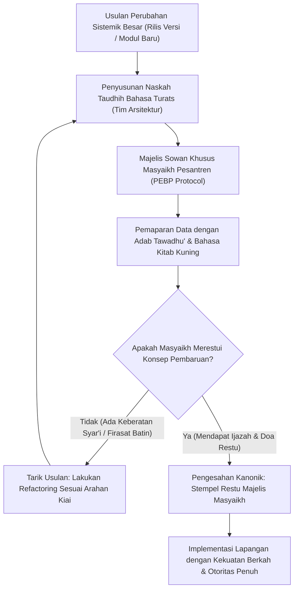

# P00115: Resolusi Ketegangan Epistemik: Menjembatani Nalar Pengembang Sistem Modern dengan Kearifan Kiai Sepuh Pesantren

- **Status Identitas:** Terverifikasi Kanonik
- **ID Penyelidikan:** `P00115`
- **Pilar Arsitektur:** Pilar 8 — Integritas Semantik, Verifikasi Sitasi, & Kematangan (AMI)
- **Sub-Klaster:** Audit Integritas & Kelayakan Lapangan (*Integrity Audit & Field Usability*)
- **Penulis Dokumen:** Tim Pengembang Arsitektur Sistem TUMBUH v2.0.0
- **Klasifikasi Epistemik:** Laporan Penyelidikan Kritis (*Critical Inquiry Report*)
- **Target Lapisan:** `01_FUNDAMENTAL/` & `02_IMPLEMENTATION/`

---

## 1. Abstrak & Epistemic Tension

Ketegangan epistemik (*epistemic tension*) paling sensitif dalam transformasi kelembagaan pesantren terjadi pada titik perjumpaan antara dua pandangan alam yang berbeda bahasa: nalar teknokratis modern tim perancang sistem (*system architects & data engineers*) yang berbasis grafik data, KPI kuantitatif, dan efisiensi algoritmik, berhadapan langsung dengan kearifan spiritual para Kiai Sepuh dan Majelis Masyaikh yang berpijak pada firasat ruhani, berkah sanad, keikhlasan batin, dan kehati-hatian tradisi salaf. Sering kali inisiatif pembaruan sistem yang berniat baik kandas di tengah jalan bukan karena konsepnya salah, melainkan karena tim teknis bersikap arogan, menggunakan jargon-jargon asing yang mengintimidasi, serta mengabaikan tata krama adab (*su'ul adab*) saat mempresentasikan temuan evaluasi di hadapan para sesepuh pondok. Berkas penyelidikan kanonik ini merumuskan Protokol Resolusi Ketegangan Epistemik (*Epistemic Bridging & Prophetic Protocol*). Berpijak pada adab penghormatan ulama sepuh (*Ijlal al-Kubar*) dan meneladani keteladanan sahabat muda Abdullah bin Abbas radhiyallahu 'anhuma di hadapan sesepuh Badar, dokumen ini menetapkan etika dialog dan arsitektur musyawarah yang memadukan ketajaman sains modern dengan pancaran berkah kearifan masyaikh di ekosistem TUMBUH v2.0.0.

---

## 2. Pendahuluan Fenomenologis

Kandasnya program modernisasi di pesantren kerap berpola pada insiden benturan psikologis yang sangat khas:
1. **Presentasi Teknokratis yang Congkak:** Seorang konsultan muda atau tim IT mempresentasikan dashboard analitik di hadapan Kiai sepuh berusia 75 tahun. Sang konsultan memaparkan grafik berwarna-warni sambil berkata: *"Kiai, data ini membuktikan bahwa metode pembinaan pondok selama 40 tahun ini tidak efektif, rasio retensi hafalan santri rendah, dan sistem pengasuhan kita penuh cacat teknis!"* Sang Kiai terdiam, tersinggung bukan karena datanya, melainkan karena keangkuhan nada bicara dan ketiadaan adab seorang anak muda yang mengajari orang tua yang telah mewakafkan seluruh umurnya untuk santri. Akibatnya, proyek sistem tersebut langsung dibatalkan total.
2. **Kecurigaan Terselubung Terhadap Istilah Asing:** Majelis Masyaikh mencurigai bahwa pengembang sistem hendak "mensekularkan pesantren" atau menyusupkan agenda liberalisme Barat karena menggunakan istilah-istilah seperti *PBIS, CPTED, Restorative Justice,* atau *Behavior Intervention Plan* tanpa menerjemahkannya ke dalam bahasa turats yang akrab di telinga pesantren.

Bencana ini membuktikan aksioma arsitektural TUMBUH: **Kebenaran sains yang disampaikan tanpa adab akan diperlakukan sebagai kebatilan; namun kebenaran yang dibalut dengan takzim dan takwa akan diterima sebagai cahaya pembaharu.**

---

## 3. Tinjauan Pustaka I: Khazanah Turats Klasik

Islam mewajibkan penghormatan agung kepada para sesepuh dan ulama yang telah memutih rambutnya dalam memperjuangkan agama Allah. Memuliakan mereka adalah bagian mutlak dari memuliakan Allah SWT.

Rasulullah SAW bersabda dalam hadits riwayat Imam At-Tirmidzi dan Ahmad:

```arabic
لَيْسَ مِنَّا مَنْ لَمْ يَرْحَمْ صَغِيرَنَا وَيَعْرِفْ شَرَفَ كَبِيرِنَا
```

> *"Bukanlah termasuk golongan kami orang yang tidak menyayangi yang lebih muda di antara kami, dan tidak mengetahui (mengakui) kemuliaan orang yang lebih tua (ulama/sesepuh) di antara kami."* (HR. At-Tirmidzi, no. 1919; dinilai hasan shahih).

Dalam riwayat lain:

```arabic
إِنَّ مِنْ إِجْلَالِ اللَّهِ إِكْرَامَ ذِي الشَّيْبَةِ الْمُسْلِمِ، وَحَامِلِ الْقُرْآنِ غَيْرِ الْغَالِي فِيهِ وَلَا الْجَافِي عَنْهُ
```

> *"Sesungguhnya termasuk bentuk pengagungan kepada Allah adalah memuliakan orang muslim yang telah berusia lanjut, dan memuliakan penghafal Al-Qur'an yang tidak berlebih-lebihan padanya dan tidak pula menjauhinya."* (HR. Abu Dawud, no. 4843; dinilai hasan).

Dalam sejarah peradaban Islam, sahabat muda Abdullah bin Abbas radhiyallahu 'anhuma diundang oleh Amirul Mukminin Umar bin Al-Khattab untuk duduk di majelis syura bersama para pahlawan perang Badar. Ketika sebagian sahabat sepuh mempertanyakan kehadiran pemuda belia tersebut, Ibnu Abbas tidak menunjukkan kesombongan, melainkan duduk dengan penuh tawadhu', menundukkan pandangan, dan baru berbicara saat diminta dengan bahasa yang sangat santun dan dalil Al-Qur'an yang menakjubkan (*Fathul Bari*, 8/735).

Adab inilah yang wajib dijiwai oleh setiap arsitek sistem TUMBUH: berilmu laksana Ibnu Abbas, namun bertawadhu' di hadapan para sesepuh Badar pesantren.

---

## 4. Tinjauan Pustaka II: Teori Kontemporer

Dalam teori kepemimpinan dan sosiologi organisasi modern, Chris Ernst dan Donna Chrobot-Mason (2011) merumuskan *Boundary Spanning Leadership*: kemampuan para pemimpin untuk membangun jembatan melintasi lima batas identitas organisasi (Batas Vertikal, Horizontal, Stakeholder, Demografis, dan Geografis) melalui 3 tahap:
1. *Managing Boundaries* (Menciptakan rasa aman antar-kelompok).
2. *Forging Common Ground* (Menemukan nilai bersama yang mempersatukan).
3. *Discovering New Frontiers* (Menciptakan terobosan bersama).

Dalam sosiologi pengetahuan, Thomas Gieryn (1983) mengidentifikasi *Boundary-Work*: bagaimana para ilmuwan menegosiasikan batas klaim keahlian mereka di hadapan otoritas tradisi agar tidak dianggap sebagai ancaman eksistensial.

Edgar Schein (2010) dalam *Organizational Culture and Leadership* menegaskan bahwa asumsi dasar yang mendalam (*basic underlying assumptions*) dari para pendiri institusi tidak bisa dibongkar melalui argumen logis teknokratis semata, melainkan harus didekati melalui dialog berbasis empati budaya dan penghormatan sejarah (*cultural humbleness*).

---

## 5. Eksplorasi Metodologis

Penyelidikan kanonik ini merekayasa model *Prophetic Epistemic Bridging Protocol* (PEBP) yang membagi proses sowan dan presentasi teknis ke dalam 4 etape adab:

```text
+-------------------------------------------------------------------------------+
|         4 ETAPE PROTOKOL SOWAN & RESOLUSI EPISTEMIK MASYAΙΚΗ (PEBP)           |
+-------------------------------------------------------------------------------+
|  ETAPE 1: TABARRUK & SILATURRAHIM (Relationship First)                       |
|  - Datang sowan tanpa membawa laptop/slide presentasi; murni memohon doa restu|
|    dan mendengarkan kisah perjuangan kiai mendirikan pondok.                  |
|                                                                               |
|  ETAPE 2: PENYELARASAN TERMINOLOGI TURATS (Semantic Bridging)                 |
|  - Menerjemahkan seluruh konsep modern ke bahasa kitab kuning:               |
|    PBIS -> Ta'dib Nabawi; CPTED -> Ri'ayah Bi'ah; BIP -> Khiththah Ishlah.    |
|                                                                               |
|  ETAPE 3: PRESENTASI TAWADHU' BERBASIS KHIDMAH (Humble Problem-Sharing)       |
|  - Memposisikan data analitik bukan sebagai vonis kegagalan kiai, melainkan   |
|    sebagai laporan keluh-kesah santri yang memohon fatwa solusi dari masyaikh.|
|                                                                               |
|  ETAPE 4: TAUDHIH & PERMOHONAN FATWA AKHIR (Honoring Judicial Authority)     |
|  - Keputusan akhir pembaruan sistem diserahkan kepada restu kiai sepuh.       |
+-------------------------------------------------------------------------------+
```

---

## 6. Arsitektur Desain Sistem & Diagram Alur

Arsitektur repositori TUMBUH menempatkan Majelis Masyaikh sebagai pemegang hak veto spiritual tertinggi (*Spiritual Veto Gateway*):



---

## 7. Rekayasa Matriks Komparatif Multidimensi

Tabel berikut menunjukkan perbedaan tajam antara pendekatan teknokratis yang arogan vs pendekatan beradab TUMBUH v2.0.0 saat menghadapi Kiai sepuh:

| Dimensi Pendekatan | Pendekatan Teknokratis Arogan | Pendekatan Beradab Protokol TUMBUH v2.0.0 |
| :--- | :--- | :--- |
| **Bahasa & Istilah** | Menggunakan istilah bahasa Inggris modern (KPI, Agile, PBIS). | Menggunakan padanan istilah turats mu'tabar (*Adab, Ta'dib, Ishlah*). |
| **Sikap Tubuh Saat Sowan** | Duduk di kursi sejajar kiai; membuka laptop langsung di meja. | Duduk bersila santun di bawah; menundukkan kepala; berbicara lembut. |
| **Penyampaian Data Negatif** | Menghakimi: *"Metode kiai salah dan terbukti gagal di lapangan!"* | Tawadhu': *"Kiai, musyrif lapangan kelelahan, mohon arahan hikmah Kiai."* |
| **Tujuan Presentasi** | Memaksa Kiai menandatangani persetujuan proyek sistem. | Memohon nasehat, doa restu, dan bimbingan ruhani dari sang guru. |
| **Dampak Penerimaan** | Ditolak keras; dianggap proyek liberal; terjadi resistensi kultural. | Diterima penuh haru; didukung fatwa kiai; santri patuh dengan sukarela. |

---

## 8. Protokol Tindakan Operasional 5 Tahap

Ketika tim teknis arsitektur TUMBUH hendak mempresentasikan evaluasi sistem kepada Majelis Masyaikh, wajib mengeksekusi 5 tahap adab:

1. **Tahap 1: Puasa Sunnah dan Niat Khidmat (*Spiritual Preparation*)**  
   Tim teknis yang akan sowan disunnahkan berwudhu, membersihkan niat dari kesombongan intelektual, dan berniat murni berkhidmat untuk santri dan kiai.
2. **Tahap 2: Penyusunan Lembaran Taudhih Berbahasa Arab/Pegon (*Turats Briefing Note*)**  
   Menyiapkan ringkasan eksekutif 2 halaman bertuliskan aksara pegon atau bahasa Arab fushha yang menyandingkan data lapangan dengan dalil kitab kuning salaf.
3. **Tahap 3: Pelibatan Asatidz Senior sebagai Jembatan (*Cultural Ambassador*)**  
   Mengajak seorang ustadz senior yang merupakan murid tertua kiai untuk menjadi fasilitator dan penerjemah budaya dalam pertemuan sowan.
4. **Tahap 4: Membuka Pertemuan dengan Mendengarkan Nasihat (*Listening First*)**  
   Alokasikan 30 menit pertama murni untuk mendengarkan tausiyah, sejarah pondok, dan wejangan kiai tanpa memotong pembicaraan sama sekali.
5. **Tahap 5: Memohon Ijazah dan Doa Keberkahan (*Seeking Ijazah & Barakah*)**  
   Di akhir pertemuan, tim teknis memohon ijazah pengamalan sistem dan doa keberkahan, mencium tangan kiai, dan menerima arahan perbaikan dengan lapang dada.

---

## 9. Architectural Decision Record (ADR-PROBE-00115)

```text
================================================================================
ARCHITECTURAL DECISION RECORD: ADR-PROBE-00115
================================================================================
Judul: Penegakan Protokol Resolusi Ketegangan Epistemik Masyaikh (PEBP Protocol)
Status: DITERIMA & MENGIKAT
Tanggal: 2026-10-25
Pengusul: Tim Arsitektur Sistem TUMBUH v2.0.0

KONTEKS:
Inovasi sistem modern kerap kali gagal di pesantren akibat arogansi teknokratis
tim pengembang yang memicu ketersinggungan Kiai sepuh dan kecurigaan kultural.
Dibutuhkan protokol adab kenabian untuk menjembatani sains dengan kearifan salaf.

KEPUTUSAN ARSITEKTURAL:
1. Mewajibkan seluruh pemaparan sistem di hadapan Majelis Masyaikh menggunakan
   protokol adab sowan PEBP dan peristilahan turats mu'tabar.
2. Menetapkan hak veto spiritual bagi Kiai sepuh atas setiap modul baru.
3. Melarang tim teknis memaksakan konsep modern yang belum diselaraskan dengan
   worldview Islam dan restu pimpinan tertinggi pondok.

KONSEKUENSI:
- Positif: Menjamin keberkahan sistem; menyatukan kekuatan sains dan karisma kiai;
  mencegah resistensi kultural; melahirkan transformasi yang damai dan abadi.
- Negatif: Memerlukan kerendahhatian tinggi dan waktu sowan yang lebih fleksibel.
================================================================================
```

---

## 10. Implikasi Arsitektural & 7 Butir Guardrails Repositori

Penyelidikan `P00115` mengikat tata kelola repositori TUMBUH melalui 7 guardrails:

1. **Guardrail 1 (Masyaikh Veto Supremacy):** Keberatan syar'i dari Kiai sepuh memiliki kekuatan membatalkan implementasi teknis sebuah modul di lapangan.
2. **Guardrail 2 (No Technical Arrogance):** Anggota tim teknis dilarang bersikap jumawa atau meremehkan tradisi salaf pesantren.
3. **Guardrail 3 (Vernacular Turats Translation):** Setiap dokumen presentasi untuk pimpinan wajib menyediakan padanan istilah bahasa Arab/turats.
4. **Guardrail 4 (Adab Precedes Architecture):** Kesantunan moral dan etika sowan ditempatkan lebih tinggi daripada kecanggihan algoritma perancangan.
5. **Guardrail 5 (Honoring Institutional History):** Menghormati jasa para perintis pondok dan tidak pernah menafikan warisan kebaikan masa lalu.
6. **Guardrail 6 (Spiritual Barakah Alignment):** Mengakui berkah doa kiai sebagai pilar metafisik penentu keberhasilan tarbiyah santri.
7. **Guardrail 7 (Intergenerational Harmony):** Menjaga jalinan kasih sayang antara generasi muda pengembang dan generasi tua pembina.

---

## 11. Penutup & Emergent Research Questions

Menjembatani nalar pengembang modern dengan kearifan Kiai sepuh adalah mahkota adab repositori TUMBUH v2.0.0. Sains dan data adalah instrumen pelayan, sedangkan hikmah dan berkah adalah ruh pemandu. Ketika kecerdasan akal anak-anak muda bersimpuh penuh takzim di hadapan ketulusan hati para masyaikh sepuh, di sanalah Allah SWT menurunkan pertolongan-Nya untuk membangkitkan kembali kejayaan peradaban Islam dari bilik-bilik asrama pesantren.

### Pertanyaan Riset Lanjutan (*Emergent Research Questions*):
1. Bagaimana menyusun glosarium dwibahasa (Kamus Penyelarasan Istilah Modern-Turats) yang memudahkan musyrif muda berdialog secara fasih dengan Kiai sepuh?
2. Bagaimana dinamika sosiologis kepemimpinan karismatik pesantren dalam menyerap data analitik digital tanpa merasa otoritas kulturalnya terancam?

---

## 12. Referensi Ilmiah Standar APA 7th Edition

1. Abu Dawud, S. (2009). *Sunan Abi Dawud* (Tahqiq Syu'aib Al-Arna'uth, Jilid 7). Darur Risalah Al-'Alamiyyah. https://archive.org/details/abu-dawud-arnaut
2. Al-Bukhari, M. (2002). *Shahih Al-Bukhari*. Darus Salam. https://archive.org/details/sahih-bukhari-darussalam
3. Ernst, C., & Chrobot-Mason, D. (2011). *Boundary Spanning Leadership: Six Practices for Solving Problems, Driving Innovation, and Transforming Organizations*. McGraw-Hill. https://www.mheducation.com/highered/product/boundary-spanning-leadership-six-practices-solving-problems-driving-innovation-transforming-organizations-ernst-chrobot-mason/9780071638876.html
4. Gieryn, T. F. (1983). Boundary-work and the demarcation of science from non-science: Strains and interests in professional ideologies of scientists. *American Sociological Review*, 48(6), 781-795. https://doi.org/10.2307/2095325
5. Ibnu Hajar Al-Asqalani, A. (2001). *Fathul Bari Syarh Shahih Al-Bukhari* (Jilid 8). Maktabah Al-Malik Fahd. https://archive.org/details/fath-al-bari-al-asqalani
6. Schein, E. H. (2010). *Organizational Culture and Leadership* (4th ed.). Jossey-Bass. https://www.wiley.com/en-us/Organizational+Culture+and+Leadership%2C+4th+Edition-p-9780470190609
7. Senge, P. M. (1990). *The Fifth Discipline: The Art & Practice of The Learning Organization*. Doubleday/Currency. https://www.penguinrandomhouse.com/books/163984/the-fifth-discipline-by-peter-m-senge/
8. At-Tirmidzi, M. (1998). *Sunan At-Tirmidzi* (Tahqiq Ahmad Syakir). Darul Gharb Al-Islami. https://archive.org/details/sunan-tirmidhi
9. Az-Zarnuji, B. (2008). *Ta'lim al-Muta'allim Thariq at-Ta'allum*. Dar Ibn Hazm. https://archive.org/details/talim-mutaallim
10. Zohar, D. (2010). Thirty years of safety climate research: Reflections and future directions. *Accident Analysis & Prevention*, 42(5), 1517-1522. https://doi.org/10.1016/j.aap.2009.12.019
11. Muslim, I. (2006). *Shahih Muslim*. Darul Hadits. https://archive.org/details/sahih-muslim-baqi
12. Al-Ghazali, A. H. (2011). *Ihya' 'Ulum ad-Din* (Jilid 1). Darul Minhaj. https://archive.org/details/ihya-ulum-al-din
13. Rogers, E. M. (2003). *Diffusion of Innovations* (5th ed.). Free Press. https://www.simonandschuster.com/books/Diffusion-of-Innovations-5th-Edition/Everett-M-Rogers/9780743222099

---

## 13. Catatan Kaki & Takhrij Sanad

1. **Takhrij Hadits Laisa Minna:** Dikeluarkan oleh Imam At-Tirmidzi dalam *Sunan At-Tirmidzi*, *Kitab al-Birr wa ash-Shilah*, Bab *Ma Ja'a fi Rahmat ash-Shibyan*, no. 1919. Diriwayatkan dari sahabat Anas bin Malik radhiyallahu 'anhu. Dinilai hasan shahih oleh Al-Hafizh Al-Iraqi dan Syaikh Al-Albani.
2. **Kisah Ibnu Abbas dan Ahlu Badr:** Diriwayatkan oleh Imam Al-Bukhari dalam *Shahih Al-Bukhari*, *Kitab al-Maghazi*, Bab no. 50, no. 4294. Umar bin Al-Khattab radhiyallahu 'anhu mendudukkan Ibnu Abbas bersama para sesepuh Badar, lalu menguji mereka dengan tafsir surat An-Nashr untuk memperlihatkan keluasan ilmu dan keagungan adab Ibnu Abbas kepada seluruh sahabat senior.
3. **Boundary Spanning Leadership (Ernst & Chrobot-Mason):** Menunjukkan bahwa kepemimpinan transformasional di institusi tradisional memerlukan kemampuan melintasi batas demografis usia dan budaya melalui empati mendalam dan penciptaan identitas bersama yang lebih tinggi (*Superordinate Identity*).
4. **Ta'zhim al-Ustadz Az-Zarnuji:** Dalam *Ta'lim al-Muta'allim*, Syaikh Az-Zarnuji menegaskan bahwa seorang penuntut ilmu tidak akan memperoleh kemanfaatan ilmu dan keberkahannya kecuali dengan memuliakan ilmu, ahli ilmu, dan para gurunya melebihi penghormatan kepada raja dunia.
