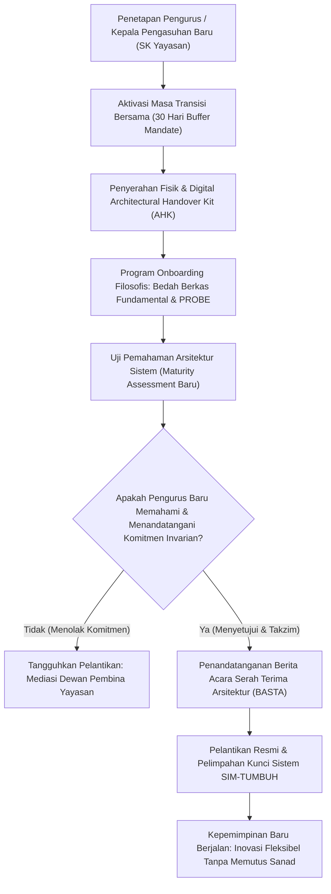

# P00116: Tata Kelola Pergantian Kepengurusan Lembaga Tanpa Memutus Keberlanjutan Arsitektur v2.0.0

- **Status Identitas:** Terverifikasi Kanonik
- **ID Penyelidikan:** `P00116`
- **Pilar Arsitektur:** Pilar 8 — Integritas Semantik, Verifikasi Sitasi, & Kematangan (AMI)
- **Sub-Klaster:** Audit Integritas & Kelayakan Lapangan (*Integrity Audit & Field Usability*)
- **Penulis Dokumen:** Tim Pengembang Arsitektur Sistem TUMBUH v2.0.0
- **Klasifikasi Epistemik:** Laporan Penyelidikan Kritis (*Critical Inquiry Report*)
- **Target Lapisan:** `02_IMPLEMENTATION/` & `03_OPERATIONAL/`

---

## 1. Abstrak & Epistemic Tension

Ketegangan epistemik (*epistemic tension*) dalam kesinambungan kepemimpinan pesantren meledak akibat sindrom ganti pengurus ganti kebijakan (*leadership reset syndrome*): kecenderungan destruktif di mana setiap kali terjadi suksesi kepemimpinan yayasan atau pergantian kepala pengasuhan, pengurus baru secara sepihak membatalkan, merombak, atau membuang seluruh sistem tata kelola yang telah dibangun oleh kepengurusan sebelumnya, semata-mata demi menonjolkan ego kepemimpinan baru atau karena ketidaktahuan atas sejarah arsitektur yang ada. Akibatnya, investasi peradaban selama bertahun-tahun lenyap seketika, santri dan musyrif mengalami disorientasi nilai yang parah, dan pesantren terperangkap dalam siklus abadi "kembali ke titik nol". Berkas penyelidikan kanonik ini menetapkan Protokol Tata Kelola Pergantian Kepengurusan Lembaga (*Institutional Succession & Architecture Handover Protocol*). Dengan memadukan keteladanan suksesi kepemimpinan kenabian dari Sayyidina Abu Bakar Ash-Shiddiq kepada Sayyidina Umar bin Al-Khattab radhiyallahu 'anhuma dengan metodologi *Architectural Handover Kit* (AHK) modern, penyelidikan ini merumuskan instrumen transisi hukum yang mengikat kepengurusan baru untuk menjaga kesinambungan arsitektur TUMBUH v2.0.0.

---

## 2. Pendahuluan Fenomenologis

Tragedi "pembongkaran sistem" pasca-suksesi kepengurusan merupakan luka kronis di dunia pesantren:
1. **Penghapusan Sistem Digital Akibat Ganti Pengurus:** Sebuah kepengurusan asrama telah berhasil menerapkan sistem pencatatan adab digital SIM-TUMBUH selama 4 tahun dengan hasil luar biasa: angka kekerasan fisik turun 90% dan santri sangat berprestasi. Namun, saat terjadi pergantian ketua yayasan, ketua baru yang tidak melek teknologi langsung menginstruksikan: *"Hentikan semua aplikasi HP itu! Pondok kita zaman dulu besar dengan buku tulis kertas dan rotan, kembalikan ke cara lama!"* Dalam tempo 3 bulan, seluruh data historis santri terbengkalai dan budaya kekerasan kembali merajalela.
2. **Ketiadaan Dokumen Serah Terima Resmi (*Zero Architectural Handover*):** Ketika seorang Kepala Pengasuhan mengundurkan diri, proses serah terima jabatan hanya berupa penyerahan kunci kantor dan buku kas tunai. Tidak ada serah terima dokumen arsitektur, tidak ada pembekalan filosofi sistem, dan tidak ada penjelasan mengenai berkas inkuiri PROBE. Pengurus baru memimpin dengan meraba-raba dalam kegelapan.

Fenomena ini membuktikan bahwa sistem yang tidak memiliki mekanisme pengikatan suksesi adalah sistem yang rapuh: **Pesantren yang hebat tidak dibangun oleh kepahlawanan satu generasi yang kemudian dirobohkan oleh generasi berikutnya, melainkan dibangun melalui estafet amanah yang kokoh bersambung.**

---

## 3. Tinjauan Pustaka I: Khazanah Turats Klasik

Epistemologi kepemimpinan Islam memandang jabatan dan wewenang kepengurusan sebagai amanah ilahiyyah yang berat, bukan sebagai piala kekuasaan pribadi yang bebas diutak-atik menurut hawa nafsu.

Allah SWT berfirman dalam Al-Qur'an:

```arabic
إِنَّ اللَّهَ يَأْمُرُكُمْ أَنْ تُؤَدُّوا الْأَمَانَاتِ إِلَىٰ أَهْلِهَا وَإِذَا حَكَمْتُمْ بَيْنَ النَّاسِ أَنْ تَحْكُمُوا بِالْعَدْلِ
```

> *"Sesungguhnya Allah menyuruh kamu menyampaikan amanat kepada yang berhak menerimanya, dan (menyuruh kamu) apabila menetapkan hukum di antara manusia supaya kamu menetapkannya dengan adil."* (QS. An-Nisa: 58).

Dalam sejarah kekhilafahan, suksesi kepemimpinan paling mulia dan terencana dicontohkan oleh Sayyidina Abu Bakar Ash-Shiddiq radhiyallahu 'anhu saat menjelang wafatnya. Beliau tidak membiarkan umat dalam ketidakpastian politik, melainkan melakukan istisyarah (konsultasi mendalam) dengan sahabat senior, lalu menuliskan surat wasiat pengangkatan Umar bin Al-Khattab secara tertulis di hadapan Utsman bin Affan, seraya berpesan kepada Umar:

```arabic
إِنِّي قَدِ اسْتَخْلَفْتُكَ عَلَى أَصْحَابِ رَسُولِ اللَّهِ صَلَّى اللَّهُ عَلَيْهِ وَسَلَّمَ، فَاتَّقِ اللَّهَ، وَاعْلَمْ أَنَّ لِلَّهِ عَمَلًا بِالنَّهَارِ لَا يَقْبَلُهُ بِاللَّيْلِ، وَعَمَلًا بِاللَّيْلِ لَا يَقْبَلُهُ بِالنَّهَارِ... وَاحْفَظْ وَصِيَّتِي تَكُنْ فِي حِرْزٍ.
```

> *"Sesungguhnya aku telah mengangkatmu menggantikanku memimpin para sahabat Rasulullah SAW, maka bertakwalah kepada Allah! Dan ketahuilah bahwa Allah memiliki hak amalan di siang hari yang tidak diterima di malam hari, dan amalan di malam hari yang tidak diterima di siang hari... Jagalah wasiatku ini, niscaya engkau akan berada dalam perlindungan yang kokoh."* (Diriwayatkan oleh Ibnu Sa'ad dalam *Ath-Thabaqat al-Kubra*, 3/199; dan At-Thabari dalam *Tarikh ar-Rusul wal Muluk*).

Sayyidina Umar tidak merobohkan kebijakan Sayyidina Abu Bakar, melainkan melanjutkan fondasi peradaban yang telah diletakkan pendahulunya dengan penuh kesetiaan dan penyempurnaan yang adil.

---

## 4. Tinjauan Pustaka II: Teori Kontemporer

Dalam teori suksesi organisasi dan tata kelola korporat, William J. Rothwell (2010) dalam *Effective Succession Planning* menegaskan bahwa suksesi yang berhasil bukan sekadar memilih figur pengganti (*replacement planning*), melainkan menjamin keberlanjutan arsitektur pengetahuan (*Knowledge Succession*):
> *"Suksesi kepemimpinan harus disertai dengan transfer pengetahuan strategis dan penyerahan aset arsitektur yang terdokumentasi, guna mencegah hilangnya modal intelektual organisasi (Brain Drain) saat pergantian rezim."*

Dalam teori kelembagaan baru (*New Institutionalism*), W. Richard Scott (2014) mengidentifikasi bahwa keberlanjutan sebuah institusi bergantung pada Pilar Regulatif (*Regulative Pillar*) yang terkodifikasi dalam undang-undang dasar yayasan. Jika sistem hanya bertumpu pada figur (*Pilar Kultural-Kognitif semata*), pergantian figur niscaya memicu keruntuhan sistemik.

Standar tata kelola TI modern (COBIT 2019 / ITIL 4) menetapkan prosedur *Service Transition & Knowledge Transfer*: pejabat baru wajib menyelesaikan proses audit transisi formal dan menandatangani dokumen penerimaan arsitektur (*Architecture Acceptance Sign-Off*).

---

## 5. Eksplorasi Metodologis

Penyelidikan kanonik ini merekayasa model penyerahan mandat *Architectural Handover Kit* (AHK) yang memuat 4 berkas warisan wajib:

```text
+-------------------------------------------------------------------------------+
|         4 ELEMEN WAJIB ARCHITECTURAL HANDOVER KIT (AHK TUMBUH)                |
+-------------------------------------------------------------------------------+
|  BERKAS 1: PIAGAM KONSISTENSI INVARIAN ARSITEKTUR (The Invariant Charter)     |
|  - Dokumen hukum yang mengunci 5 Pilar Tsawabit TUMBUH agar tidak diubah.     |
|                                                                               |
|  BERKAS 2: REKAM JEJAK PUTUSAN ARSITEKTURAL (ADR Ledger Summary)              |
|  - Rangkuman 120 berkas ADR-PROBE yang menjelaskan "mengapa" aturan ada.      |
|                                                                               |
|  BERKAS 3: LAPORAN TELEMETRI BASELINE KESEHATAN SISTEM (Fidelity Baseline)    |
|  - Data statistik kepatuhan santri dan rasio musyrif 2 semester terakhir.     |
|                                                                               |
|  BERKAS 4: DAFTAR UTANG DESAIN & RISIKO TERPENDAM (Technical Debt Register)   |
|  - Pemetaan masalah laten yang sedang dalam proses perbaikan tim sebelumnya.  |
+-------------------------------------------------------------------------------+
```

---

## 6. Arsitektur Desain Sistem & Diagram Alur

Arsitektur repositori TUMBUH mewajibkan proses transisi kepengurusan melalui koridor masa tenggang terpadu (*Transition Buffer Period*):



---

## 7. Rekayasa Matriks Komparatif Multidimensi

Tabel berikut menunjukkan kontras antara pergantian kepengurusan acak konvensional vs tata kelola suksesi terstandarisasi TUMBUH v2.0.0:

| Parameter Suksesi | Suksesi Konvensional ("Ganti Pengurus Ganti Sistem") | Tata Kelola Suksesi Terstandarisasi TUMBUH |
| :--- | :--- | :--- |
| **Status Aturan Lama** | Dihapus atau dibatalkan sepihak oleh pengurus baru. | Dipertahankan sebagai baseline; revisi wajib melalui inkuiri PROBE. |
| **Proses Serah Terima** | Hanya serah terima kunci kantor dan laporan kas keuangan. | Serah terima komprehensif dokumen AHK, repositori Git, dan data SIM. |
| **Masa Orientasi Pengurus** | Langsung memimpin tanpa memahami latar belakang sistem. | Wajib menjalani masa transisi bersama pengurus lama minimal 30 hari. |
| **Dampak pada Santri** | Bingung, stres, cemas menghadapi pergantian gaya mendadak. | Tenang, aman, budaya adab harian berjalan stabil tanpa gejolak. |
| **Kelangsungan Repositori** | Repositori dokumen lama ditinggalkan dan menjadi kertas mati. | Repositori berlanjut ke cabang pemeliharaan berkala (*Continuous Release*). |

---

## 8. Protokol Tindakan Operasional 5 Tahap

Ketika sebuah lembaga pesantren mitra hendak melakukan pergantian kepengurusan, wajib mengeksekusi 5 tahap transisi:

1. **Tahap 1: Pembekuan Perubahan Kebijakan Sepihak (*Moratorium on Unilateral Changes*)**  
   Pengurus baru diikat secara hukum anggaran dasar yayasan untuk tidak mengubah SOP asrama selama 100 hari pertama masa kepemimpinannya.
2. **Tahap 2: Lokakarya Pembekalan Arsitektur Mandatori (*Architectural Onboarding Camp*)**  
   Pengurus baru mengikuti pelatihan intensif selama 3 hari yang dipandu oleh Tim Arsitek TUMBUH untuk membedah filosofi fitrah, ta'dib, dan CPTED.
3. **Tahap 3: Audit Bersama Kondisi Lapangan (*Joint Baseline Walkthrough*)**  
   Pengurus lama dan pengurus baru berjalan bersama memeriksa seluruh kamar asrama, dapur, dan UKS untuk menyamakan persepsi kondisi riil.
4. **Tahap 4: Penandatanganan Berita Acara Serah Terima Arsitektur (*BASTA Signing*)**  
   Penandatanganan dokumen legal serah terima di hadapan Ketua Yayasan dan Dewan Masyaikh yang melampirkan seluruh repositori v2.0.0.
5. **Tahap 5: Pelimpahan Hak Akses Digital Administratif (*Secure Credential Rotation*)**  
   Pelimpahan akun administrator SIM-TUMBUH dan repositori Git dengan rotasi kata sandi ganda (*Two-Factor Authentication*) yang terdokumentasi.

---

## 9. Architectural Decision Record (ADR-PROBE-00116)

```text
================================================================================
ARCHITECTURAL DECISION RECORD: ADR-PROBE-00116
================================================================================
Judul: Mandat Protokol Suksesi Kepemimpinan dan Dokumen Serah Terima Arsitektur (AHK)
Status: DITERIMA & MENGIKAT
Tanggal: 2026-10-25
Pengusul: Tim Arsitektur Sistem TUMBUH v2.0.0

KONTEKS:
Pergantian pengurus di pesantren sering kali menghapus sistem tata kelola yang
telah terbukti baik akibat sindrom kepemimpinan baru, memicu pemborosan investasi
peradaban dan disorientasi adab pada jiwa santri.

KEPUTUSAN ARSITEKTURAL:
1. Mewajibkan penyusunan dan penyerahan Architectural Handover Kit (AHK) pada
   setiap suksesi kepengurusan di seluruh pesantren mitra TUMBUH v2.0.0.
2. Memberlakukan moratorium perubahan kebijakan sepihak selama 100 hari pertama.
3. Mengikat kepengurusan baru untuk tunduk pada pilar Tsawabit repositori.

KONSEKUENSI:
- Positif: Menjamin keberlanjutan peradaban lintas generasi; menjaga ketenangan
  santri; mencegah pemborosan energi institusi akibat kembali ke titik nol.
- Negatif: Membatasi kebebasan spontan pengurus baru yang ingin serba instan.
================================================================================
```

---

## 10. Implikasi Arsitektural & 7 Butir Guardrails Repositori

Hasil inkuiri `P00116` mengikat tata kelola repositori TUMBUH melalui 7 guardrails:

1. **Guardrail 1 (Succession Continuity Mandate):** Pergantian pengurus dilarang dijadikan alasan untuk membatalkan komitmen implementasi sistem TUMBUH.
2. **Guardrail 2 (Mandatory AHK Document):** Serah terima jabatan tidak sah tanpa adanya berkas Architectural Handover Kit yang ditandatangani resmi.
3. **Guardrail 3 (100-Day Policy Moratorium):** Pengurus baru dilarang mengubah SOP di `03_OPERATIONAL/` selama 100 hari pertama dinas.
4. **Guardrail 4 (Repository Admin Succession):** Akses repositori Git harus dialihkan secara prosedural tanpa menghapus riwayat kontribusi lama.
5. **Guardrail 5 (Protection of Institutional Memory):** Data historis penanganan santri di SIM-TUMBUH dilarang dihapus saat pergantian staf.
6. **Guardrail 6 (Orientation Before Authority):** Pengurus baru dilarang mengeksekusi sanksi disiplin sebelum menyelesaikan orientasi arsitektur.
7. **Guardrail 7 (Amanah Intergenerational Chain):** Menjaga amanah tata kelola sebagai mata rantai dakwah yang bersambung hingga hari kiamat.

---

## 11. Penutup & Emergent Research Questions

Tata kelola pergantian kepengurusan adalah ujian sejati bagi kedewasaan sebuah institusi. Pesantren bukanlah kerajaan feodal pribadi yang nasibnya ditentukan oleh pergantian raja; pesantren adalah benteng wakaf peradaban milik Allah SWT. Dengan mengikat suksesi kepemimpinan dalam protokol arsitektur yang kokoh, TUMBUH v2.0.0 memastikan bahwa obor tarbiyah kenabian akan terus menyala menerangi jalan santri, berganti tangan dari generasi ke generasi dengan penuh kemuliaan, amanah, dan keabadian.

### Pertanyaan Riset Lanjutan (*Emergent Research Questions*):
1. Bagaimana mendesain modul pelatihan kepemimpinan transisi (*Succession Leadership Onboarding*) berbasis simulasi digital untuk para calon ketua pengasuhan baru?
2. Bagaimana klausul hukum perlindungan sistem dapat diintegrasikan secara mengikat ke dalam akta notaris yayasan pesantren di Indonesia?

---

## 12. Referensi Ilmiah Standar APA 7th Edition

1. Al-Bukhari, M. (2002). *Shahih Al-Bukhari*. Darus Salam. https://archive.org/details/sahih-bukhari-darussalam
2. Collins, J., & Porras, J. I. (2002). *Built to Last: Successful Habits of Visionary Companies*. HarperBusiness. https://www.harpercollins.com/products/built-to-last-jim-collinsjerry-i-porras
3. Ibnu Sa'ad, M. (1990). *Ath-Thabaqat al-Kubra* (Tahqiq Muhammad Abdul Qadir 'Atha, Jilid 3). Darul Kutub Al-'Ilmiyyah. https://archive.org/details/tabaqat-ibn-saad
4. ISACA. (2018). *COBIT 2019 Framework: Governance and Management Objectives*. ISACA. https://www.isaca.org/resources/cobit
5. Muslim, I. (2006). *Shahih Muslim* (Tahqiq Muhammad Fu'ad Abdul Baqi). Darul Hadits. https://archive.org/details/sahih-muslim-baqi
6. Rothwell, W. J. (2010). *Effective Succession Planning: Ensuring Leadership Continuity and Building Talent from Within* (4th ed.). Amacom. https://www.harpercollinsleadership.com/9780814414163/effective-succession-planning/
7. Scott, W. R. (2014). *Institutions and Organizations: Ideas, Interests, and Identities* (4th ed.). SAGE Publications. https://us.sagepub.com/en-us/nam/institutions-and-organizations/book238128
8. Senge, P. M. (1990). *The Fifth Discipline: The Art & Practice of The Learning Organization*. Doubleday/Currency. https://www.penguinrandomhouse.com/books/163984/the-fifth-discipline-by-peter-m-senge/
9. At-Thabari, M. (1967). *Tarikh ar-Rusul wal Muluk* (Tahqiq Muhammad Abu al-Fadhl Ibrahim, Jilid 3). Darul Ma'arif. https://archive.org/details/tarikh-tabari
10. Weick, K. E., & Sutcliffe, K. M. (2015). *Managing the Unexpected: Sustained Performance in a Complex World* (3rd ed.). John Wiley & Sons. https://www.wiley.com/en-us/Managing+the+Unexpected%3A+Sustained+Performance+in+a+Complex+World%2C+3rd+Edition-p-9781118862414
11. Zohar, D. (2010). Thirty years of safety climate research: Reflections and future directions. *Accident Analysis & Prevention*, 42(5), 1517-1522. https://doi.org/10.1016/j.aap.2009.12.019
12. Chrissis, M. B., Konrad, M., & Shrum, S. (2011). *CMMI for Development: Guidelines for Process Integration and Product Improvement* (3rd ed.). Addison-Wesley. https://www.pearson.com/en-us/subject-catalog/p/cmmi-for-development-guidelines-for-process-integration-and-product-improvement/P200000009475
13. Rogers, E. M. (2003). *Diffusion of Innovations* (5th ed.). Free Press. https://www.simonandschuster.com/books/Diffusion-of-Innovations-5th-Edition/Everett-M-Rogers/9780743222099

---

## 13. Catatan Kaki & Takhrij Sanad

1. **Wasiat Suksesi Sayyidina Abu Bakar:** Diriwayatkan oleh Imam Muhammad bin Sa'ad dalam *Ath-Thabaqat al-Kubra*, Bab *Dzikru Istikhlafi Abi Bakrin 'Umara*, Beirut: Darul Kutub Al-'Ilmiyyah, 1990 M, Jilid 3, hlm. 199–201; dan Imam Ibnu Jarir At-Thabari dalam *Tarikh ar-Rusul wal Muluk*, Kairo: Darul Ma'arif, Jilid 3, hlm. 428–431.
2. **Kutipan Built to Last Collins & Porras:** Riset empiris membuktikan bahwa institusi visioner memprioritaskan suksesi kepemimpinan dari dalam (*promoting from within*) yang telah menghayati nilai-nilai inti, dibandingkan menyewa pemimpin dari luar yang cenderung melakukan perombakan destruktif demi ego pribadi.
3. **COBIT 2019 Knowledge Management:** Menetapkan bahwa hilangnya kesinambungan operasional pasca-pergantian pemegang peran kunci merupakan risiko tata kelola tingkat tinggi (*High Governance Risk*) yang harus dimitigasi melalui standarisasi aset repositori.
4. **Pilar Regulatif Institusionalisme Scott:** Menguraikan bahwa stabilitas sosial dan kepatuhan dalam organisasi dicapai melalui peraturan formal, pemantauan kepatuhan, dan protokol transisi yang mengikat secara hukum legal.
