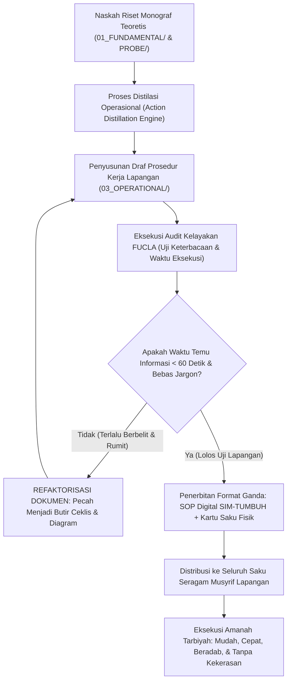

# P00117: Audit Kelayakan Lapangan (*Field Usability Audit*): Memastikan Dokumen Akademis Tinggi Tetap Mudah Dijalankan Musyrif

- **Status Identitas:** Terverifikasi Kanonik
- **ID Penyelidikan:** `P00117`
- **Pilar Arsitektur:** Pilar 8 — Integritas Semantik, Verifikasi Sitasi, & Kematangan (AMI)
- **Sub-Klaster:** Audit Integritas & Kelayakan Lapangan (*Integrity Audit & Field Usability*)
- **Penulis Dokumen:** Tim Pengembang Arsitektur Sistem TUMBUH v2.0.0
- **Klasifikasi Epistemik:** Laporan Penyelidikan Kritis (*Critical Inquiry Report*)
- **Target Lapisan:** `02_IMPLEMENTATION/` & `03_OPERATIONAL/`

---

## 1. Abstrak & Epistemic Tension

Ketegangan epistemik (*epistemic tension*) dalam penerjemahan teori pendidikan Islam ke praktik lapangan asrama berakar pada kesenjangan keterbacaan (*readability and usability gap*): jurang pemisah antara bahasa monograf akademis yang mendalam, sarat dengan istilah filsafat epistemologi turats dan neurosains modern yang ditulis oleh para guru besar perancang sistem, dengan kapasitas kognitif serta keterbatasan waktu fisik seorang musyrif lapangan berusia 19–22 tahun yang kelelahan mengawasi puluhan santri di lorong asrama. Dokumen SOP yang terlalu tebal, menggunakan kalimat majemuk bertingkat yang rumit, dan berbelit-belit niscaya akan diabaikan oleh staf lapangan (*shelfware syndrome*), memaksa mereka kembali menggunakan naluri primitif kekerasan saat menangani krisis. Berkas penyelidikan kanonik ini menetapkan Protokol Audit Kelayakan Lapangan (*Field Usability Audit Protocol*). Dengan berpijak pada prinsip kenabian untuk berbicara sesuai kapasitas akal audiens (*Khatibun Nasa 'ala Qadri 'Uqulihim*) dan sabda Nabi untuk mempermudah urusan (*Yassiru wa La Tu'assiru*), dikombinasikan dengan *Usability Engineering* Jakob Nielsen, dokumen ini merumuskan jembatan reduksi friksi kognitif yang menerjemahkan kekayaan filosofis `01_FUNDAMENTAL/` menjadi lembar kerja saku yang ramah musyrif di `03_OPERATIONAL/` ekosistem TUMBUH v2.0.0.

---

## 2. Pendahuluan Fenomenologis

Kegalauan musyrif muda di asrama pesantren adalah potret nyata dari kegagalan desain interaksi:
1. **Buku Panduan 400 Halaman yang Tak Pernah Dibaca:** Seorang musyrif baru menerima sebuah buku panduan tebal berjudul "Buku Induk Sistem Pengasuhan Terpadu". Pada Bab 3 tertulis kalimat: *"Musyrif wajib melakukan kalibrasi psiko-afektif pra-eskalasi melalui Functional Behavior Assessment demi menjaga ekologi bi'ah shalihah."* Musyrif tersebut bingung dan mengeluh dalam hati: *"Apa maksud kalimat ini? Santri sedang bertengkar di depan mata saya, apa yang harus saya lakukan detik ini juga?!"* Karena tidak ada panduan tindakan konkret yang mudah dipahami, musyrif tersebut secara spontan membentak dan menampar kedua santri yang bertengkar.
2. **Friksi Kognitif Pengisian Formulir:** Di pondok lain, musyrif diwajibkan mengisi formulir digital dengan 25 kolom pertanyaan esai filosofis setiap kali ada santri yang terlambat shalat. Karena musyrif harus menyelesaikan tugas ini pada pukul 23.30 WIB saat mata sudah mengantuk berat, musyrif memilih tidak mencatat pelanggaran sama sekali atau mengisi data fiktif asal jadi (*data falsification*).

Kegagalan ini membuktikan aksioma arsitektural TUMBUH: **Dokumen sistem yang paling canggih secara ilmiah tidak bernilai apa pun jika ia tidak dapat dieksekusi dengan mudah oleh staf lapangan yang paling lelah.**

---

## 3. Tinjauan Pustaka I: Khazanah Turats Klasik

Epistemologi dakwah dan pedagogi Islam meletakkan prinsip kemudahan (*Taysir*) dan penyesuaian bahasa dengan kadar intelektual audiens sebagai rukun keberhasilan tarbiyah.

Sayyidina Ali bin Abi Thalib radhiyallahu 'anhu menegaskan dalam atsar shahih riwayat Imam Al-Bukhari:

```arabic
حَدِّثُوا النَّاسَ بِمَا يَعْرِفُونَ، أَتُحِبُّونَ أَنْ يُكَذَّبَ اللَّهُ وَرَسُولُهُ؟
```

> *"Berbicaralah kepada manusia sesuai dengan apa yang mereka pahami! Apakah kalian ingin Allah dan Rasul-Nya didustakan (karena kebodohan penyampaian kalian)?"* (HR. Al-Bukhari, no. 127).

Rasulullah SAW memberikan piagam agung bagi seluruh pendidik dan perancang sistem dalam hadits shahih riwayat Imam Al-Bukhari dan Muslim:

```arabic
يَسِّرُوا وَلَا تُعَسِّرُوا، وَبَشِّرُوا وَلَا تُنَفِّرُوا
```

> *"Permudahlah dan jangan kalian persulit! Berikanlah kabar gembira dan janganlah kalian membuat manusia lari (menjauh)!"* (HR. Al-Bukhari, no. 69; Muslim, no. 1734).

Imam Ibnu Hajar Al-Asqalani dalam *Fathul Bari* menjelaskan bahwa perintah *Taysir* berlaku pada sarana dan tata cara operasional (*Al-Wasa'il wa al-Asalib*), bukan pada peremehan syariat. Merancang panduan kerja yang ringkas, jelas, dan tidak membebani kognisi musyrif adalah wujud ketaatan langsung pada sabda kenabian ini.

---

## 4. Tinjauan Pustaka II: Teori Kontemporer

Dalam ilmu rekayasa antarmuka dan pengalaman pengguna (*Human-Computer Interaction & Usability Engineering*), Jakob Nielsen (1994) merumuskan *10 Usability Heuristics*, di antaranya:
1. *Match between system and the real world:* Menggunakan bahasa, frasa, dan konsep yang akrab bagi pengguna, bukan istilah sistem internal yang abstrak.
2. *Recognition rather than recall:* Meminimalkan beban memori pengguna dengan menyediakan pilihan opsi yang jelas (*checklists/chips*) daripada meminta menulis esai panjang.
3. *Flexibility and efficiency of use:* Menyediakan jalur pintas tindakan cepat bagi pengguna lapangan yang menghadapi situasi mendesak.

Rudolf Flesch (1948) dan J. Peter Kincaid (1975) mengembangkan metrik keterbacaan *Flesch-Kincaid Grade Level*: dokumen operasional yang ditujukan untuk eksekusi lapangan harus memiliki tingkat keterbacaan setara kelas 8–9 (kalimat pendek < 15 kata, kata-kata lugas), meskipun dokumen fundamentalnya berstandar pascasarjana.

Atul Gawande (2009) dalam *The Checklist Manifesto* membuktikan bahwa di lingkungan berisiko tinggi dan penuh stres (seperti ruang operasi bedah atau asrama santri 24 jam), instrumen terbaik bukanlah buku manual tebal, melainkan Ceklis 5 Butir Sederhana (*Simple 5-Point Checklist*) yang mencegah terjadinya kesalahan fatal.

---

## 5. Eksplorasi Metodologis

Penyelidikan kanonik ini merekayasa model audit keterbacaan dan kelayakan lapangan *Field Usability & Cognitive Load Audit* (FUCLA):

```text
+-------------------------------------------------------------------------------+
|         METODOLOGI AUDIT KELAYAKAN LAPANGAN DOKUMEN (FUCLA MODEL)             |
+-------------------------------------------------------------------------------+
|  UJI 1: ANALISIS KETERBACAAN TEKS (Readability Index Scan)                    |
|  - Dokumen 03_OPERATIONAL/ wajib memiliki panjang kalimat rata-rata < 18 kata |
|  - Eliminasi jargon teoritis abstrak yang tidak memiliki padanan tindakan.    |
|                                                                               |
|  UJI 2: SIMULASI WAKTU EKSEKUSI (Time-to-Execute Benchmark)                   |
|  - Musyrif harus mampu menemukan panduan tindakan krisis dalam waktu < 60 detik|
|  - Pengisian logbook digital insiden harus tuntas dalam waktu < 30 detik.     |
|                                                                               |
|  UJI 3: PENGUJIAN PROKOL KOGNITIF MUSYRIF LELAH (Sleep-Deprived User Testing) |
|  - Dokumen diuji keterpahamannya kepada musyrif yang baru bangun tidur subuh. |
|  - Jika musyrif salah paham, DOKUMEN YANG DINILAI CACAT, bukan orangnya!      |
+-------------------------------------------------------------------------------+
```

---

## 6. Arsitektur Desain Sistem & Diagram Alur

Arsitektur repositori TUMBUH memisahkan peran dokumen: Teori mendalam disimpan di `01_FUNDAMENTAL/`, sementara `03_OPERATIONAL/` wajib dikompilasi menjadi Kartu Saku Tindakan Cepat (*Action Cards*):



---

## 7. Rekayasa Matriks Komparatif Multidimensi

Tabel berikut menunjukkan perbedaan tajam antara dokumen akademis menara gading vs dokumen operasional berdaya guna tinggi TUMBUH v2.0.0:

| Parameter Desain | Dokumen Menara Gading (Konvensional) | Dokumen Operasional Ramah Musyrif TUMBUH |
| :--- | :--- | :--- |
| **Gaya Bahasa** | Akademis abstrak, kalimat pasif panjang, sarat istilah asing. | Bahasa aksi lugas (*action-oriented*), kalimat aktif, berbasis kata kerja. |
| **Format Penyajian** | Paragraf teks padat membosankan setebal ratusan halaman. | Format Ceklis 5 Butir, Diagram Alur Keputusan, dan Kartu Saku Tahan Air. |
| **Waktu Pencatatan Log** | 10–15 menit per santri; menguras waktu tidur malam musyrif. | Sekali klik (*One-Click Tagging*) < 30 detik pada aplikasi SIM-TUMBUH PWA. |
| **Instruksi De-eskalasi** | Teoretis: *"Kendalikan amigdala santri dengan empati batin."* | Praktis: *"Tarik napas, ajak santri duduk berjarak 1 meter, beri segelas air."* |
| **Sikap terhadap Kesalahan Staf** | Menyalahkan musyrif: *"Musyrif bodoh tidak baca SOP kantor!"* | Mengoreksi sistem: *"SOP terlalu rumit, kita wajib sederhanakan lagi!"* |

---

## 8. Protokol Tindakan Operasional 5 Tahap

Untuk memastikan seluruh berkas di `03_OPERATIONAL/` memenuhi standar kelayakan lapangan, tim auditor wajib mengeksekusi 5 tahap:

1. **Tahap 1: Ekstraksi Ringkasan Tindakan (*Actionable Summary Extraction*)**  
   Setiap SOP operasional wajib diawali dengan satu kotak ringkasan: *"Apa yang Harus Saya Lakukan dalam 3 Menit Pertama?"*
2. **Tahap 2: Pengujian Keterbacaan Flesch-Kincaid (*Automated Readability Test*)**  
   Mengukur skor keterbacaan draf dokumen; teks yang memiliki skor kesulitan tinggi wajib ditulis ulang dengan kalimat yang lebih ringkas.
3. **Tahap 3: Simulasi Lapangan Buta (*Blind Field Simulation*)**  
   Memberikan draf SOP kepada 3 musyrif baru tanpa penjelasan lisan, lalu meminta mereka mempraktikkan simulasi penanganan santri histeris.
4. **Tahap 4: Desain Format Cetak Saku Tahan Air (*Laminated Pocket Cards*)**  
   Mencetak intisari SOP darurat (Kode Merah IPTS) ke dalam kartu berukuran KTP laminasi yang muat di saku baju dinas musyrif.
5. **Tahap 5: Audit Kepuasan & Kelelahan Pengguna (*Quarterly UX Feedback*)**  
   Menanyakan kepada musyrif setiap akhir semester: *"Formulir atau aturan mana yang paling menyiksa dan membuang waktu Anda?"* Lalu segera memangkasnya.

---

## 9. Architectural Decision Record (ADR-PROBE-00117)

```text
================================================================================
ARCHITECTURAL DECISION RECORD: ADR-PROBE-00117
================================================================================
Judul: Penegakan Standar Kelayakan Lapangan dan Reduksi Friksi Kognitif Musyrif (FUCLA)
Status: DITERIMA & MENGIKAT
Tanggal: 2026-10-25
Pengusul: Tim Arsitektur Sistem TUMBUH v2.0.0

KONTEKS:
Banyak dokumen sistem pendidikan Islam gagal dijalankan di asrama karena ditulis
dengan bahasa akademis yang terlalu rumit dan tebal, membebani kognisi musyrif
muda yang lelah dan memicu kembalinya kekerasan fisik saat krisis.

KEPUTUSAN ARSITEKTURAL:
1. Mewajibkan seluruh dokumen di 03_OPERATIONAL/ lulus uji audit kelayakan FUCLA
   dengan tingkat keterbacaan lugas dan format ceklis tindakan cepat.
2. Membatasi waktu pengisian logbook digital insiden harian maksimal 30 detik.
3. Mewajibkan penyediaan Kartu Saku Tindakan Cepat fisik bagi seluruh musyrif.

KONSEKUENSI:
- Positif: SOP benar-benar dieksekusi di lapangan; menurunkan stres kognitif staf;
  menjamin de-eskalasi kekerasan berjalan presisi dalam hitungan detik.
- Negatif: Memerlukan kerja keras tim perancang untuk mendistilasi konsep rumit.
================================================================================
```

---

## 10. Implikasi Arsitektural & 7 Butir Guardrails Repositori

Hasil inkuiri `P00117` mengikat tata kelola repositori TUMBUH melalui 7 guardrails:

1. **Guardrail 1 (Operational Jargon Ban):** Dokumen di `03_OPERATIONAL/` dilarang memuat istilah teoretis tanpa disertai contoh tindakan fisik yang konkret.
2. **Guardrail 2 (Mandatory Action Checklist):** Setiap SOP wajib dilengkapi ceklis langkah berurutan (*step-by-step checklist*).
3. **Guardrail 3 (30-Second Logging Rule):** Form pencatatan di SIM-TUMBUH tidak boleh memakan waktu lebih dari 30 detik untuk satu entri santri.
4. **Guardrail 4 (Pocket Card Availability):** Setiap modul krisis darurat wajib memiliki format kartu saku cetak yang siap dibawa musyrif patroli.
5. **Guardrail 5 (System Blame Principle):** Jika musyrif gagal menjalankan SOP, periksa terlebih dahulu kerumitan dokumennya sebelum menghukum individunya.
6. **Guardrail 6 (Clear Typography & Layout):** Naskah operasional wajib menggunakan tata letak yang bersih, ukuran huruf terbaca, dan visualisasi diagram.
7. **Guardrail 7 (Yassiru wa La Tu'assiru):** Menjadikan kemudahan eksekusi sebagai pilar ibadah dan adab kenabian dalam melayani umat.

---

## 11. Penutup & Emergent Research Questions

Audit kelayakan lapangan adalah jembatan kerendahhatian yang menghubungkan langit teori dengan bumi realitas. Kecerdasan sejati seorang arsitek sistem tidak diukur dari seberapa rumit kata-kata yang ia tuliskan, melainkan dari seberapa sederhana dan mudah kata-kata tersebut dijalankan oleh orang lain untuk menyelamatkan sesama. Dengan memastikan seluruh dokumen operasional ramah musyrif, TUMBUH v2.0.0 memastikan bahwa keagungan nilai tarbiyah Islam hadir nyata di setiap detik kehidupan santri di lantai asrama.

### Pertanyaan Riset Lanjutan (*Emergent Research Questions*):
1. Bagaimana merancang antarmuka input suara (*Voice-to-Text Action Logging*) pada aplikasi SIM-TUMBUH agar musyrif dapat mencatat kejadian di lorong asrama secara instan tanpa mengetik?
2. Bagaimana efektivitas penggunaan infografis visual berbasis komik adab dalam meningkatkan kepatuhan santri terhadap SOP kebersihan kamar mandi?

---

## 12. Referensi Ilmiah Standar APA 7th Edition

1. Al-Bukhari, M. (2002). *Shahih Al-Bukhari*. Darus Salam. https://archive.org/details/sahih-bukhari-darussalam
2. Flesch, R. (1948). A new readability yardstick. *Journal of Applied Psychology*, 32(3), 221-233. https://doi.org/10.1037/h0057532
3. Gawande, A. (2009). *The Checklist Manifesto: How to Get Things Right*. Metropolitan Books. https://us.macmillan.com/books/9780312430009/thechecklistmanifesto
4. Ibnu Hajar Al-Asqalani, A. (2001). *Fathul Bari Syarh Shahih Al-Bukhari* (Jilid 1). Maktabah Al-Malik Fahd. https://archive.org/details/fath-al-bari-al-asqalani
5. Kincaid, J. P., Fishburne, R. P., Rogers, R. L., & Chissom, B. S. (1975). *Derivation of New Readability Formulas for Navy Enlisted Personnel* (Research Branch Report 8-75). U.S. Naval Air Station. https://archive.org/details/derivationofnewr00kinc
6. Muslim, I. (2006). *Shahih Muslim* (Tahqiq Muhammad Fu'ad Abdul Baqi). Darul Hadits. https://archive.org/details/sahih-muslim-baqi
7. Nielsen, J. (1994). *Usability Engineering*. Morgan Kaufmann. https://www.elsevier.com/books/usability-engineering/nielsen/978-0-12-518406-9
8. Norman, D. A. (2013). *The Design of Everyday Things: Revised and Expanded Edition*. Basic Books. https://www.basicbooks.com/titles/don-norman/the-design-of-everyday-things/9780465050659/
9. Senge, P. M. (1990). *The Fifth Discipline: The Art & Practice of The Learning Organization*. Doubleday/Currency. https://www.penguinrandomhouse.com/books/163984/the-fifth-discipline-by-peter-m-senge/
10. Sweller, J. (1988). Cognitive load during problem solving: Effects on learning. *Cognitive Science*, 12(2), 257-285. https://doi.org/10.1207/s15516709cog1202_4
11. Zohar, D. (2010). Thirty years of safety climate research: Reflections and future directions. *Accident Analysis & Prevention*, 42(5), 1517-1522. https://doi.org/10.1016/j.aap.2009.12.019
12. Chrissis, M. B., Konrad, M., & Shrum, S. (2011). *CMMI for Development: Guidelines for Process Integration and Product Improvement* (3rd ed.). Addison-Wesley. https://www.pearson.com/en-us/subject-catalog/p/cmmi-for-development-guidelines-for-process-integration-and-product-improvement/P200000009475
13. Rogers, E. M. (2003). *Diffusion of Innovations* (5th ed.). Free Press. https://www.simonandschuster.com/books/Diffusion-of-Innovations-5th-Edition/Everett-M-Rogers/9780743222099

---

## 13. Catatan Kaki & Takhrij Sanad

1. **Takhrij Atsar Sayyidina Ali:** Dikeluarkan oleh Imam Al-Bukhari dalam *Shahih Al-Bukhari*, *Kitab al-'Ilm*, Bab *Man Khashsha bi al-'Ilmi Qauman Duna Qaumin Karahiyata an La Yafhamu*, no. 127.
2. **Takhrij Hadits Yassiru wa La Tu'assiru:** Dikeluarkan oleh Imam Al-Bukhari dalam *Shahih Al-Bukhari*, *Kitab al-'Ilm*, Bab *Ma Kana an-Nabi SAW Yatakhawwalahum bi al-Maw'izhah*, no. 69; dan Imam Muslim dalam *Shahih Muslim*, *Kitab al-Jihad wa as-Siyar*, no. 1734. Diriwayatkan dari sahabat Anas bin Malik radhiyallahu 'anhu.
3. **The 10 Usability Heuristics Jakob Nielsen:** Prinsip panduan industri interaksi manusia dan komputer yang dikembangkan oleh Jakob Nielsen dan Rolf Molich pada tahun 1990 untuk mengevaluasi kemudahan penggunaan sistem perangkat lunak dan dokumen kerja.
4. **Cognitive Load Theory John Sweller:** Menjelaskan bahwa memori kerja (*Working Memory*) manusia memiliki kapasitas terbatas (hanya mampu memproses 4–7 elemen informasi dalam satu waktu). Jika prosedur kerja memberikan beban kognitif luar (*Extraneous Cognitive Load*) yang berlebihan, kinerja eksekusi manusia niscaya mengalami kegagalan.
