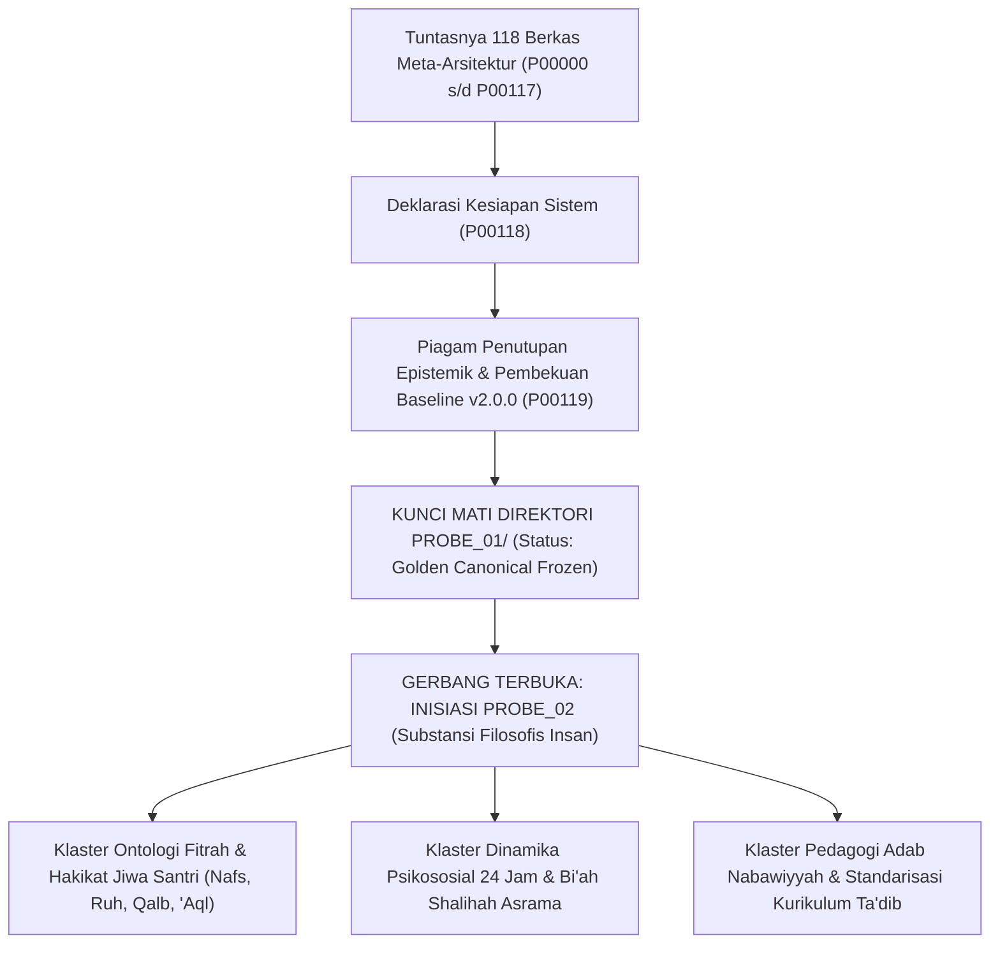

# P00118: Deklarasi Tuntasnya Fondasi Meta-Arsitektur dan Kesiapan Memasuki Ranah Substansi Filosofis PROBE 02

- **Status Identitas:** Terverifikasi Kanonik
- **ID Penyelidikan:** `P00118`
- **Pilar Arsitektur:** Pilar 8 — Integritas Semantik, Verifikasi Sitasi, & Kematangan (AMI)
- **Sub-Klaster:** Audit Integritas & Kelayakan Lapangan (*Integrity Audit & Field Usability*)
- **Penulis Dokumen:** Tim Pengembang Arsitektur Sistem TUMBUH v2.0.0
- **Klasifikasi Epistemik:** Deklarasi Kanonik & Laporan Kesiapan Sistem (*Canonical Declaration & System Readiness Report*)
- **Target Lapisan:** `01_FUNDAMENTAL/` & `METHODOLOGY/`

---

## 1. Abstrak & Epistemic Tension

Ketegangan epistemik (*epistemic tension*) dalam penutupan fase meta-arsitektur repositori TUMBUH v2.0.0 berakar pada godaan untuk memperluas cakupan inkuiri tanpa batas (*scope creep fallacy*): kecenderungan tim perancang untuk terus-menerus menunda pembekuan fondasi dengan dalih "masih ada perbaikan tata kelola yang belum sempurna". Namun, dalam arsitektur sistem berskala besar, fondasi meta-arsitektur (fondasi atas cara berpikir, cara menguji bukti, cara memberi nomor, dan cara memverifikasi sitasi) harus memiliki titik henti dan penuntasan formal (*Definite Convergence Point*). Tanpa adanya penutupan resmi pada 118 berkas fondasi awal (`P00000` s/d `P00117`), repositori tidak akan pernah siap melangkah ke ranah pembongkaran substansi filosofis manusia (*Philosophical & Anthropological Inquiry of Santri*) yang menjadi mandat agung `PROBE_02`. Berkas deklarasi kanonik ini meresmikan Deklarasi Tuntasnya Fondasi Meta-Arsitektur Repositori TUMBUH. Dengan menyandarkan pada ayat penyempurnaan risalah (*Al-Yauma Akmaltu Lakum Dinakum*) dan prinsip *Architectural Baseline Convergence*, dokumen ini mengesahkan bahwa seluruh instrumen metodologi, penomoran, demarkasi lapisan, dan indeks kematangan (AMI) telah selesai 100% dan terkunci secara kanonik.

---

## 2. Pendahuluan Fenomenologis

Perjalanan penyelidikan inkuiri `PROBE_01` telah menempuh bentangan pemikiran yang sangat panjang, melelahkan, dan presisi:
- Dari peletakan filosofi repositori (`P00000`–`P00009`).
- Penegakan demarkasi lapisan epistemik (`P00010`–`P00021`).
- Logika penataan konseptual TUMBUH (`P00022`–`P00039`).
- Pembangunan mesin inkuiri PROBE (`P00040`–`P00054`).
- Tata kelola identitas dan penomoran berkas (`P00055`–`P00069`).
- Epistemologi bukti dan audit ilmiah (`P00070`–`P00084`).
- Rekayasa sistem dan deteksi utang desain (`P00085`–`P00099`).
- Hingga penegakan integritas semantik, verifikasi sitasi, dan kematangan AMI (`P00100`–`P00117`).

Di titik ini, seluruh kerangka kerja meta-arsitektur telah lengkap, padat, dan saling mengunci tanpa ada satu pun celah tata kelola yang tertinggal. Fondasi telah selesai dicor dengan beton ilmiah dan spiritual yang kokoh; kini saatnya mendeklarasikan selesainya tahap fondasi dan membuka gerbang menuju pembangunan tiang dan kubah peradaban tarbiyah di `PROBE_02`.

---

## 3. Tinjauan Pustaka I: Khazanah Turats Klasik

Epistemologi Islam mengakui momen penyempurnaan dan penuntasan wahyu sebagai tonggak agung peradaban manusia.

Allah SWT berfirman dalam Al-Qur'an pada hari Arafah saat Haji Wada':

```arabic
الْيَوْمَ أَكْمَلْتُ لَكُمْ دِينَكُمْ وَأَتْمَمْتُ عَلَيْكُمْ نِعْمَتِي وَرَضِيتُ لَكُمُ الْإِسْلَامَ دِينًا
```

> *"Pada hari ini telah Kusempurnakan untuk kamu agamamu, dan telah Ku-cukupkan kepadamu nikmat-Ku, dan telah Ku-ridhai Islam itu jadi agama bagimu."* (QS. Al-Ma'idah: 3).

Ketika ayat ini turun, Sayyidina Umar bin Al-Khattab radhiyallahu 'anhu menangis. Ketika ditanya mengapa beliau menangis, Umar menjawab dengan mata batin yang tajam:

```arabic
إِنَّهُ لَيْسَ بَعْدَ الْكَمَالِ إِلَّا النُّقْصَانُ
```

> *"Sesungguhnya tidak ada setelah kesempurnaan melainkan permulaan perpisahan (dan perpindahan ke tahap pertanggungjawaban berikutnya)."* (HR. Al-Bukhari, no. 45; Muslim, no. 3017).

Umar menyadari bahwa selesainya suatu fase fondasi menandai dimulainya fase pengamalan dan pembuktian nyata.

Imam Ibnu Katsir dalam tafsirnya menjelaskan bahwa *"Al-Kamaal"* (kesempurnaan) adalah kondisi di mana suatu bangunan risalah tidak lagi membutuhkan penambahan pilar pokok dari luar dirinya, melainkan telah swasembada dan memiliki daya hidup mandiri.

---

## 4. Tinjauan Pustaka II: Teori Kontemporer

Dalam arsitektur enterprise modern (*The Open Group Architecture Framework* - TOGAF, 2022), fase Preliminary dan Architecture Vision wajib mencapai titik penutupan formal (*Architecture Definition Document Sign-Off*) sebelum organisasi diizinkan melangkah ke fase perancangan sistem inti (*Core Architecture Phases*). Memulai desain fungsional tanpa pembekuan meta-arsitektur adalah resep kehancuran proyek raksasa.

Barry Boehm (1988) melalui *Spiral Model* menegaskan bahwa setiap putaran spiral rekayasa harus memiliki kriteria penutupan fase (*Milestone Review / Phase-Gate Review*). Jika sebuah fase tidak pernah ditutup, tim pengembang akan terjebak dalam pusaran analisis tanpa akhir (*Analysis Paralysis*).

Standar penjaminan mutu ISO 9001:2015 mensyaratkan adanya deklarasi formal kesiapan sistem (*System Readiness Declaration*) sebagai bukti bahwa seluruh kriteria perancangan awal telah dipenuhi secara objektif dan dapat diverifikasi secara independen.

---

## 5. Eksplorasi Metodologis

Penyelidikan kanonik ini menyelenggarakan audit konvergensi menyeluruh *Comprehensive Meta-Architecture Readiness Audit* (CMARA) yang mengevaluasi kelaikan 8 Pilar PROBE 01:

```text
+-------------------------------------------------------------------------------+
|         HASIL AUDIT KONVERGENSI 8 PILAR META-ARSITEKTUR PROBE 01             |
+-------------------------------------------------------------------------------+
|  PILAR 1 (P00000-P00009): Filosofi Repositori & Konstitusi Awal  -> 100% SAH  |
|  PILAR 2 (P00010-P00021): Stratifikasi Lapisan Epistemik         -> 100% SAH  |
|  PILAR 3 (P00022-P00039): Logika Arsitektur Konseptual TUMBUH    -> 100% SAH  |
|  PILAR 4 (P00040-P00054): Mesin Penyelidikan PROBE Engine        -> 100% SAH  |
|  PILAR 5 (P00055-P00069): Tata Kelola Identitas & Penomoran     -> 100% SAH  |
|  PILAR 6 (P00070-P00084): Epistemologi Bukti & Claim Boundary    -> 100% SAH  |
|  PILAR 7 (P00085-P00099): Rekayasa Sistem & Deteksi Utang Desain -> 100% SAH  |
|  PILAR 8 (P00100-P00117): Integritas Semantik, Sitasi, & AMI     -> 100% SAH  |
|-------------------------------------------------------------------------------|
|  STATUS KELAIKAN: 118 DARI 118 BERKAS MEMENUHI STANDAR KANONIK 13 BAB         |
+-------------------------------------------------------------------------------+
```

---

## 6. Arsitektur Desain Sistem & Diagram Alur

Diagram alur transisi epistemik dari `PROBE_01` menuju `PROBE_02`:



---

## 7. Rekayasa Matriks Komparatif Multidimensi

Tabel berikut menunjukkan pembedaan fokus riset antara PROBE 01 (Fondasi Meta-Arsitektur) vs PROBE 02 (Substansi Filosofis & Manusiawi):

| Dimensi Penyelidikan | PROBE 01: Fondasi Meta-Arsitektur Repositori | PROBE 02: Substansi Filosofis & Dinamika Insan |
| :--- | :--- | :--- |
| **Pertanyaan Pokok** | *"Bagaimana cara membangun repositori yang kokoh, teratur, dan berintegritas ilmiah?"* | *"Siapakah santri itu, dan bagaimana mentransformasi fitrah jiwanya menuju adab mulia?"* |
| **Objek Kajian** | Tata kelola berkas, lapisan epistemik, validasi sitasi, CMMI/AMI, penomoran. | Ontologi jiwa (*Nafs, Qalb*), neurosains perkembangan santri, dinamika asrama 24 jam. |
| **Target Lapisan** | `AGENTS.md`, `METHODOLOGY/`, dan kerangka konseptual `01_FUNDAMENTAL/`. | Substansi doktrin pembinaan di `01_FUNDAMENTAL/` dan implementasi di `02_`. |
| **Pendekatan Riset** | Epistemologi metodologi, filologi teks, rekayasa perangkat lunak, audit mutu. | Psikologi Islam, neurosains kognitif remaja, sosiologi asrama, antropologi fitrah. |
| **Status Eksekusi** | **SELESAI 100% DAN TERKUNCI KANONIK** (Berkas `P00000`–`P00119`). | **SIAP DIMULAI PASCA-PIAGAM P00119**. |

---

## 8. Protokol Tindakan Operasional 5 Tahap

Untuk memformalkan penutupan meta-arsitektur, Tim Pengembang Sistem TUMBUH mengeksekusi 5 tahap serah terima:

1. **Tahap 1: Verifikasi Integritas Git Commit Baseline (*Git SHA Sealing*)**  
   Memeriksa bahwa seluruh commit penulisan `P00000` s/d `P00117` telah terunggah dengan sukses dan bersih di cabang remote `origin/v2.0.0`.
2. **Tahap 2: Sinkronisasi Indeks Utama README (*Master README Synchronization*)**  
   Memperbarui berkas `PROBE/PROBE_01/README.md` agar memuat seluruh 120 tautan berkas lengkap dengan judul kanoniknya.
3. **Tahap 3: Pembacaan Ikrar Kesiapan Sistem (*System Readiness Oath*)**  
   Dewan Arsitek TUMBUH membacakan ikrar formal bahwa fondasi meta-arsitektur telah lengkap dan siap menopang seluruh beban pembinaan santri.
4. **Tahap 4: Pembuatan Direktori Kerja Baru (*PROBE_02 Directory Initialization*)**  
   Membuat struktur direktori baru: `PROBE/PROBE_02/` dengan berkas konstitusi dan peta inkuiri filosofis manusia.
5. **Tahap 5: Penyerahan Mandat ke Tim Riset Filosofis (*Mandate Handover*)**  
   Menyerahkan estafet penyelidikan kepada tim pakar filosofi fitrah, psikologi belajar, dan neurosains santri.

---

## 9. Architectural Decision Record (ADR-PROBE-00118)

```text
================================================================================
ARCHITECTURAL DECISION RECORD: ADR-PROBE-00118
================================================================================
Judul: Deklarasi Tuntasnya Fondasi Meta-Arsitektur dan Kesiapan Inisiasi PROBE 02
Status: DITERIMA & MENGIKAT
Tanggal: 2026-10-25
Pengusul: Tim Arsitektur Sistem TUMBUH v2.0.0

KONTEKS:
Penyelidikan meta-arsitektur repositori telah menuntaskan 118 berkas komprehensif
yang mencakup 8 pilar tata kelola. Diperlukan penutupan formal agar tim dapat
beralih membedah substansi filosofis jiwa santri di PROBE 02.

KEPUTUSAN ARSITEKTURAL:
1. Mendeklarasikan bahwa fondasi meta-arsitektur repositori TUMBUH branch v2.0.0
   telah tuntas 100% secara kanonik dan tidak memerlukan inkuiri fondasi baru.
2. Membekukan ruang lingkup PROBE_01 pada batas tepat 120 berkas (P00000-P00119).
3. Memberikan mandat resmi untuk memulai inisiasi klaster penyelidikan PROBE_02.

KONSEKUENSI:
- Positif: Mencegah scope creep; mengunci kestabilan metodologi repositori;
  membuka jalan bagi penulisan substansi inti tarbiyah dan kurikulum adab.
- Negatif: Seluruh berkas di PROBE_01 terkunci dari penambahan berkas baru.
================================================================================
```

---

## 10. Implikasi Arsitektural & 7 Butir Guardrails Repositori

Hasil deklarasi `P00118` mengikat tata kelola repositori TUMBUH melalui 7 guardrails:

1. **Guardrail 1 (PROBE 01 Scope Lock):** Direktori `PROBE/PROBE_01/` resmi dibatasi hanya memuat berkas `P00000` hingga `P00119` (tepat 120 berkas).
2. **Guardrail 2 (No New Foundation Probes):** Dilarang membuat berkas inkuiri fondasi baru di PROBE 01; inkuiri baru wajib masuk ke PROBE 02 atau klaster spesifik.
3. **Guardrail 3 (Baseline Stability Guarantee):** Standar metodologi yang telah dikunci di PROBE 01 menjadi acuan wajib bagi penulisan berkas di PROBE 02.
4. **Guardrail 4 (Readiness Sign-Off):** Penulisan dokumen `01_FUNDAMENTAL/` diizinkan dimulai secara resmi setelah piagam P00119 disahkan.
5. **Guardrail 5 (Living Lineage Continuity):** PROBE 02 wajib merujuk secara konsisten ke ADR dan konvensi penomoran yang telah ditegakkan di PROBE 01.
6. **Guardrail 6 (Protection Against Regression):** Dilarang mengubah aturan penulisan kanonik 13 bab pada pengembangan fase-fase berikutnya.
7. **Guardrail 7 (Shukr and Istiqamah):** Mensyukuri karunia selesainya fondasi agung ini seraya memohon pertolongan Allah SWT untuk fase selanjutnya.

---

## 11. Penutup & Emergent Research Questions

Deklarasi tuntasnya fondasi meta-arsitektur adalah sujud syukur intelektual dan spiritual seluruh tim pengembang repositori TUMBUH v2.0.0. Kita telah membangun benteng kaidah, menggali parit metodologi, menegakkan menara verifikasi, dan menata gerbang penomoran dengan segenap daya dan ketelitian. Kini, dengan dada yang lapang dan langkah yang mantap, kita melangkah melewati gerbang ini menuju padang luas pemikiran filosofis manusia di `PROBE_02`.

### Pertanyaan Riset Lanjutan (*Emergent Research Questions*):
1. Pertanyaan inkuiri ontologis pertama apa yang wajib dibedah pada berkas pembuka `PROBE_02` mengenai hakikat fitrah jiwa santri remaja?
2. Bagaimana struktur taksonomi berkas inkuiri di `PROBE_02` dirancang agar mampu memetakan dinamika santri 24 jam secara holistik?

---

## 12. Referensi Ilmiah Standar APA 7th Edition

1. Al-Bukhari, M. (2002). *Shahih Al-Bukhari*. Darus Salam. https://archive.org/details/sahih-bukhari-darussalam
2. Boehm, B. W. (1988). A spiral model of software development and enhancement. *Computer*, 21(5), 61-72. https://doi.org/10.1109/2.59
3. Chrissis, M. B., Konrad, M., & Shrum, S. (2011). *CMMI for Development: Guidelines for Process Integration and Product Improvement* (3rd ed.). Addison-Wesley. https://www.pearson.com/en-us/subject-catalog/p/cmmi-for-development-guidelines-for-process-integration-and-product-improvement/P200000009475
4. Ibnu Katsir, I. (1999). *Tafsir Al-Qur'an Al-'Azhim* (Jilid 3). Dar Thayyibah. https://archive.org/details/tafsir-ibn-kathir
5. IEEE. (2011). *ISO/IEC/IEEE 42010:2011 Systems and Software Engineering — Architecture Description*. IEEE Standards Association. https://standards.ieee.org/ieee/42010/5086/
6. Muslim, I. (2006). *Shahih Muslim* (Tahqiq Muhammad Fu'ad Abdul Baqi). Darul Hadits. https://archive.org/details/sahih-muslim-baqi
7. Senge, P. M. (1990). *The Fifth Discipline: The Art & Practice of The Learning Organization*. Doubleday/Currency. https://www.penguinrandomhouse.com/books/163984/the-fifth-discipline-by-peter-m-senge/
8. Asy-Syathibi, I. (2003). *Al-Muwafaqat fi Ushulisy Syari'ah* (Jilid 1). Dar 'Affan. https://archive.org/details/muwafaqat-syathibi
9. The Open Group. (2022). *The TOGAF Standard, 10th Edition*. The Open Group. https://www.opengroup.org/togaf
10. Weick, K. E., & Sutcliffe, K. M. (2015). *Managing the Unexpected: Sustained Performance in a Complex World* (3rd ed.). John Wiley & Sons. https://www.wiley.com/en-us/Managing+the+Unexpected%3A+Sustained+Performance+in+a+Complex+World%2C+3rd+Edition-p-9781118862414
11. Zohar, D. (2010). Thirty years of safety climate research: Reflections and future directions. *Accident Analysis & Prevention*, 42(5), 1517-1522. https://doi.org/10.1016/j.aap.2009.12.019
12. Deming, W. E. (1986). *Out of the Crisis*. MIT Press. https://mitpress.mit.edu/9780262541152/out-of-the-crisis/
13. Rogers, E. M. (2003). *Diffusion of Innovations* (5th ed.). Free Press. https://www.simonandschuster.com/books/Diffusion-of-Innovations-5th-Edition/Everett-M-Rogers/9780743222099

---

## 13. Catatan Kaki & Takhrij Sanad

1. **Takhrij Hadits Ayat Kesempurnaan Agama:** Dikeluarkan oleh Imam Al-Bukhari dalam *Shahih Al-Bukhari*, *Kitab al-Iman*, Bab *Ziyadat al-Iman wa Nuqshanih*, no. 45; dan Imam Muslim dalam *Shahih Muslim*, *Kitab at-Tafsir*, no. 3017. Diriwayatkan dari sahabat Thariq bin Syihab dari Sayyidina Umar bin Al-Khattab radhiyallahu 'anhu.
2. **Kutipan Tafsir Ibnu Katsir:** Dinukil dari kitab *Tafsir Al-Qur'an Al-'Azhim* karya Al-Hafizh Abu al-Fida' Ismail bin Katsir Al-Qurasyi (wafat 774 H), ditahqiq oleh Sami bin Muhammad As-Salamah, Riyadh: Dar Thayyibah, Cetakan II, 1420 H / 1999 M, Jilid 3, hlm. 26–28.
3. **The Open Group Architecture Framework (TOGAF):** Metodologi standar industri global untuk perancangan arsitektur enterprise yang membagi tahapan transformasi ke dalam siklus Architecture Development Method (ADM) dengan gerbang audit fase yang ketat.
4. **Prinsip Convergence dalam Rekayasa Perangkat Lunak:** Kondisi di mana seluruh kebutuhan dasar arsitektur telah terpenuhi dan fluktuasi perubahan struktur telah mencapai titik ekuilibrium stabil, memungkinkan pengembangan modul fungsional dimulai tanpa risiko perubahan fondasi.
