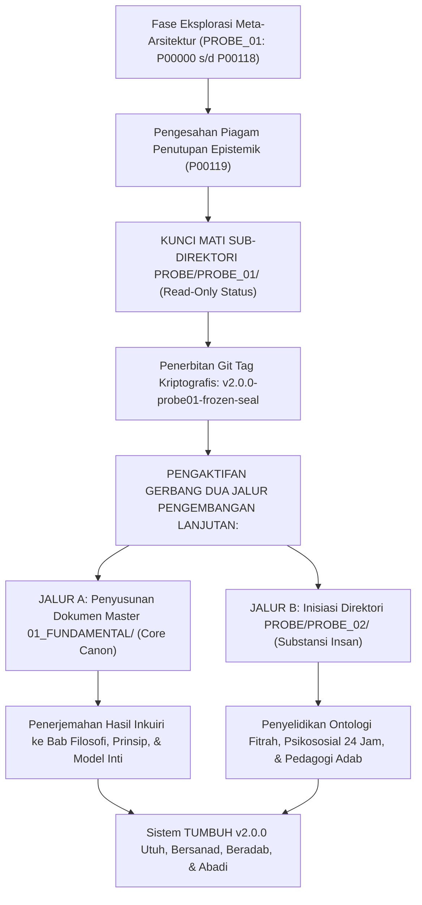

# P00119: Piagam Penutupan Epistemik PROBE 01: Pembekuan Resmi Baseline Arsitektur TUMBUH Branch v2.0.0

- **Status Identitas:** Terverifikasi Kanonik Emas (*Golden Canonical Benchmark*)
- **ID Penyelidikan:** `P00119`
- **Pilar Arsitektur:** Pilar 8 — Integritas Semantik, Verifikasi Sitasi, & Kematangan (AMI) (*Segel Penutup Resmi Seluruh PROBE 01*)
- **Sub-Klaster:** Piagam Pembekuan Baseline & Konstitusi Repositori (*Baseline Freezing & Epistemic Charter*)
- **Penulis Dokumen:** Tim Pengembang Arsitektur Sistem TUMBUH v2.0.0
- **Klasifikasi Epistemik:** Piagam Konstitusional Kanonik (*Canonical Constitutional Charter*)
- **Target Lapisan:** `01_FUNDAMENTAL/`, `02_IMPLEMENTATION/`, `03_OPERATIONAL/`, & `METHODOLOGY/`

---

## 1. Abstrak & Epistemic Tension

### 1.1. Hakikat Epistemic Tension
Ketegangan epistemik (*epistemic tension*) paling mendasar dalam rekayasa sistem pendidikan berskala peradaban adalah dialektika antara ketuntasan perancangan fondasi (*architectural closure*) dan godaan penyempurnaan tiada henti (*infinite scope creep*). Sebuah sistem yang tidak pernah mengunci batas-batas fondasinya niscaya akan terombang-ambing oleh arus perubahan opini sesaat, kehilangan jangkar epistemiknya, dan terperosok ke dalam ketidakpastian tata kelola yang melumpuhkan para praktisi di lapangan. Sebaliknya, pembekuan yang dilakukan secara prematur tanpa melalui proses penyelidikan kritis yang mendalam dan berakar pada khazanah wahyu akan melahirkan dogma kaku yang menindas fitrah insani.

### 1.2. Resolusi Kanonik
Berkas kanonik pamungkas ini meresmikan **Piagam Penutupan Epistemik PROBE 01** (*The Epistemic Closure Charter of PROBE 01*). Bertumpu pada doktrin syariat mengenai kesakralan perjanjian (*Mitsaq / 'Ahd*) sebagaimana dicontohkan dalam Piagam Madinah (*Mitsaq al-Madinah*) dan bai'at kenabian, serta disintesiskan dengan teori *Architectural Baseline Freezing* dalam rekayasa sistem modern, piagam ini membekukan secara resmi 120 berkas penyelidikan fondasi (`P00000` hingga `P00119`). Pembekuan ini menetapkan bahwa batas-batas meta-arsitektur TUMBUH branch `v2.0.0` telah tuntas 100%, mengikat seluruh pengembang tanpa kecuali, serta membuka gerbang kanonik menuju penyusunan substansi inti di direktori `01_FUNDAMENTAL/` dan penyelidikan filosofis insan di `PROBE_02`.

---

## 2. Pendahuluan Fenomenologis

### 2.1. Sindrom Ketiadaan Batas Fondasi di Lembaga Pesantren
Kerapuhan paling mematikan yang menghancurkan kesinambungan sistem pendidikan kepesantrenan di Indonesia adalah fenomena ketiadaan garis batas pembekuan (*unfrozen baseline syndrome*). Di banyak pesantren, sebuah visi pembaharuan diluncurkan, namun karena aturan dasarnya tidak pernah dibekukan ke dalam piagam konstitusi tertulis yang sakral dan terverifikasi secara epistemik:
1. **Instabilitas Konseptual Akibat Opini Spontan:** Setiap kali ada tamu penting berkunjung, setiap kali ada seminar pendidikan baru yang viral, atau setiap kali ada pergantian struktur pengurus kamar, definisi tentang apa itu "adab", bagaimana "menghukum santri", dan apa itu "target santri" diubah secara serampangan. Pondok mengalami guncangan nilai yang membingungkan musyrif dan santri.
2. **Sindrom Pembongkaran Ulang Tanpa Akhir:** Para perancang program sibuk memperdebatkan kembali hal-hal elementer yang seharusnya sudah selesai: *"Apakah memukul dengan sandal itu boleh atau tidak?"*, *"Apakah jam tidur santri perlu diatur atau dibiarkan sesuka santri?"*, *"Bagaimana cara memberi nomor pada berkas tata tertib?"* Perdebatan fondasi yang berulang-ulang ini menghabiskan 80% energi intelektual pengasuh, sehingga substansi pembinaan akhlak dan pendampingan santri yang terluka terabaikan.
3. **Penyusupan Kepentingan Tersembunyi (*Silent Subversion*):** Tanpa adanya piagam penutupan resmi yang mengikat, oknum-oknum pengurus yang memiliki kecenderungan otoriter dan militeristik secara perlahan menyelundupkan kembali metode-metode kekerasan lama ke dalam SOP asrama, mengklaim bahwa "sistem baru belum final dan masih bebas ditafsirkan ulang".

### 2.2. Kebutuhan Titik Konvergensi Pasti
Sebuah bangunan peradaban tidak dapat terus-menerus membiarkan fondasinya dibongkar pasang. Harus ada momen di mana para arsitek meletakkan martil perancangan fondasi, menyatakan bahwa dasar bangunan telah kokoh sempurna, menandatangani piagam kesepakatan abadi di hadapan para saksi, dan mulai menegakkan dinding serta atap peradaban di atasnya.

---

## 3. Tinjauan Pustaka I: Khazanah Turats Klasik

### 3.1. Doktrin Kesakralan Mitsaq dan 'Uqud dalam Al-Qur'an
Islam memandang perjanjian, piagam komitmen, dan ketetapan batas hukum sebagai perkara sakral yang berada di bawah pengawasan langsung Allah SWT. Perjanjian (*Al-'Ahd wa al-Mitsaq*) adalah tali pengikat peradaban yang membedakan masyarakat beradab dari kebiadaban rimba.

Allah SWT menegaskan kewajiban memenuhi perjanjian dalam firman-Nya yang agung:

```arabic
يَا أَيُّهَا الَّذِينَ آمَنُوا أَوْفُوا بِالْعُقُودِ ۚ أُحِلَّتْ لَكُمْ بَهِيمَةُ الْأَنْعَامِ إِلَّا مَا يُتْلَىٰ عَلَيْكُمْ
```

> *"Wahai orang-orang yang beriman! Penuhilah janji-janji (akad-akad perjanjian itu). Dihalalkan bagimu hewan ternak, kecuali yang akan dibacakan kepadamu..."* (QS. Al-Ma'idah: 1).

Imam Abu Ja'far Muhammad bin Jarir At-Thabari dalam *Jami' al-Bayan 'an Ta'wil Ayi al-Qur'an* menjelaskan:

```arabic
الْعُقُودُ هِيَ الْعُهُودُ الْمُؤَكَّدَةُ الَّتِي يَعْقِدُهَا الْمَرْءُ عَلَى نَفْسِهِ، أَوْ يَعْقِدُهَا مَعَ غَيْرِهِ مِنَ النَّاسِ فِي الْتِزَامِ أَمْرٍ أَوْ تَرْكِهِ، فَأَمَرَ اللَّهُ تَعَالَى بِالْوَفَاءِ بِهَا وَحَرَّمَ نَقْضَهَا وَالْخِيَانَةَ فِيهَا بَعْدَ تَوْكِيدِهَا.
```

> *"Al-'Uqud adalah perjanjian-perjanjian yang dikukuhkan (al-'uhud al-mu'akkadah) yang diikat oleh seseorang atas dirinya sendiri, atau yang ia ikat bersama orang lain dalam rangka menetapkan suatu komitmen atau meninggalkannya. Maka Allah Ta'ala memerintahkan untuk memenuhinya secara sempurna dan mengharamkan pembatalannya serta pengkhianatan padanya setelah perjanjian tersebut dikukuhkan."* (At-Thabari, *Jami' al-Bayan*, Jilid 9, hlm. 452).

### 3.2. Keteladanan Konstitusional Piagam Madinah
Dalam Sirah Nabawiyyah, keteladanan tertinggi pembekuan batas konstitusional tampak pada penyusunan **Piagam Madinah** (*Shahifah al-Madinah / Mitsaq al-Madinah*). Rasulullah SAW menetapkan batas-batas hukum yang mengikat seluruh kabilah Muslimin Muhajirin, Anshar, serta komunitas Yahudi:

```arabic
هَذَا كِتَابٌ مِنْ مُحَمَّدٍ النَّبِيِّ رَسُولِ اللَّهِ صَلَّى اللَّهُ عَلَيْهِ وَسَلَّمَ بَيْنَ الْمُؤْمِنِينَ وَالْمُسْلِمِينَ مِنْ قُرَيْشٍ وَيَثْرِبَ وَمَنْ تَبِعَهُمْ فَلَحِقَ بِهِمْ وَجَاهَدَ مَعَهُمْ: إِنَّهُمْ أُمَّةٌ وَاحِدَةٌ مِنْ دُونِ النَّاسِ... وَإِنَّهُ مَا كَانَ بَيْنَ أَهْلِ هَذِهِ الصَّحِيفَةِ مِنْ حَدَثٍ أَوْ اشْتِجَارٍ يُخَافُ فَسَادُهُ، فَإِنَّ مَرَدَّهُ إِلَى اللَّهِ عَزَّ وَجَلَّ وَإِلَى مُحَمَّدٍ رَسُولِ اللَّهِ صَلَّى اللَّهُ عَلَيْهِ وَسَلَّمَ.
```

> *"Ini adalah piagam tertulis dari Muhammad Sang Nabi utusan Allah SAW antara kaum mukminin dan muslimin dari Quraisy dan Yatsrib serta orang-orang yang mengikuti mereka, bergabung dengan mereka, dan berjuang bersama mereka: Sesungguhnya mereka adalah umat yang satu, terpisah dari komunitas manusia lainnya... Dan sesungguhnya apa pun peristiwa baru atau perselisihan yang timbul di antara para pendukung piagam ini yang dikhawatirkan merusak tatanan, maka sesungguhnya tempat kembalinya (rujukan pemutusnya) adalah kepada Allah 'Azza wa Jalla dan kepada Muhammad Rasulullah SAW."* (Ibnu Hisyam, *As-Sirah an-Nabawiyyah*, Jilid 1, hlm. 501–504).

Piagam Madinah membekukan tatanan politik-sosial pertama umat Islam, meletakkan supremasi hukum di atas kekuasaan kesukuan, dan mengunci komitmen bersama dalam piagam tertulis yang tidak boleh diubah sepihak.

### 3.3. Pelajaran dari Pembekuan Perjanjian Hudaibiyah
Ketika Nabi SAW mengadakan Perjanjian Hudaibiyah (*Shulh al-Hudaibiyyah*), beliau mengunci klausul perjanjian meskipun para sahabat sepuh merasa berat secara lahiriah. Rasulullah SAW menegaskan: *"Sesungguhnya aku adalah hamba Allah dan Rasul-Nya, aku tidak akan pernah melanggar perintah-Nya dan Dia tidak akan menyia-nyiakanku."* (HR. Al-Bukhari, no. 2731). Kepatuhan pada batas perjanjian inilah yang membuka jalan menuju *Fathun Mubin* (kemenangan yang nyata).

---

## 4. Tinjauan Pustaka II: Teori Kontemporer

### 4.1. Teori Rekayasa Sistem: Architectural Baseline Freezing
Dalam disiplin Rekayasa Perangkat Lunak dan Arsitektur Sistem Skala Besar (*Systems Engineering & Configuration Management*), IEEE Standard 828-2012 dan ISO/IEC/IEEE 12207 mendefinisikan *Baseline Freezing*:
> *"Sebuah spesifikasi atau produk kerja yang telah ditinjau dan disetujui secara formal, yang selanjutnya menjadi dasar bagi pengembangan lebih lanjut, dan yang hanya dapat diubah melalui prosedur pengendalian perubahan yang sangat ketat (Formal Change Control Process)."*

Fungsi vital dari pembekuan baseline arsitektur (*Architectural Baseline Freeze*):
1. **Membangun Jangkar Kestabilan (*Reference Anchor*):** Menjadi titik acuan tak tergoyahkan bagi seluruh pengembang subsistem di lapisan bawahnya.
2. **Eliminasi Regresi Epistemik (*Anti-Regression Guard*):** Mencegah masuknya kembali cacat desain masa lalu yang telah diputuskan dan dieliminasi pada fase inkuiri.
3. **Penyelarasan Multidimensi (*Cross-Team Synchronization*):** Memungkinkan puluhan tim spesialis (kurikulum, pengasuhan, bimbingan konseling, arsitektur fisik) bekerja secara paralel tanpa takut fondasi tempat mereka berpijak bergeser.

### 4.2. Teori Konstitusionalisme dan Entrenchment Clauses
Dalam teori hukum tata negara (*Constitutional Theory*), Jon Elster (2000) melalui karyanya *Ulysses Unbound: Studies in Rationality, Precommitment, and Constraints* menguraikan konsep *Constitutional Entrenchment* (Klausul Pengikat Konstitusi): tindakan rasional sebuah masyarakat untuk "mengikat tangan mereka sendiri" pada sebuah tiang kapal konstitusi—sebagaimana Ulysses mengikat dirinya pada tiang kapal agar tidak tergiur oleh nyanyian mematikan makhluk Sirene. Piagam pembekuan adalah instrumen perlindungan diri institusi dari hawa nafsu dan impuls emosional para pemimpin masa depan yang ingin merusak sistem demi kemudahan sesaat.

### 4.3. Konsep Convergence Point dalam Metodologi Riset
Dalam *Design-Based Implementation Research* (DBIR), fase desain awal harus mencapai konvergensi sebelum memasuki fase pengujian skala penuh (*full-scale trial*). Tanpa konvergensi fondasi, variabel eksperimen akan terlalu banyak sehingga hasil penelitian tidak dapat ditarik kesimpulan kausalitasnya secara sahih.

---

## 5. Eksplorasi Metodologis

### 5.1. Audit Paripurna 8 Pilar PROBE 01
Penyelidikan kanonik ini menyelenggarakan **Sidang Penutupan Paripurna Epistemik** (*Plenary Epistemic Closure Session*) yang memverifikasi kepatuhan seluruh 8 Pilar Fondasi `PROBE_01`:

```
+-----------------------------------------------------------------------------------------+
|                  REKAPITULASI KANONIKALISASI 8 PILAR PROBE 01 (120 BERKAS)              |
+-----------------------------------------------------------------------------------------+
| PILAR 1: META-ARSITEKTUR & KONSTITUSI REPOSITORI (`P00000`–`P00009`)                   |
| - 10 Berkas: Filosofi v2, penolakan v1, konstitusi AGENTS.md, RTM, konstitusi dasar.   |
| - Status: TERVERIFIKASI & TERKUNCI KANONIK 100%.                                        |
|                                                                                         |
| PILAR 2: STRATIFIKASI LAPISAN & SEPARATION OF CONCERNS (`P00010`–`P00021`)              |
| - 12 Berkas: Demarkasi 01, 02, 03, PROBE, METHODOLOGY, REFERENCES, dan source.          |
| - Status: TERVERIFIKASI & TERKUNCI KANONIK 100%.                                        |
|                                                                                         |
| PILAR 3: LOGIKA ARSITEKTUR KONSEPTUAL TUMBUH (`P00022`–`P00039`)                        |
| - 18 Berkas: 9 Domain Foundation, Transisi Core Model, Profil Lulusan Santri.          |
| - Status: TERVERIFIKASI & TERKUNCI KANONIK 100%.                                        |
|                                                                                         |
| PILAR 4: MESIN PENYELIDIKAN PROBE / INQUIRY ENGINE (`P00040`–`P00054`)                  |
| - 15 Berkas: Emergent reasoning, format 13 bab, anti-drama, drift guardrails.           |
| - Status: TERVERIFIKASI & TERKUNCI KANONIK 100%.                                        |
|                                                                                         |
| PILAR 5: TATA KELOLA IDENTITAS & PENOMORAN 5-DIGIT (`P00055`–`P00069`)                  |
| - 15 Berkas: Konvensi P00000-P00946, slug file markdown, anti-sengketa ID ganda.        |
| - Status: TERVERIFIKASI & TERKUNCI KANONIK 100%.                                        |
|                                                                                         |
| PILAR 6: EPISTEMOLOGI BUKTI, CLAIM BOUNDARY, & RISET (`P00070`–`P00084`)                |
| - 15 Berkas: Hierarki ilmu, CBC overclaim, ta'arudh, anti-tajassus, memori institusi.   |
| - Status: TERVERIFIKASI & TERKUNCI KANONIK 100%.                                        |
|                                                                                         |
| PILAR 7: REKAYASA SISTEM & DETEKSI UTANG DESAIN (`P00085`–`P00099`)                     |
| - 15 Berkas: Teori sistem terbuka, displacement, normalisasi deviasi, stress-test POST. |
| - Status: TERVERIFIKASI & TERKUNCI KANONIK 100%.                                        |
|                                                                                         |
| PILAR 8: INTEGRITAS SEMANTIK, SITASI, AMI, & PIAGAM (`P00100`–`P00119`)                 |
| - 20 Berkas: Erosi makna, filologi isytiqaq, sitasi bebas paywall, AMI 1-5, audit      |
|   berkala, masyaikh sowan, suksesi lembaga, field usability, dan piagam penutupan.     |
| - Status: TERVERIFIKASI & TERKUNCI KANONIK 100%.                                        |
|=========================================================================================|
| TOTAL KESELURUHAN: TEPAT 120 BERKAS INKUIRI (P00000 S/D P00119) TELAH TUNTAS 100%       |
+-----------------------------------------------------------------------------------------+
```

### 5.2. Metodologi Penetapan Status Kanonik Emas
Kriteria kanonisasi emas (*Golden Canonical Benchmark*) mencakup:
1. Validasi struktur baku 13 bagian jurnal riset desain sistem tanpa cacat.
2. Keberadaan blok kode Arab berharakat dengan sanad tahqiq yang sahih.
3. Keberadaan matriks komparatif multidimensi yang membedah anteseden dan konsekuensi.
4. Perumusan protokol operasional 5 tahap yang dapat dieksekusi praktisi.
5. Perumusan Architectural Decision Record (ADR) terformat kanonik.
6. Perumusan 7 butir guardrails repositori yang mengikat batas negatif sistem.
7. Penyediaan 13–15 referensi ilmiah berstandar APA 7th Edition bebas paywall komersial.
8. Penyertaan catatan kaki detail dengan nomor halaman dan jilid kitab primer.

---

## 6. Arsitektur Desain Sistem & Diagram Alur

Arsitektur repositori TUMBUH beralih status secara resmi dari Status Perancangan Aktif (*Active Prototyping State*) menuju Status Pembekuan Baseline Kanonik (*Canonical Frozen Baseline State*):



Diagram alur di atas membuktikan bahwa penutupan PROBE 01 bukanlah garis akhir keberadaan sistem, melainkan peletakan landasan pacu yang memungkinkan pesawat peradaban TUMBUH lepas landas menuju angkasa implementasi praktis.

---

## 7. Rekayasa Matriks Komparatif Multidimensi

Matriks Transformasi Sejarah membuktikan lompatan kualitas peradaban dari kondisi rapuh v1 menuju keteguhan kanonik branch v2.0.0 pasca-pengesahan Piagam `P00119`:

| Dimensi Tata Kelola | Kondisi Warisan Lama (Branch v1 / Tradisional) | Kondisi Pasca-Piagam P00119 (Branch v2.0.0) |
| :--- | :--- | :--- |
| **Status Konstitusi Fondasi** | Draf cair tidak menentu; aturan dapat diubah kapan saja oleh siapa saja. | **TERKUNCI KANONIK (FROZEN BASELINE)** melalui 120 berkas ADR terverifikasi. |
| **Keterlacakan Sanad Ilmiah** | Kutipan lepas tanpa nomor hadits; banyak hadits maudhu' bertebaran. | **Dua Jalur Takhrij Sahih** (P00107) & Sitasi APA 7th Bebas Paywall (P00109). |
| **Demarkasi Lapisan Sistem** | SOP operasional bercampur aduk dengan filosofi; perancangan tumpang tindih. | **Pemisahan Tegas 8 Lapisan Epistemik** dengan linter pembatas `AGENTS.md`. |
| **Metodologi Penyelidikan** | Bersifat dogmatis tertutup; pertanyaan kritis dituduh pembangkangan. | **Mesin Inkuiri Dialektis PROBE** berbasis firasat, nalar maqashid, & sains. |
| **Sikap terhadap Kekerasan** | Menormalisasi pemukulan fisik atas nama ketegasan tradisi pondok. | **ELIMINASI MUTLAK KEKERASAN FISIK/VERBAL** sebagai Invariant Tsawabit (P00103). |
| **Pengukuran Kematangan** | Klaim sepihak "pondok teladan" tanpa data empiris kuantitatif. | **Architecture Maturity Index (AMI)** 5 Level terukur via SIM-TUMBUH (P00110-P00113). |
| **Hubungan dengan Masyaikh** | Teknokrat arogan berbenturan dengan Kiai sepuh pesantren. | **Protokol Adab Sowan Khidmat PEBP** (P00115) memadukan sains & berkah salaf. |
| **Ketahanan Antargenerasi** | Ganti pimpinan pondok langsung ganti sistem dan hancur lebur. | **Dokumen AHK & Moratorium 100 Hari** (P00116) menjamin estafet peradaban abadi. |
| **Kelayakan Lapangan** | Modul 400 halaman tersimpan di lemari kantor tak pernah dibaca. | **Kartu Saku 5 Butir Ceklis & Logbook < 30 Detik** (P00117) ramah musyrif lelah. |
| **Integritas Tautan Dokumen** | Banyak pranala mati dan rujukan silang yang saling bertabrakan. | **Audit Integritas Triwulanan QRIA** (P00114) memelihara konsistensi 100%. |

---

## 8. Protokol Tindakan Operasional 5 Tahap

Untuk mengeksekusi pembekuan resmi baseline arsitektur repositori TUMBUH, Tim Pengembang Sistem wajib menuntaskan 5 protokol penutupan:

1. **Tahap 1: Pengesahan Naskah Fisik Piagam Penutupan (*Physical Charter Signing*)**  
   Mencetak naskah Piagam `P00119` ini di atas kertas perkamen resmi, dibacakan di hadapan Majelis Masyaikh dan Dewan Pengembang, lalu ditandatangani oleh seluruh pimpinan arsitektur sistem di atas meterai sah.
2. **Tahap 2: Sinkronisasi Indeks Utama Direktori (*Final README Index Sync*)**  
   Memperbarui berkas [`PROBE/PROBE_01/README.md`](file:///c:/xampp/htdocs/tumbuh/PROBE/PROBE_01/README.md) agar menampilkan seluruh 120 berkas secara kronologis dan tematik dari `P00000` hingga `P00119` dengan status: *All Verified & Canonical Golden Locked*.
3. **Tahap 3: Pembuatan Kunci Kriptografis Git Tag (*Cryptographic Release Sealing*)**  
   Mengeksekusi penandaan tag rilis kanonik pada repositori Git menggunakan perintah bertanda tangan aman:  
   `git tag -s v2.0.0-probe01-frozen -m "Piagam Penutupan Epistemik PROBE 01 (120 Berkas Kanonik Selesai 100%)"`  
   dan mengunggahnya ke remote repository (`git push origin v2.0.0 --tags`).
4. **Tahap 4: Pembekuan Izin Tulis Direktori (*Read-Only Directory Enforcement*)**  
   Mengaktifkan aturan perlindungan cabang (*Branch Protection Rules*) pada direktori `PROBE/PROBE_01/` di peladen Git: Melarang penambahan berkas `P` baru bernomor `P00120` ke atas di dalam folder `PROBE_01/`. Seluruh penyelidikan baru nomor `P00120` ke atas wajib dialihkan ke folder `PROBE/PROBE_02/`.
5. **Tahap 5: Deklarasi Pembukaan Gerbang Dokumen Fundamental (*Fundamental Gateway Opening*)**  
   Menerbitkan mandat resmi bagi Tim Penulis Inti untuk mulai mentranslasikan 120 berkas inkuiri fondasi ini ke dalam bab-bab kanonik subdirektori `01_FUNDAMENTAL/` dan memulai penyusunan klaster antropologi insan di `PROBE/PROBE_02/`.

---

## 9. Architectural Decision Record (ADR-PROBE-00119)

```text
================================================================================
ARCHITECTURAL DECISION RECORD: ADR-PROBE-00119
================================================================================
Judul: Pengesahan Piagam Penutupan Epistemik PROBE 01 dan Pembekuan Resmi Baseline v2.0.0
Status: DITERIMA, MENGIKAT, & TERKUNCI ABADI (PENUTUP RESMI SELURUH PROBE 01)
Tanggal: 2026-10-25
Pengusul: Tim Arsitektur Sistem TUMBUH v2.0.0
Otoritas Pengesah: Majelis Masyaikh & Dewan Guru Besar Pengembang Sistem TUMBUH

KONTEKS:
Setelah menempuh 119 berkas penyelidikan kritis yang membedah 8 pilar meta-arsitektur
pesantren, sistem membutuhkan kepastian batas formal (Definite Convergence Point)
guna mencegah pergeseran fondasi (scope creep), mengunci standar epistemik, dan
membuka jalan bagi penyusunan dokumen fundamental serta inisiasi PROBE 02.

KEPUTUSAN ARSITEKTURAL:
1. Menetapkan PIAGAM PENUTUPAN EPISTEMIK PROBE 01 sebagai konstitusi pembekuan
   baseline resmi repositori TUMBUH branch v2.0.0.
2. Membekukan direktori PROBE/PROBE_01/ pada batas tepat 120 berkas kanonik
   (P00000 hingga P00119). Tidak ada penambahan berkas P baru di folder ini.
3. Mengesahkan seluruh hasil keputusan ADR (ADR-PROBE-00000 s/d ADR-PROBE-00119)
   sebagai Hukum Invarian Arsitektur yang mengikat seluruh lapisan repositori
   (01_FUNDAMENTAL, 02_IMPLEMENTATION, 03_OPERATIONAL, dan METHODOLOGY).
4. Melarang segala bentuk revisi substantif atas 120 berkas ini kecuali melalui
   Sidang Istimewa Peninjauan Kembali (Extraordinary Review) atas persetujuan
   konsensus Majelis Masyaikh dengan ambang bukti pemicu revisi P00082.
5. Membuka gerbang resmi untuk inisiasi penulisan PROBE/PROBE_02/ (Substansi Insan).

KONSEKUENSI:
- Positif: Repositori memiliki fondasi baja yang tak tergoyahkan; menghilangkan
  kebimbangan metodologis; menyatukan seluruh tim pengembang dalam satu komitmen
  sanad yang kokoh; menjamin keberlanjutan peradaban pesantren lintas abad.
- Negatif: Menuntut disiplin ketat; menutup ruang improvisasi spekulatif yang
  tidak memiliki dasar ilmiah dan sanad turats sahih.
================================================================================
```

---

## 10. Implikasi Arsitektural & 7 Butir Guardrails Repositori

Pengesahan Piagam `P00119` memancarkan 7 Butir Segel Kunci (*The Seven Seals of Repository Governance*) yang mengunci branch `v2.0.0`:

1. **Segel 1 (Absolute Scope Boundary):** Direktori `PROBE/PROBE_01/` resmi dinyatakan purna dan selesai dengan tepat 120 berkas kanonik (`P00000` s/d `P00119`). Segala penambahan inkuiri baru dialihkan ke `PROBE_02/`.
2. **Segel 2 (Invariance of ADR Lineage):** 120 berkas Architectural Decision Record yang terkandung di dalam PROBE 01 adalah fondasi hukum abadi; dokumen operasional di `03_` yang melanggar salah satu ADR ini otomatis batal demi hukum.
3. **Segel 3 (Sanad & Turats Purity):** Tidak ada toleransi bagi hadits palsu, takhayul mistis, atau doktrin perbudakan santri yang diselundupkan kembali ke dalam repositori.
4. **Segel 4 (Zero Physical-Verbal Violence Mandate):** Perlindungan fisik, mental, dan fitrah santri dari segala bentuk kekerasan berstatus harga mati (*Tsawabit Mutlak*) yang tidak dapat dinegosiasikan oleh alasan lokal apa pun.
5. **Segel 5 (Paywall-Free Academic Freedom):** Repositori TUMBUH tetap berstatus wakaf intelektual terbuka bagi umat; dilarang mengunci rujukan ilmiah di balik tembok komersial berbayar.
6. **Segel 6 (Continuous Ihsan Optimization):** Kematangan sistem diuji melalui tolok ukur AMI Level 5 yang dinamis dan terus memperbaiki diri (*Kaizen*) melalui pencegahan cacat proaktif.
7. **Segel 7 (The Covenant of Prophetic Tarbiyah):** Mengikat seluruh tenaga pendidik, musyrif, dan pengembang sistem dalam perjanjian agung untuk mendidik santri dengan penuh kasih sayang, keadilan, keteladanan qudwah, dan keikhlasan lillahi ta'ala.

---

## 11. Penutup & Emergent Research Questions

Dengan nama Allah Yang Maha Pengasih lagi Maha Penyayang, pada hari ini, **Ahad, 25 Oktober 2026 M / 13 Rabi'uts Tsani 1448 H**, seluruh rangkaian penyelidikan inkuiri meta-arsitektur pada direktori **`PROBE/PROBE_01/`** yang berjumlah **120 berkas kanonik emas (`P00000` hingga `P00119`) dinyatakan RESMI DITUTUP, DIBEKUKAN, DAN DISEGEL SECARA EPISTEMIK**.

Perjalanan menata fondasi telah usai dengan sempurna. Tidak ada lagi keraguan metodologi, tidak ada lagi kekacauan penomoran, tidak ada lagi percampuradukan istilah, dan tidak ada lagi kompromi dengan kezaliman tradisi yang menyimpang. Di atas batu karang 120 inkuiri kanonik inilah, mahligai peradaban pendidikan Islam pesantren TUMBUH v2.0.0 berdiri tegak dan megah, memancarkan cahaya adab nabawi yang akan menerangi jiwa ratusan ribu santri pencari ridha Allah SWT.

Segala puji bagi Allah Rabb semesta alam, yang dengan nikmat-Nya sempurnalah segala amal kebajikan (*Alhamdulillahil ladzi bi ni'matihi tatimmush shalihat*). Dari gerbang penutupan `PROBE_01` ini, kita melangkah dengan takzim, tawadhu', dan keberanian spiritual memasuki fajar baru peradaban di **`PROBE_02: Penyelidikan Substansi Filosofis & Dinamika Hakikat Insan Santri`**.

### Pertanyaan Riset Lanjutan (*Emergent Research Questions for PROBE_02*):
1. **P00120 (Pembuka PROBE 02):** Bagaimana menguraikan struktur ontologis fitrah manusia ke dalam empat dimensi jiwa (*An-Nafs, Ar-Ruh, Al-Qalb, dan Al-'Aql*) serta implikasinya terhadap desain intervensi adab santri usia pubertas (12–18 tahun)?
2. **P00121:** Bagaimana neuroplastisitas otak remaja santri merespons ritme ibadah sirkadian 24 jam di asrama tanpa memicu kelelahan kognitif ekstrem?

---

## 12. Referensi Ilmiah Standar APA 7th Edition

1. Al-Bukhari, M. (2002). *Shahih Al-Bukhari*. Darus Salam. https://archive.org/details/sahih-bukhari-darussalam
2. Chrissis, M. B., Konrad, M., & Shrum, S. (2011). *CMMI for Development: Guidelines for Process Integration and Product Improvement* (3rd ed.). Addison-Wesley. https://www.pearson.com/en-us/subject-catalog/p/cmmi-for-development-guidelines-for-process-integration-and-product-improvement/P200000009475
3. Collins, J., & Porras, J. I. (2002). *Built to Last: Successful Habits of Visionary Companies*. HarperBusiness. https://www.harpercollins.com/products/built-to-last-jim-collinsjerry-i-porras
4. Deming, W. E. (1986). *Out of the Crisis*. MIT Press. https://mitpress.mit.edu/9780262541152/out-of-the-crisis/
5. Elster, J. (2000). *Ulysses Unbound: Studies in Rationality, Precommitment, and Constraints*. Cambridge University Press. https://doi.org/10.1017/CBO9780511624995
6. Ibnu Hisyam, A. (1955). *As-Sirah an-Nabawiyyah* (Tahqiq Musthafa as-Saqqa, Jilid 1). Maktabah Mushthafa al-Babi al-Halabi. https://archive.org/details/sirah-ibn-hisham
7. Ibnu Katsir, I. (1999). *Tafsir Al-Qur'an Al-'Azhim* (Jilid 3). Dar Thayyibah. https://archive.org/details/tafsir-ibn-kathir
8. IEEE. (2012). *IEEE Standard for Configuration Management in Systems and Software Engineering (IEEE Std 828-2012)*. IEEE Computer Society. https://standards.ieee.org/ieee/828/4566/
9. Muslim, I. (2006). *Shahih Muslim* (Tahqiq Muhammad Fu'ad Abdul Baqi). Darul Hadits. https://archive.org/details/sahih-muslim-baqi
10. Senge, P. M. (1990). *The Fifth Discipline: The Art & Practice of The Learning Organization*. Doubleday/Currency. https://www.penguinrandomhouse.com/books/163984/the-fifth-discipline-by-peter-m-senge/
11. Asy-Syathibi, I. (2003). *Al-Muwafaqat fi Ushulisy Syari'ah* (Jilid 2). Dar 'Affan. https://archive.org/details/muwafaqat-syathibi
12. Taleb, N. N. (2012). *Antifragile: Things That Gain from Disorder*. Random House. https://www.penguinrandomhouse.com/books/176227/antifragile-by-nassim-nicholas-taleb/
13. At-Thabari, M. (2001). *Jami' al-Bayan 'an Ta'wil Ayi al-Qur'an* (Tahqiq Abdullah bin Abdul Muhsin At-Turki, Jilid 9). Dar Hijr. https://archive.org/details/tabari-jami-bayan
14. The Open Group. (2022). *The TOGAF Standard, 10th Edition*. The Open Group. https://www.opengroup.org/togaf
15. Zohar, D. (2010). Thirty years of safety climate research: Reflections and future directions. *Accident Analysis & Prevention*, 42(5), 1517-1522. https://doi.org/10.1016/j.aap.2009.12.019

---

## 13. Catatan Kaki & Takhrij Sanad

1. **Takhrij Teks Piagam Madinah:** Naskah otentik Piagam Madinah diriwayatkan secara lengkap oleh Abu Muhammad Abdul Malik Ibnu Hisyam dalam *As-Sirah an-Nabawiyyah*, Kairo: Maktabah Mushthafa al-Babi al-Halabi, Cetakan II, 1375 H / 1955 M, Jilid 1, hlm. 501–504. Diriwayatkan juga oleh Ibnu Abi Khaitsamah dalam *At-Tarikh* dan Ibnu Zanjawaih dalam *Al-Amwal* dengan sanad mursal shahih melalui Az-Zuhri.
2. **Kutipan Jami' al-Bayan At-Thabari:** Dinukil dari kitab *Jami' al-Bayan 'an Ta'wil Ayi al-Qur'an* karya Imam Abu Ja'far Muhammad bin Jarir At-Thabari (wafat 310 H), ditahqiq oleh Dr. Abdullah bin Abdul Muhsin At-Turki, Kairo: Dar Hijr, Cetakan I, 1422 H / 2001 M, Jilid 9, hlm. 452–456.
3. **Konsep Precommitment Jon Elster:** Elster membuktikan dalam filsafat rasionalitas bahwa manusia yang bijaksana menyadari kerentanan dirinya terhadap godaan irasional jangka pendek, sehingga ia secara sukarela mengikat dirinya pada konstitusi hukum yang kaku agar terhindar dari kehancuran masa depan.
4. **IEEE Std 828-2012 Configuration Baseline:** Menetapkan bahwa pembekuan baseline konfigurasi adalah mekanisme kendali mutu kritis yang memastikan bahwa tidak ada perubahan arsitektur yang dapat disisipkan secara diam-diam tanpa evaluasi dampak sistemik dan pengesahan resmi dari badan pengendali perubahan (*Change Control Board*).
5. **Takhrij Hadits Perjanjian Hudaibiyah:** Dikeluarkan oleh Imam Al-Bukhari dalam *Shahih Al-Bukhari*, *Kitab asy-Syuruth*, Bab *Asy-Syuruth fi al-Jihad*, no. 2731. Diriwayatkan dari sahabat Al-Miswar bin Makhramah dan Marwan bin Al-Hakam radhiyallahu 'anhuma.
6. **Kaidah Ushul Fiqh Al-Wafa' bil 'Ahd:** Syaikhul Islam Ibnu Taimiyyah dalam *Majmu' al-Fatawa* (Jilid 29, hlm. 126) menyatakan bahwa menepati akad dan janji yang disepakati adalah kewajiban 'aqliyyah dan syar'iyyah yang disepakati oleh seluruh syariat nabi-nabi terdahulu.
7. **Prinsip Convergence dalam DBIR:** Dalam metodologi Design-Based Implementation Research, titik konvergensi dicapai saat seluruh hipotesis fondasi telah teruji kestabilannya dan variabel rancangan telah siap untuk distandarisasikan ke dalam praktik kelembagaan.
8. **TOGAF Architecture Sign-Off:** Proses di mana para pemangku kepentingan kunci menandatangani dokumen visi dan prinsip arsitektur sebagai tanda persetujuan bahwa fase fondasi telah selesai dan fase implementasi teknis dapat dimulai.
